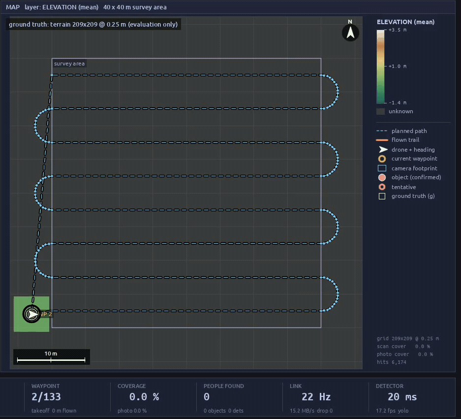
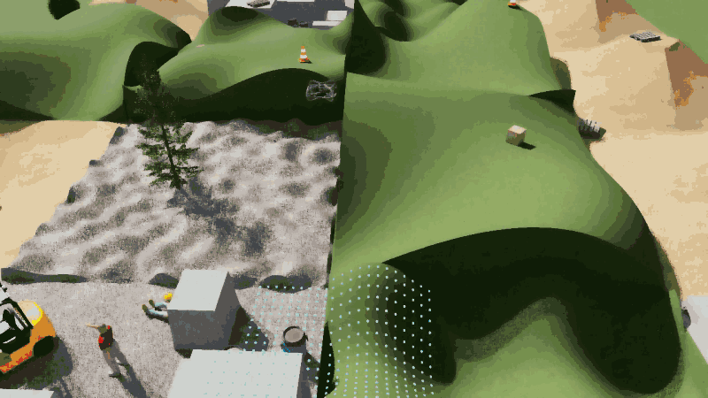
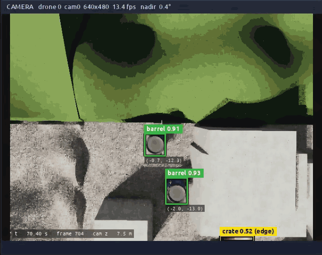
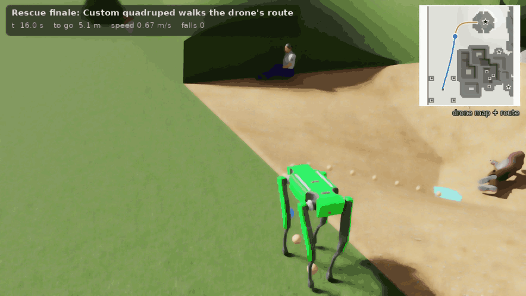
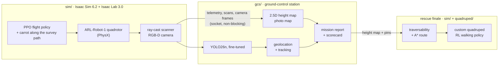

# Drone Search & Rescue

**A reinforcement-learning pilot flies a drone over a disaster site in NVIDIA Isaac Sim. A ground station maps the
site live and pins every person it finds, and a four-legged robot walks over the rubble to reach one of them.**

[](https://github.com/Wavy-Hec/drone-search-rescue/actions/workflows/tests.yml)


[](#licensing)

<p align="center">
  
</p>

## What it does

1. **Search.** An ARL-Robot-1 quadrotor takes off from its landing pad and flies a lawnmower survey over a
   40 × 40 m disaster site in Isaac Sim: hills, collapsed buildings, a crater, rubble, vehicles and people. Its
   pilot is a PPO policy that was trained in Isaac Lab only to reach a point and hover there; a carrot that
   slides along the survey path turns that skill into path following, with the network unchanged.
2. **Map and detect, live.** Telemetry, ray-cast scans and camera frames stream over a socket to a ground
   station. It builds a 2.5D height map and a photo map as the drone uncovers the site, runs a YOLO26n detector
   fine-tuned on auto-labelled simulator images, and pins every person and object in world coordinates.
3. **Report.** After the landing, the ground station writes a mission report and scores it against the site's
   ground truth: people found, false alarms, pin error, map error, coverage and flight time.
4. **Rescue.** A custom quadruped gets the drone's height map and pins, plans a safe route over the rubble
   (traversability and A*) and walks to a person the drone found, in the same simulated site.

<p align="center">
  
  
  <br>
  
</p>

## How it works



- **Pilot.** The policy sees exactly the 17 observations of Isaac Lab's position-tracking task; only the target
  is replaced by the carrot, whose lead is limited to 1 m and whose offset is clamped to the training range.
- **Link.** A small documented wire format ([gcs/PROTOCOL.md](gcs/PROTOCOL.md)): a JSON header and raw buffers
  over a UNIX socket or TCP. The sender needs only NumPy and never blocks the simulation; when the ground station
  falls behind, old camera frames are dropped.
- **Detector.** Trained on simulator images whose labels come from instance segmentation, so no box was drawn by
  hand. Detections are projected into the world with the depth image and merged over repeated sightings.
- **Finale.** The planner turns the drone's map into a traversability cost (slope, step height, roughness,
  object footprints, the robot's size), plans with A*, and steers the robot's velocity commands by pure pursuit.

## Results

| | Result |
|---|---|
| Detector (YOLO26n fine-tuned on simulator images) | mAP50 **0.995** on 7 sites never seen in training; it finds **255 of 256** people there, the stock COCO model 107 |
| People and objects found (recorded live mission) | **10 / 10** people in the survey area and **40 / 41** objects on the site (the one missed: a responder walking outside the area, never in view), **0** false alarms; pins **4 cm** from the truth on average |
| Mapping | **100 %** of the site scanned; height map within 4 mm of the true terrain away from steps |
| Flight | 428 m in about **6 minutes**, take-off to touchdown; landed **7 mm** from the pad centre |
| Rescue finale (custom quadruped, Isaac Sim PhysX) | **32 / 32** robots reached the person on the drone's map, **0 falls** |

Details, more runs and how each number is measured: [sim/README.md](sim/README.md) and
[gcs/README.md](gcs/README.md).

## Quick start

Developed and tested on Ubuntu 22.04 with an RTX 5080 (16 GB), Isaac Sim 6.2, Isaac Lab 3.0 and Python 3.12. The
ground station alone runs on any machine, on the CPU.

**1. Clone** (the robot model is stored with Git LFS):

```bash
git lfs install
git clone https://github.com/Wavy-Hec/drone-search-rescue.git
cd drone-search-rescue
```

**2. Environments.** Two conda environments, so the simulator and the ground station keep their own packages:

| Environment | For | Setup |
|---|---|---|
| `env_isaaclab` | `sim/`, `quadruped/` | Isaac Sim 6.2 and Isaac Lab 3.0 ([installation guide](https://isaac-sim.github.io/IsaacLab/)), then `python -m pip install --no-deps -e quadruped` |
| `vision` | `gcs/` | `conda create -n vision python=3.12`, PyTorch for your platform, then `python -m pip install -e "gcs[gcs]"` |

**3. Trained models.** They are release assets, not part of the git history:

```bash
scripts/download_assets.sh          # checks each file against the release's SHA256SUMS.txt
```

| Asset | What it is |
|---|---|
| `arl-robot-1_policy.pt` | the drone's flight policy (TorchScript) |
| `drone_sar_yolo26n.pt` | the fine-tuned detector (AGPL-3.0, like the YOLO weights it starts from) |
| `height_scanner_model_rslrl5.pt` | the custom quadruped's walking policy |
| `height_scanner_model.pt` | the same policy as trained in Isaac Lab 2.x, to rerun the checkpoint conversion |
| `drone-sar-demo.mp4` | the demo video |

**4. Run the demo:**

```bash
scripts/run_demo.sh                      # ground station and Isaac Sim windows; about 6 minutes of flight
scripts/run_demo.sh --finale             # as above, then the quadruped walks to a person the drone found
scripts/run_demo.sh --headless --video   # no windows; records both sides and composes the demo video
```

**Without Isaac Sim**, the ground station runs against a stand-in drone that flies a synthetic world through the
real link:

```bash
conda activate vision
python gcs/scripts/gcs.py --detector blob --name first_look &
python gcs/scripts/fake_drone.py --speedup 4
```

**Tests.** The same checks as CI: ruff and the CPU test suites of the three projects (tests that need Isaac Lab,
PyTorch or Ultralytics skip without them):

```bash
python -m pip install -r .github/requirements-ci.txt
scripts/check.sh
```

## Repository layout

```
sim/          drone_lab: the Isaac Lab 3.0 project. Survey and search-and-rescue tasks, the disaster site,
              the live mission, the rescue finale (traversability, A*, pure pursuit)
gcs/          drone_gcs: the ground-control station. Link and wire protocol, live mapping, detection,
              dashboard, mission report, stand-in drone, dataset and training tools
quadruped/    quadruped_lab: the custom quadruped's walking tasks, ported to Isaac Lab 3.0
scripts/      check.sh (lint and CPU tests), download_assets.sh, run_demo.sh
docs/media/   the GIFs of this README
```

The three projects started as separate repositories; their histories are kept here commit by commit. Each has its
own README with the details.

## Licensing

- **MIT** ([LICENSE](LICENSE)): everything in this repository, except as noted below.
- **AGPL-3.0** ([gcs/LICENSE](gcs/LICENSE)): the ground-control station in `gcs/`, because it uses
  [Ultralytics YOLO](https://github.com/ultralytics/ultralytics), which is AGPL-3.0. The fine-tuned detector
  weights published with the releases are derived from YOLO weights and are AGPL-3.0 as well. The sender side of
  the link that the simulator imports (in `gcs/drone_gcs/`: `__init__.py`, `link.py`, `protocol.py`, `geometry.py`
  and `isaac_bridge.py`; NumPy only, no YOLO) is MIT, so `sim/` does not depend on AGPL code.
- **BSD-3-Clause**: files that come from Isaac Lab keep its license and say so in their headers: the files
  generated from the Isaac Lab project template, and the quadruped's robot, task and agent configurations, which
  started from Isaac Lab's Unitree A1 example.

Isaac Sim and the robot and scene assets it loads at run time keep their own licenses; none of them is
redistributed here.

## Acknowledgements

- [NVIDIA Isaac Sim](https://developer.nvidia.com/isaac/sim) and [Isaac Lab](https://github.com/isaac-sim/IsaacLab)
  (BSD-3-Clause): the simulator, the RL environments, the terrain generator, ray casters and cameras; the people
  and props of the disaster site come from the Isaac Sim asset library.
- The **ARL-Robot-1** quadrotor, Isaac Lab's multirotor support and the position-tracking task the pilot was
  trained on were contributed to Isaac Lab by the [NTNU Autonomous Robots Lab](https://www.autonomousrobotslab.com/)
  (Mihir Kulkarni, Welf Rehberg, Kostas Alexis; *Aerial Gym Simulator*). Robot asset: BSD-3-Clause, © 2025 NTNU
  Autonomous Robots Lab ([license](https://github.com/isaac-sim/IsaacLab/blob/v3.0.0/docs/licenses/assets/arl-robot-1-license.txt)).
- [RSL-RL](https://github.com/leggedrobotics/rsl_rl) (BSD-3-Clause): the PPO implementation used for training.
- [Ultralytics YOLO](https://github.com/ultralytics/ultralytics) (AGPL-3.0): the YOLO26n detector and its training
  code.
- The Unitree Go2 and its rough-terrain task from Isaac Lab: the fallback robot of the rescue finale.

Made by Hector Lugo ([@Wavy-Hec](https://github.com/Wavy-Hec)).
