# How it works: from rewards to rescue

This walk-through explains the repository as one chain. A reinforcement-learning pilot flies a quadrotor over a
simulated disaster site. A ground station turns the drone's ray hits and camera frames into a map with a pin on every
person and object it finds. A planner turns that map into a route over the rubble, and a reinforcement-learning walking
policy follows the route to a person. Section 1 shows the whole chain, and sections 2 to 11 follow it one link at a
time and cite the code behind every number: the links open the file at the line, so any claim can be checked in one
click. Section 12 reports the experiments run on a CPU for this document, section 13 lists what needs a GPU and how to
run it, and section 14 is a glossary.

**How to read it.** The rewards: sections 3.3 and 3.5 (the drone) and 11.2 (the quadruped), with PPO in section 3.2.
The detector: section 6 (training images, labels, training, evaluation, inference); section 7 turns its boxes into
pins. The numbers in the README's results: sections 4.6, 6.5, 9.3 and 11.6. Sections 1 to 12 end with questions an
advisor might ask, with short answers that cite the code.

## Contents

- [1. The big picture](#1-the-big-picture)
- [2. The simulated world](#2-the-simulated-world)
- [3. Flying with reinforcement learning](#3-flying-with-reinforcement-learning)
- [4. The mission](#4-the-mission)
- [5. The link](#5-the-link)
- [6. Finding people with YOLO](#6-finding-people-with-yolo)
- [7. From pixels to pins](#7-from-pixels-to-pins)
- [8. Mapping](#8-mapping)
- [9. The mission report](#9-the-mission-report)
- [10. The rescue planner](#10-the-rescue-planner)
- [11. Walking with reinforcement learning](#11-walking-with-reinforcement-learning)
- [12. Experiments run on the CPU](#12-experiments-run-on-the-cpu)
- [13. What needs a GPU, and how to run it at home](#13-what-needs-a-gpu-and-how-to-run-it-at-home)
- [14. Glossary](#14-glossary)

## 1. The big picture

The repository is one chain of programs. A reinforcement-learning (RL) policy flies a quadrotor over a simulated
disaster site. A ground station turns the drone's ray hits and camera frames into a map with a pin on every person and
object it finds. After the landing, a planner turns that map into a route, and an RL walking policy takes a four-legged
robot along it to a person. This section shows the chain, gives one paragraph per stage with the section that explains
it, and says where each part lives and what needs a GPU.

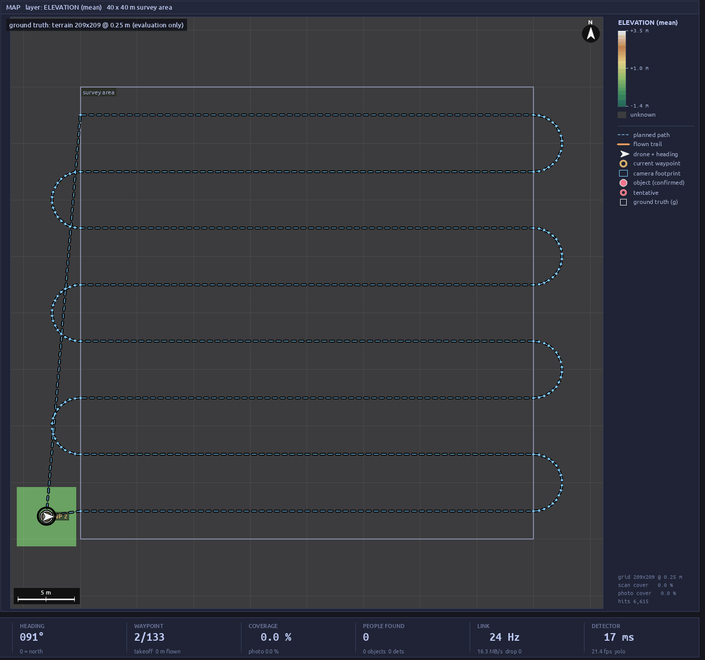

*The ground station's map panel during the recorded Isaac Sim mission over the demo site, from take-off to landing,
sped up: the planned path (dashed), the flown trail (orange), the elevation map filling in, and a pin with class and
mean detector confidence for every object found. The bottom row counts waypoints, coverage and people found, and shows
the link's message and data rates and the detector's time per frame
([`dashboard.py:1016-1028`](../gcs/drone_gcs/dashboard.py#L1016-L1028), [`:972-985`](../gcs/drone_gcs/dashboard.py#L972-L985)).
The GIF is a crop of the dashboard ([`make_gif.sh:23-28`](../scripts/make_gif.sh#L23-L28)), which the station draws
at 12 frames per second and 1600 x 900 px ([`app.py:41-42`](../gcs/drone_gcs/app.py#L41-L42)).*

```mermaid
flowchart LR
  subgraph SIM["sim/ · Isaac Sim 6.2 + Isaac Lab 3.0 · GPU"]
    C["flight plan + carrot<br/>(sections 3, 4)"] --> P["RL pilot: hover policy<br/>17 inputs, 4 thrusts, 10 Hz"]
    P --> D["ARL-Robot-1 in PhysX<br/>over the site (section 2)"]
    D --> S["sensors: 441 mapping rays,<br/>640 x 480 RGB-D camera"]
  end
  subgraph GCS["gcs/ · ground station · CPU"]
    R["receiver + main loop, 12 Hz"] --> M["elevation map, orthomosaic,<br/>surface map (section 8)"]
    R --> Y["YOLO26n detector thread<br/>(section 6)"]
    Y --> G["geolocation + tracker:<br/>pins (section 7)"]
    M --> REP["mission report + scorecard<br/>(section 9)"]
    G --> REP
  end
  subgraph FIN["rescue finale · sim/ + quadruped/"]
    T["traversability, A*, smoothing<br/>CPU (section 10)"] --> F["pure pursuit:<br/>vx, vy, yaw rate"]
    F --> Q["quadruped RL policy, 50 Hz<br/>Isaac Sim PhysX, GPU (section 11)"]
  end
  S -- "TELEMETRY, SCAN, CAMERA every 0.1 s<br/>over a socket (section 5)" --> R
  REP -- "elevation map, surface map, pins" --> T
```

### 1.1 The stages

**Pilot (section 3).** A neural network, not a hand-written controller, flies the drone. Ten times a second it reads 17
numbers (its offset from a target point, its orientation quaternion, its body-frame linear and angular velocity, its
previous action) and outputs one thrust command per rotor
([`survey_env_cfg.py:7-12`](../sim/src/drone_lab/tasks/survey/config/arl_robot_1/survey_env_cfg.py#L7-L12)). It was
trained with PPO on Isaac Lab's built-in task `IsaacContrib-TrackPositionNoObstacles-ARL-Robot-1` to fly to a point and
hover there ([`rsl_rl_ppo_cfg.py:5-16`](../sim/src/drone_lab/tasks/survey/config/arl_robot_1/agents/rsl_rl_ppo_cfg.py#L5-L16)).
A *carrot*, a target that slides along the survey path, makes it follow the path without retraining: the carrot waits
when the drone lags, and the offset the policy sees is clamped to the 1 m range of its training
([`carrot.py:3-10`](../sim/src/drone_lab/carrot.py#L3-L10)).

**Mission (section 4).** [`sar_mission.py`](../sim/scripts/sar_mission.py) rebuilds the site on the CPU and plans the
flight ([`sar_mission.py:368-399`](../sim/scripts/sar_mission.py#L368-L399)): take off from the landing pad, climb to
7.515 m (the highest terrain point, 3.515 m, plus 4 m), fly 8 lawnmower lines 5 m apart, come back and land
([`mission.py:3-11`](../sim/src/drone_lab/sar/mission.py#L3-L11)). Then it starts Isaac Sim and loops, 0.1 s of
simulated time per step, until the drone has landed (or crashed, or run out of time)
([`sar_mission.py:427-522`](../sim/scripts/sar_mission.py#L427-L522)).

**World and sensors (section 2).** The site is a 40 m x 40 m procedural terrain of hills, rough ground, pyramids, a
crater, waves, blocks of collapsed buildings and stairs ([`terrain.py:3-4`](../sim/src/drone_lab/terrain.py#L3-L4)),
dressed by a seeded generator with people, a forklift, crates, barrels, pallets, cones, trees and the landing pad
([`sar_env_cfg.py:9-12`](../sim/src/drone_lab/tasks/sar/config/arl_robot_1/sar_env_cfg.py#L9-L12)). The drone carries
441 vertical mapping rays and a downward RGB-D camera of 640 x 480 px.

**Link (section 5).** Every step the simulator sends TELEMETRY (pose, velocity, waypoint, carrot, mission phase), SCAN
(the ray hits) and CAMERA (colour and depth images, intrinsics, camera pose)
([`sim/README.md:99-101`](../sim/README.md#L99-L101)). Each message is one frame: a 16-byte prefix, a JSON header and
raw array buffers, over a UNIX socket or TCP ([`PROTOCOL.md:9-27`](../gcs/PROTOCOL.md#L9-L27)). Sending only copies
the data into a bounded queue; a background thread writes it, and when the station falls behind, the oldest data
messages are dropped instead of stalling the simulation ([`link.py:13-17`](../gcs/drone_gcs/link.py#L13-L17)).

**Detection (section 6).** YOLO26n, fine-tuned on simulator images, runs in a background thread on the newest camera
frame, on the CPU by default because the GPU belongs to the simulator
([`detector.py:3-14`](../gcs/drone_gcs/detector.py#L3-L14)).

**Pins (section 7).** Each box becomes a world point through a reference pixel, the camera ray through it and the
depth there, or the ray's hit on the elevation map ([`mapping.py:438-473`](../gcs/drone_gcs/mapping.py#L438-L473)). A
tracker merges the points of one object over many frames into a *pin*, with a merge radius per class (1.5 m for a
person), and confirms the pin after 2 detections ([`state.py:36-48`](../gcs/drone_gcs/state.py#L36-L48)).

**Maps (section 8).** The ray hits build a 2.5D elevation map on a 0.25 m grid
([`sar_mission.py:407`](../sim/scripts/sar_mission.py#L407)). The camera pixels build a top-down photo map, the
orthomosaic, and the depth pixels a *surface map*: the terrain plus whatever stands on it
([`state.py:32-35`](../gcs/drone_gcs/state.py#L32-L35)).

**Report (section 9).** At the end the station writes its maps, the pins and a scorecard
([`report.py:1-2`](../gcs/drone_gcs/report.py#L1-L2), [`:123`](../gcs/drone_gcs/report.py#L123),
[`:231`](../gcs/drone_gcs/report.py#L231)). The scorecard compares them with ground truth that the
simulator sends once at the start (GT_OBJECTS, GT_TERRAIN), for evaluation only
([`sim/README.md:102-103`](../sim/README.md#L102-L103)).

**Rescue planner (section 10).** [`rescue_finale.py`](../sim/scripts/rescue_finale.py) reads the report's maps and
pins, or the site's ground truth. It computes a cost per map cell from slope, step height, roughness, object
footprints and the obstacles the camera saw, inflated by the robot's radius, plans a route with A* and smooths it
([`rescue_finale.py:3-16`](../sim/scripts/rescue_finale.py#L3-L16)). Planning alone takes seconds on the CPU
([`sim/README.md:224`](../sim/README.md#L224)).

**Walking (section 11).** A custom quadruped with 12 joints walks the route. Its PPO policy was trained in Isaac Lab
2.3.2 ([`PORT_NOTES.md:9`](../quadruped/PORT_NOTES.md#L9)); it reads 235 values (48 for its body state, the velocity
command, its joints and its last action, plus a 187-point height scan;
[`PORT_NOTES.md:121-136`](../quadruped/PORT_NOTES.md#L121-L136)) and outputs 12 joint targets at 50 Hz
([`test_task_configs.py:136-140`](../quadruped/tests/test_task_configs.py#L136-L140)). Nothing is retrained: the
rescue task replaces the random velocity commands of training with those of a pure-pursuit follower on the route, on
the same seeded terrain and site the drone flew over
([`rescue_env_cfg.py:7-14`](../sim/src/drone_lab/tasks/rescue/rescue_env_cfg.py#L7-L14)).

### 1.2 Where each part lives

| Folder | Python package | What it holds | Conda env |
|---|---|---|---|
| [`sim/`](../sim) | `drone_lab` | the terrain and site generators, the drone tasks, the mission and rescue-finale scripts, the rescue planner (`src/drone_lab/teaming/`) and the rescue tasks ([`sim/README.md:350-391`](../sim/README.md#L350-L391)) | `env_isaaclab` |
| [`gcs/`](../gcs) | `drone_gcs` | the wire protocol, sender and receiver, the station itself ([`gcs/drone_gcs/`](../gcs/drone_gcs): maps, detector, tracker, dashboard, report), and in [`gcs/scripts/`](../gcs/scripts) the station's entry point, the stand-in drone and the detector's dataset, training and evaluation scripts | `vision` |
| [`quadruped/`](../quadruped) | `quadruped_lab` | the custom quadruped, its walking tasks ported from Isaac Lab 2.3 to 3.0, the checkpoint conversion ([`quadruped/README.md:1-4`](../quadruped/README.md#L1-L4), [`:18-19`](../quadruped/README.md#L18-L19)) | `env_isaaclab`, installed into it ([`quadruped/README.md:58`](../quadruped/README.md#L58)) |
| [`scripts/`](../scripts) | shell | [`run_demo.sh`](../scripts/run_demo.sh) (station and mission, optionally the finale), [`run_benchmark.sh`](../scripts/run_benchmark.sh) (the mission on many sites), [`download_assets.sh`](../scripts/download_assets.sh) (the trained models), [`check.sh`](../scripts/check.sh) (lint and CPU tests), `make_gif.sh` (the GIFs) | both |

The two conda environments keep the simulator's and the station's packages apart
([`README.md:104-109`](../README.md#L104-L109)). The trained models are release assets: the flight policy and the
detector land in `downloads/`, which git ignores ([`.gitignore:22-23`](../.gitignore#L22-L23)), and the walking policy
in `quadruped/checkpoints_2x/` ([`download_assets.sh:16-22`](../scripts/download_assets.sh#L16-L22)).

### 1.3 What runs on a GPU and what on a CPU

| Step | Runs on | Code |
|---|---|---|
| Terrain, site layout and flight plan, before the simulator starts | CPU | [`sar_mission.py:368-374`](../sim/scripts/sar_mission.py#L368-L374), [`terrain.py:15`](../sim/src/drone_lab/terrain.py#L15) |
| The mission: PhysX physics, the RTX render of the camera, the flight policy | GPU (Isaac Sim) | [`sim/README.md:384`](../sim/README.md#L384); the policy is loaded onto the simulator's device, [`sar_mission.py:608`](../sim/scripts/sar_mission.py#L608) |
| Rendering the detector's training images | GPU | [`sim/README.md:385`](../sim/README.md#L385) |
| Training YOLO | GPU (`--device 0` by default) | [`train_detector.py:112`](../gcs/scripts/train_detector.py#L112) |
| Training an RL policy (the hover task; the trajectory task of section 3) | GPU | [`sim/README.md:393-403`](../sim/README.md#L393-L403), [`:471`](../sim/README.md#L471) |
| The ground station, YOLO inference included | CPU (YOLO on the GPU only with `--device cuda:0` or `auto`) | [`gcs.py:58-61`](../gcs/scripts/gcs.py#L58-L61) |
| Rescue planning (`--plan_only`, `--tour`) | CPU | [`rescue_finale.py:9-16`](../sim/scripts/rescue_finale.py#L9-L16), [`teaming/__init__.py:17`](../sim/src/drone_lab/teaming/__init__.py#L17) |
| The quadruped's walk | GPU (Isaac Sim PhysX) | [`rescue_finale.py:17-21`](../sim/scripts/rescue_finale.py#L17-L21) |
| The stand-in drone, link replays, the tests, the experiments of section 12 | CPU | [`fake_drone.py:2-7`](../gcs/scripts/fake_drone.py#L2-L7), [`check.sh:2`](../scripts/check.sh#L2) |

The sim README's results were measured on one RTX 5080 ([`sim/README.md:19`](../sim/README.md#L19)), the GPU the
repository was developed and tested on ([`README.md:93`](../README.md#L93)). Section 13 says how to run the GPU parts
on another machine.

### Questions an advisor might ask

**Is anything trained while the mission runs?** No. The mission loads the released flight policy as TorchScript in
evaluation mode and calls it inside `torch.inference_mode()`
([`sar_mission.py:608-609`](../sim/scripts/sar_mission.py#L608-L609), [`:450-455`](../sim/scripts/sar_mission.py#L450-L455)).
The detector loads fixed weights ([`detector.py:3-5`](../gcs/drone_gcs/detector.py#L3-L5)), and the finale keeps the
walking policy's robot, actions and observations exactly as trained
([`rescue_env_cfg.py:3-5`](../sim/src/drone_lab/tasks/rescue/rescue_env_cfg.py#L3-L5)). All training happened before
(sections 3, 6 and 11).

**What exactly does the quadruped get from the drone?** The station's report: the elevation map, the surface map from
the camera's depth and the pins in `detections.json`. Without a report the planner uses the ground truth, the exact
terrain and the site's objects ([`rescue_finale.py:3-13`](../sim/scripts/rescue_finale.py#L3-L13)).

**Do the drone and the quadruped share one simulation?** No. The walk is a separate Isaac Sim run after the mission, on
the same seeded terrain and dressed site ([`rescue_finale.py:17-21`](../sim/scripts/rescue_finale.py#L17-L21),
[`rescue_env_cfg.py:7-11`](../sim/src/drone_lab/tasks/rescue/rescue_env_cfg.py#L7-L11)). The drone is not in that
scene: no file under [`tasks/rescue/`](../sim/src/drone_lab/tasks/rescue) configures ARL-Robot-1 or any multirotor.

**What runs at which rate?** In simulated time: the drone's physics at 100 Hz, its policy and camera at 10 Hz
([`survey_env_cfg.py:199`](../sim/src/drone_lab/tasks/survey/config/arl_robot_1/survey_env_cfg.py#L199),
[`sar_env_cfg.py:74-75`](../sim/src/drone_lab/tasks/sar/config/arl_robot_1/sar_env_cfg.py#L74-L75)); the quadruped's
policy at 50 Hz on 200 Hz physics ([`test_task_configs.py:140`](../quadruped/tests/test_task_configs.py#L140)). In
wall-clock time: the station's loop at 12 Hz ([`app.py:41`](../gcs/drone_gcs/app.py#L41)) and the detector at
16-24 ms per frame on the CPU ([`gcs/README.md:675`](../gcs/README.md#L675)). The recorded mission ran at
1.45 times real time ([`sim/README.md:28`](../sim/README.md#L28)).

**Can I work on the ground station without Isaac Sim?** Yes. [`fake_drone.py`](../gcs/scripts/fake_drone.py) flies a
synthetic world through the real link ([`fake_drone.py:2-7`](../gcs/scripts/fake_drone.py#L2-L7)), and a recorded link
stream can be replayed (section 5). The experiments of section 12 use both.

## 2. The simulated world

Everything the drone flies over is generated from two seeds: the terrain generator's, 17 (the *standard terrain*), and
the site's, 0 (the *demo site*). The same seeds give the same world to the millimetre
([`sar/README.md:106`](../sim/src/drone_lab/sar/README.md#L106)). Values marked *computed here* come from running the
repository's own generators for this document, on a CPU with the Isaac Lab 3.0.0 package and no simulator, which the
generators do not need. In that setup the repository's terrain and site tests pass (22 tests in `test_terrain.py`,
`test_sar_scenario.py` and `test_sar_env_cfg.py`, and the terrain-seed test of `test_trajectory_pilot.py`).

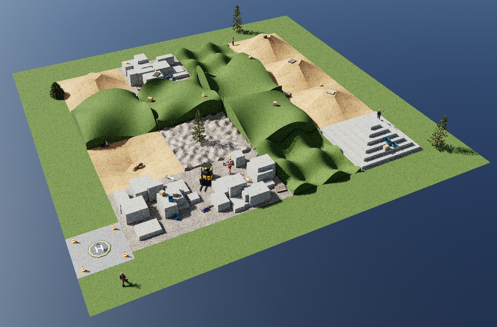

*The demo site, rendered in Isaac Sim by `scripts/sar_preview.py` ([`sim/README.md:248-254`](../sim/README.md#L248-L254)).
The landing pad with its four cones is at the bottom left (south-west), a responder walking past it. The blocks of the
collapsed buildings and the forklift run along the south edge, the crater and the gravel tile lie north of them, green
hills cross the middle, and the east side holds the sandy pyramids and, at the right, the stairs.*

### 2.1 Isaac Sim and Isaac Lab

Background first. Isaac Sim is NVIDIA's robot simulator: a scene is a USD stage (Universal Scene Description, the file
format of the assets), PhysX simulates rigid bodies and contacts (on the GPU in Isaac Lab), and the RTX renderer
ray-traces camera images. Isaac Lab is a robot-learning framework on top of it. An environment is a set of Python
configuration classes for the scene, observations, actions, commands (targets such as the carrot), events (such as
resets), rewards and terminations; a *manager-based* environment executes them at every step, in thousands of copies
side by side for training. The mission's task `DroneLab-SAR-ARL-Robot-1-v0` is such a `ManagerBasedRLEnv`
([`__init__.py:9-19`](../sim/src/drone_lab/tasks/sar/config/arl_robot_1/__init__.py#L9-L19)).

The repository targets Isaac Sim 6.2 and Isaac Lab 3.0 ([`sim/README.md:3`](../sim/README.md#L3)) but pins no exact
Isaac Lab build: the project template points at a local checkout ([`pyproject.toml:78-93`](../sim/pyproject.toml#L78-L93))
that the README says is not used ([`sim/README.md:37-39`](../sim/README.md#L37-L39)). Isaac Lab's own code is therefore
cited from Isaac Lab 3.0.0 as installed by pip, the release the quadruped's port notes name
([`PORT_NOTES.md:9`](../quadruped/PORT_NOTES.md#L9)). The drone's physics is PhysX only, because Isaac Lab 3.0's
multirotor has no path to its other physics engine, Newton ([`physics.py:11-16`](../sim/src/drone_lab/tasks/physics.py#L11-L16)),
and the camera needs the RTX renderer ([`sar_env_cfg.py:24-25`](../sim/src/drone_lab/tasks/sar/config/arl_robot_1/sar_env_cfg.py#L24-L25)).
The world frame has z up and is used as east-north-up: +x is east, +y is north
([`geometry.py:10`](../gcs/drone_gcs/geometry.py#L10)).

### 2.2 The terrain

Isaac Lab's terrain generator builds the ground from `SURVEY_TERRAIN_CFG`
([`terrain.py:137-168`](../sim/src/drone_lab/terrain.py#L137-L168)): 4 x 4 square tiles (*sub-terrains*) of 10 m,
centred on the origin, so x and y run from -20 to 20 m ([`terrain.py:172-176`](../sim/src/drone_lab/terrain.py#L172-L176)),
inside a flat border 6 m wide, so the site spans -26 to 26 m
([`scenario.py:356-357`](../sim/src/drone_lab/sar/scenario.py#L356-L357)). Each tile but the stairs is a height field
on a 0.1 m grid with 5 mm height steps, turned into a triangle mesh ([`terrain.py:145-146`](../sim/src/drone_lab/terrain.py#L145-L146));
the stairs tile is a mesh of boxes from the start ([`terrain.py:164-166`](../sim/src/drone_lab/terrain.py#L164-L166)).
The curriculum is off: for each tile the generator draws a type, with probability proportional to the type's share,
and a *difficulty* $d$ uniformly in [0.4, 1.0], from one random generator seeded with `seed` = 17
([`terrain.py:138-139`](../sim/src/drone_lab/terrain.py#L138-L139), [`:150`](../sim/src/drone_lab/terrain.py#L150);
`isaaclab/terrains/terrain_generator.py:140-147, 213-232` (Isaac Lab 3.0.0)). The difficulty places each type's
parameters in their range:

| Type | Share | What it is; how the difficulty $d$ sets it | Tiles on seed 17 | Heights on seed 17 [m] |
|---|---|---|---|---|
| hills | 0.22 | random heights 0-3 m in 5 cm steps at 4 x 4 points spread over the tile (`downsampled_scale` 2 m), joined by a cubic spline, which can overshoot the range; $d$ is not used | 4 | -0.19 to 3.515 |
| rough | 0.10 | the same with 0-0.4 m at 19 x 19 points (`downsampled_scale` 0.5 m) | 1 | -0.115 to 0.545 |
| pyramid | 0.16 | truncated pyramid of slope $0.4 + 0.3\,d$ with a flat 1.5 m top | 4 | 0 to 2.03-2.54 |
| pit | 0.08 | inverted pyramid, a crater, of slope $0.3 + 0.15\,d$ with a flat 1.5 m floor | 1 | -1.43 to 0 |
| waves | 0.10 | two sine waves per tile, amplitude $0.6 + 0.9\,d$ m | 2 | -1.28 to 1.28 |
| blocks | 0.20 | the repository's own "collapsed buildings": 12 rectangular blocks with 1-3 m edges, each at a multiple of 0.5 m up to $1.5 + 1.5\,d$ m, the higher one winning where they overlap | 3 | 0 to 2.0 |
| stairs | 0.14 | a pyramid of steps $0.25 + 0.25\,d$ m high and 0.8 m deep, 1.5 m top | 1 | 0 to 2.83 |

Configuration: [`terrain.py:154-166`](../sim/src/drone_lab/terrain.py#L154-L166); the blocks tile:
[`terrain.py:90-134`](../sim/src/drone_lab/terrain.py#L90-L134); the other formulas:
`isaaclab/terrains/height_field/hf_terrains.py:32, 59-73, 112-114, 330` and
`isaaclab/terrains/trimesh/mesh_terrains.py:74` (Isaac Lab 3.0.0). Inside its rim (below) a height-field tile is
9.9 m wide, so `downsampled_scale` 2 m gives $\lfloor 9.9/2 \rfloor = 4$ random heights per side (derived from
`isaaclab/terrains/height_field/utils.py:44-54` (Isaac Lab 3.0.0)). The last two columns are computed here.

Which tile has which type is not written down in the repository; the mission records it at run time in
`ground_truth.json` ([`scenario.py:507-512`](../sim/src/drone_lab/sar/scenario.py#L507-L512)). Computed here for seed
17, north up and east to the right, as on the ground station's map:

| y \ x | -20 to -10 m | -10 to 0 m | 0 to 10 m | 10 to 20 m |
|---|---|---|---|---|
| **10 to 20 m** | pyramid | blocks | waves | pyramid |
| **0 to 10 m** | hills | hills | hills (highest point) | pyramid |
| **-10 to 0 m** | pit (the crater) | rough | hills | pyramid |
| **-20 to -10 m** | blocks | blocks | waves | stairs |

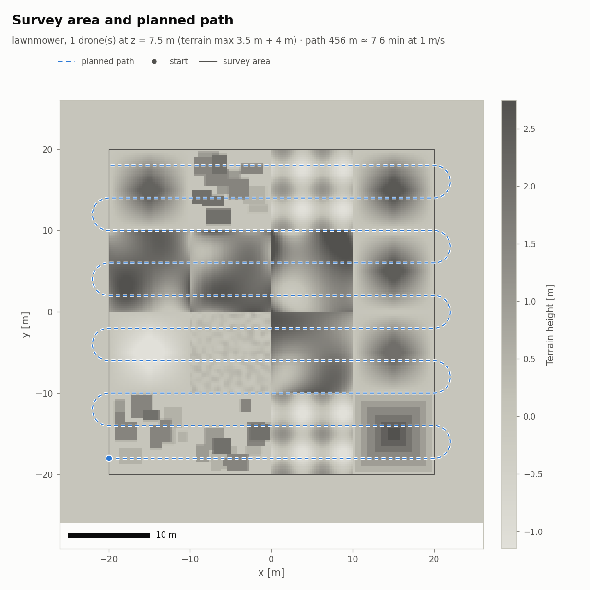

*The standard terrain from `scripts/preview_area.py`, which runs the same generator on the CPU
([`preview_area.py:1-5`](../sim/scripts/preview_area.py#L1-L5)); dark is high. The tiles match the table above. The
dashed path is the survey task's default lawnmower with lines 4 m apart, not the mission's 5 m plan of section 4.*

**Heights and seams.** The surface spans -1.43 m (the crater floor) to 3.515 m (computed here;
[`camera.py:9-13`](../sim/src/drone_lab/sar/camera.py#L9-L13) states the same two numbers). The border is a slab whose
top is at z = 0; `border_height` (1 m) is its thickness
(`isaaclab/terrains/terrain_generator.py:271-289` (Isaac Lab 3.0.0)). Isaac Lab frames every height-field tile with a
one-pixel rim at z = 0 (`isaaclab/terrains/height_field/utils.py:44-58` (Isaac Lab 3.0.0)), so tiles meet at ground
level, and a tile that is
high at its edge drops to the ground within 0.1 m. Slope correction is off, because it would turn such drops into
vertical walls with slits that downward rays fall through
([`terrain.py:147-149`](../sim/src/drone_lab/terrain.py#L147-L149)); a test checks that 100 000 random points of the
site all have ground under them, seen from above ([`test_terrain.py:43-46`](../sim/tests/test_terrain.py#L43-L46)). The
highest point is such an edge: (0.1, 8.3) m on the hills tile north-east of the origin, where the ground falls 3.5 m
to the seam at x = 0 (computed here). The survey flies 4 m above it, at 7.515 m (section 4).
[`camera.py:12-13`](../sim/src/drone_lab/sar/camera.py#L12-L13) gives 3.41 m for "the top of the highest hill".
Computed here, the highest summit inside a tile is 2.84 m, near (-18, 3) m on the westernmost hills tile; all higher
ground is hillside that a seam cuts off (on the hills tile north-east of the origin it is still 3.3 m high 0.5 m from
the seam at y = 10 m). Where 3.41 m comes from is UNVERIFIED.

**Determinism.** The site generator and the flight planner query a CPU copy of the terrain
([`scenario.py:345-357`](../sim/src/drone_lab/sar/scenario.py#L345-L357)), which must equal the mesh Isaac Sim imports.
Isaac Lab draws types and difficulties from its own seeded generator, but the hills and rough tiles use numpy's global
random state. The repository wraps them so that each tile seeds numpy itself and restores the global state afterwards,
and its blocks tile uses a local generator ([`terrain.py:6-13`](../sim/src/drone_lab/terrain.py#L6-L13),
[`:64-80`](../sim/src/drone_lab/terrain.py#L64-L80), [`:97`](../sim/src/drone_lab/terrain.py#L97)). The seed of a tile is

$$\text{seed}_\text{tile} = \left(b \cdot 1\,000\,003 + \mathrm{round}(10^6 d)\cdot 7919 + \mathrm{crc32}(\text{config class name})\right) \bmod 2^{32}$$

([`terrain.py:57-61`](../sim/src/drone_lab/terrain.py#L57-L61)), where $b$ is the tile configuration's `seed`, which
Isaac Lab sets to the generator's 17 (`isaaclab/terrains/terrain_generator.py:361-362` (Isaac Lab 3.0.0)). A test
requires the same mesh under two different global seeds and an untouched global state
([`test_terrain.py:17-26`](../sim/tests/test_terrain.py#L17-L26)). In Isaac Sim the spawner warns if any vertex of the
stage's mesh differs from the CPU copy by more than 1 mm ([`scene.py:635-659`](../sim/src/drone_lab/sar/scene.py#L635-L659)).

**Materials.** Grass on hills, waves and the border, soil on pyramids and the pit, gravel on the rough tile and between
blocks, concrete on block tops and walls and on the stairs ([`scene.py:662-691`](../sim/src/drone_lab/sar/scene.py#L662-L691)).

**Another terrain: `--terrain_seed N`.** The option reseeds the generator and hands the same generator to the site
spawner, so the objects stand on the terrain that is actually built
([`mission.py:179-187`](../sim/src/drone_lab/sar/mission.py#L179-L187)). Tiles, heights, the flight height and the
run names (ending in `_terrain<N>`) follow ([`sar_mission.py:164-173`](../sim/scripts/sar_mission.py#L164-L173)).
Computed here for the seeds of the CPU test ([`test_trajectory_pilot.py:381-425`](../sim/tests/test_trajectory_pilot.py#L381-L425)):
terrain 1 has five pits and would be flown at 7.365 m; terrain 3 has no pit and five pyramids, and would be flown at
7.585 m. The site seed keeps its rules but not its objects (only the pad and its cones stay put): site 0 has 45
objects on terrain 17, 43 on terrain 1 and
40 on terrain 3, because the same random stream also feeds the placement attempts, whose outcomes depend on the
ground. No mission has been flown on another terrain in Isaac Sim, and the rescue finale walks on the standard terrain
only ([`sim/README.md:125-129`](../sim/README.md#L125-L129)).

### 2.3 The disaster site

The function `generate_scenario` dresses the terrain ([`scenario.py:1030-1169`](../sim/src/drone_lab/sar/scenario.py#L1030-L1169))
on the CPU copy, without a simulator ([`scenario.py:27`](../sim/src/drone_lab/sar/scenario.py#L27)), drawing from
`np.random.default_rng([seed, 0x5A12])` with the site seed ([`scenario.py:1042`](../sim/src/drone_lab/sar/scenario.py#L1042)).
It places each object by *rejection sampling*: draw a position in the object's region, a yaw in $[-\pi, \pi)$ and a
size scale, test every rule, and try again on a failure, up to 3000 times
([`scenario.py:969-1013`](../sim/src/drone_lab/sar/scenario.py#L969-L1013), [`:112`](../sim/src/drone_lab/sar/scenario.py#L112)).
The order:

1. **Landing pad**, on the border 3 m west of the survey area, level with the first line of the survey task's 4 m
   lawnmower: (-23, -18) m ([`scenario.py:1020-1027`](../sim/src/drone_lab/sar/scenario.py#L1020-L1027),
   [`:1049-1066`](../sim/src/drone_lab/sar/scenario.py#L1049-L1066)). A dark disc 1.25 m in radius and 4 cm high, with
   a collider, a yellow ring and a white "H"; its top is 4.9 cm above the ground
   ([`scene.py:569-620`](../sim/src/drone_lab/sar/scene.py#L569-L620)). It lies on a visual-only asphalt square of
   6 m x 6 m ([`scene.py:623-632`](../sim/src/drone_lab/sar/scene.py#L623-L632)) with four traffic cones 2.2 m from its
   centre in x and y; after that, no other object may reach into a circle of 3.6 m around the centre
   ([`scenario.py:1067-1084`](../sim/src/drone_lab/sar/scenario.py#L1067-L1084)).
2. **One forklift**, anywhere in the area ([`scenario.py:1086-1088`](../sim/src/drone_lab/sar/scenario.py#L1086-L1088)).
3. **6-10 people, the victims** ([`scenario.py:1090-1113`](../sim/src/drone_lab/sar/scenario.py#L1090-L1113)),
   each lying with probability 0.5 (face up 0.6, face down 0.4) or standing, in one of 10 Isaac Sim characters,
   1.61-1.80 m tall and scaled by 0.96-1.04 ([`assets.py:8-9`](../sim/src/drone_lab/sar/assets.py#L8-L9),
   [`:94-155`](../sim/src/drone_lab/sar/assets.py#L94-L155)). The first 40 % must be next to a step while such a spot
   is left, and go anywhere otherwise.
4. **Clutter**: 7-10 crates in piles of 1-4 and 4-6 barrels in piles of 1-3 (pile members within 1.6 m of the first),
   then 3-5 pallets and 2-4 cones ([`scenario.py:1115-1137`](../sim/src/drone_lab/sar/scenario.py#L1115-L1137),
   [`:86-89`](../sim/src/drone_lab/sar/scenario.py#L86-L89)).
5. **4-6 trees**, one inside the area and the others on the border
   ([`scenario.py:1139-1144`](../sim/src/drone_lab/sar/scenario.py#L1139-L1144)).
6. **Natural poses** for every person, then 2-3 responders
   ([`scenario.py:1146-1156`](../sim/src/drone_lab/sar/scenario.py#L1146-L1156)).

The rules of steps 1-5, checked for every attempt (the responders of step 6 have their own):

| Rule | What is checked | Code |
|---|---|---|
| Region | labelled objects: all four footprint corners at least 0.75 m inside the survey area; border objects (trees): at least 0.3 m inside the site, centre outside the area grown by 0.5 m; pad and pad cones: at least 0.1 m inside the site | [`scenario.py:633-649`](../sim/src/drone_lab/sar/scenario.py#L633-L649) |
| Spacing | centre distance at least $r_1 + r_2 + g$, where $r$ is the radius of the circle around the footprint and $g$ = 0.6 m (0.12 m inside a pile); the footprint circle stays out of every keep-out circle | [`scenario.py:590-598`](../sim/src/drone_lab/sar/scenario.py#L590-L598), [`:650-652`](../sim/src/drone_lab/sar/scenario.py#L650-L652) |
| Flatness | the terrain heights on a 0.1 m grid under the footprint, grown by a clearance (vehicle 0.25 m, lying person 0.15 m, standing person 0.1 m, others 0.05 m), may spread by at most 0.15 m (standing person, cone), 0.12 m (lying person, vehicle), 0.10 m (crate, barrel), 0.08 m (pallet, also used for the pad) or 0.5 m (tree). A lying T-pose person is sampled along its body and arms, a standing one along its body only, and the terrain under a standing person's outstretched arms (about 1.3 m up) may rise at most 1 m above its ground; a tree is sampled under its 0.8 m trunk square | [`scenario.py:117-127`](../sim/src/drone_lab/sar/scenario.py#L117-L127), [`:653-676`](../sim/src/drone_lab/sar/scenario.py#L653-L676) |
| Resting height | the object stands on the highest terrain point under its footprint, so no terrain pokes into it; a tree on the median height under its trunk | [`scenario.py:669`](../sim/src/drone_lab/sar/scenario.py#L669), [`:682-687`](../sim/src/drone_lab/sar/scenario.py#L682-L687) |
| Next to a step (people) | `near_step`: terrain at least 0.6 m above the person's ground on rings 0.35, 0.8 or 1.3 m around the footprint; `near_block` if that terrain is on a blocks or stairs tile, a "collapsed building" | [`scenario.py:719-724`](../sim/src/drone_lab/sar/scenario.py#L719-L724), [`:128`](../sim/src/drone_lab/sar/scenario.py#L128), [`:159-161`](../sim/src/drone_lab/sar/scenario.py#L159-L161) |
| Trees below the flight | the tree's top at least 2 m below the survey height | [`scenario.py:682-685`](../sim/src/drone_lab/sar/scenario.py#L682-L685), [`:110`](../sim/src/drone_lab/sar/scenario.py#L110) |

There is no separate slope rule: the height spread under the footprint is the slope criterion.

**People.** The characters have no colliders ([`assets.py:8-9`](../sim/src/drone_lab/sar/assets.py#L8-L9)). By default
the T-pose layout is only the first step: each victim then gets a natural pose near its place. A lying place becomes
lying on the back (probability 0.4),
on the side in the recovery position (0.35) or sitting (0.25); a standing place becomes waving (0.65) or sitting
(0.35) ([`scenario.py:132-138`](../sim/src/drone_lab/sar/scenario.py#L132-L138)). A pose is one frame of an Isaac Sim
animation clip, retargeted onto the character and baked into a static mesh on the CPU, and also exists mirrored
([`people.py:1-20`](../sim/src/drone_lab/sar/people.py#L1-L20)). A posed person rests on the highest terrain under
the under-side height map of its pose; the parts that carry it (back, seat, feet) must be within 1 cm of the ground,
and the ground under them may drop by at most 5-6 cm ([`scenario.py:139-147`](../sim/src/drone_lab/sar/scenario.py#L139-L147),
[`:727-761`](../sim/src/drone_lab/sar/scenario.py#L727-L761)). Failing that, the victim moves up to 1 m, and if
nothing fits there either it takes the best fit ([`scenario.py:831-874`](../sim/src/drone_lab/sar/scenario.py#L831-L874));
on the demo site every person fits (computed here). Then 2-3 responders in uniform, looking
around, pointing or walking, are placed by the forklift and around the pad; they are class `person` too
([`scenario.py:904-953`](../sim/src/drone_lab/sar/scenario.py#L904-L953)). `people_style=tpose` keeps the T-pose
people and adds no responders ([`sar_env_cfg.py:12-14`](../sim/src/drone_lab/tasks/sar/config/arl_robot_1/sar_env_cfg.py#L12-L14)).

**Trees, labels, colliders, light.** The trees are unlabelled occluders, four species of NVIDIA's vegetation assets
scaled to stay low ([`assets.py:227-264`](../sim/src/drone_lab/sar/assets.py#L227-L264)). Every other object carries a
semantic label `class`: person, vehicle, crate, barrel, pallet, cone or landing_pad, class ids 0-6 in that order
([`assets.py:31-35`](../sim/src/drone_lab/sar/assets.py#L31-L35), [`scene.py:524-527`](../sim/src/drone_lab/sar/scene.py#L524-L527)).
The props and the pad's disc have colliders, so a landing touches the pad; the trees have none
([`sar/README.md:159-163`](../sim/src/drone_lab/sar/README.md#L159-L163)). A sky dome and a sun at 43° elevation,
aligned with the sun in the sky image so that every object casts one shadow, light the scene
([`sar_env_cfg.py:46-49`](../sim/src/drone_lab/tasks/sar/config/arl_robot_1/sar_env_cfg.py#L46-L49)). The generator
also writes the ground truth of every object and of the area, the terrain and the pad
([`scenario.py:450-529`](../sim/src/drone_lab/sar/scenario.py#L450-L529)); sections 4, 9 and 10 use it.

**The demo site, seed 0.** 45 objects: 11 people (9 victims and 2 responders), a forklift, 9 crates, 6 barrels,
5 pallets, 8 cones (4 of them at the pad), 4 trees and the pad. 41 are labelled: 35 in the survey area, all 10 people
there among them, and 6 around the pad (the pad, its 4 cones and a responder). This is computed here and agrees with
the SAR README ([`sar/README.md:7-13`](../sim/src/drone_lab/sar/README.md#L7-L13)); the T-pose layout underneath is
pinned to the centimetre by a test ([`test_sar_scenario.py:208-231`](../sim/tests/test_sar_scenario.py#L208-L231)).
The people, computed here:

| Name | Pose | x, y [m] | Ground z [m] | Where |
|---|---|---|---|---|
| person_00 | waving, arms wide | 17.68, -13.36 | 1.42 | on the stairs |
| person_01 | waving | 10.71, 18.72 | 0.12 | at a pyramid terrace |
| person_02 | recovery position | -10.24, -17.38 | 0.00 | among the blocks |
| person_03 | sitting | -4.55, -11.12 | 0.00 | among the blocks |
| person_04 | on the back | -12.02, -10.68 | 0.00 | among the blocks |
| person_05 | sitting | -17.68, -0.35 | -0.01 | below the hill, on the north edge of the crater tile |
| person_06 | sitting | -8.73, 11.48 | 0.00 | among the northern blocks |
| person_07 | on the back | -3.78, -14.94 | 0.00 | among the blocks |
| person_08 | recovery position | -14.73, -4.82 | -1.37 | on the crater floor |
| person_09 (responder) | pointing | -5.30, -12.89 | 0.00 | 3.2 m from the forklift |
| person_10 (responder) | walking | -21.89, -23.61 | 0.00 | on the border, 5.7 m from the pad's centre |

All nine victims are next to a step, six of them next to a building, as the README says
([`sar/README.md:103-105`](../sim/src/drone_lab/sar/README.md#L103-L105)). person_08, in the crater, is the goal of
four of the six documented finale runs, the recorded one among them ([`sim/README.md:165-182`](../sim/README.md#L165-L182)).

### 2.4 The drone and its sensors

ARL-Robot-1 is a quadrotor from NTNU ([`sim/README.md:3-4`](../sim/README.md#L3-L4)) that ships with Isaac Lab: a USD
model on NVIDIA's asset server and a configuration with four propeller *thrusters* (back left, back right, front left,
front right), each with a first-order motor lag, and with contact sensors switched on
(`isaaclab_assets/robots/arl_robot_1.py:26-81` (Isaac Lab 3.0.0)). The policy commands the four thrusts (section 3).
The mass and inertia are in the USD file, not in this repository: UNVERIFIED here. The task spawns the drone 20 m up,
and a reset event places it at rest at the start of its path
([`survey_env_cfg.py:203-204`](../sim/src/drone_lab/tasks/survey/config/arl_robot_1/survey_env_cfg.py#L203-L204)). No
sensor feeds the policy, which flies on its 17 state values only
([`survey_env_cfg.py:13-15`](../sim/src/drone_lab/tasks/survey/config/arl_robot_1/survey_env_cfg.py#L13-L15),
[`sar_env_cfg.py:18-19`](../sim/src/drone_lab/tasks/sar/config/arl_robot_1/sar_env_cfg.py#L18-L19)).

| Sensor | What it measures | Geometry and rate | Code |
|---|---|---|---|
| Mapping scanner, an Isaac Lab `RayCaster` | where 441 vertical rays hit the terrain | a 21 x 21 grid of rays 0.25 m apart (5 m x 5 m), 0.1 m below the body; aligned with the world, so the rays stay vertical and the grid axis-aligned when the drone tilts; hits only the terrain mesh `/World/ground`, not objects or trees; range 60 m, a miss is `inf`; read every 0.1 s | [`survey_env_cfg.py:53-54`](../sim/src/drone_lab/tasks/survey/config/arl_robot_1/survey_env_cfg.py#L53-L54), [`:83-93`](../sim/src/drone_lab/tasks/survey/config/arl_robot_1/survey_env_cfg.py#L83-L93), [`isaac_bridge.py:10`](../gcs/drone_gcs/isaac_bridge.py#L10), [`sar_mission.py:481`](../sim/scripts/sar_mission.py#L481) |
| Camera, an Isaac Lab `Camera` | colour, depth, instance segmentation | 640 x 480 px, straight down, 0.1 m below the body, 10 Hz (next table) | [`scene.py:157-204`](../sim/src/drone_lab/sar/scene.py#L157-L204) |
| Contact sensor | contact forces on the drone's bodies | every physics step (0.01 s), the last 3 values kept | [`survey_env_cfg.py:95-96`](../sim/src/drone_lab/tasks/survey/config/arl_robot_1/survey_env_cfg.py#L95-L96), [`:205`](../sim/src/drone_lab/tasks/survey/config/arl_robot_1/survey_env_cfg.py#L205) |

| Camera property | Value | Code |
|---|---|---|
| Resolution | 640 x 480 px, square pixels | [`camera.py:51-52`](../sim/src/drone_lab/sar/camera.py#L51-L52) |
| Intrinsics | $f_x = f_y = 480$ px, principal point $(c_x, c_y) = (320, 240)$ | [`camera.py:53`](../sim/src/drone_lab/sar/camera.py#L53), [`:87-89`](../sim/src/drone_lab/sar/camera.py#L87-L89) |
| Field of view | $2\arctan(320/480) = 67.38°$ across, $2\arctan(240/480) = 53.13°$ along | [`camera.py:72-80`](../sim/src/drone_lab/sar/camera.py#L72-L80) |
| Mount | 0.1 m below `base_link`, looking straight down (*nadir*); image top = the drone's nose, image right = its right side | [`camera.py:29-32`](../sim/src/drone_lab/sar/camera.py#L29-L32), [`:57-59`](../sim/src/drone_lab/sar/camera.py#L57-L59) |
| Outputs | `rgb` (8-bit colour), `distance_to_image_plane` (32-bit float depth in metres), `instance_segmentation` (one id per labelled object) | [`scene.py:160`](../sim/src/drone_lab/sar/scene.py#L160), [`camera.py:120`](../sim/src/drone_lab/sar/camera.py#L120); bit depths: `isaaclab_physx/renderers/isaac_rtx_renderer_cfg.py:220-233` (Isaac Lab 3.0.0) |
| Rate | one frame per policy step, 10 Hz | [`sar_env_cfg.py:74-75`](../sim/src/drone_lab/tasks/sar/config/arl_robot_1/sar_env_cfg.py#L74-L75) |
| Clipping range | 0.05-200 m | [`camera.py:55-56`](../sim/src/drone_lab/sar/camera.py#L55-L56) |
| Renderer | RTX with FXAA anti-aliasing; labels filtered to `class:*` | [`scene.py:196-203`](../sim/src/drone_lab/sar/scene.py#L196-L203) |

The depth of a pixel is its distance to the image plane, the z coordinate of the point in the camera frame, not the
length of the ray to it ([`camera.py:120`](../sim/src/drone_lab/sar/camera.py#L120)); section 7 places detections with
it and section 8 builds the photo and surface maps. The instance segmentation gives the exact boxes the detector is
trained on (section 6). From the survey height a lying adult is 26-29 px across the shoulders
([`camera.py:15-17`](../sim/src/drone_lab/sar/camera.py#L15-L17)); section 4.2 derives the ground sample distance and
the footprint.

### Questions an advisor might ask

**Why is the terrain built twice, and how do you know the two copies agree?** The site generator and the flight
planner need heights before Isaac Sim starts, so they query a CPU copy from the same generator
([`scenario.py:345-357`](../sim/src/drone_lab/sar/scenario.py#L345-L357)). Agreement rests on determinism
([`terrain.py:57-80`](../sim/src/drone_lab/terrain.py#L57-L80)), tested under different global seeds
([`test_terrain.py:17-26`](../sim/tests/test_terrain.py#L17-L26)). In Isaac Sim the spawner checks the stage's mesh
against the copy (a warning above 1 mm, [`scene.py:635-659`](../sim/src/drone_lab/sar/scene.py#L635-L659)), and the
mission uses the spawned site's ground truth if it differs from the CPU one
([`sar_mission.py:610-613`](../sim/scripts/sar_mission.py#L610-L613)).

**How do you keep a person from floating or sinking into the ground?** A T-pose person rests on the highest terrain
point under its footprint, which must be flat within 12-15 cm
([`scenario.py:117-127`](../sim/src/drone_lab/sar/scenario.py#L117-L127), [`:653-671`](../sim/src/drone_lab/sar/scenario.py#L653-L671)).
A natural pose rests on the terrain through its under-side height map; the parts that carry the body must be within
1 cm of the ground, and the ground under them may drop by at most 5-6 cm
([`scenario.py:139-147`](../sim/src/drone_lab/sar/scenario.py#L139-L147), [`:727-761`](../sim/src/drone_lab/sar/scenario.py#L727-L761)).
A victim that fits nowhere within 1 m of its place takes the best fit instead
([`scenario.py:831-874`](../sim/src/drone_lab/sar/scenario.py#L831-L874)); on the demo site none needs to (computed
here).

**Does the mapping scanner see the people and the objects?** No. Its rays hit only the terrain mesh `/World/ground`
([`survey_env_cfg.py:89`](../sim/src/drone_lab/tasks/survey/config/arl_robot_1/survey_env_cfg.py#L89)), so the
elevation map is the bare terrain. Objects show up only in the camera, and so in the surface map built from its depth
([`sim/README.md:207-211`](../sim/README.md#L207-L211)).

**What exactly is the depth image?** For each pixel, the z coordinate of the seen point in the camera frame, in metres,
as 32-bit floats ([`camera.py:120`](../sim/src/drone_lab/sar/camera.py#L120);
`isaaclab_physx/renderers/isaac_rtx_renderer_cfg.py:226` (Isaac Lab 3.0.0)). With the drone level over flat ground at
the survey height, every pixel reads the same depth, 7.415 m (7.515 m minus the 0.1 m mount), although the rays to the
image corners are longer (derived from [`camera.py:57`](../sim/src/drone_lab/sar/camera.py#L57)).

**What does `--terrain_seed` change, and what does it keep?** It changes the tiles, the heights, the flight height and
the run names, and it moves every object of the site but the pad and its four cones, and even changes their number:
45, 43 and 40 objects on terrains 17, 1 and 3 for site seed 0 (computed here). It keeps the generator's and the
site's rules and the pad's place on the flat border ([`mission.py:179-187`](../sim/src/drone_lab/sar/mission.py#L179-L187),
[`sar_mission.py:164-173`](../sim/scripts/sar_mission.py#L164-L173)). It has not been flown in Isaac Sim, and the
rescue finale does not support it ([`sim/README.md:125-129`](../sim/README.md#L125-L129)).

## 3. Flying with reinforcement learning

The drone has no hand-written flight controller. A small neural network, the *policy*, reads a list of numbers about
the drone ten times per second and sets the thrust of its four rotors. This section explains how such a policy is
trained, what the released network is and which reward trained it, how a moving target called the *carrot* lets a
policy that only learned to hover at a point fly a whole survey, and the trajectory-tracking task the repository adds,
with every reward term. It ends with one control step worked through with numbers from the released network. The
drone and the world are in section 2; the mission phases and the flight plan are in section 4.

Two names are used throughout. The *hover pilot* is the released policy (17 inputs). The *trajectory pilot* is a
policy trained on the repository's trajectory-tracking task (26 inputs); the repository ships none, and none has flown
the mission yet ([`sim/README.md:515-516`](../sim/README.md#L515-L516)).

### 3.1 Background: the reinforcement learning loop

Reinforcement learning (RL) finds a policy by trial and error. The policy acts, a simulator applies the action, and a
number called the *reward* scores what happened. Training changes the network's weights so that actions that led to
more reward become more likely. Here one turn of the loop, one *env step*, covers 0.1 s of simulated time:

1. **Observation** $o_t$: numbers that describe the drone and its target, for example "the target is 0.5 m ahead".
2. **Policy** $\pi$: a multilayer perceptron (MLP) maps $o_t$ to an **action** $a_t$, four numbers, one per rotor.
3. **Physics**: each action value becomes a rotor thrust, and PhysX advances the world by 10 substeps of 0.01 s. The
   physics runs at 100 Hz and the policy at 10 Hz (*decimation* 10): see the comment in
   [`survey_env_cfg.py:199`](../sim/src/drone_lab/tasks/survey/config/arl_robot_1/survey_env_cfg.py#L199) and the
   assertion in [`test_env_cfgs.py:58`](../sim/tests/test_env_cfgs.py#L58).
4. **Reward** $r_t$: a weighted sum of terms that score the new state: close to the target, at yaw 0, turning slowly,
   smooth thrusts.
5. The new state gives the next observation $o_{t+1}$, and the loop repeats.

The timing and the hover task itself are set upstream, in Isaac Lab. Upstream files are cited by their path inside the
installed Isaac Lab 3.0.0 packages. The hover task's configuration,
`isaaclab_tasks/contrib/drone_arl/track_position_state_based/config/arl_robot_1/track_position_state_based_env_cfg.py`,
is shortened to `track_position_state_based_env_cfg.py` from here on; it sets decimation 10 and dt 0.01 s at
`track_position_state_based_env_cfg.py:227-230` (Isaac Lab 3.0.0).

An **episode** is one run of a drone from a **reset** to its end. A reset puts the drone back into a start state (an
*event* of mode `reset`) and restarts its target (the *command*). An episode ends in one of two ways. A
**termination** is a failure: the drone fell, flipped or flew too far from its reference. A **time-out**, also called
a *truncation*, means the episode's time ran out. Isaac Lab keeps the two apart: only termination terms marked
`time_out=True` count as time-outs (`isaaclab/managers/termination_manager.py:165-171`, Isaac Lab 3.0.0). The
difference matters twice. The `termination_penalty` reward fires only on failures
(`isaaclab/envs/mdp/rewards.py:38-40`, Isaac Lab 3.0.0), and PPO treats a time-out as "the future would have gone on"
(section 3.2).

Training runs 4096 copies of the drone side by side in one simulation. Each copy is an *environment* (env) and resets
on its own when its episode ends
([`track_trajectory_env_cfg.py:127`](../sim/src/drone_lab/tasks/track_trajectory/config/arl_robot_1/track_trajectory_env_cfg.py#L127);
the upstream default at `track_position_state_based_env_cfg.py:214` (Isaac Lab 3.0.0) is also 4096). Training
maximises the expected *discounted return* $G_t=\sum_{k\ge 0}\gamma^k r_{t+k}$. With the discount $\gamma = 0.98$ that
both drone tasks use, a reward 50 steps (5 s) ahead counts $0.98^{50}\approx 0.36$ times as much as one now;
$1/(1-\gamma) = 50$ steps is the usual *effective horizon*.

One env step in Isaac Lab 3.0.0 runs in this order (`isaaclab/envs/manager_based_rl_env.py:205-279`):

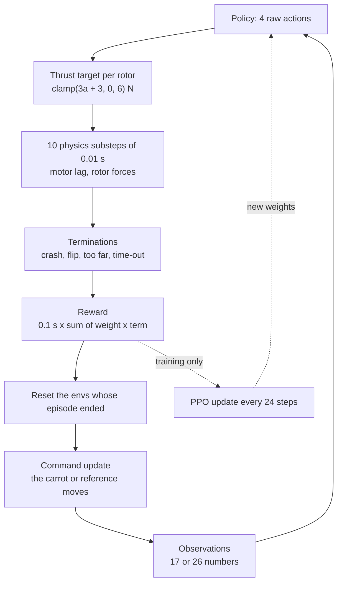

Two consequences of this order matter later. The carrot or reference moves after physics, so the next observation
already measures the drone against the new target. The reward, in contrast, is computed before the command update, so
it scores the drone against the target of the previous update, 0.1 s old. The repository does not state this; it
follows from the Isaac Lab 3.0.0 step order.

### 3.2 PPO with rsl_rl: one training iteration

Both drone tasks are trained with Proximal Policy Optimization (PPO) from the rsl_rl library. The internals below are
read from rsl_rl 5.5.1, the version installed with Isaac Lab 3.0.0; the class names inside the released policy file
belong to the same version family. PPO trains two networks:

* The **actor** is the policy. During training it is a Gaussian: the MLP gives the mean $\mu(o)$ of each of the four
  action values, and a learned standard deviation per action value, independent of the observation and starting at
  0.5, adds exploration noise: $a\sim\mathcal N(\mu(o),\sigma^2)$
  ([`rsl_rl_ppo_cfg.py:17-22`](../sim/src/drone_lab/tasks/track_trajectory/config/arl_robot_1/agents/rsl_rl_ppo_cfg.py#L17-L22);
  `rsl_rl/modules/distribution.py:144-191`, rsl_rl 5.5.1). The exported file keeps only the mean.
* The **critic** is a second MLP of the same size. It estimates the *value* $V(o)$, the expected discounted return from
  $o$. Both tasks define only a `policy` observation group, so the critic sees exactly what the actor sees, with no
  privileged information
  ([`track_trajectory_env_cfg.py:77`](../sim/src/drone_lab/tasks/track_trajectory/config/arl_robot_1/track_trajectory_env_cfg.py#L77);
  `track_position_state_based_env_cfg.py:121`, Isaac Lab 3.0.0; fallback in `rsl_rl/utils/utils.py:192-271`, rsl_rl
  5.5.1).

One iteration (`rsl_rl/runners/on_policy_runner.py:79-108`, rsl_rl 5.5.1) has four parts:

1. **Rollout.** Every env runs `num_steps_per_env` = 24 steps with the current actor: 24 × 4096 = 98,304 transitions,
   2.4 s of flight per env. Each transition stores $o_t$, $a_t$, $\log\pi(a_t\mid o_t)$, $V(o_t)$, $r_t$ and whether
   the episode ended. On a time-out rsl_rl adds $\gamma V(o_t)$ to $r_t$, so a truncated episode is not scored as if
   its future were worth nothing (`rsl_rl/algorithms/ppo.py:153-158`, rsl_rl 5.5.1).
2. **Advantages.** The *advantage* $\hat A_t$ says how much better an action turned out than the critic expected.
   Generalised Advantage Estimation (GAE) computes it backward over the 24 steps (`rsl_rl/algorithms/ppo.py:166-191`):

   $$\delta_t = r_t + \gamma(1-d_t)V(o_{t+1}) - V(o_t),\qquad \hat A_t = \delta_t + \gamma\lambda(1-d_t)\hat A_{t+1},\qquad R_t = \hat A_t + V(o_t)$$

   with $d_t=1$ where an episode ended, $\gamma$ = `gamma` = 0.98 and $\lambda$ = `lam` = 0.95. $\lambda$ trades the
   critic's bias against the variance of long sums of rewards. The advantages are then normalised to zero mean and unit
   standard deviation over the whole batch.
3. **Update.** The batch is split into `num_mini_batches` = 4 mini-batches of 24,576 transitions and passed over
   `num_learning_epochs` = 4 times: 16 gradient steps. Each step minimises (`rsl_rl/algorithms/ppo.py:268-285`)

   $$L = L_{surr} + c_V L_V - c_H\bar H,\qquad L_{surr} = \mathrm{mean}\big[\max\big(-\hat A\rho,\ -\hat A\,\mathrm{clip}(\rho,1-\epsilon,1+\epsilon)\big)\big],\qquad \rho=\frac{\pi_{new}(a\mid o)}{\pi_{old}(a\mid o)}$$

   The clip, $\epsilon$ = `clip_param` = 0.2, stops one batch from pushing the policy far from the one that collected
   it. $L_V$ is the squared error between $V$ and the return $R$, with the same ±0.2 clip around the old value
   (`use_clipped_value_loss`), weighted by $c_V$ = `value_loss_coef` = 1.0. $\bar H$ is the entropy of the Gaussian;
   its weight $c_H$ = `entropy_coef` (0.001 in the hover task, 0.002 in the trajectory task) pays for keeping some
   exploration. The optimiser is Adam (the default, `isaaclab_rl/rsl_rl/rl_cfg.py:198`, Isaac Lab 3.0.0) with learning
   rate 4e-4 on the *adaptive* schedule: on every mini-batch the mean KL divergence between the old and the new
   Gaussian is measured; above 2 × `desired_kl` = 0.02 the rate is divided by 1.5 (floor 1e-5), below 0.005 it is
   multiplied by 1.5 (cap 1e-2) (`rsl_rl/algorithms/ppo.py:240-266`). Gradient norms are clipped at 1.0
   (`max_grad_norm`, `rsl_rl/algorithms/ppo.py:309-310`).
4. **Repeat** for `max_iterations`: 1500 in the upstream hover task (147.5 M transitions) and 2000 in the trajectory
   task (196.6 M).

Isaac Lab's runner defaults add two details: `init_at_random_ep_len=True` sets every env's episode clock to a random
value before the first iteration, so the 4096 envs do not all reset at once, and the seed is 42
(`isaaclab_rl/rsl_rl/rl_cfg.py:239`, `:248`, Isaac Lab 3.0.0; `rsl_rl/runners/on_policy_runner.py:59-62`, rsl_rl
5.5.1). Section 3.5 lists every PPO setting of both tasks side by side.

### 3.3 The released hover policy

#### What the file contains

The hover pilot is `downloads/arl-robot-1_policy.pt`, a release asset of 197,334 bytes that
[`download_assets.sh:17`](../scripts/download_assets.sh#L17) fetches; the folder is git-ignored
([`.gitignore:23`](../.gitignore#L23)), so the file is not in the repository's history. It is a TorchScript archive,
which is a zip file. Its code members (`policy/code/__torch__/rsl_rl/models/mlp_model.py`,
`policy/code/__torch__/rsl_rl/modules/mlp.py`, `policy/code/__torch__/rsl_rl/modules/distribution.py`) and its tensor
shapes (`policy/data.pkl`), read as text without executing anything, give this network:

| Part | Operation | Weight shapes | Parameters |
|---|---|---|---|
| `obs_normalizer` | `torch.nn.Identity`: inputs pass unchanged | none | 0 |
| `mlp.0`, `mlp.1` | Linear 17 → 256, then ELU | (256, 17) and 256 | 4,608 |
| `mlp.2`, `mlp.3` | Linear 256 → 128, then ELU | (128, 256) and 128 | 32,896 |
| `mlp.4`, `mlp.5` | Linear 128 → 64, then ELU | (64, 128) and 64 | 8,256 |
| `mlp.6` | Linear 64 → 4 | (4, 64) and 4 | 260 |
| `deterministic_output` | returns the MLP output unchanged | none | 0 |
| **total** | | | **46,020** |

ELU is $x$ for $x>0$ and $e^x-1$ otherwise ($\alpha$ = 1 in the archive). Three facts matter:

* **No observation normalisation.** Metres, quaternion components, m/s and rad/s enter the first layer raw. This
  matches the repository's description of the hover runner, "Actor/critic MLP (256, 128, 64), ELU, no observation
  normalization"
  ([`rsl_rl_ppo_cfg.py:12`](../sim/src/drone_lab/tasks/survey/config/arl_robot_1/agents/rsl_rl_ppo_cfg.py#L12)).
* **Deterministic mean action.** The file outputs the mean of the training Gaussian: no sampling, no tanh, no clip.
* **One call per step.** The mission loads the file with `torch.jit.load`, switches it to eval mode and calls it on the
  concatenated `policy` observation group ([`sar_mission.py:608-609`](../sim/scripts/sar_mission.py#L608-L609),
  [`sar_mission.py:455`](../sim/scripts/sar_mission.py#L455)).

#### The 17 observations

The survey task keeps the training task's observation group, `ObservationsCfg.PolicyCfg`, and overrides only the first
term; an overridden field keeps its place in the order
([`survey_env_cfg.py:111-131`](../sim/src/drone_lab/tasks/survey/config/arl_robot_1/survey_env_cfg.py#L111-L131)). The
test [`test_env_cfgs.py:32-51`](../sim/tests/test_env_cfgs.py#L32-L51) checks the order and that terms 2-5 are the
built-in task's, with the same function, parameters, scale and clip.

| # | Term | Dim | Index | Value | Frame, units | Scaling |
|---|---|---|---|---|---|---|
| 1 | `base_link_position` | 3 | 0-2 | drone position minus carrot, `clamp_offset(p - c, 1.0, (1, 1, 1))` ([`survey_terms.py:23-38`](../sim/src/drone_lab/tasks/survey/mdp/survey_terms.py#L23-L38)) | world axes, m | clamped to a 1 m ball, then to ±1 m per axis |
| 2 | `base_orientation` | 4 | 3-6 | root orientation quaternion (x, y, z, w) | world | none |
| 3 | `base_lin_vel` | 3 | 7-9 | linear velocity | body frame, m/s | none |
| 4 | `base_ang_vel` | 3 | 10-12 | angular velocity | body frame, rad/s | none |
| 5 | `last_action` | 4 | 13-16 | the previous step's raw policy output | unitless | none |

* In training, term 1 was `root_pos_w`, the drone position minus the env origin
  (`isaaclab/envs/mdp/observations.py:94-97`, Isaac Lab 3.0.0). The training goal sat at the env origin, so that too was
  "drone minus target" ([`survey_terms.py:32-34`](../sim/src/drone_lab/tasks/survey/mdp/survey_terms.py#L32-L34)).
* There is no observation noise. Training ran with `enable_corruption=False`, and the survey sets every term's noise to
  `None`
  ([`survey_env_cfg.py:124-129`](../sim/src/drone_lab/tasks/survey/config/arl_robot_1/survey_env_cfg.py#L124-L129)).
* No input depends on absolute position, so the policy behaves the same at the survey height (z = 7.515 m with the
  defaults, [`mission.py:6-7`](../sim/src/drone_lab/sar/mission.py#L6-L7)) as near its training origin. The mapping
  rays and the camera are not inputs: the task has only the `policy` group
  ([`test_env_cfgs.py:50-51`](../sim/tests/test_env_cfgs.py#L50-L51); with the camera,
  [`test_sar_env_cfg.py:61`](../sim/tests/test_sar_env_cfg.py#L61)).

#### From action to thrust

Each action value sets one rotor's thrust target:

$$T_i = \mathrm{clamp}(3a_i + 3,\ 0,\ 6)\ \mathrm{N}$$

This is `ThrustActionCfg` with scale 3, offset 3 and clip 0 to 6 per rotor, unchanged from training
([`survey_env_cfg.py:12`](../sim/src/drone_lab/tasks/survey/config/arl_robot_1/survey_env_cfg.py#L12); asserted in
[`test_env_cfgs.py:54-57`](../sim/tests/test_env_cfgs.py#L54-L57); implemented in
`isaaclab_contrib/mdp/actions/thrust_actions.py:204-234`, Isaac Lab 3.0.0). A raw −1 gives 0 N, which the mission
sends to stop the motors after touchdown ([`sar_mission.py:158-159`](../sim/scripts/sar_mission.py#L158-L159),
[`sar_mission.py:442`](../sim/scripts/sar_mission.py#L442)); 0 gives 3 N and +1 gives 6 N. The network has no tanh,
so this clamp is the only bound, and outputs beyond ±1 saturate.

The motor model is upstream code, not in the repository (UNVERIFIED here). In Isaac Lab 3.0.0 the thrust target is
clamped to 0.1-10 N, so "0 N" leaves about 0.1 N per rotor; the rotor speed follows the target with a first-order lag
whose time constant is 0.05-0.08 s when thrust rises and 0.005 s when it falls; and the time constants and the thrust
coefficient are re-drawn for every motor at every reset (`isaaclab_assets/robots/arl_robot_1.py:26-33`;
`isaaclab_contrib/actuators/thruster.py:122-177`). An allocation matrix turns the four thrusts into a body force and
torque, with 0.13 m lever arms about the body x and y axes and a yaw-torque ratio of 0.07
(`isaaclab_assets/robots/arl_robot_1.py:73-80`;
`isaaclab_contrib/assets/multirotor/multirotor.py:563-582`). The drone's mass and inertia are in its USD file on
Isaac's Nucleus server, not in the repository (UNVERIFIED).

Given "level, at rest, exactly on the target", the released network settles on its own hover action. Feeding its
output back in as `last_action` converges to $a_{\mathrm{hover}}$ = (0.0846, 0.0891, 0.0801, 0.0879): 3.24-3.27 N per
rotor, 13.03 N in total. These numbers come from a numpy forward pass of the archive's weights, not from a simulator.
If 13.03 N is the true hover thrust, the drone weighs about 1.33 kg and the 4 × 6 N ceiling gives a thrust-to-weight
ratio of about 1.8; both are inferences, not checked against the USD.

#### Timing

Physics step 0.01 s (100 Hz), decimation 10, policy step 0.1 s (10 Hz), and the thruster model integrates with the
physics step ([`test_env_cfgs.py:58-60`](../sim/tests/test_env_cfgs.py#L58-L60)). These tests skip without Isaac Lab,
which CI does not install ([`sim/README.md:545-546`](../sim/README.md#L545-L546)); the Isaac Lab 3.0.0 values agree
(`track_position_state_based_env_cfg.py:227-230`; `isaaclab_tasks/contrib/drone_arl/track_position_state_based/config/arl_robot_1/no_obstacle_env_cfg.py:24`).

#### How it was trained

The README names the training task, Isaac Lab's built-in `IsaacContrib-TrackPositionNoObstacles-ARL-Robot-1`, and its
one skill: "fly from up to 1 m away to a target point and hover there"
([`sim/README.md:296-300`](../sim/README.md#L296-L300)). The survey configuration subclasses that task's config class,
`NoObstacleEnvCfg`
([`survey_env_cfg.py:37-39`](../sim/src/drone_lab/tasks/survey/config/arl_robot_1/survey_env_cfg.py#L37-L39),
[`survey_env_cfg.py:187-188`](../sim/src/drone_lab/tasks/survey/config/arl_robot_1/survey_env_cfg.py#L187-L188)), and
the documented command trains it with `--num_envs 4096 --max_iterations 1500 --seed 42`
([`sim/README.md:399-403`](../sim/README.md#L399-L403)).

The task's code is not in the repository. In Isaac Lab 3.0.0 it is `track_position_state_based_env_cfg.py`, and the
"Line" column below refers to that file. Each step pays $r = 0.1\,\mathrm{s}\times\sum_i w_i f_i$:

| Term | Weight $w_i$ | $f_i$ | Line | Function (Isaac Lab 3.0.0) |
|---|---|---|---|---|
| `distance_to_goal_exp` | +25.0 | $\exp(-\lVert g-(p-o_{env})\rVert^2/1.5^2)$, goal $g=0$ | 158-166 | `isaaclab_tasks/contrib/drone_arl/mdp/rewards.py:28-60` |
| `flat_orientation_l2` | **+1.0** | $g_{b,x}^2+g_{b,y}^2$, the squared x and y components of the gravity direction in the body frame | 167-171 | `isaaclab/envs/mdp/rewards.py:114-120` |
| `yaw_aligned` | +2.0 | $\exp(-\mathrm{wrap}(\psi)^2/1.0^2)$ | 172-176 | `isaaclab_tasks/contrib/drone_arl/mdp/rewards.py:225-255` |
| `lin_vel_xyz_exp` | +2.5 | $\exp(-\lVert v_w\rVert^2/2.0^2)$ | 177-181 | `isaaclab_tasks/contrib/drone_arl/mdp/rewards.py:198-222` |
| `ang_vel_xyz_exp` | +10.0 | $\exp(-\lVert\omega_b\rVert^2/10^2)$ | 182-186 | `isaaclab_tasks/contrib/drone_arl/mdp/rewards.py:115-141` |
| `action_rate_l2` | −0.05 | $\lVert a_t-a_{t-1}\rVert^2$ | 187 | `isaaclab/envs/mdp/rewards.py:288-290` |
| `action_magnitude_l2` | −0.05 | $\lVert a_t\rVert^2$ | 188 | `isaaclab/envs/mdp/rewards.py:293-295` |
| `termination_penalty` | −5.0 | 1 when a failure ends the episode, 0 on a time-out | 190-193 | `isaaclab/envs/mdp/rewards.py:38-40` |

Symbols: $p$ is the drone position, $o_{env}$ the env origin, $v_w$ the world-frame velocity, $\omega_b$ the body
rates, $\psi$ the yaw and $a$ the raw action. The rest of the same file:

* **Goal**: the command `target_pose` has every range 0, so the goal is the env origin; it is resampled every 10 s
  (lines 66-79).
* **Reset**: position ±1 m per axis around the goal; roll, pitch and yaw ±π/6 (±30°); linear and angular velocity ±0.2
  per axis (lines 130-151; the offsets are added to the env origin in `isaaclab/envs/mdp/events.py:1276`).
* **Terminations**: the time-out, and `crash` below z = −3.0 m (lines 200-201). The world is empty, with no ground
  (lines 40-54).
* **Episode**: 5.0 s, so 50 policy steps (lines 227-230).
* **Observations**: U(±0.1) noise is configured but switched off by `enable_corruption=False` (lines 110-118).
* **PPO**: the right-hand column of the table in section 3.5.

Reading this reward: a perfect hover step (on the goal, level, still, at yaw 0) pays $0.1\times(25+2+2.5+10) = 3.95$,
about 198 over a 5 s episode (derived). The goal term is most of it. Both velocity terms pay for keeping still, which
is what a hover needs and, as section 3.4 explains, part of why the policy lags a moving target. The +1.0 on
`flat_orientation_l2` *rewards* tilt, because the function is never negative, but by at most 0.1 per step. The
repository's trajectory task makes it a penalty (section 3.5).

What the repository itself records about this training agrees with the table, independently of any Isaac Lab copy:

* the survey reward class is documented as "Training rewards with the goal term measured to the carrot" and replaces
  only `distance_to_goal_exp`, with weight 25.0 and std 1.5
  ([`survey_env_cfg.py:145-153`](../sim/src/drone_lab/tasks/survey/config/arl_robot_1/survey_env_cfg.py#L145-L153));
* the README states the +1.0 on `flat_orientation_l2` ([`sim/README.md:581-582`](../sim/README.md#L581-L582));
* training started "within +-1 m per axis" of a fixed goal, without observation noise
  ([`carrot.py:3-4`](../sim/src/drone_lab/carrot.py#L3-L4);
  [`survey_env_cfg.py:11`](../sim/src/drone_lab/tasks/survey/config/arl_robot_1/survey_env_cfg.py#L11);
  [`sim/README.md:579`](../sim/README.md#L579)).

**UNVERIFIED in this repository:**

* *Which Isaac Lab version trained the file.* The README runs the simulator with "Isaac Sim 6.2 + Isaac Lab 3.0"
  ([`sim/README.md:32`](../sim/README.md#L32)), but [`pyproject.toml:79-93`](../sim/pyproject.toml#L79-L93) points at an
  unversioned local checkout, and the archive carries no Isaac Lab or rsl_rl version and no run metadata. The table
  above is the Isaac Lab 3.0.0 task: a cross-check, not proof of what trained the file.
* *How long it trained.* The README says the survey was flown "after 1300 training iterations (the release asset
  `arl-robot-1_policy.pt`)" ([`sim/README.md:322-323`](../sim/README.md#L322-L323)), while the documented command runs
  1500 iterations and the examples load `model_1499.pt` ([`sim/README.md:431`](../sim/README.md#L431),
  [`sim/README.md:454`](../sim/README.md#L454)). Git history adds that commit `8da3f08` first described that policy as
  "`exported/policy.pt` of the `demo_drone_track` run". Whether the release is iteration 1300 of a 1500-iteration run,
  and with how many envs and which seed it was trained, is not recorded.

### 3.4 The carrot: from hovering to surveying

#### The idea

The hover policy's only notion of a goal is term 1, its offset from the target. It cannot tell a fixed target from a
moving one. The survey task `DroneLab-Survey-ARL-Robot-1-v0` uses this: its target is a *carrot* that slides along the
survey path, and the policy, still trying to reach its target and hover there, chases it
([`carrot.py:1-16`](../sim/src/drone_lab/carrot.py#L1-L16)). Two safeguards keep the offset inside what the policy saw
in training ([`sim/README.md:301-305`](../sim/README.md#L301-L305)): the carrot slows down and waits when the drone
lags, so it never gets more than 1 m ahead, and the observed offset is clamped to 1 m. The same network then flies
the whole survey and the mission, unchanged. The mission's default `--pilot hover` runs this set-up over the dressed
site, task `DroneLab-SAR-ARL-Robot-1-v0` ([`mission.py:47-52`](../sim/src/drone_lab/sar/mission.py#L47-L52),
[`sar_mission.py:156`](../sim/scripts/sar_mission.py#L156)).

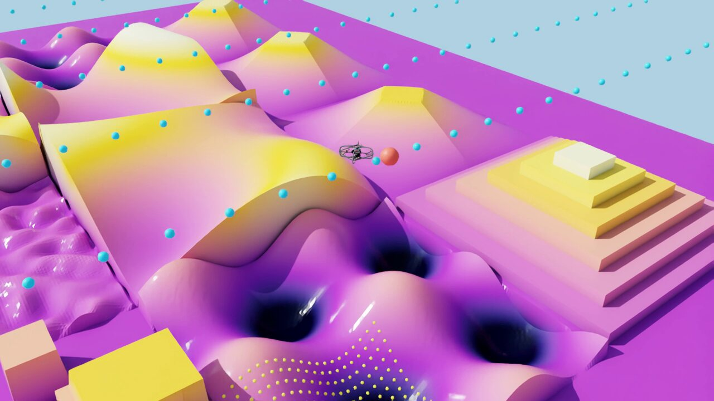

*Isaac Sim, chase camera: the drone (centre) follows the red carrot along the planned path (cyan dots); the yellow
dots are its mapping rays hitting the ground ([`sim/README.md:291-294`](../sim/README.md#L291-L294)).*

#### The path

The command term `SurveyCarrotCommand` builds one waypoint polyline per env when it starts, and resamples it to points
at most 0.25 m apart, keeping every corner
([`commands.py:61-78`](../sim/src/drone_lab/tasks/survey/mdp/commands.py#L61-L78);
[`commands_cfg.py:73`](../sim/src/drone_lab/tasks/survey/mdp/commands_cfg.py#L73);
[`paths.py:390-412`](../sim/src/drone_lab/paths.py#L390-L412)). The carrot's state is its arclength $s$ along the
path, and $c(s)$ is the path point at that arclength, interpolated linearly and held at the path's ends
([`carrot.py:52-77`](../sim/src/drone_lab/carrot.py#L52-L77)). A reset puts $s = 0$, the carrot on the first point and
its speed to 0 ([`commands.py:185-195`](../sim/src/drone_lab/tasks/survey/mdp/commands.py#L185-L195)), and the reset
event places the drone on that point, level, at rest, yaw 0
([`survey_terms.py:46-64`](../sim/src/drone_lab/tasks/survey/mdp/survey_terms.py#L46-L64)).

#### One carrot update

Every step, after physics, `_update_command` moves the carrot
([`commands.py:197-229`](../sim/src/drone_lab/tasks/survey/mdp/commands.py#L197-L229), calling `advance_carrot`,
[`carrot.py:80-126`](../sim/src/drone_lab/carrot.py#L80-L126)). With $p$ the drone position after physics,
$\Delta t$ = 0.1 s, $v_c$ the carrot speed, $L$ the path length, $L_{max}$ = `max_lead` and $L_{slow}$ = `slow_lead`:

1. distance $d = \lVert c(s)-p\rVert$;
2. lead gate $g = \mathrm{clamp}\big((L_{max}-d)/(L_{max}-L_{slow}),\ 0,\ 1\big)$;
3. step $\Delta s = v_c\,g\,\Delta t$ and trial $s' = \min(s+\Delta s,\ L)$;
4. if $\lVert c(s')-p\rVert > L_{max}$, the step is shortened to $\min(\Delta s,\ L_{max}-d)$. A chord is never longer
   than its arc, so the carrot ends at most $d + (L_{max}-d) = L_{max}$ from the drone.

For the hover pilot $L_{max}$ = 1.0 m and $L_{slow}$ = 0.7 m, with no speed ramp
([`commands_cfg.py:59-68`](../sim/src/drone_lab/tasks/survey/mdp/commands_cfg.py#L59-L68)):

```text
 gate g        carrot step = speed x g x 0.1 s
  1.0 +-----------------------------
      |                               \
  0.5 |                                  \
      |                                     \
  0.0 +----------------------------------------+------------->  d = |carrot - drone|  [m]
       0                          0.7         1.0
                           slow_lead        max_lead
```

The gate is 1 up to 0.7 m, 0.5 at 0.85 m and 0 at 1.0 m, so a drone that stops dead holds the carrot within 1 m (test
[`test_carrot.py:49-60`](../sim/tests/test_carrot.py#L49-L60)). Shortening a step instead of rejecting it matters at
high speed: rejecting it would make the carrot stop and go above 3 m/s and stall for good once
$v_c\Delta t \ge L_{max}$ ([`carrot.py:93-97`](../sim/src/drone_lab/carrot.py#L93-L97);
[`test_carrot.py:84-99`](../sim/tests/test_carrot.py#L84-L99)).

#### The offset clamp

`clamp_offset` first scales the offset onto a ball of radius 1 m, keeping its direction, then clips each axis to ±1 m
([`carrot.py:162-181`](../sim/src/drone_lab/carrot.py#L162-L181), called with `max_offset=1.0` and
`per_axis_limit=(1.0, 1.0, 1.0)` from
[`survey_env_cfg.py:119-122`](../sim/src/drone_lab/tasks/survey/config/arl_robot_1/survey_env_cfg.py#L119-L122)).
With these numbers the box never binds, since no component of a vector of length 1 exceeds 1
([`test_carrot.py:102-112`](../sim/tests/test_carrot.py#L102-L112)); the README's "clamped to the +-1 m box"
([`sim/README.md:304`](../sim/README.md#L304)) names this redundant second stage. The gate already keeps the carrot
within 1 m of the drone, measured with the same post-physics position the observation uses, so the clamp acts only
when the drone ends up farther away anyway, after an overshoot or a disturbance (the carrot never moves backward). A
carrot 1.5 m ahead then reads as (−1, 0, 0), exactly like one 1.0 m ahead. The ball is a little tighter than the
training starts, which filled a ±1 m box whose corners are 1.73 m from the goal, so clamped offsets stay inside what
the policy saw.

#### Speeds

In the survey task the carrot runs at `speed` = 1.0 m/s
([`commands_cfg.py:56-57`](../sim/src/drone_lab/tasks/survey/mdp/commands_cfg.py#L56-L57)). The mission sets the speed
every step from the carrot's phase: 0 for the first 1.5 s (`--settle`, 15 steps) so the drone first hovers, then
1.0 m/s for the climb, 1.5 m/s for transit, survey and return, 0.8 m/s for the descent and 0.3 m/s for the touchdown
([`sar_mission.py:440`](../sim/scripts/sar_mission.py#L440), [`sar_mission.py:454`](../sim/scripts/sar_mission.py#L454),
[`sar_mission.py:66-71`](../sim/scripts/sar_mission.py#L66-L71);
[`mission.py:128-131`](../sim/src/drone_lab/sar/mission.py#L128-L131),
[`mission.py:166`](../sim/src/drone_lab/sar/mission.py#L166)). The carrot reads `cfg.speed` at every update
([`commands.py:200`](../sim/src/drone_lab/tasks/survey/mdp/commands.py#L200)). Section 4 describes the phases.

#### Why the hover pilot lags and tops out near 1.3 m/s

The README reports two measurements from Isaac Sim: the drone follows "about 0.75 s behind" the carrot (0.75 m at
1 m/s), and it "tops out near 1.3 m/s however fast the carrot goes": commands of 1.5, 2 and 3 m/s give 1.16, 1.23 and
1.31 m/s ([`sim/README.md:335-337`](../sim/README.md#L335-L337)). The run logs are not in the repository, so these
numbers cannot be re-checked here. The code shows the mechanism:

* **No velocity input, and no moving goal in training.** The 17 inputs hold the offset but not the target's velocity,
  and the training goal never moved ([`sim/README.md:579`](../sim/README.md#L579)). The policy notices that the
  carrot moves only when the offset grows.
* **It was paid to keep still.** In the Isaac Lab 3.0.0 reward above, `lin_vel_xyz_exp` and `ang_vel_xyz_exp` pay for
  low speed and low body rates. A policy that damps its own velocity behaves like a spring and damper on the offset:
  to fly at a steady speed $V$ it needs a steady pull, an offset that grows with $V$. That is a constant time lag,
  about 0.75 s on the README's numbers. (This reading is an interpretation, not a measurement.)
* **The lead limit and the clamp cap the pull.** At speed $V$ the drone needs a lead of about
  $0.75\,\mathrm{s}\times V$, but the carrot may lead by at most 1.0 m and the policy sees at most 1 m. So
  $V \lesssim 1.0/0.75 \approx 1.33$ m/s, where the measured speeds level off. The CPU tests model the policy the same
  way, as a follower that "closes the offset with a 0.75 s time constant and tops out at 1.33 m/s (measured)"
  ([`test_carrot.py:63-79`](../sim/tests/test_carrot.py#L63-L79)).

The README's remedy is a policy trained on moving targets ([`sim/README.md:339-340`](../sim/README.md#L339-L340)),
the task of section 3.5. The mission's camera-overlap numbers allow for the cap: they assume the hover pilot flies
min(speed, 1.25) m/s ([`sar_mission.py:389-390`](../sim/scripts/sar_mission.py#L389-L390)).

### 3.5 The trajectory-tracking task `DroneLab-TrackTrajectory-ARL-Robot-1-v0`

#### Purpose and set-up

This task, registered in
[`__init__.py:11-20`](../sim/src/drone_lab/tasks/track_trajectory/config/arl_robot_1/__init__.py#L11-L20), teaches a
policy to follow a moving reference. Besides its position error, the policy sees its velocity error and where the
reference will be 0.5 s and 1.0 s ahead: the feed-forward information the hover policy lacks
([`track_trajectory_env_cfg.py:1-15`](../sim/src/drone_lab/tasks/track_trajectory/config/arl_robot_1/track_trajectory_env_cfg.py#L1-L15)).
It subclasses the same `NoObstacleEnvCfg` as the hover task, so the robot, the thrust actions and the timing are the
same
([`track_trajectory_env_cfg.py:124`](../sim/src/drone_lab/tasks/track_trajectory/config/arl_robot_1/track_trajectory_env_cfg.py#L124);
test [`test_trajectory_pilot.py:150-158`](../sim/tests/test_trajectory_pilot.py#L150-L158)). It runs 4096 envs
6.0 m apart in an empty world, with 12.0 s episodes (120 steps) and no curriculum term: the random references alone
set the difficulty
([`track_trajectory_env_cfg.py:123-137`](../sim/src/drone_lab/tasks/track_trajectory/config/arl_robot_1/track_trajectory_env_cfg.py#L123-L137)).

#### The reference trajectories

Every reference is, per axis, a sum of two sinusoids around an offset, so its velocity is exact
([`reference.py:3-6`](../sim/src/drone_lab/reference.py#L3-L6),
[`reference.py:37-45`](../sim/src/drone_lab/reference.py#L37-L45)):

$$p(t) = o + \sum_{k=1}^{2} A_k\sin(\omega_k t+\phi_k),\qquad v(t) = \sum_{k=1}^{2} A_k\omega_k\cos(\omega_k t+\phi_k)$$

and the world reference is $p_{ref}(t) = o_{env} + p(t)$
([`commands.py:77-80`](../sim/src/drone_lab/tasks/track_trajectory/mdp/commands.py#L77-L80)). At every reset each env
draws (ranges in [`commands_cfg.py:38-53`](../sim/src/drone_lab/tasks/track_trajectory/mdp/commands_cfg.py#L38-L53),
sampling in [`reference.py:47-150`](../sim/src/drone_lab/reference.py#L47-L150)):

* a shape, uniformly from circle, figure-eight, Lissajous and random;
* a size $a \sim U(0.8, 2.5)$ m (radius or half-width) and a peak speed $V \sim U(0.3, 1.5)$ m/s;
* a height offset $z_0 \sim U(-0.5, 0.5)$ m and a vertical amplitude of up to 0.5 m;
* a speed split $\alpha \sim U(0^\circ, 30^\circ)$: the horizontal shape gets $V_h = V\cos\alpha$ and the vertical
  wave at most $V\sin\alpha$, so the 3-D speed never exceeds $V$ (test
  [`test_reference.py:17-31`](../sim/tests/test_reference.py#L17-L31));
* a phase $\phi \sim U(0, 2\pi)$ and a direction $d = \pm 1$.

| Shape | $x(t)$ | $y(t)$ | $\omega$ | Code |
|---|---|---|---|---|
| circle | $a\cos(\omega t+\phi)$ | $d\,a\sin(\omega t+\phi)$ | $V_h/a$, constant speed | [`reference.py:97-102`](../sim/src/drone_lab/reference.py#L97-L102) |
| figure-eight (Gerono) | $a\sin(\omega t+\phi)$ | $d\,\frac{a}{2}\sin(2\omega t+2\phi)$ | $V_h/(a\sqrt{2})$, fastest at the crossing | [`reference.py:103-108`](../sim/src/drone_lab/reference.py#L103-L108) |
| Lissajous | $a\sin(\omega t+\phi)$ | $b\sin(r\omega t+\phi_2)$ with $r\in\lbrace 1.5, 2, 3\rbrace$, $b = a\,U(0.5, 1)$ | $V_h/\sqrt{a^2+(br)^2}$ | [`reference.py:109-123`](../sim/src/drone_lab/reference.py#L109-L123) |
| random | two sinusoids, amplitudes $0.5a\,U(0.4, 1)$, frequencies $U(0.3, 1.2)$ rad/s | the same, drawn separately | frequencies scaled so the speed bound is $V_h$ | [`reference.py:124-134`](../sim/src/drone_lab/reference.py#L124-L134) |

In all shapes the height is $z = z_0 + A_z\sin(\omega_z t+\phi_z)$ with $\omega_z = U(0.3, 0.7)\,V/a$ and
$A_z = \min\big(U(0, 0.5),\ V\sin\alpha/\omega_z\big)$
([`reference.py:135-142`](../sim/src/drone_lab/reference.py#L135-L142)). The command term advances its clock by 0.1 s
per step and evaluates $p_{ref}(t)$, $v_{ref}(t)$ and the look-ahead points $p_{ref}(t+0.5)$ and $p_{ref}(t+1.0)$
([`commands.py:82-89`](../sim/src/drone_lab/tasks/track_trajectory/mdp/commands.py#L82-L89),
[`commands.py:108-110`](../sim/src/drone_lab/tasks/track_trajectory/mdp/commands.py#L108-L110)). It never resamples in
mid-episode ([`commands_cfg.py:35-36`](../sim/src/drone_lab/tasks/track_trajectory/mdp/commands_cfg.py#L35-L36)).

#### The 26 observations

The terms are in
[`track_trajectory_env_cfg.py:57-71`](../sim/src/drone_lab/tasks/track_trajectory/config/arl_robot_1/track_trajectory_env_cfg.py#L57-L71)
and the functions in [`track_terms.py:26-57`](../sim/src/drone_lab/tasks/track_trajectory/mdp/track_terms.py#L26-L57).

| # | Term | Dim | Index | Value | Frame, units | Clip | Noise in training |
|---|---|---|---|---|---|---|---|
| 1 | `reference_error` | 3 | 0-2 | $p - p_{ref}$ | world, m | ±2.0 per axis | U(±0.02) |
| 2 | `velocity_error` | 3 | 3-5 | $v - v_{ref}$ | world, m/s | ±3.0 | U(±0.05) |
| 3 | `lookahead` | 6 | 6-11 | $p_{ref}(t+0.5)-p$, then $p_{ref}(t+1.0)-p$ | world, m | ±3.0 | none |
| 4 | `base_orientation` | 4 | 12-15 | quaternion (x, y, z, w), made unique (w ≥ 0) | world | none | none |
| 5 | `base_lin_vel` | 3 | 16-18 | linear velocity | body, m/s | none | U(±0.05) |
| 6 | `base_ang_vel` | 3 | 19-21 | angular velocity | body, rad/s | none | U(±0.05) |
| 7 | `last_action` | 4 | 22-25 | previous raw action | unitless | none | none |

The noise is on during training (`enable_corruption=True`,
[`track_trajectory_env_cfg.py:73-75`](../sim/src/drone_lab/tasks/track_trajectory/config/arl_robot_1/track_trajectory_env_cfg.py#L73-L75)).
Isaac Lab adds noise after the term function (`isaaclab/managers/observation_manager.py:382-388`, Isaac Lab 3.0.0),
and the clips here sit inside the functions, so in training the position error can read up to ±2.02 m. The errors and
look-ahead points are in the world frame, while the policy is rewarded for holding yaw at 0
([`track_terms.py:21-23`](../sim/src/drone_lab/tasks/track_trajectory/mdp/track_terms.py#L21-L23)). Unlike the hover
policy's, the quaternion is made unique (`make_quat_unique=True`; `isaaclab/envs/mdp/observations.py:103-115`, Isaac Lab
3.0.0).

#### The reward, term by term

The weights and parameters are in
[`track_trajectory_env_cfg.py:91-110`](../sim/src/drone_lab/tasks/track_trajectory/config/arl_robot_1/track_trajectory_env_cfg.py#L91-L110).
Symbols: $p$ = `root_pos_w`, $v$ = `root_lin_vel_w` (world frame), $\omega_b$ = `root_ang_vel_b`, $g_b$ =
`projected_gravity_b` (the gravity direction in the body frame, a unit vector), $\psi$ = yaw and $a$ =
`action_manager.action`, the raw action.

| Term | Weight $w_i$ | $f_i$ | std | Function |
|---|---|---|---|---|
| `tracking_fine` | +15.0 | $\exp(-\lVert p-p_{ref}\rVert^2/0.4^2)$ | 0.4 m | `reference_tracking_exp`, [`track_terms.py:100-109`](../sim/src/drone_lab/tasks/track_trajectory/mdp/track_terms.py#L100-L109) |
| `tracking_coarse` | +5.0 | $\exp(-\lVert p-p_{ref}\rVert^2/1.5^2)$ | 1.5 m | the same function |
| `velocity_tracking` | +5.0 | $\exp(-\lVert v-v_{ref}\rVert^2/1.0^2)$ | 1.0 m/s | `reference_velocity_exp`, [`track_terms.py:112-121`](../sim/src/drone_lab/tasks/track_trajectory/mdp/track_terms.py#L112-L121) |
| `flat_orientation_l2` | **−1.0** | $g_{b,x}^2+g_{b,y}^2=\sin^2(\mathrm{tilt})$ | | `isaaclab/envs/mdp/rewards.py:114-120` (Isaac Lab 3.0.0) |
| `yaw_aligned` | +2.0 | $\exp(-\mathrm{wrap}(\psi)^2/1.0^2)$ | 1.0 rad | `isaaclab_tasks/contrib/drone_arl/mdp/rewards.py:225-255` (Isaac Lab 3.0.0) |
| `ang_vel_xyz_exp` | +2.0 | $\exp(-\lVert\omega_b\rVert^2/5.0^2)$ | 5.0 rad/s | `isaaclab_tasks/contrib/drone_arl/mdp/rewards.py:115-141` (Isaac Lab 3.0.0) |
| `action_rate_l2` | −0.05 | $\lVert a_t-a_{t-1}\rVert^2$ | | `isaaclab/envs/mdp/rewards.py:288-290` (Isaac Lab 3.0.0) |
| `action_magnitude_l2` | −0.05 | $\lVert a_t\rVert^2$ | | `isaaclab/envs/mdp/rewards.py:293-295` (Isaac Lab 3.0.0) |
| `termination_penalty` | −20.0 | 1 when a failure ends the episode | | `isaaclab/envs/mdp/rewards.py:38-40` (Isaac Lab 3.0.0) |

The reward of one step is

$$r_t = \Delta t\sum_i w_i f_i,\qquad \Delta t = 0.1\ \mathrm{s}$$

(`isaaclab/managers/reward_manager.py:143-152`, Isaac Lab 3.0.0). How to read the table:

* **Two position kernels.** The coarse one (std 1.5 m) still pays when the drone is far off and pulls it back towards
  the reference; the fine one (std 0.4 m) pays most only within a few tens of centimetres. At 0.4 m of error the fine
  term has fallen to $15e^{-1} = 5.5$, while the coarse term still pays $5e^{-0.07} = 4.7$.
* **Velocity.** `velocity_tracking` is what the hover reward lacks: it pays for matching the reference's velocity, not
  for keeping still.
* **Tilt.** `flat_orientation_l2` is a penalty here, as its name suggests; the repository notes that the built-in task
  uses +1.0
  ([`track_trajectory_env_cfg.py:104`](../sim/src/drone_lab/tasks/track_trajectory/config/arl_robot_1/track_trajectory_env_cfg.py#L104);
  [`sim/README.md:581-582`](../sim/README.md#L581-L582)). It costs 0.03 at 10° of tilt and 0.25 at 30° (times 0.1 per
  step), so it discourages needless tilt without forbidding the tilt that acceleration needs.
* **Body rates.** `ang_vel_xyz_exp` has std 5.0 rad/s here against 10.0 upstream, so it falls off faster with body
  rate, but its weight is 2.0 instead of 10.0.
* **Scale.** The best step pays $0.1\times(15+5+5+2+2) = 2.9$, so a 120-step episode pays at most 348. A failure costs
  $20\times 0.1 = 2.0$ once, plus every reward the episode no longer collects: with $\gamma = 0.98$, flying on at the
  best rate is worth up to $2.9/(1-0.98) = 145$, so ending early costs far more than the explicit penalty (derived).
* **Timing.** As section 3.1 showed, the reward compares the drone after physics with the reference of the previous
  command update, so it is highest for a drone that trails the reference by one step (0.1 s). This follows from the
  Isaac Lab 3.0.0 step order; the repository does not discuss it.

<p align="center">
  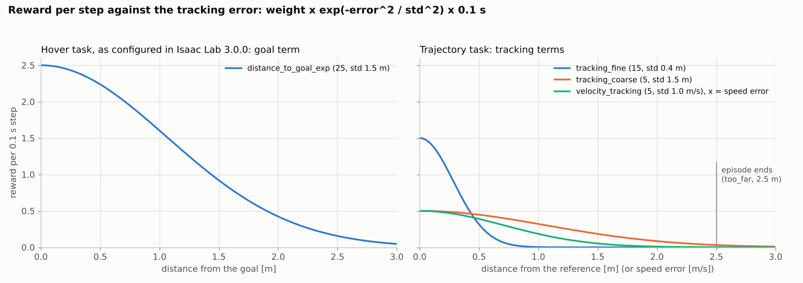
</p>

The figure plots the per-step value (weight × term × 0.1 s) of the tracking terms against the error
([`make_figures.py`](experiments/make_figures.py), `plot_rewards`). The hover task's goal term pays 2.5 per step on the
goal and still about 0.9 at 1.5 m away. The trajectory task's fine term pays 1.5 on the reference but almost nothing
beyond 0.8 m (0.03), where only the coarse term (0.38 at 0.8 m) still pulls the drone back.

#### Reading the reward at one state

Take the state the repository's test builds
([`test_trajectory_pilot.py:341-356`](../sim/tests/test_trajectory_pilot.py#L341-L356)): the reference moves along +x
at 1 m/s; the drone is 0.3 m behind and 0.2 m below it, flying at (0.8, 0, 0.1) m/s. The test sets no attitude, so
assume, for illustration, that the drone is level, at yaw 0 and not rotating, and that the previous and the new action
are both (0.1, 0.1, 0.1, 0.1). The 26 inputs, grouped
as in the observation table (position error, velocity error, look-ahead, quaternion, body velocity, body rates, last
action), are

`[−0.3, 0, −0.2 | −0.2, 0, 0.1 | 0.8, 0, 0.2, 1.3, 0, 0.2 | 0, 0, 0, 1 | 0.8, 0, 0.1 | 0, 0, 0 | 0.1, 0.1, 0.1, 0.1]`

The body velocity equals the world velocity because the drone is level with yaw 0. The reward terms are:

| Term | Computation | $w_i f_i$ |
|---|---|---|
| `tracking_fine` | $15\exp(-0.13/0.16)$, since $\lVert p-p_{ref}\rVert^2 = 0.3^2+0.2^2 = 0.13$ | 6.656 |
| `tracking_coarse` | $5\exp(-0.13/2.25)$ | 4.719 |
| `velocity_tracking` | $5\exp(-0.05/1.0)$, since $\lVert v-v_{ref}\rVert^2 = 0.2^2+0.1^2 = 0.05$ | 4.756 |
| `flat_orientation_l2`, `yaw_aligned`, `ang_vel_xyz_exp` | level, yaw 0, no rotation | 0, 2.0, 2.0 |
| `action_rate_l2`, `action_magnitude_l2` | $-0.05\times 0$ and $-0.05\times 4\times 0.1^2$ | 0, −0.002 |
| `termination_penalty` | no failure | 0 |

The sum is 20.13, so this step pays $0.1\times 20.13 = 2.013$ of the possible 2.9 (derived). Most of the shortfall is
the fine position term: being 0.3 m behind and 0.2 m low leaves 44 % of it.

#### Terminations and reset

The episode ends on
([`track_trajectory_env_cfg.py:113-120`](../sim/src/drone_lab/tasks/track_trajectory/config/arl_robot_1/track_trajectory_env_cfg.py#L113-L120)):

* `time_out` after 12 s, a truncation;
* `too_far`: $\lVert p-p_{ref}\rVert > 2.5$ m
  ([`track_terms.py:129-137`](../sim/src/drone_lab/tasks/track_trajectory/mdp/track_terms.py#L129-L137));
* `crash`: z below −3.0 m, a fixed world height;
* `flipped`: tilt above 1.75 rad (100°), Isaac Lab's `bad_orientation`.

The reset event `reset_near_reference`
([`track_trajectory_env_cfg.py:80-88`](../sim/src/drone_lab/tasks/track_trajectory/config/arl_robot_1/track_trajectory_env_cfg.py#L80-L88);
[`track_terms.py:65-92`](../sim/src/drone_lab/tasks/track_trajectory/mdp/track_terms.py#L65-L92)) draws a new
reference, then places the drone at $p_{ref}(0)$ plus U(±0.3 m) per axis, with roll, pitch and yaw each U(±0.26 rad),
about ±15°, linear velocity $v_{ref}(0)$ plus U(±0.2 m/s) per axis and angular velocity U(±0.2 rad/s) per axis. The
module docstring leaves out the angular-velocity noise
([`track_trajectory_env_cfg.py:13`](../sim/src/drone_lab/tasks/track_trajectory/config/arl_robot_1/track_trajectory_env_cfg.py#L13)).
Because events run before the command manager resets, the event draws the reference and the command term then only
restarts its clock ([`commands.py:21-27`](../sim/src/drone_lab/tasks/track_trajectory/mdp/commands.py#L21-L27),
[`commands.py:97-106`](../sim/src/drone_lab/tasks/track_trajectory/mdp/commands.py#L97-L106)).

#### PPO settings

The trajectory runner is
[`rsl_rl_ppo_cfg.py:13-37`](../sim/src/drone_lab/tasks/track_trajectory/config/arl_robot_1/agents/rsl_rl_ppo_cfg.py#L13-L37).
The hover task's runner is upstream,
`isaaclab_tasks/contrib/drone_arl/track_position_state_based/config/arl_robot_1/agents/rsl_rl_ppo_cfg.py:13-41`
(Isaac Lab 3.0.0). The survey's `SurveyPPORunnerCfg` subclasses it and changes nothing, so built-in checkpoints load
into the survey task
([`rsl_rl_ppo_cfg.py:1-16`](../sim/src/drone_lab/tasks/survey/config/arl_robot_1/agents/rsl_rl_ppo_cfg.py#L1-L16);
test [`test_env_cfgs.py:98-109`](../sim/tests/test_env_cfgs.py#L98-L109)).

| Setting | Trajectory task | Hover task (upstream) |
|---|---|---|
| steps per env per iteration | 24 | 24 |
| iterations / checkpoint every | 2000 / 100 | 1500 / 50 |
| actor and critic | MLP 256-128-64, ELU | MLP 256-128-64, ELU |
| observation normalisation | **yes**, actor and critic | **no** |
| initial action std | 0.5 | 0.5 |
| clip ε, value-loss weight, clipped value loss | 0.2, 1.0, yes | 0.2, 1.0, yes |
| entropy coefficient | **0.002** | **0.001** |
| epochs × mini-batches | 4 × 4 | 4 × 4 |
| learning rate, schedule, target KL | 4e-4, adaptive, 0.01 | 4e-4, adaptive, 0.01 |
| γ, λ | 0.98, 0.95 | 0.98, 0.95 |
| max gradient norm | 1.0 | 1.0 |
| experiment name (log folder) | `drone_lab_track_trajectory` | `arl_robot_1_track_position_state_based` |

The trajectory runner's docstring gives the reason for the normalisation: "the 26-D observation mixes metres, metres
per second and quaternions"
([`rsl_rl_ppo_cfg.py:10-11`](../sim/src/drone_lab/tasks/track_trajectory/config/arl_robot_1/agents/rsl_rl_ppo_cfg.py#L10-L11)).
rsl_rl keeps running means and variances of every input, and an exported normalising policy carries them inside its
TorchScript file (`rsl_rl/models/mlp_model.py:60-64`, `:196-213`, rsl_rl 5.5.1). The same docstring's claim of "the
built-in drone task's ... hyper-parameters" holds except for the entropy coefficient, the iteration count and the
save interval.

#### Training, evaluation and status

The README trains the task with `isaaclab train --rl_library rsl_rl --task DroneLab-TrackTrajectory-ARL-Robot-1-v0
--num_envs 4096 --max_iterations 2000` ([`sim/README.md:471`](../sim/README.md#L471)). `eval_trajectory.py` then flies
one fixed reference, by default a figure-eight of 2.0 m at 1.0 m/s for 30 s, with reset and observation noise off and
`too_far` relaxed to 5.0 m, and reports position, horizontal and velocity RMSE
([`eval_trajectory.py:34-38`](../sim/scripts/eval_trajectory.py#L34-L38),
[`eval_trajectory.py:102-115`](../sim/scripts/eval_trajectory.py#L102-L115),
[`eval_trajectory.py:199-216`](../sim/scripts/eval_trajectory.py#L199-L216)). **The repository holds no trained
trajectory policy**: the download script fetches none
([`download_assets.sh:16-22`](../scripts/download_assets.sh#L16-L22)), and the README says none has flown the mission
([`sim/README.md:515-516`](../sim/README.md#L515-L516)). What exists are
CPU tests of the reference math, the configurations and the carrot term.

### 3.6 The trajectory pilot on the survey

`sar_mission.py --pilot trajectory` flies the task `DroneLab-SAR-Trajectory-ARL-Robot-1-v0`
([`sar_mission.py:56-61`](../sim/scripts/sar_mission.py#L56-L61), [`mission.py:47-52`](../sim/src/drone_lab/sar/mission.py#L47-L52));
`DroneLab-Survey-Trajectory-ARL-Robot-1-v0` is the same pilot over the bare survey terrain. Both differ from the hover
tasks in two places.

**Observations.** They use the training task's seven terms, order and clips, pointed at the survey carrot
(`command_name="survey_target"`), with noise off
([`survey_trajectory_env_cfg.py:30-54`](../sim/src/drone_lab/tasks/survey/config/arl_robot_1/survey_trajectory_env_cfg.py#L30-L54);
test [`test_trajectory_pilot.py:121-147`](../sim/tests/test_trajectory_pilot.py#L121-L147)). The carrot supplies the
reference ([`commands.py:129-132`](../sim/src/drone_lab/tasks/survey/mdp/commands.py#L129-L132),
[`commands.py:216-226`](../sim/src/drone_lab/tasks/survey/mdp/commands.py#L216-L226);
[`carrot.py:129-159`](../sim/src/drone_lab/carrot.py#L129-L159)):

* `ref_pos_w` is the carrot itself;
* `ref_vel_w` is the carrot's displacement over the last step divided by 0.1 s. Across a corner this is the chord:
  2 m/s around a right angle gives (1, 1, 0) m/s, not 2 m/s along a tangent
  ([`test_trajectory_pilot.py:78-88`](../sim/tests/test_trajectory_pilot.py#L78-L88));
* `lookahead_w` holds the points the carrot would reach in 0.5 s and 1.0 s at its current speed along the path,
  stopping at the path's end; a waiting carrot gives zero velocity and look-ahead points on itself
  ([`test_trajectory_pilot.py:104-113`](../sim/tests/test_trajectory_pilot.py#L104-L113)).

The state used in section 3.5 to read the reward is the test that checks these three terms against a moving carrot
([`test_trajectory_pilot.py:341-356`](../sim/tests/test_trajectory_pilot.py#L341-L356)).

**Carrot.** `max_lead` is 1.5 m, `slow_lead` 1.0 m and `max_accel` 1.0 m/s²
([`survey_trajectory_env_cfg.py:57-65`](../sim/src/drone_lab/tasks/survey/config/arl_robot_1/survey_trajectory_env_cfg.py#L57-L65),
[`survey_trajectory_env_cfg.py:74-76`](../sim/src/drone_lab/tasks/survey/config/arl_robot_1/survey_trajectory_env_cfg.py#L74-L76);
[`sar_trajectory_env_cfg.py:27-29`](../sim/src/drone_lab/tasks/sar/config/arl_robot_1/sar_trajectory_env_cfg.py#L27-L29)).
The wider lead fits the training task, which clipped the observed error at 2 m and ended episodes at 2.5 m
([`survey_trajectory_env_cfg.py:13-15`](../sim/src/drone_lab/tasks/survey/config/arl_robot_1/survey_trajectory_env_cfg.py#L13-L15)).
The acceleration limit lets the carrot speed up by at most 1.0 × 0.1 = 0.1 m/s per step, also after it waited for
the drone, because the ramp restarts from the speed the carrot really moved
([`commands.py:201-204`](../sim/src/drone_lab/tasks/survey/mdp/commands.py#L201-L204),
[`commands.py:220-222`](../sim/src/drone_lab/tasks/survey/mdp/commands.py#L220-L222)). From rest to 1.5 m/s takes 15
steps (1.5 s), and braking to a lower phase speed runs at the same rate
([`test_trajectory_pilot.py:275-297`](../sim/tests/test_trajectory_pilot.py#L275-L297)); only the lead gate slows it
faster, when the drone falls behind. Without the ramp the reference velocity would jump from 0 to the full speed in
one step along a line
([`survey_trajectory_env_cfg.py:13-14`](../sim/src/drone_lab/tasks/survey/config/arl_robot_1/survey_trajectory_env_cfg.py#L13-L14)).

**Caveats** ([`sim/README.md:515-520`](../sim/README.md#L515-L520)). No trajectory policy has flown the mission. Such a
policy trains on 3-D speeds of 0.3-1.5 m/s and on vertical waves of at most 0.5 m amplitude whose vertical speed is at
most $1.5\sin 30^\circ = 0.75$ m/s ([`reference.py:86`](../sim/src/drone_lab/reference.py#L86),
[`reference.py:136-138`](../sim/src/drone_lab/reference.py#L136-L138)), so the mission's 1.0 m/s climb, 0.8 m/s descent
and default 1.5 m/s are at or beyond that edge. For this pilot the camera-overlap numbers assume the drone flies the
commanded speed ([`sar_mission.py:390`](../sim/scripts/sar_mission.py#L390)).

### 3.7 One control step, worked with numbers

The hover pilot in the survey task with its defaults: carrot speed 1.0 m/s, `max_lead` 1.0 m, `slow_lead` 0.7 m
([`commands_cfg.py:56-63`](../sim/src/drone_lab/tasks/survey/mdp/commands_cfg.py#L56-L63)). The drone is level
(quaternion (0, 0, 0, 1)), at rest and at yaw 0 on a survey line along +x; the carrot is 0.5 m ahead in +x; the
previous action is $a_{\mathrm{hover}}$ = (0.0846, 0.0891, 0.0801, 0.0879). The policy's numbers come from a numpy
forward pass of the released file's weights, not from a simulator run.

| Stage | What happens | Numbers |
|---|---|---|
| 1. Observation | offset $p-c$ = (−0.5, 0, 0); its norm 0.5 is below 1, so the clamp leaves it unchanged | $o$ = [−0.5, 0, 0, 0, 0, 0, 1, 0, 0, 0, 0, 0, 0, 0.0846, 0.0891, 0.0801, 0.0879] |
| 2. Policy | 17 → 256 → 128 → 64 → 4 with ELU, mean output | $a$ = (−0.1215, 0.3288, 0.3152, −0.0869) |
| 3. Thrust targets | $T=\mathrm{clamp}(3a+3,0,6)$ | (2.635, 3.986, 3.945, 2.739) N; total 13.31 N, 0.28 N above hover |
| 4. Body wrench at the targets | Isaac Lab 3.0.0 allocation matrix times $T$; in the simulator it multiplies the lagged thrusts of stage 5 (`isaaclab_contrib/assets/multirotor/multirotor.py:298-300`) | $F_z$ = 13.31 N; torque (0.008, **0.332**, 0.010) N·m |
| 5. Motors and physics | each rotor lags towards its target; 10 PhysX substeps of 0.01 s | the next state is not computable here: mass and inertia are in the USD |
| 6. Terminations | z below −5 m, contact above 1 N, tilt above 1.75 rad ([`survey_env_cfg.py:160-169`](../sim/src/drone_lab/tasks/survey/config/arl_robot_1/survey_env_cfg.py#L160-L169)) | none fires |
| 7. Reward, logged only | the Isaac Lab 3.0.0 terms with the carrot as goal, evaluated at the pre-step state as an approximation | 22.371 + 0 + 2.0 + 2.5 + 10.0 − 0.0093 − 0.0115 = 36.85; times 0.1 = **3.685** |
| 8. Carrot update | the drone is still within 0.7 m of the carrot, so $g$ = 1 | the carrot moves 1.0 × 1 × 0.1 = 0.1 m along +x |
| 9. Next observation | offset about −(0.6 m minus the drone's own advance); `last_action` = $a$ | the loop repeats |

Reading stages 3 and 4: in action order, rotors 1 and 2 get more thrust than at hover and rotors 0 and 3 less, which
the allocation matrix turns into a positive torque about body y. By the right-hand rule that tips the body z axis, and
the thrust with it, towards +x, where the carrot is. The total rises a little, consistent with the extra thrust a
tilted drone needs to keep its height. Which physical rotor is which column depends on the body order in the USD file
and is not verified here. In stage 7, the goal term is $25\exp(-0.5^2/1.5^2) = 22.371$
([`survey_terms.py:72-82`](../sim/src/drone_lab/tasks/survey/mdp/survey_terms.py#L72-L82)), the yaw and velocity
terms are at their maxima, and the two action penalties are
$-0.05\times\lVert a-a_{\mathrm{hover}}\rVert^2 = -0.05\times 0.186$ and
$-0.05\times\lVert a\rVert^2 = -0.05\times 0.230$. The survey only logs this reward; nothing learns from it
([`survey_terms.py:67-69`](../sim/src/drone_lab/tasks/survey/mdp/survey_terms.py#L67-L69)).

The same network in other states (level, at rest, previous action $a_{\mathrm{hover}}$; offline):

* carrot 0.1 m ahead: total 13.05 N. Carrot 1.0 m ahead: 13.72 N, with rotors 1 and 2 at 4.60 and 4.55 N and rotors 0
  and 3 at 2.24 and 2.34 N. Carrot 1.5 m ahead: identical to 1.0 m, because the clamp maps both to (−1, 0, 0);
* carrot 0.5 m above: total 17.58 N; 0.5 m below: 9.48 N;
* first step after a reset (offset 0, last action 0): $a$ = (0.0937, 0.0940, 0.0875, 0.1039), slightly above hover.

### Questions an advisor might ask

**"Your policy only learned to hover. Why can it fly a survey several hundred metres long?"**
Its only goal input is the offset to its target
([`survey_terms.py:23-38`](../sim/src/drone_lab/tasks/survey/mdp/survey_terms.py#L23-L38)), and the survey moves that
target along the path every step ([`commands.py:197-229`](../sim/src/drone_lab/tasks/survey/mdp/commands.py#L197-L229)).
The lead gate keeps the carrot within 1 m and the clamp keeps the observed offset within 1 m, inside the ±1 m starts it
trained on ([`carrot.py:80-126`](../sim/src/drone_lab/carrot.py#L80-L126),
[`carrot.py:162-181`](../sim/src/drone_lab/carrot.py#L162-L181), [`carrot.py:3-4`](../sim/src/drone_lab/carrot.py#L3-L4)).
No input depends on absolute position, so the flight height does not matter.

**"Which reward trained the released policy? Can you prove it?"**
Not from the repository: it is UNVERIFIED. The repository implies a goal term of weight 25 and std 1.5
([`survey_env_cfg.py:145-153`](../sim/src/drone_lab/tasks/survey/config/arl_robot_1/survey_env_cfg.py#L145-L153)) and
+1.0 on `flat_orientation_l2` ([`sim/README.md:581-582`](../sim/README.md#L581-L582)). The Isaac Lab 3.0.0 task has the
eight terms in the table of section 3.3, but nothing records which Isaac Lab version trained the file, and the README's
"1300 training iterations" ([`sim/README.md:322-323`](../sim/README.md#L322-L323)) do not match its 1500-iteration
training command ([`sim/README.md:399-403`](../sim/README.md#L399-L403)).

**"What exactly does the network output, and how does it become force?"**
Four unbounded numbers, the mean of the training Gaussian: the archive's `deterministic_output` returns the MLP output
unchanged. Each becomes $\mathrm{clamp}(3a+3, 0, 6)$ N
([`survey_env_cfg.py:12`](../sim/src/drone_lab/tasks/survey/config/arl_robot_1/survey_env_cfg.py#L12);
[`sar_mission.py:158-159`](../sim/scripts/sar_mission.py#L158-L159)); Isaac Lab 3.0.0 then lags each motor and maps
the four thrusts to a body force and torque (`isaaclab_contrib/assets/multirotor/multirotor.py:563-582`).

**"Why does the drone lag 0.75 s and top out near 1.3 m/s?"**
Those are README measurements ([`sim/README.md:335-337`](../sim/README.md#L335-L337)). The policy has no target
velocity input and was trained on a fixed goal with a reward for keeping still, so its pull grows with the offset; the
offset is capped at 1 m by the lead gate and the clamp
([`commands_cfg.py:59-63`](../sim/src/drone_lab/tasks/survey/mdp/commands_cfg.py#L59-L63),
[`carrot.py:174-177`](../sim/src/drone_lab/carrot.py#L174-L177)), and 1.0 m / 0.75 s ≈ 1.33 m/s. The CPU tests model it
the same way ([`test_carrot.py:63-79`](../sim/tests/test_carrot.py#L63-L79)).

**"Why is `flat_orientation_l2` weighted −1 in your task but +1 upstream?"**
The function returns $g_{b,x}^2+g_{b,y}^2\ge 0$ (`isaaclab/envs/mdp/rewards.py:114-120`, Isaac Lab 3.0.0), so a positive
weight rewards tilt. The repository makes it a penalty
([`track_trajectory_env_cfg.py:104-105`](../sim/src/drone_lab/tasks/track_trajectory/config/arl_robot_1/track_trajectory_env_cfg.py#L104-L105);
[`sim/README.md:581-582`](../sim/README.md#L581-L582)). It does not say why upstream chose +1.

**"A good step pays 2.9. Isn't a crash penalty of 20 × 0.1 = 2 too small?"**
The penalty is the smaller part of the cost. A failure also ends the episode, and with $\gamma = 0.98$ flying on at
the best rate is worth up to $2.9/0.02 = 145$; `too_far` ends the episode as soon as the drone is 2.5 m off
([`track_trajectory_env_cfg.py:110`](../sim/src/drone_lab/tasks/track_trajectory/config/arl_robot_1/track_trajectory_env_cfg.py#L110),
[`track_trajectory_env_cfg.py:118`](../sim/src/drone_lab/tasks/track_trajectory/config/arl_robot_1/track_trajectory_env_cfg.py#L118);
the numbers are derived).

**"Why normalise observations in the trajectory task only?"**
Its 26 inputs mix metres, m/s and quaternions
([`rsl_rl_ppo_cfg.py:10-11`](../sim/src/drone_lab/tasks/track_trajectory/config/arl_robot_1/agents/rsl_rl_ppo_cfg.py#L10-L11)).
The hover runner must build exactly the built-in network so that its checkpoints load
([`rsl_rl_ppo_cfg.py:1`](../sim/src/drone_lab/tasks/survey/config/arl_robot_1/agents/rsl_rl_ppo_cfg.py#L1); test
[`test_env_cfgs.py:98-109`](../sim/tests/test_env_cfgs.py#L98-L109)), and the released file indeed has an `Identity`
normaliser. A normalising policy carries its statistics inside the exported file (`rsl_rl/models/mlp_model.py:196-213`,
rsl_rl 5.5.1).

**"Has the trajectory pilot been trained or flown? What would you check first?"**
Neither is recorded: no checkpoint ships ([`download_assets.sh:16-22`](../scripts/download_assets.sh#L16-L22)) and
the README says none has flown the mission ([`sim/README.md:515-516`](../sim/README.md#L515-L516)). After training, the
first checks are `eval_trajectory.py` on its fixed figure-eight
([`eval_trajectory.py:34-38`](../sim/scripts/eval_trajectory.py#L34-L38)) and the mission's climb, descent and survey
speeds, which are at or beyond the training ranges ([`sim/README.md:516-520`](../sim/README.md#L516-L520)).

## 4. The mission

`sim/scripts/sar_mission.py` flies one search-and-rescue mission in Isaac Sim and streams it to the ground station as
it flies. Before the simulator starts, it rebuilds the site on the CPU (section 2) and plans the flight: climb from the
landing pad, fly a lawnmower over the 40 m × 40 m area, fly back and land on the pad
([`sar_mission.py:368-399`](../sim/scripts/sar_mission.py#L368-L399)). The plan's waypoints replace the survey task's
path in the carrot command, and the hover policy chases that carrot (section 3.4;
[`sar_mission.py:203-213`](../sim/scripts/sar_mission.py#L203-L213)).

<p align="center">
  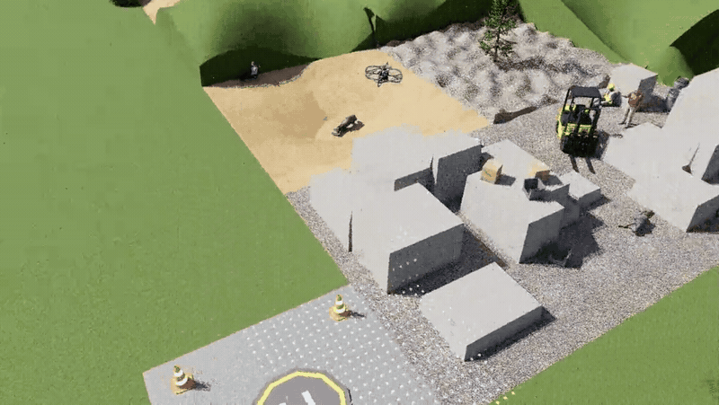
</p>

*The chase view of the demo mission: the landing pad and its cones, then the collapsed buildings, the forklift and
people. The glowing dots are the 441 mapping-ray hits; only this viewer camera draws them, never the drone camera
([`chase_view.py:146-159`](../sim/src/drone_lab/sar/chase_view.py#L146-L159)).*

### 4.1 Phases and speeds

`plan_mission` joins five fixed points and the lawnmower into one polyline, $[H,\ T,\ L_1, \dots, L_n,\ T,\ H,\ D]$:
$H$ is 0.5 m above the pad's top surface, $T$ the same point at the survey height $z_f$, and $D$ 5 cm above the pad's
top ([`mission.py:154-161`](../sim/src/drone_lab/sar/mission.py#L154-L161)). Each phase ends at one of these points.
The carrot's arclength $s$ picks the phase, and the phase sets the carrot speed
([`mission.py:87-97`](../sim/src/drone_lab/sar/mission.py#L87-L97),
[`mission.py:162-166`](../sim/src/drone_lab/sar/mission.py#L162-L166)). On site seed 0 the pad's top is at
(−23, −18, 0.049) and $z_f$ = 7.515 m, which gives 133 waypoints (derived by running `plan_mission`;
[`test_sar_mission.py:19-34`](../sim/tests/test_sar_mission.py#L19-L34) pins the end points and the 8 lines):

| Phase | Path | Length | Carrot speed | Set by |
|---|---|---|---|---|
| `takeoff` | straight up over the pad, z from 0.549 to 7.515 m | 6.97 m | 1.0 m/s | `--climb_speed` |
| `transit` | to the start of line 1 at (−20, −17.5) | 3.04 m | 1.5 m/s | `--speed` |
| `survey` | 8 lines of 40 m and 7 U-turns | 374.90 m | 1.5 m/s | `--speed` |
| `return` | from the end of line 8 at (−20, 17.5) back over the pad | 35.63 m | 1.5 m/s | `--speed` |
| `descent` | straight down to z = 0.549 m | 6.97 m | 0.8 m/s | `--descent_speed` |
| `touchdown` | towards z = 0.099 m | 0.45 m | 0.3 m/s | fixed |
| total | | 427.95 m | | |

The speeds are the defaults of [`sar_mission.py:66-71`](../sim/scripts/sar_mission.py#L66-L71); 0.3 m/s is a default
of `plan_mission`, not an option ([`mission.py:128-133`](../sim/src/drone_lab/sar/mission.py#L128-L133)). The transit
is a 3.04 m diagonal, 3 m east and 0.5 m north: the site puts the pad 3 m outside the area and level with the first line
of a 4 m lawnmower, the survey task's default (y = −18), while the mission's first 5 m line is at y = −17.5
([`commands_cfg.py:50`](../sim/src/drone_lab/tasks/survey/mdp/commands_cfg.py#L50),
[`sar_env_cfg.py:72-73`](../sim/src/drone_lab/tasks/sar/config/arl_robot_1/sar_env_cfg.py#L72-L73),
[`scenario.py:1020-1027`](../sim/src/drone_lab/sar/scenario.py#L1020-L1027)).

### 4.2 The flight-plan math

The math is in `prepare_mission` and `survey_geometry`
([`sar_mission.py:368-399`](../sim/scripts/sar_mission.py#L368-L399),
[`mission.py:190-225`](../sim/src/drone_lab/sar/mission.py#L190-L225)). Symbols: $s$ = line spacing (`--spacing`,
5 m), $a$ = clearance (`--altitude`, 4 m), $E$ = 40 m, the area's width across the lines, $f$ = 480 px and
$W \times H$ = 640 × 480 px for the camera ([`camera.py:51-57`](../sim/src/drone_lab/sar/camera.py#L51-L57)),
$v$ = flown speed, $r$ = 10 frames/s.

**Survey height.** The U-turns reach up to $s/2$ = 2.5 m beyond the area, so the highest terrain vertex is taken over
the area grown by a band $b = s/2 + 0.5$ = 3 m ([`sar_mission.py:377-379`](../sim/scripts/sar_mission.py#L377-L379),
[`scenario.py:378-382`](../sim/src/drone_lab/sar/scenario.py#L378-L382)):

$$z_f = \max_{\text{area} + b} z_{\text{terrain}} + a = 3.515 + 4 = 7.515\ \text{m}$$

The 3.515 m is the value in the code's docstrings ([`camera.py:9-13`](../sim/src/drone_lab/sar/camera.py#L9-L13)).
Building the terrain with Isaac Lab 3.0.0's generator on the CPU (`TerrainSite`,
[`scenario.py:345-357`](../sim/src/drone_lab/sar/scenario.py#L345-L357)) gives the same 3.515 m for the area alone and
for bands of 2.5 m and 3 m (derived); the test that pins 7.515 m does so for the survey task's 4 m spacing
and skips without Isaac Lab ([`test_sar_env_cfg.py:140-150`](../sim/tests/test_sar_env_cfg.py#L140-L150)). All
survey waypoints share this height ([`test_sar_mission.py:27`](../sim/tests/test_sar_mission.py#L27)).

**Lines.** `lawnmower` cuts the area into $n = \lceil E/s \rceil$ = 8 swaths of width $w = E/n$ = 5 m, with one line
along x through the middle of each, at $y_i = y_{min} + w\,(i + \frac12)$ = −17.5, −12.5, …, 17.5 m, flown in
alternating directions and joined by semicircles of radius $w/2$ = 2.5 m outside the area
([`paths.py:129-149`](../sim/src/drone_lab/paths.py#L129-L149)).

**Camera.** The camera hangs 0.1 m below the body and looks straight down; most of the site is at z = 0
([`camera.py:4-12`](../sim/src/drone_lab/sar/camera.py#L4-L12)). Over that ground, with $v$ = 1.25 m/s:

| Quantity | Formula | Value |
|---|---|---|
| camera height | $h = z_f - 0.1$ | 7.415 m |
| ground sample distance | $\mathrm{GSD} = h/f$ | 1.545 cm/px |
| footprint across the track (image width) | $W \cdot \mathrm{GSD}$ | 9.887 m |
| footprint along the track (image height) | $H \cdot \mathrm{GSD}$ | 7.415 m |
| side overlap | $(W \cdot \mathrm{GSD} - s)\,/\,(W \cdot \mathrm{GSD})$ | 4.887 m, 49.4 % |
| distance between frames | $v/r$ | 0.125 m |
| forward overlap | $1 - (v/r)\,/\,(H \cdot \mathrm{GSD})$ | 98.3 % |
| time a point stays in view | $H \cdot \mathrm{GSD}/v$ | 5.93 s |
| narrowest swath | $W\,(a - 0.1)/f$ | 5.20 m |

[`test_sar_mission.py:51-57`](../sim/tests/test_sar_mission.py#L51-L57) checks the footprints and the GSD and bounds
the side overlap, the narrowest swath and the forward overlap. The image width lies across the track because the lines
run along the drone's nose
([`mission.py:203-205`](../sim/src/drone_lab/sar/mission.py#L203-L205)). At 1.545 cm/px a lying adult is 26-29 px wide;
over the pit floor the GSD is 1.84 cm/px ([`camera.py:12-16`](../sim/src/drone_lab/sar/camera.py#L12-L16)). The
docstring there rounds the camera height and the GSD over flat ground to 7.4 m and 1.54 cm/px
([`camera.py:11-14`](../sim/src/drone_lab/sar/camera.py#L11-L14)).

The 5 m spacing meets three conditions ([`mission.py:11-14`](../sim/src/drone_lab/sar/mission.py#L11-L14)):

* neighbouring photo swaths overlap by 49.4 %;
* over the highest terrain point the camera is $a - 0.1$ = 3.9 m up and still sees a 5.2 m swath, so the photo map has
  no gap ([`sar_mission.py:397`](../sim/scripts/sar_mission.py#L397));
* the mapping scanner's grid is 5 m wide (21 × 21 rays, 0.25 m apart), so the outer rays of neighbouring lines meet and
  every ray row lies on the station's 0.25 m map lattice
  ([`survey_env_cfg.py:53-54`](../sim/src/drone_lab/tasks/survey/config/arl_robot_1/survey_env_cfg.py#L53-L54)).

The flown speed $v$ is an assumption in the script: `min(--speed, 1.25)` for the hover pilot, which tops out near
1.3 m/s (section 3.4), and `--speed` for the trajectory pilot
([`sar_mission.py:389-390`](../sim/scripts/sar_mission.py#L389-L390)).

### 4.3 The loop

`fly()` runs one iteration per policy step $k$ of 0.1 s ([`sar_mission.py:427-522`](../sim/scripts/sar_mission.py#L427-L522)).
It first resets the env, which puts the drone at rest on the first waypoint, and sets the time limit, by default
1.5 × path length / min(`--speed`, 1 m/s) + 60 s = 701.9 s
([`sar_mission.py:440-444`](../sim/scripts/sar_mission.py#L440-L444)). Then each step:

1. **Carrot speed.** The phase comes from the carrot's arclength before the step. The carrot waits for the first 15
   steps, so the drone hovers for `--settle` 1.5 s (after the spawn it dips about 15 cm,
   [`sim/README.md:347-348`](../sim/README.md#L347-L348)), then runs at the phase's speed
   ([`sar_mission.py:452-454`](../sim/scripts/sar_mission.py#L452-L454)).
2. **Policy.** `actions = policy(obs["policy"])` (section 3); after a touchdown, −1 on every rotor, which the thrust
   action maps to 0 N ([`sar_mission.py:455`](../sim/scripts/sar_mission.py#L455),
   [`sar_mission.py:158-159`](../sim/scripts/sar_mission.py#L158-L159)).
3. **Step.** A viewer's chase camera and scan dots are first placed from the previous step
   ([`sar_mission.py:456-459`](../sim/scripts/sar_mission.py#L456-L459)). `env.step` runs 10 physics steps, moves the
   carrot (section 3.4), computes the observations and renders the drone camera; the step's time is
   $t = (k+1) \cdot 0.1$ s ([`sar_mission.py:460-465`](../sim/scripts/sar_mission.py#L460-L465)).
4. **Checks** for a crash or a touchdown (4.4; [`sar_mission.py:466-479`](../sim/scripts/sar_mission.py#L466-L479)).
5. **Sensors.** It reads the root position and the 441 ray hits. In `transit`, `survey` and `return` a monitor keeps the
   closest distance to a ray hit and to any object's box but the pad's, trees included
   ([`sar_mission.py:480-482`](../sim/scripts/sar_mission.py#L480-L482),
   [`mission.py:252-305`](../sim/src/drone_lab/sar/mission.py#L252-L305)).
6. **Streaming.** TELEMETRY and SCAN every step, CAMERA every `--camera_every`-th step (default 1, so 10 Hz; section 5;
   [`sar_mission.py:483-490`](../sim/scripts/sar_mission.py#L483-L490)).
7. **Log and video.** A row of `trajectory.csv`; with `--video`, a frame of the viewer camera from the end of the
   settle on, so the default 10 fps plays in real time
   ([`sar_mission.py:491-501`](../sim/scripts/sar_mission.py#L491-L501),
   [`video.py:53-59`](../sim/src/drone_lab/video.py#L53-L59)).
8. **End checks** (4.4; [`sar_mission.py:511-516`](../sim/scripts/sar_mission.py#L511-L516)).

### 4.4 Touchdown and the end of the mission

`configure` removes the survey task's `collision` and `survey_complete` terminations: a touchdown is a contact, and the
end of the path is not the end of the mission ([`sar_mission.py:210-212`](../sim/scripts/sar_mission.py#L210-L212)).
The script decides itself, from the largest contact force on any of the drone's bodies
([`sar_mission.py:261-264`](../sim/scripts/sar_mission.py#L261-L264)):

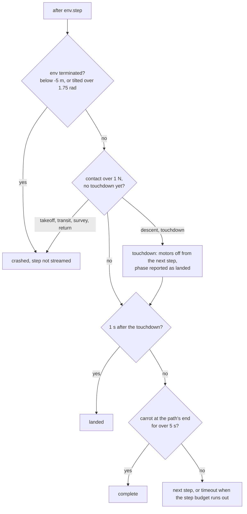

The env's own `crash` (z below −5 m) and `flipped` (tilt above 1.75 rad) still end the run; the env has then reset the
drone, so that step is not streamed
([`survey_env_cfg.py:161-166`](../sim/src/drone_lab/tasks/survey/config/arl_robot_1/survey_env_cfg.py#L161-L166),
[`sar_mission.py:466-469`](../sim/scripts/sar_mission.py#L466-L469)). A contact above 1 N is a crash outside `descent`
and `touchdown`, whatever was touched, and the touchdown inside them
([`sar_mission.py:470-479`](../sim/scripts/sar_mission.py#L470-L479)). The path ends 5 cm above the pad, "lower than the
drone's body allows", so the drone touches the pad before the carrot gets there
([`sim/README.md:97`](../sim/README.md#L97), [`mission.py:139-141`](../sim/src/drone_lab/sar/mission.py#L139-L141)).
The loop ends with `landed` 1 s after the touchdown, with `complete` if the carrot has waited at the path's end for
over 5 s (meant for a drone that hovers over the pad without touching it), with `timeout` (the default outcome) when
the step budget, `max_time` / 0.1 rounded up, runs out, and with `aborted` on Ctrl+C
([`sar_mission.py:511-519`](../sim/scripts/sar_mission.py#L511-L519),
[`sar_mission.py:296`](../sim/scripts/sar_mission.py#L296)). Then the script sends END, waits up to 5 s for the link to drain and writes its files
([`sar_mission.py:634-647`](../sim/scripts/sar_mission.py#L634-L647)).

### 4.5 Outputs

The run folder is `sim/runs/sar_mission_seed<seed>`, plus `_terrain<N>` on another terrain, or `sim/runs/<--out>`
(`--out` itself when it is a path) ([`sar_mission.py:170-173`](../sim/scripts/sar_mission.py#L170-L173)).

| File | Content |
|---|---|
| `mission.json` | `task`, `pilot`, `seed`, `terrain_seed`, `checkpoint`, `outcome`, `sim_time_s`, `wall_time_s`, `real_time_factor`; `plan` (home, area, `flight_z`, spacing, `length_m`, the waypoint count and the survey's index range, each phase's `start_m`, `end_m`, `speed_mps`); `survey_geometry` (the table of 4.2); `stats` (`closest_approach` to terrain and objects, `flight_time_s`, `touchdown_t`, `progress_pct`); `timing_ms` (mean, p50, p95, max of `env_step`, `streaming`, `viewer`, `video`); `loop_hz`; `camera_frames_sent`; `link` (the sender's counters, drops per type included); `link_mb_per_s`; `vram_peak_mib`; `created`; `command` ([`sar_mission.py:528-554`](../sim/scripts/sar_mission.py#L528-L554), [`mission.py:104-119`](../sim/src/drone_lab/sar/mission.py#L104-L119), [`sar_mission.py:634-639`](../sim/scripts/sar_mission.py#L634-L639)) |
| `trajectory.csv` | one row per step but a crash step (streamed or not): `t, phase, x, y, z, qx, qy, qz, qw, vx, vy, vz, cx, cy, cz` (root position, quaternion in Isaac Lab's x-y-z-w order, world velocity, carrot) ([`sar_mission.py:491-494`](../sim/scripts/sar_mission.py#L491-L494), [`sar_mission.py:556-559`](../sim/scripts/sar_mission.py#L556-L559)) |
| `ground_truth.json` | the site's ground truth (every object's class, box, pose and ground height; area, terrain, pad, survey, camera), written before the flight from the site Isaac Sim spawned if it differs from the CPU copy ([`sar_mission.py:610-614`](../sim/scripts/sar_mission.py#L610-L614), [`scenario.py:450-531`](../sim/src/drone_lab/sar/scenario.py#L450-L531)) |
| `mission.mp4`, `mission_frames.csv` | with `--video`: the viewer camera's H.264 video and the simulation time of every frame, which the ground station's `compose_video.py` uses to line up the two videos ([`sar_mission.py:560-564`](../sim/scripts/sar_mission.py#L560-L564), [`video.py:46-50`](../sim/src/drone_lab/video.py#L46-L50)) |

### 4.6 The demo mission in time (site seed 0)

The README reports the recorded demo mission (both windows open, the chase view recorded, the fine-tuned detector):
take-off to touchdown in 6 min 16 s along a 428 m path, landed 7 mm from the pad's centre
([`sim/README.md:23`](../sim/README.md#L23), [`sim/README.md:131-134`](../sim/README.md#L131-L134)). The README's
results call this run the recorded live mission ([`README.md:83`](../README.md#L83)), the name sections 10 and 11 use.
No run folder of that flight is in the repository. The derived times below divide each phase's length by a speed:
the carrot speed on the vertical phases, and on the level ones the 1.16 m/s that survey runs measured for a 1.5 m/s
carrot (456.5 m in 392 s; [`sim/README.md:330`](../sim/README.md#L330),
[`sim/README.md:335-337`](../sim/README.md#L335-L337)).

| Sim time [s] | What happens | Source |
|---|---|---|
| 0-1.5 | at rest 0.5 m over the pad; settle hover, the carrot waits | 4.3 |
| 1.5-8.5 | `takeoff`: 6.97 m climb at 1.0 m/s | derived |
| 8.5-11.1 | `transit` to the start of line 1 | derived |
| 11.1-334.3 | `survey`: 8 lines of 34.5 s, the first eastward at y = −17.5 m, and 7 U-turns of 6.8 s | derived |
| 75 | demo-video frame: three people and the forklift boxed, five people pinned; the derived schedule puts the drone on line 2 near x = −6 m, about 2.3 m from the forklift at (−8.46, −13.16) | [`sim/README.md:70-73`](../sim/README.md#L70-L73), [`test_sar_scenario.py:213`](../sim/tests/test_sar_scenario.py#L213) |
| 334.3-365.0 | `return` to the top of the climb over the pad | derived |
| 365.0-373.7 | `descent` at 0.8 m/s | derived |
| about 374-375 | `touchdown` at 0.3 m/s: first contact, motors off | derived, 4.4 |
| touchdown + 1 | outcome `landed`; END sent, files written | 4.4 |
| 376 (6 min 16 s) | reported take-off to touchdown | [`sim/README.md:23`](../sim/README.md#L23) |

The derived schedule ends at about 375 s, close to the reported 376 s. At the 1.25 m/s of the overlap math it would end
at 349.5 s, and at the carrot's own speeds at 294 s; the hover pilot's speed limit (section 3.4) accounts for the
difference. Over the survey the drone held 7.68 m (standard deviation 0.10 m; planned 7.515 m) and tilted 0.7° on
average; its closest approach to an obstacle was 2.4 m, a tree crown
([`sim/README.md:132-138`](../sim/README.md#L132-L138)). With the window, the video and the ground station on one
machine the simulation ran at 14.5 steps/s, 1.45 × real time, so the flight took about 260 s of wall time (derived);
the step with the RTX render took 61 ms and the link 0.9 ms ([`sim/README.md:138-141`](../sim/README.md#L138-L141)).

The README does not say how it measured "7 mm", "6 min 16 s" and "428 m". The ground station's LANDED card shows three
such numbers: the horizontal distance from the last telemetry position to MISSION `home`, the touchdown time from the
first message (settle included), and the length of the trail flown
([`dashboard.py:872-881`](../gcs/drone_gcs/dashboard.py#L872-L881),
[`state.py:219-225`](../gcs/drone_gcs/state.py#L219-L225), [`state.py:561-568`](../gcs/drone_gcs/state.py#L561-L568)).

### Questions an advisor might ask

**Why 7.515 m, and one height for the whole survey?** It is the highest terrain vertex of the area and its turn band
plus 4 m ([`sar_mission.py:377-379`](../sim/scripts/sar_mission.py#L377-L379)), so every survey waypoint is at least
4 m above the terrain. The ground sample distance then follows the ground: 1.545 cm/px over flat ground, 1.84 cm/px
over the pit floor ([`camera.py:14`](../sim/src/drone_lab/sar/camera.py#L14)).

**The clearance is 4 m. Why was the closest approach 2.4 m?** The 4 m is over the terrain, and objects stand on it.
The site rejects a tree whose top comes within 2 m of the flight height
([`scenario.py:110`](../sim/src/drone_lab/sar/scenario.py#L110),
[`scenario.py:682-685`](../sim/src/drone_lab/sar/scenario.py#L682-L685)), the clearance monitor counts trees
([`mission.py:258-264`](../sim/src/drone_lab/sar/mission.py#L258-L264)), and the 2.4 m was a tree crown
([`sim/README.md:138`](../sim/README.md#L138)).

**The overlap math assumes 1.25 m/s, the drone flies about 1.16 m/s. Does it matter?** Not for coverage: a slower drone
takes its frames closer together, 0.116 m apart, 98.4 % forward overlap, 6.4 s in view (derived with
[`mission.py:211-221`](../sim/src/drone_lab/sar/mission.py#L211-L221)). It does set the mission's length: 375 s
instead of 349.5 s (4.6).

**How is a landing told from a crash?** By the phase at the first contact above 1 N: in `descent` or `touchdown` it is
the touchdown, in any other phase a collision. Flips and falls end the run through the env, and a drone that never
touches ends as `complete` (4.4; [`sar_mission.py:466-479`](../sim/scripts/sar_mission.py#L466-L479),
[`sar_mission.py:511-516`](../sim/scripts/sar_mission.py#L511-L516)).

**Does the plan change with the site seed?** Not on the standard terrain. The pad's position depends only on the area
and the 4 m spacing, and the height only on the terrain, so every site seed flies the same 427.95 m
([`scenario.py:1020-1027`](../sim/src/drone_lab/sar/scenario.py#L1020-L1027),
[`sar_mission.py:375-379`](../sim/scripts/sar_mission.py#L375-L379)). `--terrain_seed` changes the terrain and with it
the height ([`mission.py:179-187`](../sim/src/drone_lab/sar/mission.py#L179-L187)).

## 5. The link

The simulator and the ground station are two processes in two conda environments
([`sim/README.md:32-33`](../sim/README.md#L32-L33)), joined by one stream socket. The link runs one way: the simulator
sends, the station never answers ([`PROTOCOL.md:3-5`](../gcs/PROTOCOL.md#L3-L5)). `gcs/drone_gcs/protocol.py` defines
the frames, and `gcs/drone_gcs/link.py` the `Sender` and the `Receiver`. Both need only the standard library and numpy,
so the sender imports inside Isaac Sim's Python ([`gcs/README.md:193-194`](../gcs/README.md#L193-L194)). The station
listens and accepts any number of senders; the simulator connects and reconnects. The default address is the UNIX
socket `$XDG_RUNTIME_DIR/drone_gcs.sock`, else `/tmp/drone_gcs-<uid>.sock`; TCP on port 47800 works across machines,
and `$DRONE_GCS_ADDR` overrides both ends ([`link.py:65-79`](../gcs/drone_gcs/link.py#L65-L79)).

### 5.1 What the simulator sends

`sar_mission.py` sends through `IsaacLabStreamer`, which copies env 0's row off the GPU, subtracts the env's origin and
reorders Isaac Lab's (x, y, z, w) quaternions to the wire's (w, x, y, z)
([`sar_mission.py:618`](../sim/scripts/sar_mission.py#L618),
[`isaac_bridge.py:58-66`](../gcs/drone_gcs/isaac_bridge.py#L58-L66),
[`isaac_bridge.py:136-209`](../gcs/drone_gcs/isaac_bridge.py#L136-L209)).

| Message | When | Key fields in the mission | Frame size |
|---|---|---|---|
| HELLO | first frame of every connection, from the sender's thread | sender name, protocol 1, pid, host, Python and numpy versions | 0.3 kB |
| MISSION | once, before the flight; latched | `area`, `resolution` 0.25 m, `planned_path` (133 × 3 float64), `survey_altitude`, `mission_id` `sar-seed0-<date>-<time>`, `name`, `ground_z` (the pad's top), `z_range`, `home`, `pattern`, `spacing`, `speed`, `phases`, `seed`, `terrain_seed` | 4.2 kB |
| GT_OBJECTS | once; latched; for scoring only | the 41 labelled objects: `id`, `class`, `pos` (footprint centre at ground level), `size`, `yaw`, `pose`, `top_z`; no trees | 5.7 kB |
| GT_TERRAIN | once; latched; for scoring only | true heights, 209 × 209 float32, on the 0.25 m lattice of the whole site, −26 to 26 m | 175 kB |
| TELEMETRY | every step, 10 Hz | `t`, `pos`, `quat`, `vel`, `ang_vel`, `wp_index`, `carrot`, `phase` | 0.6 kB |
| SCAN | every step, 10 Hz | `t`, `points` (441 × 3 float32 ray hits, `inf` = miss), `origin` | 5.7 kB |
| CAMERA | every `--camera_every`-th step, by default 10 Hz | `t`, `rgb` (480 × 640 × 3 uint8), `depth` (480 × 640 float32, distance to the image plane), `K`, `pos` and `quat` of the ROS-optical camera frame, `frame_id`; `gt_boxes` with `--gt_boxes` | 2.15 MB |
| END | once, after the flight | `reason` (the outcome), `t`, `stats` | 0.5 kB |

Code: [`sar_mission.py:402-424`](../sim/scripts/sar_mission.py#L402-L424),
[`sar_mission.py:483-490`](../sim/scripts/sar_mission.py#L483-L490),
[`sar_mission.py:634-642`](../sim/scripts/sar_mission.py#L634-L642),
[`mission.py:228-249`](../sim/src/drone_lab/sar/mission.py#L228-L249),
[`link.py:487-709`](../gcs/drone_gcs/link.py#L487-L709), [`link.py:799-814`](../gcs/drone_gcs/link.py#L799-L814);
the 41 objects of seed 0: [`gcs/README.md:637-638`](../gcs/README.md#L637-L638).
The sizes are derived by encoding one message of each type with the mission's shapes: the buffers are exact, the JSON
headers vary by a few bytes. The sender stamps the last MISSION's `mission_id` into every TELEMETRY, SCAN, CAMERA and
END, and the station ignores data of another mission ([`link.py:725-733`](../gcs/drone_gcs/link.py#L725-L733),
[`state.py:288-303`](../gcs/drone_gcs/state.py#L288-L303)). `t` is simulation time, $(k+1) \cdot 0.1$ s, not wall time
([`PROTOCOL.md:53`](../gcs/PROTOCOL.md#L53)).

**Volume.** A camera frame is 921,600 B of RGB plus 1,228,800 B of depth: 2,150,400 B
([`PROTOCOL.md:35-36`](../gcs/PROTOCOL.md#L35-L36)). With TELEMETRY and SCAN a step is about 2.157 MB, 21.6 MB per
second of simulation. The README gives "about 22 MB per second of flight (45 MB/s on the local UNIX socket when a
headless run goes at 2x real time)" and 8.1 GB per mission ([`sim/README.md:99-102`](../sim/README.md#L99-L102),
[`gcs/README.md:674`](../gcs/README.md#L674)); 8.1 GB is about 3,750 steps, the 375 s of 4.6 (derived).
`--camera_every N` sends every N-th frame, though the camera still renders every step. `--jpeg` compresses the RGB
image (quality 90, in the sender's thread) but not the depth, so at least 1.23 MB per frame remain; the repository
does not measure the JPEG sizes ([`sar_mission.py:81-82`](../sim/scripts/sar_mission.py#L81-L82),
[`sar_mission.py:487`](../sim/scripts/sar_mission.py#L487), [`link.py:349`](../gcs/drone_gcs/link.py#L349),
[`link.py:652`](../gcs/drone_gcs/link.py#L652)).

### 5.2 The DGC1 frame

Every message is one length-prefixed frame ([`protocol.py:6-23`](../gcs/drone_gcs/protocol.py#L6-L23),
[`protocol.py:37-44`](../gcs/drone_gcs/protocol.py#L37-L44)):

```text
offset   size          field
0        4             magic b"DGC1"
4        4             header_len    uint32, little-endian
8        8             payload_len   uint64, little-endian
16       header_len    header: UTF-8 JSON object
16 + H   payload_len   payload: the raw buffers, each at an 8-byte-aligned offset
```

* **Header.** `{"proto": "drone_gcs", "v": 1, "type", "seq", "drone_id", "sender", "wall_time", "fields", "buffers"}`
  as compact JSON; non-finite floats in `fields` become `null`
  ([`protocol.py:261-272`](../gcs/drone_gcs/protocol.py#L261-L272),
  [`protocol.py:70-80`](../gcs/drone_gcs/protocol.py#L70-L80)). `seq` counts up per sender, also across reconnects;
  `wall_time` is the sender's clock ([`PROTOCOL.md:45-46`](../gcs/PROTOCOL.md#L45-L46)).
* **Buffers.** Each array has a descriptor `{name, dtype, shape, offset, nbytes, encoding}`. `dtype` is numpy's explicit
  type string such as `<f4` or `|u1`; only bool, int, uint and float are allowed, nothing is pickled, and zero padding
  puts each buffer on a multiple of 8 bytes ([`protocol.py:63`](../gcs/drone_gcs/protocol.py#L63),
  [`protocol.py:213-277`](../gcs/drone_gcs/protocol.py#L213-L277); a CAMERA header:
  [`PROTOCOL.md:29-37`](../gcs/PROTOCOL.md#L29-L37)).
* **JPEG.** With `encoding: "jpeg"` the buffer holds the compressed bytes and `shape` is the decoded shape; without
  OpenCV or PIL the encoder falls back to raw ([`protocol.py:134-157`](../gcs/drone_gcs/protocol.py#L134-L157),
  [`protocol.py:236-239`](../gcs/drone_gcs/protocol.py#L236-L239)).
* **Decoding.** The receiver checks the magic, refuses headers over 8 MiB and payloads over 1 GiB, checks `proto` and
  `v == 1`, and checks that every buffer lies inside the payload and that a raw buffer's shape times its item size
  equals `nbytes`. Raw buffers become zero-copy numpy views of the received bytes
  ([`protocol.py:285-355`](../gcs/drone_gcs/protocol.py#L285-L355)).

### 5.3 Sender and receiver threads

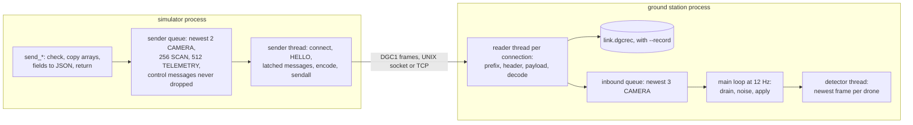

**Sender.** `send_*` runs on the simulation's thread and never raises. It checks the input, copies the arrays, turns
the fields into plain JSON values, so tensors the simulator overwrites next step are safe, and queues the message; bad
input returns `False` and a rate-limited log line ([`link.py:455-485`](../gcs/drone_gcs/link.py#L455-L485),
[`link.py:303-305`](../gcs/drone_gcs/link.py#L303-L305), [`link.py:712-716`](../gcs/drone_gcs/link.py#L712-L716)).
The README measured 0.9 ms per step for this ([`gcs/README.md:674`](../gcs/README.md#L674)). One daemon thread,
`drone_gcs-sender`, does the rest ([`link.py:829-862`](../gcs/drone_gcs/link.py#L829-L862)):

1. It connects (8 MiB send buffer, 5 s write timeout), retrying after 0.2 s and 1.6 times longer after each further
   failure, up to 2 s ([`link.py:345-350`](../gcs/drone_gcs/link.py#L345-L350),
   [`link.py:737-762`](../gcs/drone_gcs/link.py#L737-L762), [`link.py:836-841`](../gcs/drone_gcs/link.py#L836-L841)).
2. After every connect it writes HELLO, then the latched MISSION, GT_OBJECTS and GT_TERRAIN under which the next queued
   message was sent ([`link.py:799-827`](../gcs/drone_gcs/link.py#L799-L827)).
3. It writes the queue, oldest first, in the order of the `send_*` calls
   ([`link.py:209-246`](../gcs/drone_gcs/link.py#L209-L246), [`link.py:773-797`](../gcs/drone_gcs/link.py#L773-L797)).
   On a socket error it reconnects; the frame being written is lost if it is data and queued again if it is a control
   message ([`link.py:848-855`](../gcs/drone_gcs/link.py#L848-L855)).

**Receiver.** `scripts/gcs.py` builds a `Receiver` ([`app.py:264-267`](../gcs/drone_gcs/app.py#L264-L267)). It refuses
to start when another station listens on the socket, and removes a stale socket file left by a crashed one
([`link.py:908-946`](../gcs/drone_gcs/link.py#L908-L946)). An accept thread gives each connection a reader thread,
`drone_gcs-rx<id>`, with an 8 MiB receive buffer ([`link.py:1013-1033`](../gcs/drone_gcs/link.py#L1013-L1033)). The
reader reads exactly 16 bytes, then the header and the payload, decodes the frame, records it if asked, stamps the
receive time and queues the message; a protocol error closes the connection, and the sender reconnects
([`link.py:1056-1084`](../gcs/drone_gcs/link.py#L1056-L1084)). The station's main loop drains the queue 12 times a
second (sections 7 to 9; [`app.py:505-515`](../gcs/drone_gcs/app.py#L505-L515)).

### 5.4 What is dropped when the station falls behind

Nothing blocks the simulation; old data is dropped instead, in three places:

| Where | What it keeps | Counted in |
|---|---|---|
| sender queue: the station reads too slowly, or is not there | the newest 2 CAMERA, 256 SCAN and 512 TELEMETRY messages, that is 0.2 s, 25.6 s and 51.2 s of flight; MISSION, GT_OBJECTS, GT_TERRAIN and END are never dropped | `mission.json` → `link.dropped_by_type` |
| station's inbound queue: the main loop falls behind | the newest 3 CAMERA frames; other data types up to 200,000 messages each | `summary.json` → `gcs.link_dropped` |
| detector thread: inference is slower than the frames | the newest frame per drone (section 6) | `summary.json` → `gcs.detector_dropped_frames` |

Code: [`link.py:341-344`](../gcs/drone_gcs/link.py#L341-L344), [`link.py:172-198`](../gcs/drone_gcs/link.py#L172-L198),
[`link.py:880-888`](../gcs/drone_gcs/link.py#L880-L888), [`detector.py:377-384`](../gcs/drone_gcs/detector.py#L377-L384),
[`app.py:594-598`](../gcs/drone_gcs/app.py#L594-L598), [`sar_mission.py:643`](../sim/scripts/sar_mission.py#L643).
A full queue drops the oldest message of its type. The sender's 256 MiB byte budget (CAMERA dropped first, then SCAN,
then TELEMETRY) never binds here, as the limits above cap the queue at about 6 MB (derived;
[`link.py:68`](../gcs/drone_gcs/link.py#L68), [`link.py:186-196`](../gcs/drone_gcs/link.py#L186-L196)). If the station
stops reading, the sender's thread blocks at most 5 s per write call, "up to about 3 × 5 s per frame", then resets the
connection ([`PROTOCOL.md:246-248`](../gcs/PROTOCOL.md#L246-L248)). The station itself drops only camera frames: every
scan reaches the elevation map, every frame that leaves the inbound queue the photo map, and the detector's skips cost
only detections. The README reports 0 messages dropped in every Isaac Sim run
([`gcs/README.md:674`](../gcs/README.md#L674)).

A station that starts late, or restarts mid-mission, gets HELLO, the latched messages, then what is still queued (up to
51.2 s of telemetry, 25.6 s of scans, 2 frames), and starts a new, empty map
([`PROTOCOL.md:241-245`](../gcs/PROTOCOL.md#L241-L245); tests
[`test_link.py:134-151`](../gcs/tests/test_link.py#L134-L151),
[`test_link.py:153-168`](../gcs/tests/test_link.py#L153-L168),
[`test_link.py:190-214`](../gcs/tests/test_link.py#L190-L214)).

### 5.5 Recording, replay and noise

`gcs.py --record` saves the link to `<run>/link.dgcrec`, or to a given path, gzipped at level 1 if it ends in `.gz`:
the magic `DGCREC1\n`, then per frame the receive time (float64), the connection id (uint32) and the frame as received
([`recording.py:4-15`](../gcs/drone_gcs/recording.py#L4-L15), [`app.py:260-261`](../gcs/drone_gcs/app.py#L260-L261)).
The reader thread writes it before the inbound queue can drop a camera frame, so the recording is complete even where
the live station fell behind ([`link.py:1068-1069`](../gcs/drone_gcs/link.py#L1068-L1069),
[`test_recording.py:345`](../gcs/tests/test_recording.py#L345)). `gcs.py --replay FILE` reads it in place of the socket
([`app.py:177-244`](../gcs/drone_gcs/app.py#L177-L244)). At `--replay-speed 0`, the default, the replay is lossless:
after every CAMERA the station waits for the detector and applies its result, so a recording and its settings give the
same report on any computer ([`app.py:432-446`](../gcs/drone_gcs/app.py#L432-L446),
[`test_recording.py:500`](../gcs/tests/test_recording.py#L500)); above 0 the messages are paced by their recorded
receive times, as on a live link. An Isaac Sim mission would make about 8.1 GB, and none has been recorded and replayed
yet ([`gcs/README.md:314-317`](../gcs/README.md#L314-L317)). The details are in the ground station's README,
[Record and replay](../gcs/README.md#record-and-replay).

`--noise SPEC`, for example `pos=0.5,att=1,depth=0.02,seed=1`, perturbs TELEMETRY, SCAN and CAMERA as they arrive,
before the station applies them: a navigation error per drone and time step, made of a drifting first-order
Gauss-Markov part (30 s correlation time by default) and a white part, plus depth noise and dropout, height noise on
the ray hits and a camera time lag, while the ground truth is never changed
([`noise.py:1-13`](../gcs/drone_gcs/noise.py#L1-L13), [`noise.py:42-55`](../gcs/drone_gcs/noise.py#L42-L55),
[`app.py:413-414`](../gcs/drone_gcs/app.py#L413-L414)). It is meant for replaying one recording at many noise levels
with `scripts/noise_sweep.py`, and section 12.2 reports those sweeps.

### Questions an advisor might ask

**Can a slow ground station slow the simulation down?** No: `send_*` copies and returns, and a background thread
writes ([`link.py:13-19`](../gcs/drone_gcs/link.py#L13-L19)). The README measured 0.9 ms per step (p95 1.1 ms), and a
test against a station that never reads keeps every call under 50 ms ([`gcs/README.md:674`](../gcs/README.md#L674),
[`test_link.py:233-254`](../gcs/tests/test_link.py#L233-L254)). The price is dropped frames (5.4).

**Why this format, and not pickled arrays?** Arrays travel as raw little-endian bytes, with an explicit dtype and shape
in a JSON header. Nothing is pickled, so the two ends may run different numpy versions, and the sender needs only the
standard library and numpy ([`PROTOCOL.md:39-41`](../gcs/PROTOCOL.md#L39-L41),
[`protocol.py:20-23`](../gcs/drone_gcs/protocol.py#L20-L23)).

**What if the station starts after the drone, or crashes mid-mission?** The mission waits up to `--wait_gcs` 10 s on
the pad, then flies anyway ([`sar_mission.py:619-621`](../sim/scripts/sar_mission.py#L619-L621)). A station that
connects later gets the latched messages first and starts an empty map (5.4); `mission_id` keeps another mission's data
off it ([`state.py:288-303`](../gcs/drone_gcs/state.py#L288-L303)).

**Does a replay give the same result as the live run?** A lossless replay gives the same result every time, on any
computer. It can differ from a live run whose detector skipped frames: the maps are the same, the pins may not be
([`gcs/README.md:310-313`](../gcs/README.md#L310-L313)). Section 12.1 checks this on a stand-in recording.

## 6. Finding people with YOLO

The ground station finds people, and six kinds of objects, in the drone's camera frames with a YOLO26n detector: the
nano model of the Ultralytics YOLO26 family, fine-tuned from its COCO weights on renders of the simulated disaster
site. Nothing was labelled by hand ([`gcs/README.md:447-448`](../gcs/README.md#L447-L448)): Isaac Sim renders every
training frame together with an instance-segmentation image that says, for each pixel, which labelled object it
shows, and a converter turns that into YOLO boxes. The subsections follow the data; 6.7 is short background on what a
YOLO network outputs and on non-maximum suppression. Section 7 turns the boxes into pins on the map.

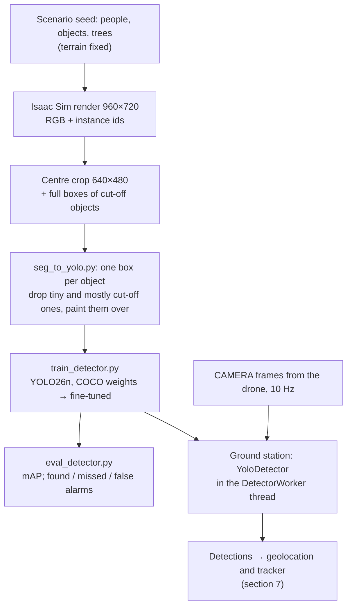

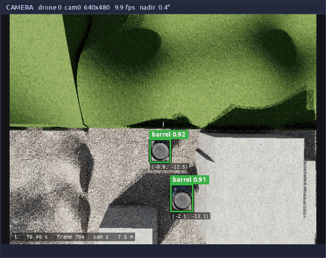

*The ground station's camera panel during the recorded Isaac Sim mission
([`gcs/README.md:444-445`](../gcs/README.md#L444-L445)). Each box shows its class and confidence, and under it the map
position (x, y in metres) this one box geolocates to; a box at the image border is drawn thin, marked "edge" and not
mapped ([`dashboard.py:830-839`](../gcs/drone_gcs/dashboard.py#L830-L839)).*

### 6.1 What the detector has to do

**Input.** One RGB frame of the downward camera: 640 × 480 px, focal length $f$ = 480 px, looking straight down
([`camera.py:47-60`](../sim/src/drone_lab/sar/camera.py#L47-L60); section 2 describes the camera). The simulator sends
10 frames a second by default ([`sar_mission.py:81`](../sim/scripts/sar_mission.py#L81)). At the survey height the
camera is $h$ = 7.415 m above flat ground, so one pixel covers $h/f$ = 1.545 cm
([`camera.py:9-14`](../sim/src/drone_lab/sar/camera.py#L9-L14)).

**Output.** Boxes of seven classes. The id order is `CLASSES` in
[`assets.py:31-35`](../sim/src/drone_lab/sar/assets.py#L31-L35); the converter's `--classes` list repeats it (6.3), and
the trained model's class names are in the same order (checkpoint). Assets:
[`assets.py:94-226`](../sim/src/drone_lab/sar/assets.py#L94-L226).

| id | class | in the scene |
|---|---|---|
| 0 | person | 10 Isaac Sim characters, posed |
| 1 | vehicle | a forklift |
| 2 | crate | two cardboard boxes, two plastic crates, a 1 m plywood crate |
| 3 | barrel | two plastic barrels |
| 4 | pallet | two pallet models |
| 5 | cone | a traffic cone, scaled to 0.69 m |
| 6 | landing_pad | the helipad the drone starts from |

Trees get no label: they only hide things ([`assets.py:37`](../sim/src/drone_lab/sar/assets.py#L37)).

**People seen from above.** A site holds 6-10 victims and, with the default "natural" people, 2-3 responders
([`scenario.py:73-83`](../sim/src/drone_lab/sar/scenario.py#L73-L83)). Victims lie on their back or side, sit, or stand
and wave; responders stand looking around, point or walk; each of the 8 base poses also exists mirrored, 16 in all
([`scenario.py:132-135`](../sim/src/drone_lab/sar/scenario.py#L132-L135),
[`people.py:314-318`](../sim/src/drone_lab/sar/people.py#L314-L318)). At the survey height a lying adult is 104-117 px
long and 26-29 px wide ([`camera.py:15-18`](../sim/src/drone_lab/sar/camera.py#L15-L18)). From straight above, a
standing person is the top of the head and the shoulders ([`gcs/README.md:493`](../gcs/README.md#L493)): a blob about as
wide as the shoulders, which stand nearer the camera and so look a little wider than a lying person's 26-29 px.
The README's explanation of why the stock COCO model misses most of them: it learned people from photos taken at eye
level ([`gcs/README.md:494-495`](../gcs/README.md#L494-L495)).

### 6.2 Rendering the training images in Isaac Sim

[`gen_yolo_dataset.py`](../sim/scripts/gen_yolo_dataset.py) starts one simulator (task `DroneLab-SAR-ARL-Robot-1-v0`)
and renders many sites in it ([`gen_yolo_dataset.py:68`](../sim/scripts/gen_yolo_dataset.py#L68),
[`:367-379`](../sim/scripts/gen_yolo_dataset.py#L367-L379)). A **site** is the survey terrain dressed by one scenario
seed: the seed places the people, objects and trees; the terrain is the same for every seed, because its generator
seed is fixed at 17 ([`gen_yolo_dataset.py:3-6`](../sim/scripts/gen_yolo_dataset.py#L3-L6),
[`terrain.py:137-138`](../sim/src/drone_lab/terrain.py#L137-L138)). Each split is a set of whole sites, and a seed
listed in two splits stops the script ([`gen_yolo_dataset.py:100-104`](../sim/scripts/gen_yolo_dataset.py#L100-L104),
[`:323-328`](../sim/scripts/gen_yolo_dataset.py#L323-L328)):

| split | scenario seeds | views per site | frames |
|---|---|---|---|
| train | 1000-1035 (36 sites) | 45 random views | 1620 |
| val | 2000-2006 (7 sites) | 45 random views | 315 |
| test | 0, the demo mission's site | one every 2.5 m along the survey path | 183 |

The 183 test frames are the points every 2.5 m along the 456.5 m lawnmower path (computed with the repository's
`drone_lab.paths`); 2118 frames in all, rendered in "about 7 min"
([`gen_yolo_dataset.py:27`](../sim/scripts/gen_yolo_dataset.py#L27)). That path has the survey task's default line
spacing of 4 m, not the 5 m of the mission's plan in section 4
([`capture.py:214`](../sim/src/drone_lab/sar/capture.py#L214),
[`sar_env_cfg.py:73`](../sim/src/drone_lab/tasks/sar/config/arl_robot_1/sar_env_cfg.py#L73),
[`commands_cfg.py:49`](../sim/src/drone_lab/tasks/survey/mdp/commands_cfg.py#L49)).

**The drone is placed, not flown.** With all terminations removed, the script writes the drone's pose for each view
into the simulator and holds it for 2 environment steps with zero action before it reads the camera
([`gen_yolo_dataset.py:150-164`](../sim/scripts/gen_yolo_dataset.py#L150-L164),
[`:233-234`](../sim/scripts/gen_yolo_dataset.py#L233-L234), [`:360-361`](../sim/scripts/gen_yolo_dataset.py#L360-L361);
2 is the `--warmup` default, [`:108`](../sim/scripts/gen_yolo_dataset.py#L108)).
Views, light and ground of a site come from three random streams seeded with (`--rng_seed`, site seed, k), so they do
not depend on the other sites of the run ([`gen_yolo_dataset.py:376`](../sim/scripts/gen_yolo_dataset.py#L376)).

**Random views** (train and val, [`capture.py:153-199`](../sim/src/drone_lab/sar/capture.py#L153-L199)):

* height above the ground under the drone $h \sim U(5, 12)$ m;
* a tilt off nadir of $U(0°, 15°)$ in a random direction, and a heading of $U(-180°, 180°)$;
* with probability 0.65 the view is aimed at a labelled object $i$, drawn with weight
  $w_i \propto \beta_i / \sqrt{n_{c(i)}}$, where $n_c$ is the number of objects of class $c$ on the site and
  $\beta$ (`person_weight`) is 1.5 for people, else 1, so rare classes and people get more views
  ([`capture.py:134-140`](../sim/src/drone_lab/sar/capture.py#L134-L140)). The object lands anywhere in the image, up
  to 10 % of the image size past its edge, so cut-off objects are part of the data
  ([`capture.py:165-166`](../sim/src/drone_lab/sar/capture.py#L165-L166),
  [`:180-187`](../sim/src/drone_lab/sar/capture.py#L180-L187)). Otherwise the view is anywhere over the survey area
  grown by 4 m ([`:189-192`](../sim/src/drone_lab/sar/capture.py#L189-L192));
* the view stays far enough inside the site that at most the corners of a high view show the void beyond it, and at
  least 1.5 m above the crown of any tree it would sit in
  ([`capture.py:143-150`](../sim/src/drone_lab/sar/capture.py#L143-L150),
  [`:193-197`](../sim/src/drone_lab/sar/capture.py#L193-L197)).

**Test views** copy the mission: a point every 2.5 m along the default lawnmower path at the survey height, a tilt of at
most 4°, the nose along +X with a heading jitter of $N(0, 2°)$, and the mission's light and ground
([`capture.py:202-223`](../sim/src/drone_lab/sar/capture.py#L202-L223),
[`gen_yolo_dataset.py:381-394`](../sim/scripts/gen_yolo_dataset.py#L381-L394)).

**Light and ground.** Train and val frames vary both. The light is drawn per frame
([`capture.py:231-255`](../sim/src/drone_lab/sar/capture.py#L231-L255)):

| case | share | sun intensity | sky intensity |
|---|---|---|---|
| mission light | 30 % | 2000 | 800 |
| overcast | 15 % | 2000 × U(0.1, 0.3) | 800 × U(1.2, 1.6) |
| sun | 55 % | 2000 × U(0.7, 1.3) | 800 × U(0.7, 1.3) |

The last two cases also give the sun a random azimuth and a random warm tint; its elevation stays at 43°
([`capture.py:10-11`](../sim/src/drone_lab/sar/capture.py#L10-L11),
[`:238-240`](../sim/src/drone_lab/sar/capture.py#L238-L240)). The ground look is drawn once per site: with probability
0.5 the four terrain materials (grass, soil, gravel, concrete) are shuffled among the terrain types, and each gets a
brightness factor U(0.8, 1.2) and a texture-scale factor U(0.8, 1.25)
([`capture.py:258-268`](../sim/src/drone_lab/sar/capture.py#L258-L268)).

**A wider render, then a crop.** The camera renders 960 × 720 px, 160 px more on the left and right and 120 px more at
the top and bottom, with the same focal length and a centred principal point
([`gen_yolo_dataset.py:358-359`](../sim/scripts/gen_yolo_dataset.py#L358-L359),
[`capture.py:276-286`](../sim/src/drone_lab/sar/capture.py#L276-L286)). The centre 640 × 480 crop is exactly the
mission camera's image ([`capture.py:289-291`](../sim/src/drone_lab/sar/capture.py#L289-L291)). For every object on the
crop's border, `unclipped_boxes` returns its full box from the margin, in crop coordinates (it may be negative or beyond
639 / 479); an object that also leaves the larger render gets a lower bound
([`capture.py:294-311`](../sim/src/drone_lab/sar/capture.py#L294-L311)).

**Files.** Per frame: `rgb_<key>.png`, `instance_<key>.png` (16-bit instance ids) and `instance_<key>.json` with the
id → class map (`idToSemantics`), the full boxes of cut-off objects (`bboxUnclipped`), the view, the light and the
camera pose ([`gen_yolo_dataset.py:256-272`](../sim/scripts/gen_yolo_dataset.py#L256-L272)).

**Label check.** The script projects every labelled object's 3D centre into each frame and checks that the instance
under it has the object's class, and writes the counts per site to `seed_<n>.json`
([`gen_yolo_dataset.py:275-307`](../sim/scripts/gen_yolo_dataset.py#L275-L307),
[`:404-420`](../sim/scripts/gen_yolo_dataset.py#L404-L420)). UNVERIFIED: the results for the shipped dataset, because
`datasets/` is git-ignored ([`.gitignore:19`](../.gitignore#L19)).

### 6.3 Labels from instance segmentation

**In the scene.** When a site is spawned, each object first loses any semantic labels its asset brought along; then
every labelled object gets the label `class: <category>`
([`scene.py:524-527`](../sim/src/drone_lab/sar/scene.py#L524-L527),
[`scene.py:552-566`](../sim/src/drone_lab/sar/scene.py#L552-L566)). The camera's `instance_segmentation` output,
filtered to `class:*`, holds one integer id per labelled object. Unlabelled parts merge into their labelled parent;
terrain, trees and the drone are background ([`scene.py:163-171`](../sim/src/drone_lab/sar/scene.py#L163-L171),
[`scene.py:196-201`](../sim/src/drone_lab/sar/scene.py#L196-L201)). So every pixel is background or belongs to exactly
one object of known class.

**The converter.** [`seg_to_yolo.py`](../gcs/scripts/seg_to_yolo.py), with its logic in
[`dataset.py`](../gcs/drone_gcs/dataset.py), keeps the `train/`, `val/` and `test/` folders of the capture as the splits
([`dataset.py:292-300`](../gcs/drone_gcs/dataset.py#L292-L300)). The shipped dataset was made with
([`gcs/README.md:521-523`](../gcs/README.md#L521-L523)):

```bash
python scripts/seg_to_yolo.py --src ../datasets/drone_sar_yolo_v2/capture \
    --out ../datasets/drone_sar_yolo_v2/yolo --classes person,vehicle,crate,barrel,pallet,cone,landing_pad \
    --min-area 100 --min-side 6 --max-truncation 0.6
```

The last three values are stricter than the command-line defaults of 20, 4 and 1.0
([`seg_to_yolo.py:50-58`](../gcs/scripts/seg_to_yolo.py#L50-L58)). For each frame the rules are:

1. **Class of each id** from `idToSemantics` (`{"class": "person"}` gives `person`); pseudo labels such as `BACKGROUND`
   and `UNLABELLED` are ignored ([`dataset.py:45`](../gcs/drone_gcs/dataset.py#L45),
   [`:113-133`](../gcs/drone_gcs/dataset.py#L113-L133)).
2. **One box per id**: the smallest box around all pixels of that id (first and last row and column, inclusive); its
   area is the pixel count ([`dataset.py:137-163`](../gcs/drone_gcs/dataset.py#L137-L163)).
3. **Too small**: fewer than 100 pixels (`tiny_area`), or a box side under 6 px (`tiny_side`): dropped
   ([`dataset.py:156`](../gcs/drone_gcs/dataset.py#L156)).
4. **Too much cut off**: a box that touches the image border gets a visible fraction, the visible box's area over the
   full box's area from `bboxUnclipped` ([`dataset.py:166-183`](../gcs/drone_gcs/dataset.py#L166-L183)):
   $$f_\text{vis} = \min\left(1,\ \frac{w\,h}{(x_1^\text{full}-x_0^\text{full}+1)\,(y_1^\text{full}-y_0^\text{full}+1)}\right)$$
   with $w, h$ the visible box's width and height. The object is dropped when $f_\text{vis} < 1 - 0.6 = 0.4$
   ([`dataset.py:220-224`](../gcs/drone_gcs/dataset.py#L220-L224)). This compares box areas, not pixel counts. (Without
   a full box it would use the class's median size, [`:184-188`](../gcs/drone_gcs/dataset.py#L184-L188); here every
   cut-off object has one.)
5. **Painting**: every dropped object, tiny or cut off, is painted over with the mean colour of the rest of the frame
   ([`dataset.py:242-258`](../gcs/drone_gcs/dataset.py#L242-L258)). Otherwise the detector would see an object with no
   label and learn to call it background ([`dataset.py:21-23`](../gcs/drone_gcs/dataset.py#L21-L23)).
6. **Not measured**: occlusion inside the frame. A person half under a tree crown gets the box of its visible pixels and
   is kept if it passes rules 3 and 4.

**The YOLO label format.** Each image gets a text file with one line per kept object, `class cx cy w h`: the class id,
then the box's centre, width and height, divided by the image width $W$ or height $H$, with 6 decimals
([`dataset.py:191-195`](../gcs/drone_gcs/dataset.py#L191-L195)). Pixels $x_0$ to $x_1$ inclusive (`b.x0`, `b.x1`) cover
the continuous interval $[x_0, x_1 + 1)$, so

$$c_x = \frac{x_0 + x_1 + 1}{2W},\qquad c_y = \frac{y_0 + y_1 + 1}{2H},\qquad w = \frac{x_1 - x_0 + 1}{W},\qquad h = \frac{y_1 - y_0 + 1}{H}$$

A worked example: a made-up 640 × 480 frame put through `frame_annotations` with the shipped settings (run for this
document with the repository's code):

| object | mask | rule | label line |
|---|---|---|---|
| person lying inside the frame | columns 251-360, rows 300-327 (110 × 28 px) | kept | `0 0.478125 0.654167 0.171875 0.058333` |
| crate cut by the left edge | 18 × 40 px visible of a 40 × 40 px full box | 45 % ≥ 40 %: kept, visible box | `2 0.014063 0.250000 0.028125 0.083333` |
| cone | 9 × 10 = 90 px | under 100 px: dropped, painted | none |
| barrel cut by the right edge | 10 × 40 px visible of a 30 × 40 px full box | 33 % < 40 %: dropped, painted | none |

For the person: $c_x = (251 + 360 + 1)/1280 = 0.478125$, $c_y = (300 + 327 + 1)/960 = 0.654167$,
$w = 110/640 = 0.171875$, $h = 28/480 = 0.058333$. A unit test checks lines like these exactly on a synthetic mask
([`test_dataset.py:28-90`](../gcs/tests/test_dataset.py#L28-L90)).

**Outputs.** `images/<split>/<key>.png`, `labels/<split>/<key>.txt`, a `data.yaml` with the split folders and the
class names 0-6, and `dataset_stats.json` with counts and drop reasons
([`dataset.py:441-505`](../gcs/drone_gcs/dataset.py#L441-L505)). The README gives the label counts: train 5048 objects
(1321 people), val 968 (256), test 173 (54) ([`gcs/README.md:450-454`](../gcs/README.md#L450-L454)). UNVERIFIED in
this repository, because the dataset is git-ignored.

### 6.4 Training

[`train_detector.py`](../gcs/scripts/train_detector.py) calls Ultralytics' `YOLO(<weights>).train(...)` and copies the
best checkpoint to `--out` ([`train_detector.py:158-167`](../gcs/scripts/train_detector.py#L158-L167)). The shipped
detector was trained with ([`gcs/README.md:520-525`](../gcs/README.md#L520-L525)):

```bash
python scripts/train_detector.py --data ../datasets/drone_sar_yolo_v2/yolo/data.yaml --model "$YOLO26N" \
    --epochs 100 --name drone_sar_yolo26n_v2 --out models/drone_sar_yolo26n.pt --offline
```

where `$YOLO26N` is Ultralytics' stock `yolo26n.pt`. The released weights, `downloads/drone_sar_yolo26n.pt`
([`download_assets.sh:18`](../scripts/download_assets.sh#L18)), keep the run's arguments and per-epoch results
(Ultralytics' `train_args` and `train_results` entries, read for this document). They agree with the script
([`train_detector.py:76-101`](../gcs/scripts/train_detector.py#L76-L101)) and the command:

| setting | value | set by |
|---|---|---|
| start weights | YOLO26n with COCO weights; no layer frozen | `--model`; Ultralytics default (`freeze` None) |
| epochs, early stop | 100; stop after 30 epochs without improvement | command (script default 120, [`train_detector.py:108`](../gcs/scripts/train_detector.py#L108)); script (`patience`) |
| image size, batch | 640 px, 32 images | script |
| optimizer | AdamW, initial learning rate 0.000909 | Ultralytics' `optimizer=auto` (below) |
| learning-rate schedule | 3 warm-up epochs, then cosine decay to 0.01 × the initial rate | script (`cos_lr`); defaults (`warmup_epochs`, `lrf`) |
| mosaic (4 images tiled into one) | every epoch but the last 15 | script (`mosaic` 1.0, `close_mosaic` 15) |
| flips | left-right 0.5, up-down 0.5 | script |
| scale | random zoom by a factor in [0.5, 1.5] (`ultralytics/data/augment.py:1159` (Ultralytics 8.4.213)) | script (`scale` 0.5) |
| also on | translation up to 10 %; HSV colour gains: hue 0.015, saturation 0.7, value 0.4 | defaults |
| off | rotation, shear, perspective, mixup, cutmix, copy-paste | script (`degrees` 0); defaults |
| other | RAM cache, 8 workers, GPU 0, seed 0, deterministic, mixed precision | script; default (`amp`) |

The docstring gives the reasons: 640 px matches the camera width, batch 32 needs about 5-6 GB, and vertical flips are
valid because "nadir imagery has no 'up'" ([`train_detector.py:10-16`](../gcs/scripts/train_detector.py#L10-L16)).
The script does not choose the optimizer, so Ultralytics' `auto` rule does. In Ultralytics 8.4.213 that rule takes
AdamW for a run of at most 10,000 iterations (here $\lceil 1620/64 \rceil \times 100 = 2600$) with an initial rate of
$0.002 \cdot 5/(4 + n_c)$ = 0.000909 for $n_c$ = 7 classes (`ultralytics/engine/trainer.py:330,1225-1234` (Ultralytics
8.4.213)). The checkpoint was made with Ultralytics 8.4.197; its stored AdamW and 0.000909 match that rule.

**What the run gave.** Ultralytics keeps the epoch with the best validation fitness, which in this checkpoint equals
val mAP50-95 (6.5 defines it): epoch 73 of 100, with mAP50-95 0.9401, mAP50 0.9947, precision 0.9964 and recall 0.9935
(checkpoint; "best epoch 73 of 100", [`gcs/README.md:530-531`](../gcs/README.md#L530-L531)). The 100 epochs took 316 s
of training. Val mAP50 is already 0.930 after the first epoch and first passes 0.99 at epoch 7 (checkpoint).

### 6.5 Evaluation

[`eval_detector.py`](../gcs/scripts/eval_detector.py) scores a model on the val and test splits; by default at 640 px,
batch 16, on the CPU, with a confidence threshold of 0.25
([`eval_detector.py:236-250`](../gcs/scripts/eval_detector.py#L236-L250)). It reports two kinds of numbers.

**Validator scores.** Ultralytics' validator (`model.val`) gives precision, recall, mAP50 and mAP50-95 per class and
overall ([`eval_detector.py:87-102`](../gcs/scripts/eval_detector.py#L87-L102),
[`:165-178`](../gcs/scripts/eval_detector.py#L165-L178)).

> **Background: IoU and mAP** (general knowledge, not code of this repository). The intersection over union of two
> boxes is $\text{IoU}(A, B) = |A \cap B| / |A \cup B|$. For one class, the detections sorted by confidence are true
> positives if they overlap a still unmatched label of the class with an IoU at or above a threshold; lowering the
> confidence threshold traces a precision-recall curve, and AP is the area under it. mAP50 averages AP over the classes
> at IoU 0.5; mAP50-95 averages it over the thresholds 0.50, 0.55, ..., 0.95, so it also rewards tight boxes. In
> Ultralytics a perfect ranking scores 0.995, not 1: the 101-point integration closes the curve with precision 0 at
> recall 1, so the step from recall 0.99 to 1 counts half (`ultralytics/utils/metrics.py:788-794` (Ultralytics
> 8.4.213); run for this document, `compute_ap` of a perfect curve returns 0.995).

**Station counts.** These are what the ground station gets: its own `YoloDetector` (confidence 0.25, NMS IoU 0.45,
640 px, at most 100 boxes; 6.6 and 6.7 explain these) runs on every whole frame of the split
([`eval_detector.py:105-149`](../gcs/scripts/eval_detector.py#L105-L149),
[`:258-261`](../gcs/scripts/eval_detector.py#L258-L261)). Its boxes and the labels go into Ultralytics' confusion
matrix with a matching IoU of 0.45 ([`eval_detector.py:56-57`](../gcs/scripts/eval_detector.py#L56-L57),
[`:146`](../gcs/scripts/eval_detector.py#L146)). In Ultralytics 8.4.213 the matching is greedy, one to one, and blind to
the class: in falling order of confidence, each box takes the unmatched label it overlaps most, if that IoU is above
0.45 (`ultralytics/utils/metrics.py:465-487` (Ultralytics 8.4.213)). From the matrix $M$ (`matrix`; rows: predicted
class, columns: true class, plus a background row and column) the script counts, per class $c$
([`eval_detector.py:152-162`](../gcs/scripts/eval_detector.py#L152-L162)):

$$\text{found}(c) = M_{cc},\qquad \text{missed}(c) = \sum_r M_{rc} - M_{cc},\qquad \text{false alarms}(c) = \sum_k M_{ck} - M_{cc}$$

So a crate boxed as a cone counts as a missed crate and a false-alarm cone
([`test_dataset.py:233-249`](../gcs/tests/test_dataset.py#L233-L249)). The counts come from the station's detector
rather than the validator because the validator pads the 640 × 480 frames to 640 × 512 and uses another NMS IoU
([`eval_detector.py:17-18`](../gcs/scripts/eval_detector.py#L17-L18)); the checkpoint stores a validation IoU of 0.7.

**Against the stock model.** The same scores for Ultralytics' COCO-trained `yolo26n.pt`, restricted to people. Class 0
is person in COCO too, so `classes=[0]` scores both models on people only
([`eval_detector.py:12-13`](../gcs/scripts/eval_detector.py#L12-L13),
[`:260`](../gcs/scripts/eval_detector.py#L260), [`:282-286`](../gcs/scripts/eval_detector.py#L282-L286)).

**Results.** The eval output (`<name>_eval.json`) is not in the repository (`gcs/models/` holds only a
[README](../gcs/models/README.md)), so the numbers are the README's
([`gcs/README.md:469-489`](../gcs/README.md#L469-L489)):

| | val: 7 held-out sites, 315 frames | test: demo site, 183 frames |
|---|---|---|
| all classes, mAP50 / mAP50-95 | 0.995 / 0.939 | 0.995 / 0.967 |
| all classes at confidence 0.25: found / missed / false alarms | 961 / 7 / 18 | 173 / 0 / 1 |
| people, fine-tuned: found / false alarms | **255 of 256** / 1 | **54 of 54** / 0 |
| people, stock COCO `yolo26n.pt`: found / false alarms | 107 of 256 / 33 | 31 of 54 / 8 |
| people, mAP50 / mAP50-95: fine-tuned; COCO | 0.995 / 0.884; 0.621 / 0.431 | 0.995 / 0.928; 0.783 / 0.520 |

So the station finds 99.6 % of the people on held-out sites, the COCO model 42 % on val and 57 % on test
([`gcs/README.md:491-495`](../gcs/README.md#L491-L495)). The 256 are person labels in 315 frames, not distinct people.
A model trained the same way on characters in their rest T-pose finds 243 and 53; its weights are not in the
repository ([`gcs/README.md:484-487`](../gcs/README.md#L484-L487)). Per the README, the one missed person on val is a
22 × 15 px sliver cut by the frame edge, and 17 of the 18 false alarms on val lie at the image border, 12 of them on
painted-over remains of dropped objects ([`gcs/README.md:497-501`](../gcs/README.md#L497-L501)).


*Three test frames of the demo site at confidence 0.25, picked by `eval_detector.py`: the frames with a person fully in
view are cut into thirds and the busiest frame of each third is shown
([`eval_detector.py:221-232`](../gcs/scripts/eval_detector.py#L221-L232)).
Left, the fine-tuned model: 6, 5 and 6 boxes. Right, the stock COCO model, person class only: 2, 0 and 1 boxes; it
misses the person in red in the first frame and the person lying in white in the second.*

**What the score does not say.** Val sites have layouts never seen in training, but they share the terrain, the 10
characters, the 16 poses and the props with the training sites
([`terrain.py:137-138`](../sim/src/drone_lab/terrain.py#L137-L138),
[`assets.py:94-226`](../sim/src/drone_lab/sar/assets.py#L94-L226)). The 0.995 is therefore an in-distribution
simulator score. Section [12.4](#124-people-on-real-drone-photos) tests the detector on real drone photos.

### 6.6 Inference in the ground station

**Which weights.** `--weights`, else `$DRONE_GCS_WEIGHTS`, else `drone_sar_yolo26n.pt` in the models folder, else the
stock `yolo26n.pt` there ([`detector.py:38-51`](../gcs/drone_gcs/detector.py#L38-L51)). The release asset lands in
`downloads/`, so the README passes `--weights ../downloads/drone_sar_yolo26n.pt`
([`gcs/README.md:38`](../gcs/README.md#L38)). Without weights the station runs with detection disabled
([`app.py:491-495`](../gcs/drone_gcs/app.py#L491-L495)).

**Settings** (command line [`gcs.py:46-67`](../gcs/scripts/gcs.py#L46-L67), constructor
[`detector.py:124-151`](../gcs/drone_gcs/detector.py#L124-L151)):

| setting | default | meaning |
|---|---|---|
| `--detector` | `yolo` | also `blob`, `gt` and `none` (below) |
| `--device` | `cpu` | `auto` takes `cuda:0` only if torch sees a GPU and `nvidia-smi` reports at least 2048 MiB free on it ([`detector.py:101-116`](../gcs/drone_gcs/detector.py#L101-L116)) |
| `--conf` | 0.25 | only boxes with a higher confidence are kept |
| `--iou` | 0.45 | NMS overlap threshold (6.7) |
| `--imgsz` | 640 | network input size [px] |
| `--classes`, `--class-map` | all; none | keep or rename classes, e.g. `truck=car,bench=` |
| `max_det` | 100 | at most this many boxes per frame (not on the command line) |

YOLO runs on the CPU by default because the GPU belongs to Isaac Sim and the RL jobs
([`detector.py:12-14`](../gcs/drone_gcs/detector.py#L12-L14)). The README measured 16-24 ms per frame on the CPU, 21 ms
in the recorded mission, and up to 74 ms on a busy CPU, when the worker skips frames (6 % in one run)
([`gcs/README.md:675`](../gcs/README.md#L675)). With a frame every 100 ms, the detector normally keeps up.

**One inference.** `detect(rgb)` flips the RGB frame to the BGR order Ultralytics expects and calls `model.predict` with
the settings above; the station does not resize or crop the frame itself
([`detector.py:193-207`](../gcs/drone_gcs/detector.py#L193-L207)). Each returned box becomes a `Detection` with
`cls_id` (model class index; −1 for boxes sent by the simulator), `cls` (class name after `--class-map`; a class mapped
to nothing is dropped), `conf` (0 to 1) and `box` $(x_1, y_1, x_2, y_2)$ in continuous pixel coordinates, where pixel
$u$ spans $[u, u+1)$ ([`detector.py:16-17`](../gcs/drone_gcs/detector.py#L16-L17),
[`:54-70`](../gcs/drone_gcs/detector.py#L54-L70), [`:208-221`](../gcs/drone_gcs/detector.py#L208-L221)). At start-up
the detector runs once on a blank 640 × 480 frame, so the first real frame is not slow
([`detector.py:189-191`](../gcs/drone_gcs/detector.py#L189-L191), [`app.py:312`](../gcs/drone_gcs/app.py#L312)).

**The worker takes the newest frame.** Inference runs in a daemon thread, `DetectorWorker`, so the dashboard never waits
for it ([`detector.py:352-436`](../gcs/drone_gcs/detector.py#L352-L436)). Every CAMERA message becomes a `CameraFrame`
(image, depth, camera model; [`state.py:419-456`](../gcs/drone_gcs/state.py#L419-L456)), submitted with the drone id as
key ([`app.py:427-428`](../gcs/drone_gcs/app.py#L427-L428)). `submit` keeps one pending frame per drone: a newer frame
replaces one not yet started, which counts as dropped ([`detector.py:377-384`](../gcs/drone_gcs/detector.py#L377-L384)).
The thread serves the drone that has waited longest, turns any exception into an empty result, and queues
`(context, detections, ms)`; it also keeps a smoothed inference time, $\bar t \leftarrow 0.85\,\bar t + 0.15\,t$
(`avg_ms`) ([`detector.py:406-433`](../gcs/drone_gcs/detector.py#L406-L433)). The dashboard loop polls every tick and
applies only results of the current mission ([`app.py:402-408`](../gcs/drone_gcs/app.py#L402-L408)). A lossless
replay instead waits for the worker after every CAMERA message, so no frame is skipped and the result does not depend
on the computer's speed ([`app.py:432-445`](../gcs/drone_gcs/app.py#L432-L445)).

**After detection.** `apply_detections` geolocates each box (section 7) and marks it as truncated when it lies within
3 px of the image border ([`state.py:458-470`](../gcs/drone_gcs/state.py#L458-L470),
[`state.py:51`](../gcs/drone_gcs/state.py#L51)). A truncated box shows only part of an object, so it is drawn ("edge" in
the GIF) but not mapped; only located, untruncated boxes go to the tracker
([`state.py:472-484`](../gcs/drone_gcs/state.py#L472-L484)).

**Other detectors.**

* `--detector blob` ([`detector.py:224-293`](../gcs/drone_gcs/detector.py#L224-L293)) serves the stand-in drone of
  section 12, whose world paints cars, tents, people and tarps in saturated colours
  ([`fake_world.py:23-28`](../gcs/drone_gcs/sim/fake_world.py#L23-L28)). Pixels within ±9 of a class's hue (OpenCV's
  0-180 scale), with saturation ≥ 130 and value ≥ 45, form blobs; each blob of 30 px up to 30 % of the image is a box
  with confidence $0.55 + 0.4\min(1, \text{fill}/0.8)$ (fill = blob area / box area), × 0.75 at the border.
* `--detector gt` runs no model. With `sar_mission.py --gt_boxes` the simulator attaches to every frame one box per
  labelled object from its instance segmentation, with every visible pixel and no size or truncation filter
  ([`sar_mission.py:83-87`](../sim/scripts/sar_mission.py#L83-L87),
  [`:267-277`](../sim/scripts/sar_mission.py#L267-L277)). The station applies them at once as detections with
  confidence 1 ([`detector.py:330-336`](../gcs/drone_gcs/detector.py#L330-L336),
  [`app.py:429-430`](../gcs/drone_gcs/app.py#L429-L430)). Perfect boxes leave only geometry errors in the pins, which
  is how the Isaac Sim link was checked ([`gcs/README.md:401-404`](../gcs/README.md#L401-L404)).
* `--detector none` detects nothing ([`detector.py:296-311`](../gcs/drone_gcs/detector.py#L296-L311)).

### 6.7 Background: what YOLO outputs, and NMS

> **Background** (general knowledge about YOLO-type detectors; facts about this model are cited).

YOLO is a one-stage detector: one pass of a convolutional network over the whole image, with no separate step that
proposes regions first. The network shrinks the image into feature maps at a few scales, and the head predicts at every
cell of each map a box (4 numbers) and one score per class. This model's head reads three feature maps and outputs 11
numbers per cell, 4 for the box and 7 class scores (the checkpoint's head stores `nl` 3, `nc` 7, `no` 11). A cell's
confidence is its highest class score.

Neighbouring cells see the same object, so the raw output holds many overlapping boxes. Post-processing keeps the boxes
scoring above `conf` (0.25) and applies **non-maximum suppression** (NMS): within one class, keep the highest-scoring
box, delete every other box that overlaps it with an IoU above `iou` (0.45), and repeat with the next box left. At most
`max_det` (100) boxes remain, scaled back to the input image.

YOLO26 also has a second, one-to-one head, trained to give one box per object so that NMS can be skipped; the
checkpoint's config says `end2end: True` and its head holds both branches. In Ultralytics 8.4.213 the head runs
one-to-one only when its `_end2end` flag is set (`ultralytics/nn/modules/head.py:155-158` (Ultralytics 8.4.213)), and
`predict` sets that flag from its `nms` argument when it loads the model: only `nms=False` selects the one-to-one head,
the default (`nms` None) runs the one-to-many head and NMS (`ultralytics/engine/predictor.py:541`,
`ultralytics/nn/backends/pytorch.py:57-58` (Ultralytics 8.4.213)). The station does not pass `nms`
([`detector.py:197-207`](../gcs/drone_gcs/detector.py#L197-L207)). Checked for this document with that version on a
repository frame ([`sar_drone_frame.jpg`](../sim/docs/images/sar_drone_frame.jpg)): the station's settings give 4 boxes,
and `iou` 0.95 lets through 3 near-copies of them (pairwise IoU 0.90-0.95); with `nms=False` the one-to-one head gives
one box for each of the 4 objects at either `iou`. So NMS runs and `--iou 0.45` matters. UNVERIFIED: which Ultralytics
version produced the README's numbers.

### Questions an advisor might ask

**Nobody labelled the images. How do you know the labels are right?** Every object carries its class in the scene
([`scene.py:524-527`](../sim/src/drone_lab/sar/scene.py#L524-L527)); the camera's instance segmentation gives one id
per object with that class ([`scene.py:163-171`](../sim/src/drone_lab/sar/scene.py#L163-L171)); each id's tight box
becomes one label line ([`dataset.py:137-163`](../gcs/drone_gcs/dataset.py#L137-L163),
[`:191-195`](../gcs/drone_gcs/dataset.py#L191-L195)). Unit tests check exact lines on synthetic masks
([`test_dataset.py:66-90`](../gcs/tests/test_dataset.py#L66-L90)), and the renderer checks each object's projected
centre against the class under it ([`gen_yolo_dataset.py:275-307`](../sim/scripts/gen_yolo_dataset.py#L275-L307)). The
check results of the shipped capture are not in the repository.

**Is the validation set really held out, and why is nearly every mAP50 0.995?** The layouts are held out: other scenario
seeds than training ([`gen_yolo_dataset.py:100-101`](../sim/scripts/gen_yolo_dataset.py#L100-L101)), split by site
folder, never by frame ([`dataset.py:292-300`](../gcs/drone_gcs/dataset.py#L292-L300)). The terrain, characters, poses
and props are shared ([`terrain.py:137-138`](../sim/src/drone_lab/terrain.py#L137-L138)). 0.995 is Ultralytics'
ceiling for a perfect ranking (`ultralytics/utils/metrics.py:788-794` (Ultralytics 8.4.213)); the README says it
"leaves nothing to compare" ([`gcs/README.md:538`](../gcs/README.md#L538)). So the 0.995 shows that the model handles
new layouts of the same world; [section 12.4](#124-people-on-real-drone-photos) tests real photos.

**What does "255 of 256 people" mean exactly?** The station's own detector (confidence 0.25, 640 px, CPU) ran on all 315
val frames; a person label counts as found when the box matched to it is a person box. Matching takes the boxes in
falling order of confidence, one to one and blind to the class, at an IoU above 0.45 (6.5;
[`eval_detector.py:105-162`](../gcs/scripts/eval_detector.py#L105-L162),
[`gcs/README.md:465-467`](../gcs/README.md#L465-L467)). 256 is the number of person labels, not of distinct people.
COCO's 107 comes from the same procedure with the stock `yolo26n.pt`, person class only
([`eval_detector.py:260`](../gcs/scripts/eval_detector.py#L260), [`:286`](../gcs/scripts/eval_detector.py#L286)).

**How are objects at the image edge handled?** In training, a 160 / 120 px render margin gives the full box of a cut-off
object; it keeps its visible box if that box has at least 40 % of the full box's area, else it is dropped and painted
([`capture.py:294-311`](../sim/src/drone_lab/sar/capture.py#L294-L311),
[`dataset.py:220-224`](../gcs/drone_gcs/dataset.py#L220-L224)). At run time, boxes within 3 px of the border are shown
but not mapped ([`state.py:470-472`](../gcs/drone_gcs/state.py#L470-L472)).

**Why paint dropped objects instead of leaving them unlabelled?** A visible object without a label teaches the detector
that it is background ([`dataset.py:21-23`](../gcs/drone_gcs/dataset.py#L21-L23)). The cost: painting keeps the outline
and the shadow, and most false alarms on val sit on such remains at the border
([`gcs/README.md:497-501`](../gcs/README.md#L497-L501)).

**YOLO26 is called NMS-free. What does `--iou 0.45` do?** With Ultralytics 8.4.213 `predict` runs the one-to-many
head and NMS unless it is called with `nms=False` (`ultralytics/engine/predictor.py:541` (Ultralytics 8.4.213)), and the
station does not pass `nms` ([`detector.py:197-207`](../gcs/drone_gcs/detector.py#L197-L207)). So NMS runs, and IoU 0.95
lets through duplicates that 0.45 removes (6.7). Other Ultralytics versions may behave differently.

**Does the detector slow the station down?** No. It runs in its own thread, keeps only the newest frame per drone
([`detector.py:377-384`](../gcs/drone_gcs/detector.py#L377-L384)), and the dashboard only polls
([`app.py:402-408`](../gcs/drone_gcs/app.py#L402-L408)). It needs 16-24 ms per frame on the CPU against a frame every
100 ms ([`gcs/README.md:675`](../gcs/README.md#L675), [`sar_mission.py:81`](../sim/scripts/sar_mission.py#L81)). A
lossless replay processes every frame ([`app.py:432-445`](../gcs/drone_gcs/app.py#L432-L445)).

## 7. From pixels to pins

Section 6 ends with the detector's output for one camera frame: a class, a confidence and a pixel box
$(x_1, y_1, x_2, y_2)$ per object ([`detector.py:54-61`](../gcs/drone_gcs/detector.py#L54-L61)). This section turns
boxes into **pins**, one point per object in the world frame (metres; x east, y north, z up). **Geolocation** turns
one box into one world point, with the camera pose and depth image sent with that frame. The **tracker** merges the
points of many frames into one pin per object and decides when a pin is **confirmed**. Both run on the station's main
thread, in `GCSState.apply_detections`, whenever the detector returns a frame's result
([`state.py:458-489`](../gcs/drone_gcs/state.py#L458-L489), [`app.py:402-408`](../gcs/drone_gcs/app.py#L402-L408)).

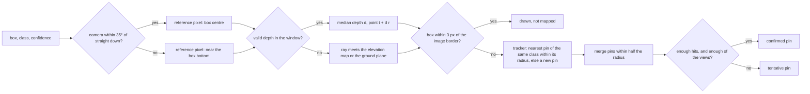

### 7.1 The camera model

Each CAMERA message carries its own intrinsic matrix $K$, the optical centre $\mathbf t$ and a quaternion from the
camera frame to the world, which `PinholeCamera.from_pose` turns into the rotation $R$, so that
$\mathbf v_\text{world} = R\,\mathbf v_\text{cam}$ ([`PROTOCOL.md:177-189`](../gcs/PROTOCOL.md#L177-L189),
[`geometry.py:175-186`](../gcs/drone_gcs/geometry.py#L175-L186)). The world is the Isaac Sim stage frame, treated as
local east-north-up. The camera frame is ROS optical: x right, y down, z forward. Pixel coordinates are continuous:
pixel index $(u, v)$ covers $[u, u+1) \times [v, v+1)$, and detector boxes use the same coordinates. The offset $p_c$
(`pixel_center`) is 0.5 for Isaac Lab's $K$, whose principal point is $c_x = W/2$, and 0 for an OpenCV-style $K$
([`geometry.py:6-14`](../gcs/drone_gcs/geometry.py#L6-L14)).

| Function | Formula | Code |
|---|---|---|
| `rays(u, v)` | $\mathbf r = R\,K^{-1}\,[u + p_c,\ v + p_c,\ 1]^\top$: the world direction through pixel index $(u, v)$, scaled so that its camera-frame z is 1 | [`geometry.py:207-215`](../gcs/drone_gcs/geometry.py#L207-L215) |
| `backproject(u, v, d)` | $\mathbf X = \mathbf t + d\,\mathbf r$, the point at depth $d$ | [`geometry.py:217-220`](../gcs/drone_gcs/geometry.py#L217-L220) |
| `project(X)` | $\mathbf p = R^\top(\mathbf X - \mathbf t)$, then $(u, v) = K\mathbf p / p_z - p_c$; also returns $p_z$. The inverse of `rays` | [`geometry.py:222-232`](../gcs/drone_gcs/geometry.py#L222-L232) |
| `nadir_angle_deg()` | $\arccos(-R_{33})$ (`R[2, 2]`): the angle between the optical axis, the third column of $R$, and straight down | [`geometry.py:203-205`](../gcs/drone_gcs/geometry.py#L203-L205) |

The ray is scaled to camera-frame z = 1 because the depth image holds the **distance to the image plane**, not the
distance along the ray ([`PROTOCOL.md:181`](../gcs/PROTOCOL.md#L181)); so $\mathbf t + d\,\mathbf r$ is exact for
every pixel. The Isaac drone's camera has 640 × 480 px, $f$ = 480 px and the principal point (320, 240); it looks
straight down with the image top towards the nose, and one pixel covers 1.545 cm of flat ground 7.415 m below
([`camera.py:3-5`](../sim/src/drone_lab/sar/camera.py#L3-L5), [`camera.py:14`](../sim/src/drone_lab/sar/camera.py#L14)).

### 7.2 Geolocating one box

Geolocation works in six steps: `Geolocator.locate` ([`mapping.py:438-473`](../gcs/drone_gcs/mapping.py#L438-L473))
does steps 1 to 5, `GCSState.apply_detections` step 6. The defaults are set in
[`mapping.py:418-436`](../gcs/drone_gcs/mapping.py#L418-L436) and [`state.py:50-52`](../gcs/drone_gcs/state.py#L50-L52).

1. **Reference rule** (`--det-ref`, default `auto`). From straight above, the centre of a box is the centre of the
   object. In an oblique view the box also shows the object's side, and its bottom edge is nearest to where the object
   stands ([`mapping.py:411-416`](../gcs/drone_gcs/mapping.py#L411-L416)). `auto` picks `center` when the nadir angle
   is at most 35° and `bottom` otherwise ([`mapping.py:444-446`](../gcs/drone_gcs/mapping.py#L444-L446)). The Isaac
   camera is fixed to the body looking straight down, so this angle is the drone's tilt.
2. **Reference pixel.** With $b_w = \max(x_2 - x_1, 1)$ and $b_h = \max(y_2 - y_1, 1)$: $x_c = (x_1 + x_2)/2$, and
   $y_c = (y_1 + y_2)/2$ (centre) or $y_c = y_2 - 0.05\,b_h$ (bottom). As a pixel index, $u = x_c - 0.5$ and
   $v = y_c - 0.5$; `rays` adds $p_c$ back, so with Isaac Lab's $K$ the ray passes exactly through $(x_c, y_c)$
   ([`mapping.py:447-450`](../gcs/drone_gcs/mapping.py#L447-L450)).
3. **Depth.** A window with the half-sizes $h_w = \max(1, 0.15\,b_w)$ and $h_h = \max(1, 0.15\,b_h)$ px spans the
   columns $x_c \pm h_w$ and the rows $y_c \pm h_h$ (centre) or $[y_2 - 2h_h,\ y_2]$, the bottom 30 % of the box
   (bottom). $d$ is the **median** of its valid depths: finite, more than 0.5 m (`--depth-min`; nearer is the drone's
   own legs or propellers) and less than 1000 m ([`mapping.py:452-465`](../gcs/drone_gcs/mapping.py#L452-L465),
   [`PROTOCOL.md:181`](../gcs/PROTOCOL.md#L181)). A median ignores how far off a minority of pixels are, such as
   ground beside a thin object; a mean would be pulled towards them.
4. **Back-projection.** $\mathbf X = \mathbf t + d\,\mathbf r(u, v)$, method `depth`
   ([`mapping.py:466`](../gcs/drone_gcs/mapping.py#L466)).
5. **Fallback without depth.** With no depth image, or no valid depth in the window, the ray is intersected with the
   elevation map of section 8.2 ([`mapping.py:468-473`](../gcs/drone_gcs/mapping.py#L468-L473),
   [`mapping.py:257-290`](../gcs/drone_gcs/mapping.py#L257-L290)). It must point down ($r_z < -10^{-9}$) and meet the
   ground plane in front of the camera, $t_0 = (g - t_z)/r_z > 0$. The ground level $g$ is the median of the known
   cell means, or MISSION `ground_z` while the map is empty ([`state.py:526-530`](../gcs/drone_gcs/state.py#L526-L530),
   [`mapping.py:248-253`](../gcs/drone_gcs/mapping.py#L248-L253)). Then
   $t_{k+1} = (h(\mathbf t + t_k\,\mathbf r) - t_z)/r_z$, with $h$ the mean height of the cell under the current
   point, or $g$ for an unknown cell. From the fourth iteration on, the average $\tfrac{1}{2}(t_k + t_{k+1})$ damps
   the jumping back and forth at a height step. The loop stops when $\lvert t_{k+1} - t_k\rvert < 10^{-3}$ (1 mm of
   depth) or after 8 iterations. The method is `map` if the map knows the height at the final point, else `plane`;
   the docstring calls this accurate "for near-nadir views of smooth terrain"
   ([`mapping.py:266`](../gcs/drone_gcs/mapping.py#L266)).
6. **Partial views.** A box within 3 px (`--edge-margin`) of the image border shows only part of an object, so its
   centre is not the object's centre. The camera panel draws it, labelled "(edge)", but it is not mapped
   ([`state.py:466-482`](../gcs/drone_gcs/state.py#L466-L482), [`dashboard.py:835`](../gcs/drone_gcs/dashboard.py#L835)).

The pose is the one sent with that frame, but the map and the ground level are those of the moment the detector's
result is applied ([`state.py:463-468`](../gcs/drone_gcs/state.py#L463-L468)). A depth hit is the **visible top** of
an object, while the ground truth gives the centre of its footprint on the ground; this is why the report scores pin
error horizontally ([`PROTOCOL.md:203-205`](../gcs/PROTOCOL.md#L203-L205)).

**Worked example**, computed with the repository's `Geolocator`. The Isaac camera hangs level at (0, 0, 7.4) m with
the image top towards +x, so image right is world −y and image down is world −x (`C_BODY_TO_NADIR_CAM`,
[`geometry.py:35-37`](../gcs/drone_gcs/geometry.py#L35-L37)). A person lies on flat ground; the top of the body is
0.25 m up, at a depth of 7.15 m. The detector returns the box (385, 250, 415, 350), 30 × 100 px.

| Step | Result |
|---|---|
| Nadir angle, rule | 0°, `center` |
| Reference pixel | (400, 300); $u$ = 399.5, $v$ = 299.5 |
| Ray $\mathbf r$ | $K^{-1}[400, 300, 1]^\top$ = (0.1667, 0.125, 1) in the camera frame; (−0.125, −0.1667, −1) in the world |
| Depth window | $h_w$ = 4.5 px, $h_h$ = 15 px: columns 395-404, rows 285-314, 300 pixels |
| Median depth | 7.15 m |
| Pin with depth | (−0.894, −1.192, 0.250), method `depth` |
| Pin without depth, over a map of the flat ground | (−0.925, −1.233, 0.000), method `map` |
| The same box with the `bottom` rule | pixel (400, 345), pin (−1.564, −1.192, 0.250) |

Without depth the ray runs on to the ground, 0.25 m lower, which moves the point outwards by 0.25 m × 0.208 = 5 cm
(0.208 is the ray's horizontal run per metre of drop). The bottom rule, wrong for a view from straight above, would put
the pin 0.67 m off.

### 7.3 The tracker

`ObjectTracker` keeps a list of pins. Each holds a position $\boldsymbol\mu$ (`pos`), a weight sum $W$ (`wsum`), a
spread sum $S$ (`_sq`), hits, views, the sum and the maximum of its confidences, the first and last time seen and the
last box ([`mapping.py:477-494`](../gcs/drone_gcs/mapping.py#L477-L494)). `update` runs once per detected frame
([`mapping.py:549-611`](../gcs/drone_gcs/mapping.py#L549-L611)). A detection can join a pin only if both have the same
class and lie within that class's radius $r$, measured horizontally:

| Class | person | vehicle | crate, barrel, cone | pallet | any other class |
|---|---|---|---|---|---|
| Radius $r$ [m] | 1.5 | 3.0 | 0.8 | 1.0 | `--merge-radius`, default 2.0 |

The comment beside the radii gives the reason: piles of crates or barrels stand closer together, a forklift is larger
([`state.py:36-47`](../gcs/drone_gcs/state.py#L36-L47), [`mapping.py:545-547`](../gcs/drone_gcs/mapping.py#L545-L547)).
Only the default can be changed on the command line ([`gcs.py:80-86`](../gcs/scripts/gcs.py#L80-L86),
[`gcs.py:198-208`](../gcs/scripts/gcs.py#L198-L208)). The update, in order:

1. **Filter.** Drop detections with a non-finite position; count the rest in `n_detections`
   ([`mapping.py:552-555`](../gcs/drone_gcs/mapping.py#L552-L555)).
2. **Candidates.** Every pair of a detection $\mathbf x$ and a pin $\boldsymbol\mu$ of the same class with
   $\lVert \mathbf x_{xy} - \boldsymbol\mu_{xy} \rVert \le r$, over all pins, tentative or confirmed, from any drone
   ([`mapping.py:556-565`](../gcs/drone_gcs/mapping.py#L556-L565)).
3. **Greedy one-to-one.** Sort the pairs by distance; accept the nearest pair whose detection and pin are both still
   free, and repeat ([`mapping.py:566-573`](../gcs/drone_gcs/mapping.py#L566-L573)). This step gives a pin at most
   one hit per frame; a merge in step 6 can add a second. (Background: greedy nearest-first matching, not a globally
   optimal assignment.)
4. **Matched detection.** With the confidence $c$ and the weight $w = \max(c, 10^{-3})$
   ([`mapping.py:577-592`](../gcs/drone_gcs/mapping.py#L577-L592)):

$$\boldsymbol\mu' = \frac{W\boldsymbol\mu + w\,\mathbf x}{W + w},\qquad
S' = S + w\,(\mathbf x_{xy} - \boldsymbol\mu_{xy})\cdot(\mathbf x_{xy} - \boldsymbol\mu'_{xy}),\qquad
W' = W + w,\qquad \text{spread} = \sqrt{S'/W'}$$

   The pin also gets one more hit, $c$ added to its confidence sum, the latest time and the new box. So
   $\boldsymbol\mu$ is always the confidence-weighted mean of its detections (in 3D), and the spread is their
   confidence-weighted RMS horizontal distance from it,
   $\sqrt{\sum_i w_i \lVert \mathbf x_{i,xy} - \boldsymbol\mu_{xy} \rVert^2 / \sum_i w_i}$. The update is exact
   (background: the weighted form of Welford's algorithm, due to West); the tests check it against brute force
   ([`test_tracker_views.py:85-138`](../gcs/tests/test_tracker_views.py#L85-L138)).

5. **Unmatched detection.** A new pin: 1 hit, $W = w$, $S = 0$, first and last seen at the frame time
   ([`mapping.py:593-608`](../gcs/drone_gcs/mapping.py#L593-L608)).
6. **Merge.** Until nothing changes, two pins of one class within **half** their radius of each other merge into the
   older one ([`mapping.py:613-641`](../gcs/drone_gcs/mapping.py#L613-L641)):

$$W = W_a + W_b,\qquad \boldsymbol\mu = \frac{W_a\boldsymbol\mu_a + W_b\boldsymbol\mu_b}{W},\qquad
S = S_a + S_b + \frac{W_a W_b}{W}\,\lVert \boldsymbol\mu_{a,xy} - \boldsymbol\mu_{b,xy} \rVert^2$$

   Hits and confidence sums add up; the merged pin keeps the earlier first time, the later last time and the larger
   view count. Merges happen when two pins drift together, and when a second box on one object in one frame starts a
   pin of its own (the greedy step gave the object's pin to the first box), which is merged at once
   ([`test_tracker_views.py:182-192`](../gcs/tests/test_tracker_views.py#L182-L192)).

The class docstring says "two objects seen in the same frame are never merged"
([`mapping.py:529-530`](../gcs/drone_gcs/mapping.py#L529-L530)). That holds for step 3 only: step 6 merges any two
pins of a class within half the radius, even two created in the same frame. Two people lying less than 0.75 m apart
end up as one pin.

**Worked example**: three detections of one person
([`test_tracker_views.py:67-77`](../gcs/tests/test_tracker_views.py#L67-L77)).

| Detection: $\mathbf x_{xy}$, $c$ | $\boldsymbol\mu_{xy}$ after it | $W$ | $S$ | Spread [m] |
|---|---|---|---|---|
| (0, 0), 0.5 | (0, 0) | 0.5 | 0 | 0 |
| (1, 0), 0.5 | (0.5, 0) | 1.0 | 0.25 | 0.5 |
| (0.5, 1.5), 1.0 | (0.5, 0.75) | 2.0 | 1.375 | 0.829 |

In the last row $S' = 0.25 + 1 \cdot (0, 1.5) \cdot (0, 0.75) = 1.375$ and the spread is $\sqrt{1.375/2}$.

### 7.4 Views, detection rate and confirmation

A pin stays in the image for many frames: the README estimates 60 or more per pass of the Isaac drone, so two hits
alone say little ([`gcs/README.md:416-418`](../gcs/README.md#L416-L418)). Each pin also counts its **views**, the
detected frames whose image should show it. Before the update, `objects_in_view` lists every pin that
([`state.py:491-523`](../gcs/drone_gcs/state.py#L491-L523)):

1. projects in front of the camera ($p_z > 0$);
2. has its expected box at least 3 px inside the image: a box the size of its last box, placed so that its reference
   pixel falls on the projected point (centre rule: half above, half below; bottom rule: 95 % above, 5 % below). A
   box at the border would not be mapped, so it is not a miss either;
3. is not hidden: a positive depth at that pixel more than `OCCLUSION_MARGIN` = 1.0 m nearer than the pin means
   something stands above it, such as a tree crown ([`state.py:23-25`](../gcs/drone_gcs/state.py#L23-L25)).

After the update, every pin on that list and every pin the frame touched gets
$\text{views} \leftarrow \max(\text{views} + 1,\ \text{hits})$; the maximum covers two boxes of one frame on one pin
([`state.py:483-485`](../gcs/drone_gcs/state.py#L483-L485),
[`mapping.py:643-650`](../gcs/drone_gcs/mapping.py#L643-L650)). A frame without detections still counts views; a frame
the detector worker skipped because it was slower than the camera counts neither
([`detector.py:377-384`](../gcs/drone_gcs/detector.py#L377-L384)). The detection rate is
$\text{hits} / \max(\text{views}, \text{hits}, 1)$ ([`mapping.py:501-504`](../gcs/drone_gcs/mapping.py#L501-L504)).

A pin is **confirmed** when its hits reach `--min-hits` (default 2) and, if `--min-rate` is above 0, its rate reaches
`--min-rate` (default 0 = off; it must lie in [0, 1]) ([`mapping.py:652-659`](../gcs/drone_gcs/mapping.py#L652-L659),
[`gcs.py:87-95`](../gcs/scripts/gcs.py#L87-L95), [`gcs.py:156-157`](../gcs/scripts/gcs.py#L156-L157)). The other pins
are **tentative**: hollow rings on the map, dim rows in the objects table, and left out of the evaluation
([`dashboard.py:531-538`](../gcs/drone_gcs/dashboard.py#L531-L538),
[`dashboard.py:913-921`](../gcs/drone_gcs/dashboard.py#L913-L921),
[`report.py:104-107`](../gcs/drone_gcs/report.py#L104-L107)). Since a hit is one detection in one frame, each frame
must arrive once; the Isaac adapter skips a capture it has already sent
([`isaac_bridge.py:181-189`](../gcs/drone_gcs/isaac_bridge.py#L181-L189), [`PROTOCOL.md:189`](../gcs/PROTOCOL.md#L189)).
A test shows the rule on four pins in view of five frames
([`test_tracker_views.py:195-226`](../gcs/tests/test_tracker_views.py#L195-L226)):

| Pin | Hits | Views | Rate | Default (hits ≥ 2) | `--min-rate 0.5` |
|---|---|---|---|---|---|
| A | 3 | 5 | 0.6 | confirmed | confirmed |
| B | 2 | 5 | 0.4 | confirmed | tentative |
| C | 1 | 5 | 0.2 | tentative | tentative |
| D | 2 | 4 | 0.5 | confirmed | confirmed |

The README states that no `--min-rate` value has been tried on an Isaac Sim mission yet
([`gcs/README.md:429-431`](../gcs/README.md#L429-L431)).

### Questions an advisor might ask

**Why the centre of the box, and when the bottom?** From straight above the box centre is the object's centre; in an
oblique view the box includes the object's side, so its bottom is nearer the ground contact. `auto` switches at a
nadir angle of 35° ([`mapping.py:444-449`](../gcs/drone_gcs/mapping.py#L444-L449)). In the worked example the bottom
rule would put the pin 0.67 m off.

**Why a median over a window, not the depth at one pixel?** One pixel can be invalid or fall on the ground beside a
thin object; the median over 30 % of the box each way is not pulled by a minority of such pixels
([`mapping.py:452-466`](../gcs/drone_gcs/mapping.py#L452-L466)).

**What happens without depth?** The ray is intersected with the elevation map by fixed-point iteration
([`mapping.py:257-290`](../gcs/drone_gcs/mapping.py#L257-L290)). The point then lies on the ground, not on top of the
object, and shifts outwards by the object's height times the ray's slope: 5 cm in the worked example.

**Can two people end up as one pin?** Yes, when their pins come within half the person radius, 0.75 m: `_merge_close`
merges pins of one class even when one frame created both
([`mapping.py:613-641`](../gcs/drone_gcs/mapping.py#L613-L641),
[`test_tracker_views.py:182-192`](../gcs/tests/test_tracker_views.py#L182-L192)).

**What do `--min-hits` and `--min-rate` guard against, and is the spread used?** With 2 hits needed, one false
detection never becomes a confirmed pin; the rate also catches an object detected only now and then while in view
([`mapping.py:652-655`](../gcs/drone_gcs/mapping.py#L652-L655)). The spread is only a quality figure, shown in the
objects table and `detections.csv`; the tracker does not use it to associate, merge or confirm
([`dashboard.py:933`](../gcs/drone_gcs/dashboard.py#L933), [`mapping.py:549-659`](../gcs/drone_gcs/mapping.py#L549-L659)).

## 8. Mapping

The ground station builds three maps while the drone flies
([`state.py:400-456`](../gcs/drone_gcs/state.py#L400-L456)): the **elevation map**, a height per cell from the mapping
rays (SCAN); the **orthomosaic**, a colour per cell from the camera pixels (CAMERA); and the **surface map**, a height
per cell from the camera's depth. The two height maps share one grid; the mosaic uses a finer copy of it.

### 8.1 The grid

The MISSION message gives the survey rectangle $(x_0, x_1, y_0, y_1)$ and the cell size $r$, 0.25 m in the Isaac
mission ([`sar_mission.py:405-407`](../sim/scripts/sar_mission.py#L405-L407)). `setup_grid` pads the area for the
U-turns, by MISSION `padding` or else $p = \max(4,\ 0.15 \max(x_1 - x_0,\ y_1 - y_0))$ m rounded up to whole cells,
and lets the grid run from $x_0 - p - r/2$ to $x_1 + p + r/2$, the same in y
([`state.py:228-249`](../gcs/drone_gcs/state.py#L228-L249)). The half-cell shift puts the cell centres on the lattice
$x_0 + k\,r$, so rays laid out on round numbers land in the middle of cells, not on edges where a small wobble would
flip them between neighbours ([`state.py:241-244`](../gcs/drone_gcs/state.py#L241-L244)). Above 4,000,000 cells, $r$
grows to the smallest whole multiple that fits ([`state.py:236-240`](../gcs/drone_gcs/state.py#L236-L240)). The photo
grid has the same bounds, 2 times finer by default ([`state.py:250-255`](../gcs/drone_gcs/state.py#L250-L255)).
Coverage is measured over the cells whose centre lies inside the survey rectangle, edges included
([`state.py:256-257`](../gcs/drone_gcs/state.py#L256-L257), [`mapping.py:118-122`](../gcs/drone_gcs/mapping.py#L118-L122)).

A point falls in cell $i_x = \lfloor (x - x_{min})/r \rfloor$, $i_y = \lfloor (y - y_{min})/r \rfloor$; arrays have
shape $(n_y, n_x)$ with row 0 at the south edge ([`mapping.py:106-111`](../gcs/drone_gcs/mapping.py#L106-L111),
[`mapping.py:16`](../gcs/drone_gcs/mapping.py#L16)). For a 40 × 40 m area such as $[-20, 20]^2$ at 0.25 m, the padding
is 6 m and the grid has 209 × 209 = 43,681 cells from −26.125 m, 161 × 161 of them inside the area; the photo grid has
418 × 418 cells of 0.125 m (computed with `setup_grid`).

### 8.2 The elevation map

`ElevationMap` keeps per cell the hit count $n$, the sum $\Sigma z$, the sum of squares $\Sigma z^2$, the highest and
lowest hit and the time of the last one ([`mapping.py:131-142`](../gcs/drone_gcs/mapping.py#L131-L142)). Each SCAN
message's hits, an (N, 3) array of world points, go through `add_points`
([`state.py:412-413`](../gcs/drone_gcs/state.py#L412-L413), [`mapping.py:144-170`](../gcs/drone_gcs/mapping.py#L144-L170)).
It keeps the points that are finite, marked valid, inside the grid and within ±10⁴ m in z (a ray that hit nothing
arrives as `inf`, [`gcs/README.md:237`](../gcs/README.md#L237)), groups them by cell with `np.unique` and
`np.bincount`, and adds to each cell its count, sums, maximum and minimum. The layers follow, NaN where $n = 0$
(except the count, which is 0 there):

| Layer | mean | std (population) | max, min | count |
|---|---|---|---|---|
| Formula | $\bar z = \Sigma z / n$ | $\sqrt{\max(\Sigma z^2/n - \bar z^2,\ 0)}$ | highest, lowest hit | $n$ |
| Code | [`mapping.py:178-183`](../gcs/drone_gcs/mapping.py#L178-L183) | [`mapping.py:193-199`](../gcs/drone_gcs/mapping.py#L193-L199) | [`mapping.py:185-191`](../gcs/drone_gcs/mapping.py#L185-L191) | [`mapping.py:201-207`](../gcs/drone_gcs/mapping.py#L201-L207) |

A cell with $n = 0$ is **unknown**, the fog of war on the dashboard. **Scan coverage** is the fraction of the area's
cells with at least one hit ([`mapping.py:173-176`](../gcs/drone_gcs/mapping.py#L173-L176),
[`mapping.py:209-215`](../gcs/drone_gcs/mapping.py#L209-L215)).

The **mean** is the height the rest of the station uses: the dashboard's default layer, the ray intersection of 7.2
(also used by the mosaic) and the report's height error ([`mapping.py:217-231`](../gcs/drone_gcs/mapping.py#L217-L231),
[`report.py:157-160`](../gcs/drone_gcs/report.py#L157-L160)). The README: "The mean is the right statistic for
terrain. Use `e` (max) to see roofs and canopy edges"; the map is 2.5D, one height per cell, no overhangs
([`gcs/README.md:699-700`](../gcs/README.md#L699-L700)). In the Isaac mission the mapping rays are cast against the
terrain mesh `/World/ground` only
([`survey_env_cfg.py:83-92`](../sim/src/drone_lab/tasks/survey/config/arl_robot_1/survey_env_cfg.py#L83-L92), inherited
by the search-and-rescue task, [`sar_env_cfg.py:43`](../sim/src/drone_lab/tasks/sar/config/arl_robot_1/sar_env_cfg.py#L43)),
so, as the README notes, crates, vehicles, trees and people are not on the elevation map
([`gcs/README.md:115-117`](../gcs/README.md#L115-L117)).

### 8.3 The orthomosaic

Every camera frame that arrives, including frames the detector skipped, is back-projected into the mosaic
([`state.py:435-436`](../gcs/drone_gcs/state.py#L435-L436), [`mapping.py:354-407`](../gcs/drone_gcs/mapping.py#L354-L407)):

1. **Pixel stride.** The range is the median valid depth of the centre 5 × 5 pixels (if there is none:
   $\max(0.5,\ (t_z - g)/\max(0.2, \cos\theta))$, $\theta$ the nadir angle). With $\text{GSD} = \text{range}/f_x$ the
   stride is $\text{clip}(\lfloor 0.5\, r_\text{photo}/\text{GSD} \rfloor, 1, 32)$ px, so samples land about half a
   mosaic cell apart ([`mapping.py:376-392`](../gcs/drone_gcs/mapping.py#L376-L392)). For the Isaac camera 7.415 m above
   flat ground and 0.125 m photo cells the stride is 4: 160 × 120 = 19,200 samples per frame (computed).
2. **World point per sample:** in a frame with depth, $\mathbf t + d\,\mathbf r$ where the depth is valid (as in 7.2);
   a sample with invalid depth is dropped, not intersected with the map. Only a frame without a depth image uses the
   ray-map intersection of 7.2 ([`mapping.py:394-399`](../gcs/drone_gcs/mapping.py#L394-L399)).
3. **Quality** $q = -r_z / \lVert \mathbf r \rVert$, the cosine of the angle between the pixel's ray and straight down.
   A sample needs $q > 0.25$, a ray within 75.5° of straight down
   ([`mapping.py:400-401`](../gcs/drone_gcs/mapping.py#L400-L401)). For the level Isaac camera even the corner pixels
   have $q$ = 0.77 (40° off nadir), so this filter only acts when the camera tilts far (computed).
4. **Cell update** (`--photo-mode`, [`mapping.py:315-345`](../gcs/drone_gcs/mapping.py#L315-L345)). `nadir`, the
   default: sort the frame's samples by $q$, lowest first, keep those with $q \ge q_\text{stored} - 0.02$, and write
   their colour and $q$, so the best sample of a cell is written last. A cell thus keeps its most top-down view, and a
   newer view within 0.02 of it may replace it; an empty cell has $q_\text{stored} = -1$
   ([`mapping.py:307`](../gcs/drone_gcs/mapping.py#L307)). `latest` overwrites; `blend` keeps a running mean of the
   colours weighted by $q^2$.

**Photo coverage** is the fraction of the area's photo cells that have a colour
([`mapping.py:347-352`](../gcs/drone_gcs/mapping.py#L347-L352)). The README calls the result "a back-projection with a
'most top-down view wins' rule, not a true orthophoto": correct with depth, and over a ground plane where the map is
not yet scanned without it ([`gcs/README.md:704-706`](../gcs/README.md#L704-L706)). (Background: near the edge of an
image a camera sees the sides of tall objects; the most top-down view shows the least of them.)

### 8.4 The surface map

The elevation map misses everything standing on the terrain. The **surface map** is a second `ElevationMap` on the
same grid, fed with the world points of the samples the mosaic kept from every frame with depth
([`state.py:259`](../gcs/drone_gcs/state.py#L259), [`state.py:439-440`](../gcs/drone_gcs/state.py#L439-L440)), so its
points lie about half a photo cell apart, not one per pixel
([`mapping.py:402-407`](../gcs/drone_gcs/mapping.py#L402-L407)).
Its max layer is the terrain plus what stands on it. It has no dashboard layer: the report writes it as
`maps/surface_{max,mean,count}.npy` for the rescue planner, which compares `surface_max` with the elevation map to find
obstacles (section 10; [`report.py:74-81`](../gcs/drone_gcs/report.py#L74-L81),
[`gcs/README.md:254`](../gcs/README.md#L254)). `--no-surface-map` turns it off; `--depth-elevation`, off by default,
adds the same points to the elevation map as well ([`gcs.py:73-79`](../gcs/scripts/gcs.py#L73-L79),
[`state.py:437-438`](../gcs/drone_gcs/state.py#L437-L438)). The README states that the surface map has been checked on
synthetic frames and the stand-in drone only, and that no Isaac Sim mission has written one yet
([`gcs/README.md:701-703`](../gcs/README.md#L701-L703)).

### 8.5 What the dashboard shows

The dashboard draws the state 12 times per second on a 1600 × 900 canvas, in a window and/or `dashboard.mp4`
([`gcs.py:44-45`](../gcs/scripts/gcs.py#L44-L45)), in five parts
([`dashboard.py:735-743`](../gcs/drone_gcs/dashboard.py#L735-L743)): a **top bar** with the mission name and
link status; the **camera panel**, the latest frame the detector has finished (the newest frame when that one is 1 s
or more newer), with its boxes labelled by class, confidence and geolocated (x, y)
([`dashboard.py:782-858`](../gcs/drone_gcs/dashboard.py#L782-L858)); the **objects table**, the pins with their id,
class, mean confidence, hits, position, first time seen and spread, confirmed first, as many as fit in its 10 rows on
the default canvas (with more pins the last row reads "+ N more")
([`dashboard.py:883-941`](../gcs/drone_gcs/dashboard.py#L883-L941)); the **map**; and the **HUD**, whose PEOPLE FOUND
is the number of confirmed person pins, not checked against the ground truth
([`dashboard.py:987-1045`](../gcs/drone_gcs/dashboard.py#L987-L1045)). The map is drawn north up. Key `m` cycles its
layers, elevation (the mean, or the max with key `e`), photo and coverage, with fog where nothing is known
([`app.py:386-394`](../gcs/drone_gcs/app.py#L386-L394), [`dashboard.py:318-366`](../gcs/drone_gcs/dashboard.py#L318-L366)).
On top come the survey area, the planned path, the camera footprint, the flown trail, the landing pad, the ground
truth as hollow squares (key `g`), confirmed pins as filled dots labelled "class confidence" and tentative pins as
hollow rings ([`dashboard.py:444-560`](../gcs/drone_gcs/dashboard.py#L444-L560)).

<p align="center">
  
</p>

*The ground station's map panel during an Isaac Sim mission: the map fills in under the lawnmower path, and a pin
appears on each object found, labelled with its class and mean confidence.*

### Questions an advisor might ask

**Why the mean of the hits in a cell, not the maximum?** The README argues the mean is the right statistic for
terrain and keeps the max as a layer for roofs and canopy edges ([`gcs/README.md:699-700`](../gcs/README.md#L699-L700));
both are updated per cell as the hits arrive ([`mapping.py:144-199`](../gcs/drone_gcs/mapping.py#L144-L199)).

**Is an unknown cell the same as height 0?** No. It has count 0, its layers are NaN, the dashboard draws it as fog and
coverage counts it as not covered ([`mapping.py:173-215`](../gcs/drone_gcs/mapping.py#L173-L215)); the ray
intersection gives it the median ground level ([`mapping.py:280-281`](../gcs/drone_gcs/mapping.py#L280-L281)).

**How does the mosaic choose between two photos of one cell?** In `nadir` mode the sample whose ray is closest to
straight down wins; a later sample replaces it if its quality is within 0.02
([`mapping.py:328-334`](../gcs/drone_gcs/mapping.py#L328-L334)).

**Why a separate surface map instead of adding depth to the elevation map?** The elevation map stays the terrain as
the rays saw it, which the height error scores, while the planner compares the two maps to find what stands on the
terrain ([`gcs/README.md:701-702`](../gcs/README.md#L701-L702), [`gcs/README.md:254`](../gcs/README.md#L254)).

## 9. The mission report

When the station stops, after END or when the user quits, `write_report` writes the report into the run folder
`runs/<name>/` ([`app.py:562-616`](../gcs/drone_gcs/app.py#L562-L616),
[`report.py:34-239`](../gcs/drone_gcs/report.py#L34-L239)). A MISSION with a new `mission_id` arriving while the
current mission has data first archives the old mission's report in `mission<k>_<name>/`
([`app.py:448-454`](../gcs/drone_gcs/app.py#L448-L454)).

### 9.1 The files

| File | Content | Code |
|---|---|---|
| `report.md` | the page to read: scorecard, two maps, list of finds (9.5) | [`report.py:300-381`](../gcs/drone_gcs/report.py#L300-L381) |
| `summary.json` | all numbers: mission, flight, coverage, detection counts, evaluation (precision, recall, errors per class), `terrain_error`, the drone's END statistics, message counts, `scorecard`, and a `gcs` block (detector timing, link bytes and drops, recording, replay, noise) | [`report.py:162-237`](../gcs/drone_gcs/report.py#L162-L237), [`app.py:584-610`](../gcs/drone_gcs/app.py#L584-L610) |
| `final_map_elevation.png`, `final_map_photo.png`, `coverage.png` | the three map layers, 1200 px map plus legend and title, ground truth drawn when known | [`report.py:52-65`](../gcs/drone_gcs/report.py#L52-L65), [`dashboard.py:1048-1060`](../gcs/drone_gcs/dashboard.py#L1048-L1060) |
| `maps/elevation_{mean,max,min}.npy`, `maps/hit_count.npy` | raw elevation arrays, $(n_y, n_x)$, row 0 = south | [`report.py:66-73`](../gcs/drone_gcs/report.py#L66-L73) |
| `maps/surface_{max,mean,count}.npy` | the surface map, if it has a known cell | [`report.py:74-81`](../gcs/drone_gcs/report.py#L74-L81) |
| `maps/photo_rgb.png`, `maps/photo_filled.npy`, `maps/grid.json` | the mosaic (north up), its mask of coloured cells, both grids and the area | [`report.py:82-94`](../gcs/drone_gcs/report.py#L82-L94) |
| `detections.csv`, `detections.json` | every pin, confirmed or tentative: id, class, x, y, z, mean and max confidence, hits, first and last seen, spread, views, rate, confirmed; for matched pins the ground-truth id, `err_xy_m` and `err_z_m`; the drone id. The JSON adds the coordinate frame, the ground truth and the full evaluation | [`report.py:97-136`](../gcs/drone_gcs/report.py#L97-L136) |
| `trajectory.csv` | one row per TELEMETRY: drone, t, position, quaternion, velocity, waypoint, carrot, height above ground | [`report.py:20-23`](../gcs/drone_gcs/report.py#L20-L23), [`report.py:139-148`](../gcs/drone_gcs/report.py#L139-L148) |
| `coverage_timeline.csv` | t, scan and photo coverage, confirmed pins, at most every 0.25 s of simulation time | [`report.py:149-153`](../gcs/drone_gcs/report.py#L149-L153), [`state.py:554-559`](../gcs/drone_gcs/state.py#L554-L559) |

The app adds `dashboard.mp4` with `dashboard_frames.csv` (the simulation time of each video frame), `link.dgcrec`
with `--record` (section 5) and `screenshots/` ([`app.py:118-139`](../gcs/drone_gcs/app.py#L118-L139),
[`app.py:260-261`](../gcs/drone_gcs/app.py#L260-L261), [`app.py:370-379`](../gcs/drone_gcs/app.py#L370-L379)).

### 9.2 Matching pins to the ground truth

For the evaluation only, the simulator sends GT_OBJECTS: per object an id, a class and `pos`, the centre of its
footprint at ground level ([`PROTOCOL.md:192-198`](../gcs/PROTOCOL.md#L192-L198)). The Isaac mission sends every
labelled object; trees are unlabelled and left out ([`mission.py:228-249`](../sim/src/drone_lab/sar/mission.py#L228-L249)).
Only **confirmed** pins are scored ([`report.py:104-107`](../gcs/drone_gcs/report.py#L104-L107)).
`evaluate_detections` ([`mapping.py:663-728`](../gcs/drone_gcs/mapping.py#L663-L728)):

1. forms every pair of a pin and an object with the same class and a horizontal distance of at most 2 m
   (`match_radius`, [`report.py:41`](../gcs/drone_gcs/report.py#L41));
2. sorts the pairs by distance and accepts them greedily one-to-one, nearest first;
3. counts, with $N_p$ pins and $N_g$ objects: matches $tp$, false positives $fp = N_p - tp$, misses $fn = N_g - tp$,
   precision $tp/N_p$ and recall $tp/N_g$. Per match: `err_xy`, the horizontal distance, and
   `err_z` $= z_\text{pin} - z_\text{gt}$; then the mean, median and maximum of `err_xy`, and the same counts per
   class.

$N_g$ includes the objects outside the survey area. A matched pin's row in `detections.csv` gets the ground-truth id
and errors ([`report.py:108-113`](../gcs/drone_gcs/report.py#L108-L113)). **Example**
([`test_mapping.py:233-249`](../gcs/tests/test_mapping.py#L233-L249)): pins car (1.1, 0), car (9, 9), tent (5, 5.2);
truth car (1, 0), tent (5, 5), person (0, 9). The car matches at 0.1 m and the tent at 0.2 m, so $tp$ = 2, $fp$ = 1,
$fn$ = 1, precision = recall = 2/3, and the mean `err_xy` is 0.15 m.

### 9.3 The scorecard

`scorecard` ([`report.py:251-288`](../gcs/drone_gcs/report.py#L251-L288)) computes the headline numbers, stored in
`summary.json` under `scorecard` and shown at the top of `report.md`. With ground truth:

| Key | Computed as |
|---|---|
| `people_found` | ground-truth persons **inside** the survey area that a confirmed pin matched. Inside: x in $[x_0, x_1]$ and y in $[y_0, y_1]$, edges included ([`report.py:242-248`](../gcs/drone_gcs/report.py#L242-L248)) |
| `people_total` | ground-truth persons inside the area |
| `people_outside_area` | `{found, total}` for the persons outside the area; null if there are none |
| `false_alarms` | $fp$: confirmed pins of **any** class, anywhere on the map, left unmatched (no free same-class object within 2 m, so a second pin on an already matched object counts too) |
| `pin_error_m`, `people_pin_error_m` | mean `err_xy` over all matches, and over the matched persons |
| `map_height_error_m`, `map_height_error_smooth_m` | RMSE of the elevation map against the true terrain inside the area, and away from steps (9.4) |
| `coverage_pct`, `photo_coverage_pct` | 100 × scan and photo coverage of the area, to 2 decimals |
| `flight_time_s` | simulation time from the first to the latest time stamp of TELEMETRY, SCAN, CAMERA or END ([`state.py:205-225`](../gcs/drone_gcs/state.py#L205-L225)) |
| `closest_approach_m` | taken from the drone's END statistics ([`report.py:286-287`](../gcs/drone_gcs/report.py#L286-L287), [`sar_mission.py:635`](../sim/scripts/sar_mission.py#L635)): its smallest distance to the terrain and to the site's object boxes, outside take-off and landing ([`mission.py:252-256`](../sim/src/drone_lab/sar/mission.py#L252-L256)) |

Without GT_OBJECTS, `people_found` is the number of confirmed person pins, as on the HUD, and the keys that need
ground truth stay null ([`report.py:255-270`](../gcs/drone_gcs/report.py#L255-L270)). When reading the numbers:

* **Inside and outside.** "People found counts the people inside the survey area, the area the drone was sent to
  search" ([`report.py:374-376`](../gcs/drone_gcs/report.py#L374-L376)). The README's Isaac site has 41 objects: 35 in
  the survey area, 10 of them people, and 6 around the landing pad outside it, among them a responder walking by
  ([`gcs/README.md:637-638`](../gcs/README.md#L637-L638)). So `people_total` is 10, and the responder appears only
  under `people_outside_area`, with a total of 1.
* **False alarms** cover every class. A pin of the right class but more than 2 m from its object counts twice: as a
  false alarm, and its object as not found. The pin errors average over matched pins only, so read them with the
  counts.

The README's results table for the Isaac mission reports these keys: 10 of 10 people, 0 false alarms, 0.04 m pin
error, 0.10 m map height error (4 mm away from steps), 100 % scanned and 99.8 % photographed, 2.4 m closest approach
([`gcs/README.md:640-648`](../gcs/README.md#L640-L648)). UNVERIFIED in this repository: Isaac Sim cannot run here and
run folders are git-ignored, so these numbers cannot be recomputed. Section 12 reports the runs made for this document.

### 9.4 The map height error

The simulator also sends GT_TERRAIN, the true height on a grid, at 0.25 m in the Isaac mission
([`sar_mission.py:423-424`](../sim/scripts/sar_mission.py#L423-L424)). `terrain_error`
([`mapping.py:731-769`](../gcs/drone_gcs/mapping.py#L731-L769)) compares it with the map:

1. each elevation cell gets the true height $h$ of the truth cell containing its centre
   ([`state.py:144-150`](../gcs/drone_gcs/state.py#L144-L150));
2. the error is $e = \bar z - h$, with $\bar z$ the **mean** layer of the ray-hit map (not the surface map), over the
   area's cells where both are finite ([`report.py:157-160`](../gcs/drone_gcs/report.py#L157-L160));
3. the statistics are the RMSE $\sqrt{\overline{e^2}}$, the mean absolute error, the bias $\bar e$ and the largest
   $\lvert e \rvert$, in `summary.json` under `terrain_error`;
4. **away from steps** (`smooth`), the same statistics over the cells whose true height differs by at most 0.1 m from
   each of its 8 neighbours; `smooth_fraction` is their share.

A 0.25 m cell across a wall or a stair edge is ambiguous: one height cannot stand for both sides
([`mapping.py:734-735`](../gcs/drone_gcs/mapping.py#L734-L735),
[`gcs/README.md:661-663`](../gcs/README.md#L661-L663)). In a test with a 2 m wall, a map 1 cm too high everywhere and
halfway up the wall in the column beside it has an RMSE above 0.1 m over all cells but exactly 0.01 m away from the
step ([`test_mapping.py:253-267`](../gcs/tests/test_mapping.py#L253-L267)).

### 9.5 `report.md`

`report.md` is the page a person reads ([`report.py:300-381`](../gcs/drone_gcs/report.py#L300-L381)): a line with the
date, the END reason, the flight time and the distance flown; the scorecard table (people found as "x / y in the
survey area; outside it a / b", false alarms, pin error, map height error with its value away from steps, coverage,
flight time, closest approach); the photo and elevation maps; the **Finds**, one row per confirmed pin, people first,
with the matched ground-truth id or "false alarm" and the pin error; a "Not found" line for the missed objects; and a
note on the method.


*`final_map_photo.png` of the recorded Isaac Sim mission, copied into the repository by its author: the orthomosaic,
the flown path from the landing pad (bottom left) and back, and the confirmed pins. The hollow square below the pad
marks the one object missed, the responder outside the survey area
([`gcs/README.md:650-654`](../gcs/README.md#L650-L654)).*

### Questions an advisor might ask

**Is a pin 2.1 m from a person a find?** No. A match needs the same class within 2 m horizontally
([`mapping.py:678-685`](../gcs/drone_gcs/mapping.py#L678-L685)). That pin is a false alarm, and the person counts as
not found.

**Why can the HUD's PEOPLE FOUND differ from the scorecard's?** The HUD counts confirmed person pins
([`dashboard.py:1022-1025`](../gcs/drone_gcs/dashboard.py#L1022-L1025)). The scorecard counts the ground-truth persons
inside the survey area that a confirmed pin matched within 2 m ([`report.py:271-276`](../gcs/drone_gcs/report.py#L271-L276)).
A person pin far from any person, or one on a person outside the area, counts on the HUD only.

**Why is the pin error horizontal?** The pin sits on the visible top of the object, the ground truth at the centre of
its footprint on the ground. The z error is reported apart, as `err_z_m`
([`PROTOCOL.md:203-205`](../gcs/PROTOCOL.md#L203-L205), [`report.py:108-113`](../gcs/drone_gcs/report.py#L108-L113)).

**Do false alarms count only people, only in the area?** Neither: `false_alarms` is $fp$ over all confirmed pins of
every class, anywhere on the map ([`report.py:280`](../gcs/drone_gcs/report.py#L280),
[`mapping.py:716`](../gcs/drone_gcs/mapping.py#L716)). Tentative pins are not scored at all
([`report.py:104-107`](../gcs/drone_gcs/report.py#L104-L107)).

**Which map does the height error score, and why two numbers?** The mean layer of the ray-hit elevation map, not the
surface map ([`report.py:157-160`](../gcs/drone_gcs/report.py#L157-L160)). Cells across a step are ambiguous, so the
second number keeps only cells whose true height is within 0.1 m of all 8 neighbours
([`mapping.py:742-749`](../gcs/drone_gcs/mapping.py#L742-L749)).

## 10. The rescue planner

After the survey, a four-legged robot walks from the drone's landing pad to a person the drone found. The rescue
planner prepares that walk. It reads the ground station's report, decides for every map cell whether the robot may
enter it and what a metre there costs, searches the cheapest route with A*, smooths it, and steers the robot along it
with pure pursuit, which outputs the velocity commands the walking policy reads (section 11). The planner lives in
[`sim/src/drone_lab/teaming/`](../sim/src/drone_lab/teaming/__init__.py#L1-L19), and
[`rescue_finale.py`](../sim/scripts/rescue_finale.py#L1-L25) drives it. Planning needs no GPU: the package uses numpy
and scipy ([`__init__.py:17-19`](../sim/src/drone_lab/teaming/__init__.py#L17-L19)), and the ground truth and the
border fill also import Isaac Lab's terrain code, but not the simulator
([`inputs.py:343-344`](../sim/src/drone_lab/teaming/inputs.py#L343-L344),
[`:381-382`](../sim/src/drone_lab/teaming/inputs.py#L381-L382)). `--plan_only` and `--tour` stop after
planning ([`rescue_finale.py:1489-1503`](../sim/scripts/rescue_finale.py#L1489-L1503)).

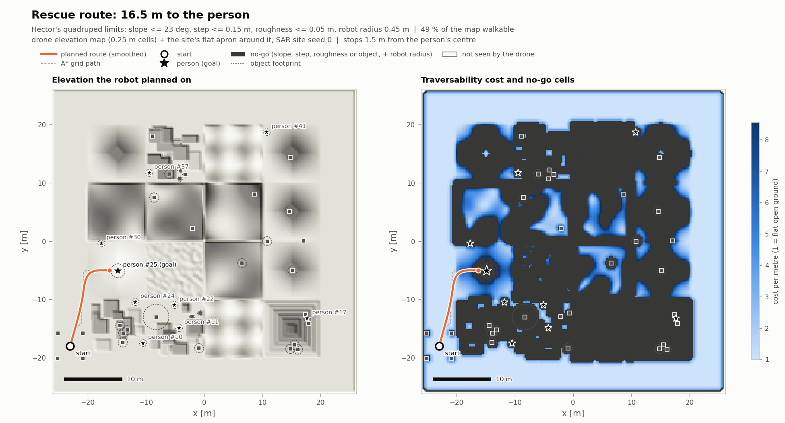

*The plan of the recorded finale, drawn by `plot_plan`
([`plots.py:265-370`](../sim/src/drone_lab/teaming/plots.py#L265-L370)) from the report of the recorded live mission,
which is not in the repository ([`sim/README.md:163-168`](../sim/README.md#L163-L168)). Left: the heights the robot
planned on. Right: the cost per metre (blue, 1 = flat open ground) and the no-go cells (dark). Orange: the final route,
16.5 m from the landing pad (circle) to a stop 1.6 m from pin #32 (star); dashed: the raw A\* path; dotted circles:
footprints. The route turns on the flat border and comes straight down the crater's west wall, as the cross-slope
cost of 10.2 asks ([`teaming/README.md:135-137`](../sim/src/drone_lab/teaming/README.md#L135-L137)).*

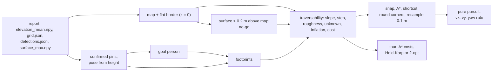

### 10.1 Inputs from a ground-station report

**Elevation map and grid.** `--report <dir>` names a ground-station report (section 9). `load_elevation` reads
`maps/elevation_mean.npy` (`--gcs_layer` picks `max` or `min` instead) and the `"elevation_grid"` entry of
`maps/grid.json`, and checks that the shapes match
([`inputs.py:287-333`](../sim/src/drone_lab/teaming/inputs.py#L287-L333)); it also reads `drone_lab` survey runs and
bare `.npy` files. A map is an array of shape `(ny, nx)` whose row 0 is the southern edge; cell `(iy, ix)` covers
$x_\text{min} + i_x\,\text{res} \le x < x_\text{min} + (i_x + 1)\,\text{res}$, the same in y, and NaN marks a cell the
drone never measured ([`mapping.py:1-4`](../sim/src/drone_lab/mapping.py#L1-L4),
[`:21-23`](../sim/src/drone_lab/mapping.py#L21-L23)). The mission asks for 0.25 m cells, and the ground station pads
the 40 m survey area by 6 m and puts cell centres on multiples of the cell size, so a report of the demo site has
209 × 209 cells starting at −26.125 m ([`sar_mission.py:407`](../sim/scripts/sar_mission.py#L407);
[`state.py:233-248`](../gcs/drone_gcs/state.py#L233-L248); derived). Without `--report` or `--elevation` the planner
uses the ground truth: the seeded terrain mesh of section 2 rasterised to 208 × 208 cells of 0.25 m, each the mean of
3 × 3 vertical-ray samples ([`inputs.py:336-362`](../sim/src/drone_lab/teaming/inputs.py#L336-L362);
[`rescue_finale.py:386-393`](../sim/scripts/rescue_finale.py#L386-L393)).

**Confirmed pins.** The pins come from `--pins`, else the report's `detections.json`, else the dressed site's ground
truth ([`rescue_finale.py:416-426`](../sim/scripts/rescue_finale.py#L416-L426)). `pins_from_data` reads each record's
class, position, id and `confirmed` flag ([`inputs.py:135-211`](../sim/src/drone_lab/teaming/inputs.py#L135-L211)).
Only confirmed pins count unless `--all_pins` is given
([`inputs.py:208-209`](../sim/src/drone_lab/teaming/inputs.py#L208-L209)): objects the tracker detected at least
twice (section 7; [`state.py:48-49`](../gcs/drone_gcs/state.py#L48-L49)). Ground-truth records also carry each
object's exact outline, `footprint_xy`, and its pose, for example `lying_side`
([`scenario.py:466-480`](../sim/src/drone_lab/sar/scenario.py#L466-L480)).

The detector does not say whether a person lies or stands, but the pin's height does. For each of the drone's person
pins, `infer_person_poses` takes the ground as the 25th percentile of the known map cells 1.2-2.0 m from the pin, and
calls the person lying when the pin is less than 0.7 m above it, else standing
([`inputs.py:253-283`](../sim/src/drone_lab/teaming/inputs.py#L253-L283)). The camera looks straight down, so a pin on
a standing person sits on the upper body, 0.8-1.9 m up on the demo site, and a pin on a lying or sitting person at
most 0.5 m up: sitting people count as lying.

**Footprints per class.** A drone pin blocks a circle of its class's radius, the object's own size; the robot's size
is added later by the inflation ([`inputs.py:68-91`](../sim/src/drone_lab/teaming/inputs.py#L68-L91),
[`:214-232`](../sim/src/drone_lab/teaming/inputs.py#L214-L232)):

| Class | Radius [m] | Class | Radius [m] |
|---|---|---|---|
| person | 0.6; the goal person 1.2 lying, 0.7 standing | barrel | 0.45 |
| vehicle | 2.2 | cone | 0.25 |
| crate, pallet | 0.8 | landing_pad | 0: no footprint |

A class missing from the code's table, which also lists classes such as truck and tree, gets 0.5 m. The goal person's
larger circle covers "the body and outstretched arms
(1.8 m long lying, 1.7 m from hand to hand) plus about 0.3 m for the pin's error"; its pose is the inferred one, else
`--person_pose`, default `lying` ([`rescue_finale.py:266-268`](../sim/scripts/rescue_finale.py#L266-L268),
[`:355-364`](../sim/scripts/rescue_finale.py#L355-L364)). A ground-truth pin blocks its exact outline instead. A circle
blocks the cells whose centres lie inside it, and at least the cell the pin is in; an outline blocks the cells whose
centres lie inside it plus every cell it crosses
([`traversability.py:409-471`](../sim/src/drone_lab/teaming/traversability.py#L409-L471)).

**The flat border (apron).** The site is the survey terrain, (−20, 20) m in x and y, plus a flat 6 m border, so
(−26, 26) m ([`inputs.py:379-387`](../sim/src/drone_lab/teaming/inputs.py#L379-L387)). The landing pad stands on the
border, which a survey map leaves out and a report knows only where the drone happened to scan it. So for a drone map,
`extend_with_apron` grows the grid by whole cells where needed, keeps the drone's cells unchanged, and gives z = 0, the
top of Isaac Lab's flat border, to every unknown cell that lies entirely inside the site and entirely outside the
terrain ([`inputs.py:390-445`](../sim/src/drone_lab/teaming/inputs.py#L390-L445);
[`rescue_finale.py:437-451`](../sim/scripts/rescue_finale.py#L437-L451)). Unseen terrain stays unknown. For a perfect
survey run the fill covers 16,928 cells, which a test matches with the terrain mesh to within 1e-6 m
([`test_teaming_task.py:400-415`](../sim/tests/test_teaming_task.py#L400-L415)). On a report's grid the outermost ring
of cells straddles the site's edge at ±26 m and stays unknown: the thin frame around the figure's right panel
(derived from [`inputs.py:434-444`](../sim/src/drone_lab/teaming/inputs.py#L434-L444)). `--no_apron` turns the fill
off.

**Surface-map obstacles.** The elevation map is the bare terrain, because in Isaac Sim the mapping rays hit only the
terrain mesh; a tree or a crate the detector missed is not on it
([`inputs.py:16-21`](../sim/src/drone_lab/teaming/inputs.py#L16-L21)). A report can also hold
`maps/surface_max.npy`, the highest camera-depth point per cell (section 8). After the border fill, every cell where
both maps are known and the surface $s$ lies more than `--obstacle_height` above the elevation, $s - z > 0.2$ m,
becomes a no-go cell ([`inputs.py:449-486`](../sim/src/drone_lab/teaming/inputs.py#L449-L486);
[`rescue_finale.py:459-461`](../sim/scripts/rescue_finale.py#L459-L461)). `plan.json` counts the marked cells and those
that were open ground before ([`rescue_finale.py:496-501`](../sim/scripts/rescue_finale.py#L496-L501),
[`:593-594`](../sim/scripts/rescue_finale.py#L593-L594)), and `--no_surface_obstacles` turns the check off. No walk
has used it, and the 0.2 m threshold is unchecked on a flown mission
([`teaming/README.md:96-98`](../sim/src/drone_lab/teaming/README.md#L96-L98)); section 12.5 shows it on a stand-in
report.

**The start on the landing pad.** The start is `--start X Y`, else the site's ground-truth home, the centre of the
landing pad (unless `--plain_terrain`), else a `landing_pad` pin, else (−23, −18) m
([`rescue_finale.py:428-436`](../sim/scripts/rescue_finale.py#L428-L436)). Home is 3 m outside the area's western
edge, level with the first survey line: (−23, −18) m on the demo site
([`scenario.py:1020-1027`](../sim/src/drone_lab/sar/scenario.py#L1020-L1027); derived). With a drone report, too, the
start comes from the site's ground truth, not from the drone's pin of the pad. A start off the map moves to 0.5 m
inside its edge, with a warning ([`rescue_finale.py:452-457`](../sim/scripts/rescue_finale.py#L452-L457)).

### 10.2 Traversability: where the robot may walk, and at what cost

`compute_traversability` turns the heights into a cost per metre for every cell
([`traversability.py:475-555`](../sim/src/drone_lab/teaming/traversability.py#L475-L555)). It first fills isolated
holes: in up to 2 passes, an unknown cell with at least 5 known neighbours of 8 gets their mean, so a missed ray closes
but an unseen area stays unknown ([`traversability.py:272-298`](../sim/src/drone_lab/teaming/traversability.py#L272-L298)).
Then it computes three terrain features.

**Slope and roughness from a plane fit.** Around each cell $i$, the window $W_i$ holds the cells at offsets
$(o_x, o_y)$ with $o_x^2 + o_y^2 \le (k + 0.5)^2$, where $k = \max(1, \text{round}(\text{fit radius}/\text{res}))$
([`traversability.py:301-305`](../sim/src/drone_lab/teaming/traversability.py#L301-L305),
[`:330-333`](../sim/src/drone_lab/teaming/traversability.py#L330-L333)). Over the known cells of the window, with the
offsets $(\Delta x_j, \Delta y_j)$ in metres, a plane is fitted by least squares:

$$\min_{a,\,g_x,\,g_y}\ \sum_{j \in W_i,\ z_j\ \text{known}} \big(z_j - a - g_x\,\Delta x_j - g_y\,\Delta y_j\big)^2$$

The code builds the 3 × 3 normal equations from nine window sums (`ndimage.correlate`; a tenth, of $z^2$, gives the
residual), adds a ridge of $10^{-10}$ times the diagonal, and solves them for all cells at once
([`traversability.py:340-369`](../sim/src/drone_lab/teaming/traversability.py#L340-L369)). The gradient
$(g_x, g_y)$ gives the slope $\beta = \arctan\sqrt{g_x^2 + g_y^2}$ in degrees (`slope_deg`); the roughness $\rho$
(`rough`) is the RMS residual of the fit, $\sqrt{\text{RSS}/n}$ over the $n$ known cells
([`traversability.py:370-375`](../sim/src/drone_lab/teaming/traversability.py#L370-L375),
[`:511`](../sim/src/drone_lab/teaming/traversability.py#L511)). The fit counts only when the cell is known and
$n \ge \max(3,\ 0.6\,\lvert W_i\rvert)$ ([`:354`](../sim/src/drone_lab/teaming/traversability.py#L354)). At 0.25 m,
the custom quadruped's 0.45 m radius gives $k = 2$, a 21-cell disk that needs 13 known cells and reaches cell centres
0.56 m away; the Go2's 0.35 m gives the 3 × 3 block, which needs 6 (derived).

**Step height.** A plane fit smooths a ledge into a slope, so the step is measured separately
([`traversability.py:379-406`](../sim/src/drone_lab/teaming/traversability.py#L379-L406)). Each cell gets a gradient
per cell, $g^\text{mm}$, the minmod of its forward and backward differences: the one of smaller magnitude when both
have the same sign, else 0 ([`:264-269`](../sim/src/drone_lab/teaming/traversability.py#L264-L269)). The step $\delta$
(`step`) is the largest height jump to a neighbour once that gradient is taken out,

$$\delta_i = \max_{(o_x,\,o_y) \ne (0,0)}\ \big\lvert z_{i+o} - z_i - g_{x,i}^\text{mm}\,o_x - g_{y,i}^\text{mm}\,o_y \big\rvert,$$

over the offsets of a square of half-size $\max(1, \text{round}(0.25/\text{res}))$ cells: at 0.25 m, the 8
neighbours, 0.25 m and 0.354 m away. On a smooth incline the step is about 0; next to a ledge of height $h$, the flat
side's difference of 0 wins the minmod, so the step is $h$. Unknown neighbours are skipped.

**Limits.** A cell is no-go when $\beta > \beta_\text{max}$, $\delta > \delta_\text{max}$ or $\rho > \rho_\text{max}$
([`traversability.py:514-520`](../sim/src/drone_lab/teaming/traversability.py#L514-L520)). The limits belong to the
robot ([`robots.py:60-93`](../sim/src/drone_lab/teaming/robots.py#L60-L93); the Go2 uses the defaults,
[`traversability.py:62-119`](../sim/src/drone_lab/teaming/traversability.py#L62-L119)):

| Setting | Code | `custom` (default) | `go2` |
|---|---|---|---|
| Steepest slope $\beta_\text{max}$ | `max_slope_deg` | 23° | 22° |
| Highest step $\delta_\text{max}$ | `max_step_m` | 0.15 m | 0.12 m |
| Roughest ground $\rho_\text{max}$ (RMS) | `max_roughness_m` | 0.05 m | 0.05 m |
| Plane-fit radius | `footprint_radius_m` | 0.45 m | 0.35 m |
| Robot radius $r$ | `robot_radius_m` | 0.45 m | 0.35 m |
| Cross-slope weight $w_\perp$ | `w_cross_slope` | 6 | 0 |
| Step window; band $b$; weights | `step_radius_m`, `inflation_buffer_m`, `w_*` | 0.25 m; 0.8 m; 6, 4, 3, 3 | the same |

For the custom quadruped the code says it trained on slopes up to 0.4 rise/run (21.8°), stairs up to 0.23 m, boxes up
to 0.1 m and rough ground up to 0.06 m, and that 23° admits the demo crater's walls, fitted over half the body length,
but not steeper ones ([`robots.py:66-71`](../sim/src/drone_lab/teaming/robots.py#L66-L71); section 11 covers the
training terrain). Fitted that way the walls reach about 24° at their steepest, so those parts stay no-go
([`teaming/README.md:119-121`](../sim/src/drone_lab/teaming/README.md#L119-L121)). Flags such as `--max_slope` and
`--robot_radius` override any limit ([`rescue_finale.py:367-377`](../sim/scripts/rescue_finale.py#L367-L377)).

**Unknown cells.** A cell is unknown when it has no height or its plane fit is not valid, for example where too much
of the window lies in a gap ([`traversability.py:513`](../sim/src/drone_lab/teaming/traversability.py#L513)). Unknown
cells are no-go by default; with `unknown_is_lethal=False` they would cost 6 extra per metre instead
([`:105-109`](../sim/src/drone_lab/teaming/traversability.py#L105-L109)).

**Inflation by the robot radius.** The core no-go cells are the bad and the unknown terrain, the footprints and the
surface-map obstacles. A Euclidean distance transform gives every cell its clearance $d$, the distance from its centre
to the nearest core cell's centre, and every cell with $d < r$ becomes no-go too
([`traversability.py:520-525`](../sim/src/drone_lab/teaming/traversability.py#L520-L525)). The planner can then treat
the robot as a point. The distances are quantised to the grid: at 0.25 m, the custom quadruped's 0.45 m closes the 8
neighbours of each core cell and leaves the cell 0.5 m away free, while the Go2's 0.35 m closes only the 4 side
neighbours, since a diagonal one is 0.354 m away (derived).

**The cost of a free cell.** With $q(u) = \min(\max(u, 0), 1)^2$ (`term`), a free cell costs, per metre
([`traversability.py:527-538`](../sim/src/drone_lab/teaming/traversability.py#L527-L538);
weights `w_slope`, `w_step`, `w_roughness`, `w_inflation` at [`:85-103`](../sim/src/drone_lab/teaming/traversability.py#L85-L103)):

$$c = 1 + 6\,q\!\left(\frac{\beta}{\beta_\text{max}}\right) + 4\,q\!\left(\frac{\delta}{\delta_\text{max}}\right) + 3\,q\!\left(\frac{\rho}{\rho_\text{max}}\right) + 3\,q\!\left(1 - \frac{d - r}{b}\right)$$

Flat open ground costs 1, every degree and centimetre costs extra, and no-go cells cost infinity. The last term, the
soft band, keeps routes off edges when there is room: for the custom quadruped it adds 2.64 at $d$ = 0.5 m, 1.17 at
0.75 m, 0.29 at 1.0 m and nothing from 1.25 m on. A 15° slope costs $1 + 6\,(15/23)^2 = 3.55$, and with the defaults
no free cell costs more than 17 per metre (derived).

**Cross-slope cost.** For the custom quadruped a move also pays for the slope across its direction. For a unit
direction $\mathbf u = (u_x, u_y)$, the cross slope comes from the same plane gradient
([`traversability.py:171-184`](../sim/src/drone_lab/teaming/traversability.py#L171-L184)):

$$c_\perp(\mathbf u) = w_\perp\, q\!\left(\frac{\arctan \lvert g_y u_x - g_x u_y \rvert}{\beta_\text{max}}\right) \quad \text{per metre (angle in degrees)}$$

It is 0 along the fall line and largest straight across it: across a 15° slope the custom quadruped pays 2.55 more per
metre (derived). So routes run straight up or down steep ground and turn where it is flat. The term depends on the
direction, so A* adds it per move. The README's reason: on ground of 17° or more, yaw-rate commands of 0.4 rad/s or
more led to speeds above 1.2 m/s in 5-74 % of the cases, below 0.4 rad/s almost never
([`teaming/README.md:128-135`](../sim/src/drone_lab/teaming/README.md#L128-L135); the walk logs are not in the
repository, so UNVERIFIED here). Section 11.6 breaks these numbers down.

### 10.3 A*: the cheapest route on the grid

**Snapping.** `plan_path` first checks that the start and the goal lie on the map
([`planner.py:436-467`](../sim/src/drone_lab/teaming/planner.py#L436-L467)). The start moves to the nearest free cell,
at most 2.0 m away, else planning fails with `start_blocked`
([`:468-474`](../sim/src/drone_lab/teaming/planner.py#L468-L474)). Then the free cells reachable from the start are
labelled with 4-connectivity ([`:257-263`](../sim/src/drone_lab/teaming/planner.py#L257-L263)), which equals
reachability under the A* moves below: a diagonal move needs both cells beside it free, so two side moves can replace
it. The goal is the person's centre, whose own cells are no-go, so it moves to the nearest reachable free cell; if that
cell is more than `max_goal_snap_m` from the person, the person is `unreachable`
([`:475-493`](../sim/src/drone_lab/teaming/planner.py#L475-L493)). The script passes `--max_goal_snap`, 2.5 m; the
function's own default is 6.0 m ([`rescue_finale.py:148-154`](../sim/scripts/rescue_finale.py#L148-L154);
[`planner.py:442`](../sim/src/drone_lab/teaming/planner.py#L442)). This is why
the robot stops beside the person: in the figure 1.6 m from the pin, about a 1.2 m circle plus the 0.45 m inflation.

**The graph.** Every free cell links to its 8 neighbours. A move from $u$ to $v$ of length $\ell$ (res to a side,
$\sqrt2\,$res on a diagonal) costs

$$\ell\,\frac{c_u + c_v}{2} + \ell\,\frac{e_u + e_v}{2},$$

where $e$ is the cross-slope cost $c_\perp$ along the move's axis: x, y, or one of the two diagonals, either way
([`planner.py:127-147`](../sim/src/drone_lab/teaming/planner.py#L127-L147),
[`:494-498`](../sim/src/drone_lab/teaming/planner.py#L494-L498)). A diagonal move may not cut the corner of a no-go cell
([`:234-236`](../sim/src/drone_lab/teaming/planner.py#L234-L236)).

**A\* in brief (background).** A* keeps $g(n)$, the cheapest known cost from the start to node $n$, and always expands
the open node with the smallest $f(n) = g(n) + h(n)$, where $h$ estimates the cost still to go. If $h$ never
overestimates (admissible) and $h(u) \le \text{cost}(u, v) + h(v)$ for neighbours (consistent), each node is expanded
at most once and the goal's $g$ is the least cost when the goal is expanded. Here the open set is a heap of
$(f, g, \text{node})$ with lazy deletion, the grid is a flat list with a ring of infinite-cost cells around it so that
no bounds checks are needed, and the path is read back from a parent array
([`planner.py:167-253`](../sim/src/drone_lab/teaming/planner.py#L167-L253)).

**The heuristic.** With $\Delta_x, \Delta_y$ the cell distances to the goal and $c_\text{min}$ (`cmin`) the cheapest
finite cell cost of the map, at least 1:

$$h = c_\text{min}\,\text{res}\,\big(\max(\Delta_x, \Delta_y) + (\sqrt2 - 1)\min(\Delta_x, \Delta_y)\big)$$

([`planner.py:163-165`](../sim/src/drone_lab/teaming/planner.py#L163-L165),
[`:198-204`](../sim/src/drone_lab/teaming/planner.py#L198-L204); the code writes
$\Delta_x + \Delta_y + (\sqrt2 - 2)\min(\Delta_x, \Delta_y)$). The bracket times res is the octile distance, the
length of the shortest 8-connected path when nothing is in the way. Every move costs at least $\ell\,c_\text{min}$,
since every cell costs at least $c_\text{min}$ and the cross-slope terms are never negative. So no path to the goal
costs less than $h$: the heuristic is admissible. Between neighbours the octile distance changes by at most
$\ell/\text{res}$, so $h(u) \le \text{cost}(u, v) + h(v)$: it is consistent (derived from the code; the docstring
states both,
[`planner.py:8-9`](../sim/src/drone_lab/teaming/planner.py#L8-L9)). The route is therefore the cheapest on this graph;
tests compare it with Dijkstra, with and without direction costs
([`test_teaming_planner.py:73-125`](../sim/tests/test_teaming_planner.py#L73-L125)).

**Shortcuts, rounded corners, resampling.** The A* path runs through cell centres in steps of 45°, so `smooth_path`
cleans it up ([`planner.py:396-432`](../sim/src/drone_lab/teaming/planner.py#L396-L432)):

1. **Shortcuts.** From the first vertex, the planner jumps to the farthest later vertex within 8 m along the path
   whose straight segment stays on free cells and costs at most 2 % more than the stretch it replaces, and repeats
   from there ([`planner.py:346-379`](../sim/src/drone_lab/teaming/planner.py#L346-L379)). A segment's cost,
   `path_cost`, samples it every quarter cell (0.0625 m), sums the nearest cell's cost times the length plus the
   cross-slope cost of each step, and is infinite if any sample is no-go or off the map
   ([`:321-338`](../sim/src/drone_lab/teaming/planner.py#L321-L338)).
2. **Corners.** Three rounds of Chaikin's scheme replace each segment by its points at 1/4 and 3/4, except that the
   path's two ends take the place of the first and the last of these points
   ([`:382-393`](../sim/src/drone_lab/teaming/planner.py#L382-L393)). The rounded path is kept if its cost is
   finite. Otherwise each corner is rounded alone and kept only if safe, and if even that path is not safe the
   shortcut path is used ([`:414-431`](../sim/src/drone_lab/teaming/planner.py#L414-L431)). Rounding is checked for
   safety, not for cost.
3. **Resampling.** The path is cut into $\lceil \text{length}/0.1 \rceil$ equal steps of at most 0.1 m, both ends kept
   ([`:286-299`](../sim/src/drone_lab/teaming/planner.py#L286-L299)).

The script writes `plan.png`, `plan.json` (the plan with its A* cost `graph_cost`, the route, the A* path, the pins and
the settings) and `traversability.npz` (elevation, cost, no-go mask, slope, step, roughness, clearance and the grid)
([`rescue_finale.py:572-638`](../sim/scripts/rescue_finale.py#L572-L638)).

### 10.4 Choosing the person

`--goal X Y` puts a person of pose `--person_pose` there; `--goal_pin ID` picks a pin by its id, a number on a report
(pin #32) or a name on the ground truth (`person_08`)
([`rescue_finale.py:522-531`](../sim/scripts/rescue_finale.py#L522-L531)). Without either, `goal_candidates` sorts the
person pins by the key ($d \notin [15, 25]$ m, not lying, $\lvert d - 20\rvert$), where $d$ is the straight-line
distance from the start ([`rescue_finale.py:56`](../sim/scripts/rescue_finale.py#L56),
[`:343-352`](../sim/scripts/rescue_finale.py#L343-L352)). False sorts before True, so people 15-25 m away come
first, lying ones first among them, then the one nearest 20 m. The script tries the candidates in turn, each with its
own footprints and the 2.5 m limit. It stops at the first route, or at once when the start fails, since then no
person is reachable ([`rescue_finale.py:540-552`](../sim/scripts/rescue_finale.py#L540-L552)). Without any person pin
the goal is (−4.5, −12.5) m ([`:533-538`](../sim/scripts/rescue_finale.py#L533-L538)).

On the ground truth of the demo site the rule tries person_07 (lying, 19.5 m away) first, who cannot be reached within
2.5 m (section 12.5), then takes person_08 (lying, 15.6 m), the person of the finale (derived from the tour run of
section 12.5). A ground-truth pose such as `sitting` does not count as lying, while a drone pin of a sitting person
does. With drone pins, the script also logs which true person the goal pin marks and how far off it is
([`rescue_finale.py:563-570`](../sim/scripts/rescue_finale.py#L563-L570)).

### 10.5 Following the route: pure pursuit

In the simulator, the rescue task runs one `PurePursuitFollower` per robot every policy step and hands its
$(v_x, v_y, \omega)$ to the policy (section 11.4;
[`commands.py:64-74`](../sim/src/drone_lab/tasks/rescue/mdp/commands.py#L64-L74),
[`:254-272`](../sim/src/drone_lab/tasks/rescue/mdp/commands.py#L254-L272)). Each step, given the robot's position and
yaw $\psi$ ([`follower.py:180-242`](../sim/src/drone_lab/teaming/follower.py#L180-L242)):

1. **Progress.** The closest route point is searched only from 0.5 m behind to 2.5 m ahead of the last progress, and
   progress never decreases, so a route that folds back near itself is never skipped
   ([`follower.py:186-188`](../sim/src/drone_lab/teaming/follower.py#L186-L188)).
2. **Stop.** Within 0.35 m of the last point, with at most 0.35 + 0.8 = 1.15 m of route left, the command is zero and
   the follower reports done until it is reset ([`follower.py:195-209`](../sim/src/drone_lab/teaming/follower.py#L195-L209)).
3. **Target.** The look-ahead point lies 0.8 m further along the route, clamped to its end. With $(\Delta x, \Delta y)$
   from the robot to it, the yaw frame gives $l_x = \cos\psi\,\Delta x + \sin\psi\,\Delta y$ and
   $l_y = -\sin\psi\,\Delta x + \cos\psi\,\Delta y$, so the target is at angle $\alpha = \operatorname{atan2}(l_y, l_x)$
   and distance $L$ ([`follower.py:210-216`](../sim/src/drone_lab/teaming/follower.py#L210-L216)).
4. **Turn on the spot.** When $\lvert\alpha\rvert$ exceeds 1.0 rad the robot stops and turns with
   $\omega = 1.2\,\alpha$ until $\lvert\alpha\rvert$ drops below 0.5 rad
   ([`follower.py:217-222`](../sim/src/drone_lab/teaming/follower.py#L217-L222)).
5. **Track.** Otherwise it drives along the arc through the target
   ([`follower.py:224-237`](../sim/src/drone_lab/teaming/follower.py#L224-L237)):

$$\kappa = \frac{2\sin\alpha}{L}, \qquad v_x = v = \max\Big(0.3,\ \min\big(0.7\max(\cos\alpha, 0),\ \frac{0.9}{\lvert\kappa\rvert},\ 0.7\,\frac{d_\text{go}}{1.2}\big)\Big), \qquad \omega = v\,\kappa$$

The curvature is geometry (background): the circle that touches the robot's heading at the robot has its centre on
the robot's side axis at distance $R$, and the target $(L\cos\alpha, L\sin\alpha)$ lies on it when
$(L\cos\alpha)^2 + (L\sin\alpha - R)^2 = R^2$, so $R = L/(2\sin\alpha)$ and $\kappa = 1/R$. The speed is the cruise
speed, 0.7 m/s, reduced when the target is off to the side ($\cos\alpha$), on tight arcs so that $\omega$ stays within
0.9 rad/s, and over the last 1.2 m, where $d_\text{go}$ is the smaller of the distance to the goal and the route left.
It never drops below 0.3 m/s, because policies trained with a lenient tracking reward tend to stand still for commands
below about 0.2 m/s, as the Go2 does ([`follower.py:60-69`](../sim/src/drone_lab/teaming/follower.py#L60-L69)). A
sideways velocity $v_y = 0.6\,e$, clipped to ±0.25 m/s, pulls the robot back onto the route, where $e$ is the sideways
offset of the closest route point in the robot's frame. With $L$ = 0.8 m (derived):

| $\alpha$ [rad] | $\kappa$ [1/m] | $v$ [m/s] | $\omega$ [rad/s] |
|---|---|---|---|
| 0.1 | 0.25 | 0.70 | 0.17 |
| 0.5 | 1.20 | 0.61 | 0.74 |
| 0.8 | 1.79 | 0.49 | 0.87 |
| 1.0 | 2.10 | 0.38 | 0.80 |

Near the goal the ramp reaches the 0.3 m/s floor 0.51 m from it (derived). Finally every output is clipped to the
policy's command ranges, copied from the training task: (−1, 1) for $v_x$, $v_y$ and $\omega$
([`follower.py:239`](../sim/src/drone_lab/teaming/follower.py#L239);
[`rescue_env_cfg.py:179-187`](../sim/src/drone_lab/tasks/rescue/rescue_env_cfg.py#L179-L187);
`isaaclab_tasks/core/velocity/velocity_env_cfg.py:146` (Isaac Lab 3.0.0)). With the default settings only $\omega$ can
reach the clip: on the spot above 0.83 rad, and on tight arcs to a target less than about 0.5 m away, as near the
route's end, where the 0.3 m/s floor can push $v\kappa$ past 1 rad/s (derived). The rescue task's command config
holds the values above ([`commands_cfg.py:94-113`](../sim/src/drone_lab/tasks/rescue/mdp/commands_cfg.py#L94-L113);
the turn and slow-down settings are the follower's defaults,
[`follower.py:70-87`](../sim/src/drone_lab/teaming/follower.py#L70-L87)), and `--speed` and `--lookahead` change the
cruise speed and the look-ahead ([`rescue_finale.py:313-323`](../sim/scripts/rescue_finale.py#L313-L323)).

### 10.6 Several people: the tour

`--tour` plans one route from the start past every reachable person, `--tour N` past the N reachable people nearest
to the start in a straight line ([`rescue_finale.py:172-188`](../sim/scripts/rescue_finale.py#L172-L188),
[`:670-712`](../sim/scripts/rescue_finale.py#L670-L712)). Every person gets the goal's footprint, so one cost map
serves the whole tour ([`:687-692`](../sim/scripts/rescue_finale.py#L687-L692)), and each person is first planned
alone with the 2.5 m limit; the unreachable ones are logged and left out. `plan_tour` then works in three steps
([`tour.py:196-257`](../sim/src/drone_lab/teaming/tour.py#L196-L257)).

**Costs.** Node 0 is the start and node $k$ the stop next to person $k$; $C_{ij}$ is the A* cost between two nodes,
cross-slope included. A move costs the same both ways, so the matrix is symmetric and each pair is planned once
([`tour.py:226-235`](../sim/src/drone_lab/teaming/tour.py#L226-L235)).

**Order.** The tour is an open route: it starts at node 0, visits every stop once and does not return. Up to 12 stops,
Held-Karp finds the cheapest order exactly. $B(S, j)$, the cost of the cheapest route that starts at 0, visits exactly
the stops in $S$ and ends at $j$, follows from smaller sets:

$$B(\lbrace j\rbrace, j) = C_{0j}, \qquad B(S \cup \lbrace j\rbrace, j) = \min_{i \in S}\ \big(B(S, i) + C_{ij}\big), \qquad \text{tour cost} = \min_j B(\text{all}, j)$$

Sets are bit masks counted upwards, so every set comes after the sets it grows from; that is $n^2 2^n$ steps for $n$
stops, 589,824 for 12 (derived; "about 600,000" in the code) ([`tour.py:37-38`](../sim/src/drone_lab/teaming/tour.py#L37-L38),
[`:119-161`](../sim/src/drone_lab/teaming/tour.py#L119-L161)). Above 12 stops the order starts as nearest neighbour,
always the cheapest unvisited stop next, and 2-opt reverses any stretch of it as long as that lowers the cost: good,
but not always the best ([`tour.py:164-192`](../sim/src/drone_lab/teaming/tour.py#L164-L192),
[`:237-242`](../sim/src/drone_lab/teaming/tour.py#L237-L242)). Tests compare Held-Karp with brute force over all
orders, on random tables and on maps ([`test_teaming_tour.py:127-148`](../sim/tests/test_teaming_tour.py#L127-L148),
[`:178-213`](../sim/tests/test_teaming_tour.py#L178-L213)).

**Legs.** Each leg is a smoothed `plan_path` from the previous stop to the next person. It snaps to the same stop as
from the start, because the cells reachable from a stop are those reachable from the start
([`tour.py:245-251`](../sim/src/drone_lab/teaming/tour.py#L245-L251)). The tour's length is the sum of the legs'
smoothed lengths, its cost the sum of their A* costs ([`tour.py:61-79`](../sim/src/drone_lab/teaming/tour.py#L61-L79)),
and its walking time an estimate: the length over the cruise speed
([`rescue_finale.py:715-720`](../sim/scripts/rescue_finale.py#L715-L720)).

The run writes `tour.png`, `tour.json` and `tour_legs.sh`: one `rescue_finale.py` command per leg, from the leg's start
to its person by `--goal_pin`, with this run's map and robot options
([`rescue_finale.py:642-667`](../sim/scripts/rescue_finale.py#L642-L667),
[`:779-787`](../sim/scripts/rescue_finale.py#L779-L787)). Each command passes `--tour_footprints`, because a single
plan gives only its goal the pose-sized footprint and every other person 0.6 m, so a leg could otherwise take another
path than the tour's. A test on a synthetic report of a flat site runs every leg command and gets the tour's path to
within 1e-6 m ([`test_teaming_tour.py:552-563`](../sim/tests/test_teaming_tour.py#L552-L563)). Section 12.5 shows the
tour on the ground truth; no tour has been walked yet
([`teaming/README.md:223-224`](../sim/src/drone_lab/teaming/README.md#L223-L224)).

### Questions an advisor might ask

**Is the route optimal?** On the 8-connected grid, yes: the heuristic, octile distance times the cheapest cell cost,
never overestimates, and tests compare A* with Dijkstra
([`planner.py:198-204`](../sim/src/drone_lab/teaming/planner.py#L198-L204);
[`test_teaming_planner.py:73-125`](../sim/tests/test_teaming_planner.py#L73-L125)). The smoothed route the robot
follows has no such guarantee: a shortcut may cost up to 2 % more than the stretch it replaces, and rounding is
checked only for safety ([`planner.py:374`](../sim/src/drone_lab/teaming/planner.py#L374),
[`:414-431`](../sim/src/drone_lab/teaming/planner.py#L414-L431)).

**Why does the robot stop about 1.6 m from the person?** A drone pin of a lying person blocks a 1.2 m circle (body,
arms and pin error), inflated by the 0.45 m robot radius, and the goal snaps to the nearest free cell reachable from
the start ([`rescue_finale.py:266-268`](../sim/scripts/rescue_finale.py#L266-L268);
[`planner.py:475-493`](../sim/src/drone_lab/teaming/planner.py#L475-L493)). The follower then stops within 0.35 m of
the route's end ([`follower.py:195-196`](../sim/src/drone_lab/teaming/follower.py#L195-L196)).

**What happens on ground the drone never saw?** It is unknown, and unknown is no-go by default. Only isolated holes
are filled (with the mean of their known neighbours), a plane fit needs 60 % of its window, and the only other heights
the drone did not measure are the flat border's z = 0, on cells entirely on it
([`traversability.py:105`](../sim/src/drone_lab/teaming/traversability.py#L105),
[`:272-298`](../sim/src/drone_lab/teaming/traversability.py#L272-L298), [`:513`](../sim/src/drone_lab/teaming/traversability.py#L513);
[`inputs.py:434-444`](../sim/src/drone_lab/teaming/inputs.py#L434-L444)).

**Why a cross-slope cost, and only for the custom quadruped?** Turning on a steep descent makes this policy run away
downhill, so its routes should cross steep ground along the fall line and turn on flat ground. The Go2 keeps weight 0
([`robots.py:66-78`](../sim/src/drone_lab/teaming/robots.py#L66-L78);
[`traversability.py:91`](../sim/src/drone_lab/teaming/traversability.py#L91)). The walk statistics behind it are in
the README only (UNVERIFIED here).

**Can the smoothing cut through a no-go cell?** Every shortcut and every rounded corner is kept only if `path_cost` is
finite, and `path_cost` returns infinity for any no-go or off-map sample, taken every quarter cell
([`planner.py:321-338`](../sim/src/drone_lab/teaming/planner.py#L321-L338),
[`:374`](../sim/src/drone_lab/teaming/planner.py#L374)). A no-go corner thinner than 0.0625 m could in principle slip
between two samples (derived).

**Does the robot keep 0.45 m from every obstacle?** Not exactly: clearance runs between cell centres, so at 0.25 m
the cells 0.5 m from a no-go cell stay free, and the route may pass anywhere inside a free cell
([`traversability.py:524-525`](../sim/src/drone_lab/teaming/traversability.py#L524-L525); derived). The soft band
charges for any clearance under 1.25 m, so routes keep more where there is room
([`traversability.py:533-535`](../sim/src/drone_lab/teaming/traversability.py#L533-L535)).

**Is the tour order optimal?** For up to 12 people, yes: Held-Karp is exact over open routes on the A* costs. Above
12, nearest neighbour with 2-opt may miss the best, and `tour.json` names the method
([`tour.py:37-38`](../sim/src/drone_lab/teaming/tour.py#L37-L38), [`:237-242`](../sim/src/drone_lab/teaming/tour.py#L237-L242)).
The order minimises A* cost, not length, and the legs are smoothed afterwards.

**What do false alarms cost?** Every confirmed pin becomes a footprint, false alarms included, so a false alarm can
close open ground ([`inputs.py:214-232`](../sim/src/drone_lab/teaming/inputs.py#L214-L232)). One on the landing pad
moves the start to the nearest free cell, and planning fails if none lies within 2.0 m
([`planner.py:468-474`](../sim/src/drone_lab/teaming/planner.py#L468-L474)). A false person pin can even become the
goal; the goal check then logs its distance to the nearest true person
([`rescue_finale.py:563-570`](../sim/scripts/rescue_finale.py#L563-L570)).

## 11. Walking with reinforcement learning

The ground robot is a custom quadruped with 12 joints. Its walking policy is a neural network trained with PPO in
Isaac Lab 2.3.2. Fifty times a second it reads a velocity command $(v_x, v_y, \omega_z)$ in the robot's own frame, the
state of its body and joints, and a height scan of the ground, and it outputs 12 joint targets. The rescue finale
trains nothing: it runs the frozen policy and replaces the random commands of training with the commands of a path
follower on the planned route. Section 3 explains the RL loop and PPO; section 10 explains the planner and the
follower.

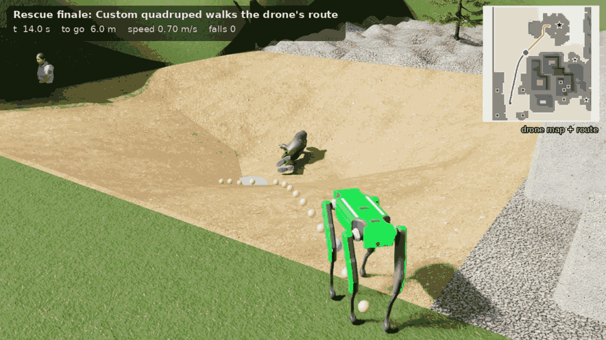

*The last 10 s of a recorded finale (HUD clock 16.0-26.3 s): the robot walks down into the crater to the person lying
there; the minimap shows the drone's map and the route. The 24.3 s arrival matches the single-robot run on the live
mission's report ([`sim/README.md:171-173`](../sim/README.md#L171-L173)).*

### 11.1 The robot

**Joints and limits.** The robot has 12 revolute joints and 17 rigid bodies: the trunk, and per leg a hip, thigh, calf
and foot. Isaac Sim PhysX orders the joints breadth-first: the four hips (front-left FL, front-right FR, rear-left RL,
rear-right RR), then the four thighs, then the four calves. The policy's joint observations and actions use this
order ([`custom_quad.py:54-91`](../quadruped/src/quadruped_lab/assets/custom_quad.py#L54-L91)). A recorded run log
gives the limits: hip ±0.611 rad (±35°), thigh −1.222 to 0 rad (−70° to 0°), calf 0.349 to 2.443 rad (20° to 140°),
and a solver limit of 10 rad/s and 45 N·m on every joint
([`zero_agent_rough_excerpt.log:7-18`](../quadruped/tests/data/zero_agent_rough_excerpt.log#L7-L18)).

**Mass.** UNVERIFIED in this repository: the robot's USD files are Git LFS pointers in this checkout. PORT_NOTES gives
the trunk 9.70 kg and per leg hip 1.16, thigh 1.24, calf 0.66 and foot 0.015 kg, about 22 kg in total
([`PORT_NOTES.md:109-111`](../quadruped/PORT_NOTES.md#L109-L111)).

**Default pose.** Hips 4°, thighs −50°, calves 100°; the root spawns at 0.719 m
([`custom_quad.py:118-128`](../quadruped/src/quadruped_lab/assets/custom_quad.py#L118-L128)). In this pose the trunk
origin is 0.452 m above flat ground, so every reset drops the robot about 0.27 m. The port keeps that drop for parity
with the checkpoint ([`PORT_NOTES.md:114-116`](../quadruped/PORT_NOTES.md#L114-L116)).

**Actuators.** One DC-motor model drives all 12 joints: stiffness $k_p = 60$ N·m/rad, damping $k_d = 1.5$ N·m·s/rad,
effort limit and saturation 45 N·m, no-load speed 21 rad/s
([`custom_quad.py:135-146`](../quadruped/src/quadruped_lab/assets/custom_quad.py#L135-L146)). On every physics step a
PD law turns the joint target $q^\ast$ into a torque, clipped to a linear torque-speed curve
(`isaaclab/actuators/actuator_pd.py:319-333,421-433` (Isaac Lab 3.0.0); the velocity target is 0 because the action
sets positions only, `isaaclab/envs/mdp/actions/joint_actions.py:196-198` (Isaac Lab 3.0.0)):

$$\tau = \mathrm{clip}\Big(k_p\,(q^\ast - q) - k_d\,\dot q,\ \ \max\big({-45},\ 45\,(-1 - \dot q/21)\big),\ \ \min\big(45,\ 45\,(1 - \dot q/21)\big)\Big)$$

The solver's 10 rad/s, not the motor's 21 rad/s, bounds the joint speed
([`PORT_NOTES.md:530-531`](../quadruped/PORT_NOTES.md#L530-L531)).

**Height scanner.** Its settings are inherited
(`isaaclab_tasks/core/velocity/velocity_env_cfg.py:108-116` (Isaac Lab 3.0.0)); this repository only mounts it on the
trunk ([`rough_env_cfg.py:87`](../quadruped/src/quadruped_lab/tasks/locomotion/config/custom_quad/rough_env_cfg.py#L87)).
A grid of 1.6 m along the body by 1.0 m across, at 0.1 m spacing, gives 17 × 11 = 187 rays
(`isaaclab/sensors/ray_caster/patterns/patterns.py:45-46` (Isaac Lab 3.0.0)). The rays start 20 m above the trunk
origin and point straight down; the grid turns with the robot's heading but does not tilt with its pitch or roll
(`isaaclab/sensors/ray_caster/kernels.py:109-118` (Isaac Lab 3.0.0)). Each ray gives one value
(`isaaclab/envs/mdp/observations.py:293-300` (Isaac Lab 3.0.0)):

$$h_i = z_\text{trunk} - z_{\text{hit},i} - 0.5, \qquad \text{clipped to } [-1, 1]$$

So the scan sees ground from 1.5 m below to 0.5 m above the trunk origin and saturates outside that band (derived).
It refreshes every 0.02 s (`isaaclab_tasks/core/velocity/velocity_env_cfg.py:363-364` (Isaac Lab 3.0.0)) and sees only
the mesh `/World/ground` ([`test_teaming_task.py:93`](../sim/tests/test_teaming_task.py#L93)). A known Isaac Lab issue
is kept for parity: with float32 timestamps the scanner skips every other refresh after about 16 s of an episode
([`PORT_NOTES.md:532-534`](../quadruped/PORT_NOTES.md#L532-L534)). A contact sensor on every body, with a 3-sample
history updated every physics step, feeds the fall check and `feet_air_time`
(`isaaclab_tasks/core/velocity/velocity_env_cfg.py:117,365-366` (Isaac Lab 3.0.0)).

### 11.2 The locomotion task

The task `Isaac-Velocity-Rough-Custom-Quad-v0`
([`__init__.py:37-47`](../quadruped/src/quadruped_lab/tasks/locomotion/config/custom_quad/__init__.py#L37-L47)) uses
`CustomQuadRoughEnvCfg`, a subclass of Isaac Lab's `LocomotionVelocityRoughEnvCfg`. The subclass sets only the robot,
the scanner mount, two sub-terrains, the action scale, some events, some rewards, the fall bodies and the physics
settings
([`rough_env_cfg.py:67-130`](../quadruped/src/quadruped_lab/tasks/locomotion/config/custom_quad/rough_env_cfg.py#L67-L130)).
The rest is inherited from Isaac Lab, outside this repository: **IL3** marks such a value, read from the installed
Isaac Lab 3.0.0 wheel and UNVERIFIED in this repository.

The policy was trained in Isaac Lab 2.3.2; this config is the 3.0 port. A static comparison with all 214 values the
2.x configs set needs the 2.x sources and could not be re-run here
([`PORT_NOTES.md:138-152`](../quadruped/PORT_NOTES.md#L138-L152)). The 2.x config file was saved 4 minutes after the
checkpoint, so "the exact reward and event settings of the training run cannot be recovered"; only the observation
interface provably matches the weights ([`PORT_NOTES.md:167-171`](../quadruped/PORT_NOTES.md#L167-L171)).

**Timing (IL3).** Physics runs at 200 Hz (dt 0.005 s) with decimation 4, so the policy acts at 50 Hz. An episode lasts
20 s, i.e. 1,000 policy steps; the default is 4,096 parallel environments
(`isaaclab_tasks/core/velocity/velocity_env_cfg.py:341,355-358` (Isaac Lab 3.0.0); dt and decimation asserted in
[`test_task_configs.py:140`](../quadruped/tests/test_task_configs.py#L140)).

**Terrain and curriculum (IL3 unless marked).** `ROUGH_TERRAINS_CFG` builds 10 rows × 20 columns of 8 m × 8 m tiles,
one sub-terrain type per column (`isaaclab/terrains/config/rough.py:11-53` (Isaac Lab 3.0.0)). Row $i$ has the
difficulty $d = (i + U(0,1))/10$, which moves each range below from its low end to its high end
(`isaaclab/terrains/terrain_generator.py:259-261` (Isaac Lab 3.0.0)):

| Sub-terrain | Share of columns | Range |
|---|---|---|
| pyramid stairs, up / down | 0.2 / 0.2 | steps 0.05-0.23 m high, 0.3 m deep |
| boxes | 0.2 | 0.45 m grid, heights 0.025-0.1 m (here; base 0.05-0.2) |
| random rough | 0.2 | noise 0.01-0.06 m in 0.01 m steps (here; base 0.02-0.10 in 0.02) |
| pyramid slope, up / down | 0.1 / 0.1 | slope 0-0.4 rise/run (0-21.8°) |

The overrides are in
[`rough_env_cfg.py:88-92`](../quadruped/src/quadruped_lab/tasks/locomotion/config/custom_quad/rough_env_cfg.py#L88-L92).
Unlike Isaac Lab's Go2 task, the stairs are not scaled down (Go2: 0.025-0.12 m,
`isaaclab_tasks/core/velocity/config/go2/rough_env_cfg.py:58-59` (Isaac Lab 3.0.0)). The only curriculum term,
`terrain_levels_vel`, starts robots on rows 0-5. At each reset it moves a robot one row up if it walked more than 4 m
(half a tile) from its tile's origin, and one row down if it walked less than half of what its command asked for,
$0.5 \cdot 20\ \text{s} \cdot \lVert c_{xy}\rVert$. A robot that climbs past the top row goes to a random row
(`isaaclab_tasks/core/velocity/velocity_env_cfg.py:89,322-326`,
`isaaclab_tasks/core/velocity/mdp/curriculums.py:43-50`,
`isaaclab/terrains/terrain_importer.py:366-373` (Isaac Lab 3.0.0)).

**Velocity commands (IL3, unchanged here).** Every 10 s each robot draws $c_x, c_y \sim U(-1, 1)$ m/s and a heading
target $\psi^\ast \sim U(-\pi, \pi)$. Every robot is a heading robot (`rel_heading_envs=1.0`), so each step its
yaw-rate command comes from the heading error, $c_\omega = \mathrm{clip}(0.5\,\mathrm{wrap}(\psi^\ast - \psi), -1, 1)$
rad/s. 2 % of the robots get the zero command and must stand. The command ranges have no curriculum
(`isaaclab_tasks/core/velocity/velocity_env_cfg.py:137-148`, `isaaclab/envs/mdp/commands/velocity_command.py:158-192`
(Isaac Lab 3.0.0)).

**Observations.** 235 values in this order (term list IL3,
`isaaclab_tasks/core/velocity/velocity_env_cfg.py:162-186` (Isaac Lab 3.0.0); layout in
[`PORT_NOTES.md:121-136`](../quadruped/PORT_NOTES.md#L121-L136), asserted in
[`test_task_configs.py:116-140`](../quadruped/tests/test_task_configs.py#L116-L140)):

| Indices | Term | Content | Training noise |
|---|---|---|---|
| 0-2 | `base_lin_vel` | trunk linear velocity, base frame [m/s] | U(±0.1) |
| 3-5 | `base_ang_vel` | trunk angular velocity, base frame [rad/s] | U(±0.2) |
| 6-8 | `projected_gravity` | unit gravity vector in the base frame (the tilt) | U(±0.05) |
| 9-11 | `velocity_commands` | the command $(c_x, c_y, c_\omega)$ | none |
| 12-23 | `joint_pos` | $q - q_0$ [rad] | U(±0.01) |
| 24-35 | `joint_vel` | $\dot q$ [rad/s] | U(±1.5) |
| 36-47 | `actions` | the previous raw action $a_{t-1}$ | none |
| 48-234 | `height_scan` | $h_i$ of the 187 rays, clipped after the noise | U(±0.1) |

No term is scaled ([`test_task_configs.py:131`](../quadruped/tests/test_task_configs.py#L131)). The noise is off in
play mode and in the rescue.

**Actions.** The policy outputs 12 numbers $a$, one per joint in the order above. Each becomes a position target
around the default pose $q_0$, with scale 0.25 instead of the base's 0.5
([`rough_env_cfg.py:94-95`](../quadruped/src/quadruped_lab/tasks/locomotion/config/custom_quad/rough_env_cfg.py#L94-L95)):
$q^\ast_j = q_{0,j} + 0.25\,a_j$. Nothing clips $a$ (`isaaclab/envs/mdp/actions/joint_actions.py:169-177`,
`isaaclab_rl/rsl_rl/rl_cfg.py:287` (Isaac Lab 3.0.0)). The trained policy's mean $\lvert a\rvert$ is 2.5
([`PORT_NOTES.md:275-277`](../quadruped/PORT_NOTES.md#L275-L277)), so its targets sit about 0.6 rad from the default
pose on average (derived).

**Rewards.** The reward of a step is $r_t = \Delta t \sum_i w_i\, f_i(s_t)$ with $\Delta t = 0.02$ s; terms of weight 0
are skipped (`isaaclab/managers/reward_manager.py:125-154` (Isaac Lab 3.0.0)). Here $c$ is the command, $v^b$ and
$\omega^b$ the trunk's linear and angular velocity in the base frame, $g^b$ the projected gravity, $\tau$ the clipped
motor torques, $\ddot q$ the joint accelerations and $a_t$ the raw action.

| Term | Weight | Where set | $f_i$ | Rewards (+) or penalises (−) |
|---|---|---|---|---|
| `track_lin_vel_xy_exp` | +1.5 | here (base 1.0) | $\exp(-\lVert c_{xy} - v^b_{xy}\rVert^2 / 0.25)$ | tracking the planar velocity |
| `track_ang_vel_z_exp` | +0.75 | here (base 0.5) | $\exp(-(c_\omega - \omega^b_z)^2 / 0.25)$ | tracking the yaw rate |
| `lin_vel_z_l2` | −2.0 | IL3 | $(v^b_z)^2$ | bouncing |
| `ang_vel_xy_l2` | −0.05 | IL3 | $(\omega^b_x)^2 + (\omega^b_y)^2$ | rolling and pitching |
| `dof_torques_l2` | −2.0e-4 | here (base −1.0e-5) | $\sum_j \tau_j^2$ | motor effort |
| `dof_acc_l2` | −2.5e-7 | here (same as base) | $\sum_j \ddot q_j^2$ | jerky joints |
| `action_rate_l2` | −0.01 | IL3 | $\sum_j (a_{t,j} - a_{t-1,j})^2$ | changing the action between steps |
| `feet_air_time` | +0.01 | here (base 0.125) | $\sum_\text{feet}(t_\text{air} - 0.5)$ at each touchdown, only if $\lVert c_{xy}\rVert \gt 0.1$ | long steps; never pays here |
| `undesired_contacts` | removed | here (base −1.0) | number of thighs touching with more than 1 N | — |
| `flat_orientation_l2` | 0 | IL3 | $(g^b_x)^2 + (g^b_y)^2$ | trunk tilt (off) |
| `dof_pos_limits` | 0 | IL3 | distance beyond the soft joint limits (90 % of each range) | joint limits (off) |

The weights set here
([`rough_env_cfg.py:120-127`](../quadruped/src/quadruped_lab/tasks/locomotion/config/custom_quad/rough_env_cfg.py#L120-L127))
equal those of Isaac Lab's Go2 rough task
(`isaaclab_tasks/core/velocity/config/go2/rough_env_cfg.py:63-69` (Isaac Lab 3.0.0)); the configs started from Isaac
Lab's Unitree A1 example
([`README.md:174-177`](../quadruped/README.md#L174-L177)). The formulas are in
`isaaclab/envs/mdp/rewards.py:102-120,168-176,196-204,227-241,288-312,343-363` and
`isaaclab_tasks/core/velocity/mdp/rewards.py:24-43`; the kernel's $\sigma^2 = 0.25$ (std 0.5) and the 0.5 s air-time
threshold are in
`isaaclab_tasks/core/velocity/velocity_env_cfg.py:280-300` (Isaac Lab 3.0.0).

`feet_air_time` never pays. Each calf's collision mesh encloses the 1.5 cm foot sphere, so the feet never touch the
ground and the robot walks on its calves. The term logged 0.0000 in every Isaac Lab 3.0 training run, and in 2.3.2 the
largest foot force was 0.0 N ([`PORT_NOTES.md:283-296`](../quadruped/PORT_NOTES.md#L283-L296)). The "reward per
episode" quoted in 11.6 is the episode sum divided by 20 s
(`isaaclab/managers/reward_manager.py:116` (Isaac Lab 3.0.0);
[`eval_policy.py:16-17`](../quadruped/scripts/eval_policy.py#L16-L17)), so the two tracking terms add at most
1.5 + 0.75 = 2.25 to it (derived).

**Terminations.** `time_out` ends an episode after 1,000 steps and counts as a time-out, not a failure
(`isaaclab_tasks/core/velocity/velocity_env_cfg.py:315` (Isaac Lab 3.0.0)). `base_contact` is a fall: the contact force
on the trunk or on any thigh exceeds 1 N in any of the last 3 contact samples
(`isaaclab/envs/mdp/terminations.py:175-182` (Isaac Lab 3.0.0)). The bodies `["trunk", ".*_thigh"]` are set here
([`rough_env_cfg.py:129-130`](../quadruped/src/quadruped_lab/tasks/locomotion/config/custom_quad/rough_env_cfg.py#L129-L130)).
About 94 % of play-mode falls are thigh contacts ([`PORT_NOTES.md:276-277`](../quadruped/PORT_NOTES.md#L276-L277)).

**Domain randomisation and resets**
(base `isaaclab_tasks/core/velocity/velocity_env_cfg.py:192-272` (Isaac Lab 3.0.0); overrides in
[`rough_env_cfg.py:97-118`](../quadruped/src/quadruped_lab/tasks/locomotion/config/custom_quad/rough_env_cfg.py#L97-L118)):

| Event | When | Effect |
|---|---|---|
| `physics_material` | start-up | robot friction 0.8 static, 0.6 dynamic, restitution 0: fixed values (IL3) |
| `add_base_mass` | start-up | adds U(−1, 3) kg to the trunk (here) |
| `base_com` | start-up | trunk centre of mass moved U(±0.05) m in x and y, U(±0.01) m in z (range IL3) |
| `base_external_force_torque` | reset | zero force and torque: no effect (IL3) |
| `reset_base` | reset | x, y U(±0.5) m around the tile origin, yaw U(±3.14) rad, velocities 0 (here; base ±0.5) |
| `reset_robot_joints` | reset | exactly the default pose (scale (1, 1), here), zero velocity |
| `push_robot` | every 10-15 s | removed here (base: velocity kicks of ±0.5 m/s) |

With the observation noise, that is all the randomisation. The mass event spells out "add, uniform" because Isaac Lab
3.0's default scales the mass instead ([`PORT_NOTES.md:86`](../quadruped/PORT_NOTES.md#L86)).

**PPO settings.** The rsl_rl 5.5 runner keeps the 2.x values unchanged
([`rsl_rl_ppo_cfg.py:20-70`](../quadruped/src/quadruped_lab/tasks/locomotion/config/custom_quad/agents/rsl_rl_ppo_cfg.py#L20-L70));
section 3 explains what each setting does.

| Setting | Value | Note |
|---|---|---|
| actor | MLP 235 → 512 → 256 → 128 → 12, ELU; Gaussian with one learned std per action, initial 1.0 | no observation normalisation |
| critic | MLP 235 → 512 → 256 → 128 → 1, ELU | the same 235 inputs |
| rollout length | 24 steps per environment per iteration | |
| epochs × mini-batches | 5 × 4 | |
| learning rate | 1.0e-3, adapted to keep the KL divergence near 0.01 | |
| discount γ / GAE λ | 0.99 / 0.95 | |
| clip ε | 0.2; the value loss is clipped too | |
| value-loss / entropy coefficient | 0.5 / 0.0025 | A1 template: 1.0 / 0.01 |
| max gradient norm | 1.0 | |
| max iterations / save interval | 80,000 / 50 | A1 template: 1,500; pass `--max_iterations` |
| not set here (IL3) | Adam, seed 42, no action clipping | `isaaclab_rl/rsl_rl/rl_cfg.py:198,239,287` (Isaac Lab 3.0.0) |

One iteration collects 24 transitions per environment: at 1,024 environments, 24,576 transitions in 4 mini-batches of
6,144, and 20 gradient steps (derived). The environment count of the 2.x run is not recorded (UNVERIFIED); the README
trains with 1,024 ([`README.md:87-90`](../quadruped/README.md#L87-L90)).

### 11.3 The checkpoint and its conversion to rsl_rl 5

`scripts/download_assets.sh` fetches two release assets into `quadruped/checkpoints_2x/`, which is absent in this
checkout ([`download_assets.sh:19-20`](../scripts/download_assets.sh#L19-L20)). `height_scanner_model.pt` is the
Isaac Lab 2.x checkpoint in rsl_rl 3.x format, at iteration 13,900: 235 → [512, 256, 128] → 12 with ELU, std
0.249-0.313, no observation normaliser, Adam state at learning rate 1.139e-4. `height_scanner_model_rslrl5.pt` holds
the same weights, optimizer state and iteration in the rsl_rl 5.5 layout; the finale uses it
([`PORT_NOTES.md:175-178`](../quadruped/PORT_NOTES.md#L175-L178)).

**Why convert.** rsl_rl 3.x saved one `model_state_dict` of an `ActorCritic` module, with keys `std`, `actor.N.*` and
`critic.N.*`. rsl_rl 5.x, which Isaac Lab 3.0 uses, loads separate models: `actor_state_dict` with
`distribution.std_param` and `mlp.N.*`, and `critic_state_dict` with `mlp.N.*`
([`convert_rslrl_checkpoint.py:4-19`](../quadruped/scripts/convert_rslrl_checkpoint.py#L4-L19)). The old file has
none of these keys, so `isaaclab play`, fine-tuning and the finale need the new layout.

**How** ([`convert_rslrl_checkpoint.py:79-199`](../quadruped/scripts/convert_rslrl_checkpoint.py#L79-L199)):

1. Load on the CPU with the weights-only unpickler; refuse a file that already has the new layout.
2. Read the architecture from the weights (Linear layers at `nn.Sequential` indices 0, 2, 4, 6; std or log-std).
3. Rename `std` → `distribution.std_param` (or `log_std` → `distribution.log_std_param`), `actor.N.*` → actor
   `mlp.N.*`, `critic.N.*` → critic `mlp.N.*`, and any observation-normaliser tensors → `obs_normalizer.*`. Any other
   tensor is an error.
4. Copy the Adam state unchanged. It is indexed by parameter position, and rsl_rl 3.x (std, actor, critic) and 5.x
   (std_param, actor mlp, critic mlp) optimise the same tensors in the same order; the converter checks every shape.
5. Write a new file atomically, never in place.

**Verification** (`--verify`,
[`convert_rslrl_checkpoint.py:244-310`](../quadruped/scripts/convert_rslrl_checkpoint.py#L244-L310),
[`:349-358`](../quadruped/scripts/convert_rslrl_checkpoint.py#L349-L358)). The script builds the runner as
`isaaclab play` does, loads the new file strictly and compares it, and its TorchScript export, with a hand-written
Linear + ELU pass of the old weights on 4,096 random inputs (half scaled ×3 to reach ELU's flat region). It fails above
1e-5 or on a different iteration. Reported: every difference 0.0, iteration 13,900, learning rate 1.139e-4
([`PORT_NOTES.md:188-196`](../quadruped/PORT_NOTES.md#L188-L196)). The test asserting this
([`test_checkpoint_conversion.py:98-108`](../quadruped/tests/test_checkpoint_conversion.py#L98-L108)) skips without the
files ([`conftest.py:56-61`](../quadruped/tests/conftest.py#L56-L61)), so it was not re-run here.

**Identical weights, different walking.** Two Isaac Lab 3.0 defaults cost the converted policy a quarter of its reward
([`README.md:20-21`](../quadruped/README.md#L20-L21)). 3.0's native actuator path feeds the PD joint positions 1-3
physics substeps old on PhysX, up to 0.19 rad off (about 11 N·m at $k_p = 60$;
[`PORT_NOTES.md:241-243`](../quadruped/PORT_NOTES.md#L241-L243)). And 3.0 applies the TGS solver's external forces on
every position iteration, which 2.3.2 did not ([`PORT_NOTES.md:251-254`](../quadruped/PORT_NOTES.md#L251-L254)). On
Isaac Sim PhysX the project therefore defaults to `sim.use_newton_actuators=False` and
`enable_external_forces_every_iteration=False`, with the 3.0 defaults one override away
([`rough_env_cfg.py:13-17`](../quadruped/src/quadruped_lab/tasks/locomotion/config/custom_quad/rough_env_cfg.py#L13-L17),
[`:71-83`](../quadruped/src/quadruped_lab/tasks/locomotion/config/custom_quad/rough_env_cfg.py#L71-L83)). Section 11.6
gives the numbers.

### 11.4 How the rescue task drives the policy

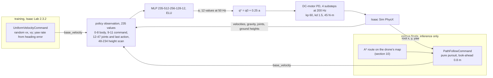

`apply_rescue_task` turns any Isaac Lab velocity-tracking config into the rescue task in place and leaves the robot,
its actions and its policy observations as trained
([`rescue_env_cfg.py:148-214`](../sim/src/drone_lab/tasks/rescue/rescue_env_cfg.py#L148-L214)).
`RescueCustomQuadEnvCfg` applies it with one environment, a 300 s episode and the mission's demo site, seed 0
([`custom_quad/rescue_env_cfg.py:42-52`](../sim/src/drone_lab/tasks/rescue/config/custom_quad/rescue_env_cfg.py#L42-L52)).
A test asserts that the observations, actions, timing, robot, actuators, height scanner and command ranges all equal
the training task's ([`test_teaming_task.py:70-96`](../sim/tests/test_teaming_task.py#L70-L96),
[`:170-201`](../sim/tests/test_teaming_task.py#L170-L201)).

**The command swap.** The command term `base_velocity` becomes a `PathFollowCommandCfg` with the same name and ranges
([`rescue_env_cfg.py:43-44`](../sim/src/drone_lab/tasks/rescue/rescue_env_cfg.py#L43-L44),
[`:178-187`](../sim/src/drone_lab/tasks/rescue/rescue_env_cfg.py#L178-L187)). The observation `velocity_commands`
reads the command by that name (`isaaclab_tasks/core/velocity/velocity_env_cfg.py:173` (Isaac Lab 3.0.0)), so the
follower's output lands in observation indices 9-11, unscaled and noise-free. Each step `PathFollowCommand` passes the
robot's position and yaw to a `PurePursuitFollower`
([`commands.py:254-272`](../sim/src/drone_lab/tasks/rescue/mdp/commands.py#L254-L272)), which section 10.5 explains
with its formulas and settings: it steers along the arc through a point 0.8 m further along the route, turns on the
spot when that point lies more than 1.0 rad off its heading, and sends zero at the route's end
([`follower.py:180-242`](../sim/src/drone_lab/teaming/follower.py#L180-L242)). Every output is finally clipped to the
training ranges, [−1, 1] each ([`follower.py:239`](../sim/src/drone_lab/teaming/follower.py#L239)). So the commands
stay inside what the policy saw in training: forward 0.3-0.7 m/s while driving, sideways at most 0.25 m/s, yaw rate at
most 1 rad/s. The 0.3 m/s floor exists because the policies stand still for much smaller commands
([`commands_cfg.py:97-98`](../sim/src/drone_lab/tasks/rescue/mdp/commands_cfg.py#L97-L98)).

Three details of the hand-over:

* **Timing.** `env.step` computes the command after the physics substeps and resets, right before the observation
  (`isaaclab/envs/manager_based_rl_env.py:271-279` (Isaac Lab 3.0.0)), so each action answers a command computed from
  the latest pose. `env.reset()` computes no command, so the very first observation carries the zero command set at
  reset ([`commands.py:242-252`](../sim/src/drone_lab/tasks/rescue/mdp/commands.py#L242-L252); an inference from the
  code, not discussed in the repository).
* **Frame.** The follower works in a yaw-only frame
  ([`follower.py:212-214`](../sim/src/drone_lab/teaming/follower.py#L212-L214)), while training compared the command
  with the velocity in the full base frame (`isaaclab/envs/mdp/rewards.py:348-351` (Isaac Lab 3.0.0)). On a slope the
  two differ by the trunk's pitch and roll. The code does not compensate, and the effect is not measured.
* **Obstacles.** The scan reads only `/World/ground`, so the policy cannot see people or props; the planner keeps it
  clear of them (section 10). That ground is a plain collision mesh: PhysX stopped colliding with the textured one,
  so the site renders the textures on a copy ([`site.py:1-9`](../sim/src/drone_lab/tasks/rescue/site.py#L1-L9);
  [`teaming/README.md:170-180`](../sim/src/drone_lab/teaming/README.md#L170-L180)).

**What else changes from training**
([`rescue_env_cfg.py:168-213`](../sim/src/drone_lab/tasks/rescue/rescue_env_cfg.py#L168-L213) unless noted):

| | Training | Rescue |
|---|---|---|
| Terrain | `ROUGH_TERRAINS_CFG`, curriculum | the drone's survey terrain: seed 17, 4 × 4 tiles of 10 m, 6 m flat border ([`terrain.py:137-169`](../sim/src/drone_lab/terrain.py#L137-L169); section 2); no curriculum |
| Scene | the robots | the dressed SAR site of seed 0: people, props with colliders, landing pad ([`rescue_env_cfg.py:112-133`](../sim/src/drone_lab/tasks/rescue/rescue_env_cfg.py#L112-L133)) |
| Command | random, heading-controlled | the path follower |
| Observation noise | on | off |
| Events | mass, centre of mass, random reset pose | `physics_material`, the default joint pose, and `reset_root_on_route`: at rest on the route, facing along it, 0.719 m above the terrain (spawn offset 0, [`custom_quad/rescue_env_cfg.py:51-52`](../sim/src/drone_lab/tasks/rescue/config/custom_quad/rescue_env_cfg.py#L51-L52)); after a fall, 0.5 m behind the progress made ([`rescue_terms.py:18-50`](../sim/src/drone_lab/tasks/rescue/mdp/rescue_terms.py#L18-L50); [`commands.py:205-225`](../sim/src/drone_lab/tasks/rescue/mdp/commands.py#L205-L225); [`test_teaming_task.py:114-116`](../sim/tests/test_teaming_task.py#L114-L116)) |
| Terminations | time-out, fall | also `flipped` and `goal_reached` (below) |
| Episode | 20 s | 300 s in the config; the finale sets its own |
| Physics | PhysX with the 2.x settings (default) | Isaac Sim PhysX only, same settings; other backends do not resolve ([`custom_quad/rescue_env_cfg.py:30-52`](../sim/src/drone_lab/tasks/rescue/config/custom_quad/rescue_env_cfg.py#L30-L52); [`test_teaming_task.py:183-189`](../sim/tests/test_teaming_task.py#L183-L189)) |
| Reward | drives PPO | computed and discarded ([`rescue_finale.py:1209`](../sim/scripts/rescue_finale.py#L1209)) |

**Terminations** ([`rescue_env_cfg.py:203-207`](../sim/src/drone_lab/tasks/rescue/rescue_env_cfg.py#L203-L207);
[`rescue_terms.py:53-57`](../sim/src/drone_lab/tasks/rescue/mdp/rescue_terms.py#L53-L57)):

| Term | Fires when | Counts as |
|---|---|---|
| `time_out` | the episode length is reached | time-out |
| `base_contact` | trunk or thigh contact above 1 N, as in training | fall |
| `flipped` | tilt $\arccos(-g^b_z) \gt 1.2$ rad (68.8°), `isaaclab/envs/mdp/terminations.py:66-74` (Isaac Lab 3.0.0) | fall |
| `goal_reached` | the follower is done and the robot has stood 3 s at the goal | time-out |

**The finale's loop.** `rescue_finale.py` runs a TorchScript file as it is. An rsl_rl checkpoint, such as the robot's
default converted one ([`robots.py:65`](../sim/src/drone_lab/teaming/robots.py#L65)), goes through the rsl_rl runner,
and the finale runs a TorchScript-ready copy of its actor that outputs the action mean. Each step it runs
`actions = policy(obs["policy"])` and `base.step(actions)`
([`rescue_finale.py:871-903`](../sim/scripts/rescue_finale.py#L871-L903),
[`:1206-1209`](../sim/scripts/rescue_finale.py#L1206-L1209)). The time budget is $90 + 3L_\text{route}/v_\text{cruise}$
seconds for a route of length $L_\text{route}$, unless `--max_time` is given, and the episode is 30 s longer
([`:1135`](../sim/scripts/rescue_finale.py#L1135), [`:811`](../sim/scripts/rescue_finale.py#L811)): 160.7 s and
190.7 s for a 16.5 m route at 0.7 m/s (derived). Each robot ends in one of four ways, or as interrupted after Ctrl+C
or an error in the loop ([`:1219-1262`](../sim/scripts/rescue_finale.py#L1219-L1262),
[`:1335-1336`](../sim/scripts/rescue_finale.py#L1335-L1336)):

* **reached**, at the first step the follower reports done; this counts as success whatever happens afterwards;
* **fell**, after more than `--retries` falls, default 2 ([`:206-208`](../sim/scripts/rescue_finale.py#L206-L208));
  earlier falls respawn;
* **stuck**, after 30 s without 0.25 m of new progress;
* **timeout**, when the budget runs out first.

The script stops logging a robot 2 s after it arrives ([`:210`](../sim/scripts/rescue_finale.py#L210)), before the
3 s `goal_reached` reset.

### 11.5 The Go2 fallback

`DroneLab-Rescue-Go2-v0` applies the same `apply_rescue_task` to Isaac Lab's `UnitreeGo2RoughEnvCfg`, with one person
on the plain survey terrain; the finale adds the site unless `--plain_terrain` is given
([`go2/rescue_env_cfg.py:20-38`](../sim/src/drone_lab/tasks/rescue/config/go2/rescue_env_cfg.py#L20-L38);
[`rescue_finale.py:812-822`](../sim/scripts/rescue_finale.py#L812-L822)). It runs on Newton MJWarp by default
([`test_teaming_task.py:154-162`](../sim/tests/test_teaming_task.py#L154-L162)), because its policy "flips within
about 2 s on PhysX" ([`robots.py:5-6`](../sim/src/drone_lab/teaming/robots.py#L5-L6)). No Go2 policy is published, so
`--checkpoint` is required; the profile describes it as "600 + 900 iterations on Newton"
([`robots.py:86-94`](../sim/src/drone_lab/teaming/robots.py#L86-L94)). Both claims are UNVERIFIED: the repository holds
no Go2 checkpoint or log. The planner uses its default limits: slope 22°, step 0.12 m, roughness 0.05 m, robot radius
0.35 m and no cross-slope cost ([`traversability.py:66-91`](../sim/src/drone_lab/teaming/traversability.py#L66-L91)).
The Go2's own training task (IL3) adds a base-height penalty (weight −30, target 0.4 m) and halves the action-rate
penalty to −0.005 (`isaaclab_tasks/core/velocity/config/go2/rough_env_cfg.py:17-77` (Isaac Lab 3.0.0)).

### 11.6 Results the documentation reports

None of this was re-run for this document: there is no GPU, no checkpoint and no walk or evaluation output here. The
numbers are quoted as the documents state them; section 12 has the experiments run for this document.

**Locomotion, play mode.** Rough task, 128 environments × 2 episodes × seeds 42-44 = 768 episodes, Isaac Sim PhysX
([`PORT_NOTES.md:207-231`](../quadruped/PORT_NOTES.md#L207-L231)):

| Execution settings | Episode | Falls | Tilt > 60° | Tracking error lin / yaw | Reward / episode |
|---|---|---|---|---|---|
| Isaac Lab 3.0 defaults | 17.82 s | 21.7 % | 5.9 % | 0.258 m/s / 0.157 rad/s | 1.117 |
| actuator setting only | 18.26 s | 18.5 % | 4.8 % | 0.226 / 0.134 | 1.312 |
| TGS setting only | 17.88 s | 19.8 % | 3.8 % | 0.193 / 0.105 | 1.435 |
| **both (project default)** | 18.03 s | **18.9 %** | 3.6 % | 0.196 / 0.102 | **1.471** |
| both, after 20 PPO fine-tuning iterations | 18.25 s | 18.1 % | 3.3 % | 0.194 / 0.102 | 1.497 |
| zero actions (seed 42) | 0.58 s | 100 % | 0 % | 0.913 / 0.693 | −0.101 |

In Isaac Lab 2.3.2 the same checkpoint falls in 18.8 % ± 3.4 % of its first episodes, with tracking errors
0.187 / 0.103 ([`PORT_NOTES.md:209-211`](../quadruped/PORT_NOTES.md#L209-L211)). A fall is a `base_contact` ending;
tilt means projected gravity z above −0.5; the tracking errors are $\lVert c_{xy} - v^b_{xy}\rVert$ and
$\lvert c_\omega - \omega^b_z\rvert$ averaged over alive steps
([`eval_policy.py:12-17`](../quadruped/scripts/eval_policy.py#L12-L17)). The policy trots in a tall stance on its
calves, with the trunk 0.69 m up ([`PORT_NOTES.md:275-279`](../quadruped/PORT_NOTES.md#L275-L279)). On Newton MJWarp
it walks zero-shot through the joint-order remap, with reward 1.285 against 1.491 on PhysX for seed 42
([`PORT_NOTES.md:323-331`](../quadruped/PORT_NOTES.md#L323-L331)).

**Rescue finale, custom quadruped.** Isaac Sim PhysX, site seed 0, 32 robots at once with spawn jitter
([`teaming/README.md:142-165`](../sim/src/drone_lab/teaming/README.md#L142-L165);
[`sim/README.md:171-185`](../sim/README.md#L171-L185)):

| Map and pins | Reached | Time | Planned / walked | Falls |
|---|---|---|---|---|
| recorded live mission's report, pin 32 (person_08) | 32/32 | 23.9-24.7 s | 16.5 / 16.3-16.6 m | 0 |
| drone survey map `runs/lawnmower_v1` + site pins | 32/32 | 32.4-33.1 s | 22.8 / 22.4-23.1 m | 1 (tipped over 0.1 s after arriving) |
| ground truth (default) | 32/32 | 23.5-24.1 s | 16.1 / 15.5-15.8 m | 0 |
| ground truth, `--goal_pin person_04` | 32/32 | 28.3-29.3 s | 17.5 / 17.3-17.6 m | 0 |
| ground truth, `--max_slope 22` | 32/32 | 34.7-36.8 s | 23.7 / 23.0-23.4 m | 0 |
| ground truth, `--sar_seed 3` (another site) | 32/32 | 33.5-38.3 s | 20.7 / 20.4-20.8 m | 0 |

The README also reports a mean cross-track error of 2-10 cm (at most 23 cm; up to 0.7 m on the rim route), walking
speeds of 0.51-0.68 m/s at a 0.7 m/s cruise command, and stops 0.8-2.2 m from the person's centre, since the route
ends at a free cell beside the person. The Go2 on Newton reached person_08 4 times out of 4, in 32.4-32.6 s
([`teaming/README.md:156-168`](../sim/src/drone_lab/teaming/README.md#L156-L168)).

One finding shaped the planner. On ground of 17° and steeper, yaw-rate commands of 0.4 rad/s or more make this policy
run away downhill: above 1.2 m/s at 0.4-0.6 rad/s in 5 % of cases at cruise speed and in 44 % while slowing down for
the goal, and in 43-74 % above 0.6 rad/s, over about 8,700 policy steps. So the custom quadruped's planner pays
$6\,(\text{cross-slope} / \text{max slope})^2$ per metre, which keeps its routes on the fall line
([`teaming/README.md:128-140`](../sim/src/drone_lab/teaming/README.md#L128-L140);
[`robots.py:66-79`](../sim/src/drone_lab/teaming/robots.py#L66-L79)).

Two caveats. The tables say "no second tries", but `--retries` defaults to 2 and the commands behind the tables are
not recorded ([`teaming/README.md:144-145`](../sim/src/drone_lab/teaming/README.md#L144-L145);
[`rescue_finale.py:206-208`](../sim/scripts/rescue_finale.py#L206-L208)). And success is counted at arrival, so the
`lawnmower_v1` robot that tipped over after arriving counts as reached
([`rescue_finale.py:1240-1241`](../sim/scripts/rescue_finale.py#L1240-L1241)).

### Questions an advisor might ask

**How can a policy trained on random commands follow a route without retraining?** Only the source of the command
changes. `PathFollowCommandCfg` replaces the random command under the same name `base_velocity`
([`rescue_env_cfg.py:178-187`](../sim/src/drone_lab/tasks/rescue/rescue_env_cfg.py#L178-L187)), so the policy reads
it in observation slots 9-11. Every output is clipped to the training ranges
([`follower.py:239`](../sim/src/drone_lab/teaming/follower.py#L239)), and a test asserts that all other inputs and the
action interface are those of training ([`test_teaming_task.py:70-96`](../sim/tests/test_teaming_task.py#L70-L96)).

**What exactly is the reward?** With $f_\text{air} = 0$, since the feet never touch the ground
([`rough_env_cfg.py:120-127`](../quadruped/src/quadruped_lab/tasks/locomotion/config/custom_quad/rough_env_cfg.py#L120-L127);
[`PORT_NOTES.md:283-296`](../quadruped/PORT_NOTES.md#L283-L296)):

$$r_t = 0.02\,\Big[1.5\,e^{-\lVert c_{xy} - v^b_{xy}\rVert^2/0.25} + 0.75\,e^{-(c_\omega - \omega^b_z)^2/0.25} - 2\,(v^b_z)^2 - 0.05\,\lVert\omega^b_{xy}\rVert^2 - 2\cdot 10^{-4}\lVert\tau\rVert^2 - 2.5\cdot 10^{-7}\lVert\ddot q\rVert^2 - 0.01\,\lVert a_t - a_{t-1}\rVert^2 + 0.01\,f_\text{air}\Big]$$

The settings of the 2.x training run itself cannot be recovered
([`PORT_NOTES.md:167-171`](../quadruped/PORT_NOTES.md#L167-L171)).

**Why convert the checkpoint, and how do you know the conversion is exact?** rsl_rl 5 loads separate actor and critic
state dicts, not rsl_rl 3's single `ActorCritic` dict
([`convert_rslrl_checkpoint.py:4-19`](../quadruped/scripts/convert_rslrl_checkpoint.py#L4-L19)). Loaded as
`isaaclab play` loads it, the new file matches an independent Linear + ELU pass of the old weights on 4,096 inputs
with difference 0.0 ([`convert_rslrl_checkpoint.py:244-310`](../quadruped/scripts/convert_rslrl_checkpoint.py#L244-L310);
[`PORT_NOTES.md:188-196`](../quadruped/PORT_NOTES.md#L188-L196)).

**Why does the same policy walk worse under the Isaac Lab 3.0 defaults?** Stale joint positions on 3.0's native
actuator path and TGS forces on every position iteration cut the reward from 1.471 to 1.117 and raise falls from
18.9 % to 21.7 %. The project and the rescue task restore the 2.x settings on PhysX
([`PORT_NOTES.md:215-254`](../quadruped/PORT_NOTES.md#L215-L254);
[`custom_quad/rescue_env_cfg.py:30-50`](../sim/src/drone_lab/tasks/rescue/config/custom_quad/rescue_env_cfg.py#L30-L50)).

**Does the policy see the people and obstacles?** No. Its scanner casts only against `/World/ground`
([`test_teaming_task.py:93`](../sim/tests/test_teaming_task.py#L93)); the planner keeps the route away from object
footprints and inflated no-go cells (section 10).

**What counts as success and as a fall in "32/32, 0 falls"?** Success is the follower's done flag: within 0.35 m of
the route's last point and 1.15 m of its end along the route
([`follower.py:195-196`](../sim/src/drone_lab/teaming/follower.py#L195-L196)). A fall is any termination that is not a
time-out: trunk or thigh contact above 1 N, or a tilt above 1.2 rad
([`rescue_env_cfg.py:203-207`](../sim/src/drone_lab/tasks/rescue/rescue_env_cfg.py#L203-L207)). The 32 robots walk the
same route with 0.15 m and 0.15 rad of spawn jitter
([`rescue_finale.py:808-809`](../sim/scripts/rescue_finale.py#L808-L809)); by Isaac Lab's default they do not collide
with each other (`isaaclab/scene/interactive_scene_cfg.py:126-131` (Isaac Lab 3.0.0), UNVERIFIED in this repository).

**How much harder is the rescue terrain than the training terrain?** Training tops out at slopes of 0.4 rise/run
(21.8°) and steps of 0.23 m. The survey terrain draws each tile's difficulty from 0.4-1.0, so its pyramids slope
0.52-0.7 rise/run, its stair steps are 0.35-0.5 m and its tallest blocks 2.1-3.0 m
([`terrain.py:150-167`](../sim/src/drone_lab/terrain.py#L150-L167); derived). Only the planner's limits, a 23° slope,
a 0.15 m step and 0.05 m roughness, keep the robot on ground like the ground it trained on
([`robots.py:72-79`](../sim/src/drone_lab/teaming/robots.py#L72-L79)).

## 12. Experiments run on the CPU

These experiments ran in a cloud container with four CPU cores, 15 GB of memory, no GPU and no Isaac Sim. So they use
three inputs that need no simulator: the **stand-in drone** of the ground station (a synthetic world flown through the
real link), **real drone photos** (the VisDrone validation set), and the **ground truth of the demo site** (planning
only, no walking). Everything that needs Isaac Sim is in section 13.

The figures below are made by [`docs/experiments/make_figures.py`](experiments/make_figures.py) from the run
folders, and [`docs/experiments/results.md`](experiments/results.md), which it writes too, holds their numbers and
those of the tables. The run folders (`gcs/runs/`, `sim/runs/`) are git-ignored; section 12.6 lists the commands
that recreate them.

### 12.1 The stand-in mission

The stand-in drone ([`fake_drone.py`](../gcs/scripts/fake_drone.py), world in
[`fake_world.py`](../gcs/drone_gcs/sim/fake_world.py)) flies a lawnmower survey over a seeded synthetic height field
(hills, buildings, trees, a dirt road) with 10 coloured objects: 3 people (magenta discs), 3 cars, 2 tents and 2 tarps
([`fake_world.py:23-29`](../gcs/drone_gcs/sim/fake_world.py#L23-L29)). Its defaults
([`fake_drone.py:69-90`](../gcs/scripts/fake_drone.py#L69-L90)): a 40 x 40 m area, lines 4 m apart at 3 m/s, a 5 x 5 m
grid of downward rays every 0.25 m at 10 Hz, and a 640 x 480 RGB-D camera with a 75° horizontal field of view at 5 Hz.
It sends MISSION, GT_OBJECTS, TELEMETRY, SCAN, CAMERA and END through the real `Sender`, and the ground station
processes them as it processes Isaac Sim's; it sends no GT_TERRAIN, so its reports have no map height error. The
trained YOLO model has never seen these coloured stand-ins, so the station runs with
`--detector blob`, which turns saturated colour blobs into boxes of the matching class
([`detector.py`](../gcs/drone_gcs/detector.py), `ColorBlobDetector`).

World seed 0, flown with `--speedup 2` (this machine managed about 1.6 times real time: 172.7 s of flight in 110 s)
with the station recording the link:

| | Result |
|---|---|
| Objects | 10 of 10 confirmed (0 tentative) from 317 detections; precision 1.00, recall 1.00 |
| People | 3 of 3, 0 false alarms |
| Pin error | 0.047 m mean horizontal distance from the true position |
| Coverage | 99.9 % of the area scanned by the rays, 100 % photographed |
| Recording | 459 MB (`link.dgcrec.gz`, gzip level 1) |

**Replay check.** Two lossless replays of the recording gave pins and all 8 map arrays bit-identical to each other
and to the live run (about 70 s per replay on this machine). Every experiment in 12.2 replays this one recording, so
they all see exactly the same frames.

<p align="center">
  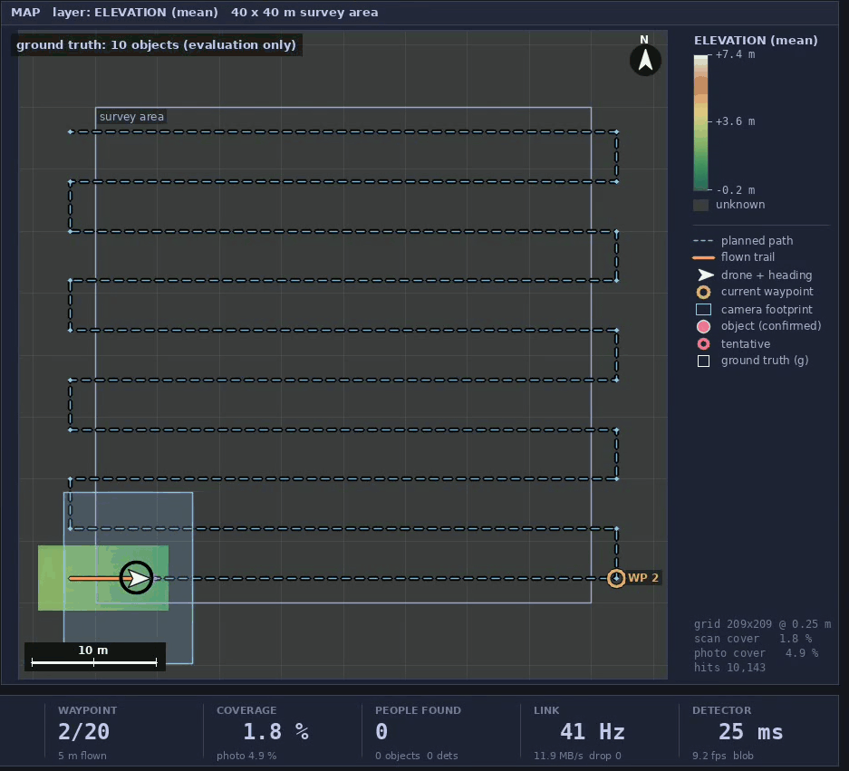
</p>

### 12.2 Sensor noise: what pins are made of

In the simulator the drone's pose, the depth image and the ray hits are exact, which is why the Isaac Sim mission's
pins are 4 cm from the truth. `--noise` adds the errors a real drone has ([`noise.py`](../gcs/drone_gcs/noise.py),
section 5); `noise_sweep.py` replays the recording at each level with 3 noise seeds (1 for the lag, which is not
random) and averages.

<p align="center">
  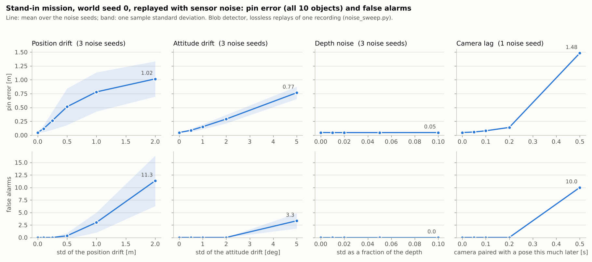
</p>

Three of the four errors move the pins, and they do it in different ways; the depth noise hardly moves them.
The numbers are the mean over the noise seeds (the table in [`results.md`](experiments/results.md) has the spreads).

* **Position drift** (a slowly varying offset with a 30 s correlation time,
  [`noise.py:51`](../gcs/drone_gcs/noise.py#L51)). The pin error grows about as fast as the drift's spread: 0.12, 0.26
  and 0.51 m at 0.1, 0.25 and 0.5 m. One pass over an object lasts a few seconds, far shorter than 30 s, so all its
  detections share one offset and the pin inherits it; the passes of the neighbouring lines, all within about 40 s (in
  the live run the first and last detection of a pin are at most 37.2 s apart), average part of it out. At 1 m the
  offsets of two passes can differ by more than the tracker's merge radius (1.5 m for people, 2 m for the stand-in's
  other classes; section 7), and the object then becomes two pins: 3.0 false alarms on average. At 2 m some pins land
  more than the evaluation's 2 m match radius from their object (section 9): 11.3 false alarms, and 2.3 of the 3
  people found.
* **Attitude drift** (roll, pitch and yaw). About 0.15 m of pin error per degree up to 2° (0.087, 0.152 and 0.291 m
  at 0.5, 1 and 2°): a tilt error turns the camera's rays, and on the ground that moves a point by roughly the height
  times the tangent of the error. The stand-in flies 9.8 m above the ground on average, and 9.8 m × tan 1° = 0.17 m.
  The mapping rays are gimballed, so the elevation map does not move
  ([`noise.py:198`](../gcs/drone_gcs/noise.py#L198)); the pins, the photo map and the surface map, which use the
  camera pose, do ([`state.py:424-440`](../gcs/drone_gcs/state.py#L424-L440)). At 5° (0.77 m) passes split objects
  again: 3.3 false alarms.
* **Depth noise** up to 10 % of the depth changes the pin error by less than 5 mm (0.042-0.047 m) and adds no false
  alarm. Geolocation takes the median depth over a window around the box's reference pixel, which removes most of the
  independent per-pixel noise ([`mapping.py:452-467`](../gcs/drone_gcs/mapping.py#L452-L467)), the pin averages what
  is left over its detections, and the camera looks nearly straight down, so a depth error moves the point mostly up
  or down. Correlated depth errors (a wrong scale, a misaligned depth camera) are not modelled.
* **Camera lag** (the frame is paired with the pose this much later). 0.056, 0.079 and 0.139 m at 0.05, 0.1 and 0.2 s,
  then 1.48 m and 10 false alarms at 0.5 s. The stand-in flies at 3 m/s and flies neighbouring lines in opposite
  directions, so a lag shifts the detections of one line forward by speed × lag and those of the next line backward.
  The tracker averages the two while the gap, 2 × 3 m/s × lag (1.2 m at 0.2 s), stays under its merge radius; at
  0.5 s the gap is 3 m, each line gets its own pin, and each pin is 1.5 m off.

**What it suggests.** The 4 cm pin error of the Isaac Sim mission measures the geometry, not the drone. With a real
navigation error, the pins are about as wrong as the position estimate, plus roughly 0.15-0.2 m per degree of attitude
error at this height; the camera frames need time stamps good to well under 0.2 s at 3 m/s. Before people are missed,
drift shows up as duplicate pins, that is, false alarms. These are the stand-in's numbers; section 13 gives the command
for the same sweep on an Isaac Sim recording.

### 12.3 The stand-in benchmark: five worlds

[`aggregate_runs.py`](../gcs/scripts/aggregate_runs.py) turns several runs into one table (section 13 gives the command
that runs it over Isaac Sim missions). Here: five stand-in worlds (world seeds 0-4), each flown once and recorded. The
first column comes from the live runs; the second from replays of the same recordings with position drift 0.5 m,
attitude drift 1° and depth noise 2 % (noise seed 0).

| | Without noise | With noise |
|---|---|---|
| People found | 15 / 15 (95 % interval 79.6-100 %) | 15 / 15 (79.6-100 %) |
| False alarms | 0 | 0 |
| Objects found | 49 / 50 (world 2 misses one of its 3 cars) | 49 / 50 |
| Pin error, all objects | 0.053 ± 0.014 m | 0.82 ± 0.06 m |
| Pin error, people | 0.047 ± 0.014 m | 0.73 ± 0.30 m |

Two lessons. First, 15 people found out of 15 still leaves a 95 % Wilson interval that reaches down to 79.6 %: five
missions with three people each cannot show that a system finds more than about four people in five. A benchmark that
wants to claim more needs more missions or more people per site. Second, noise of this size leaves detection unchanged
but multiplies the pin error by about 15. The stand-in's MISSION message carries no site seed, so the tables'
seed columns are empty; the world seed is in the run name (`exp_flight_s<seed>`).

### 12.4 People on real drone photos

The detector scores mAP50 0.995 on simulator frames (section 6). This test asks how much of that survives on real
photos. The data is the VisDrone2019-DET validation set: 548 real drone photos (408 of 1360 x 765 px, 121 of
960 x 540, 19 of 1920 x 1080), mostly oblique views of city streets, crossings and roads, with 13,969 people labelled
(8,844 "pedestrian", standing or walking, and 5,125 "people", in other poses). That is far from the mission's view
straight down from 7.515 m onto a disaster site, and the people are small: 9,575 of the 13,969 (69 %) are under 32 px
on their longer side. [`visdrone_to_yolo.py`](../gcs/scripts/visdrone_to_yolo.py) converts
its labels, and [`eval_external.py`](../gcs/scripts/eval_external.py) scores the person boxes of two detectors:

* `drone_sar_yolo26n.pt`, the release's detector, fine-tuned on simulator images (section 6), and
* `yolo26n.pt`, the stock COCO model it was fine-tuned from.

Each runs on the whole image (resized to 640 px by the detector) and, on the first 50 images only, on 640 x 480 tiles
of the image at its own size (x1) and on tiles of the image resized to twice its size (x2): x2 cuts each of these
photos into about 22 tiles, and that run took 22 minutes on this machine with one PyTorch thread. Neighbouring tiles
overlap by a fifth ([`external_eval.py:73-94`](../gcs/drone_gcs/external_eval.py#L73-L94)), and two person boxes from
different tiles count as one person, their union, when the smaller lies at least half inside the larger (intersection
over the smaller box, IoS, of 0.5 or more; [`:106-126`](../gcs/drone_gcs/external_eval.py#L106-L126)). A label counts
as found when a person box overlaps it with an IoU of at least 0.45, one to one, most confident box first; a person box
that matches no label is a false alarm ([`:146-164`](../gcs/drone_gcs/external_eval.py#L146-L164)).

<p align="center">
  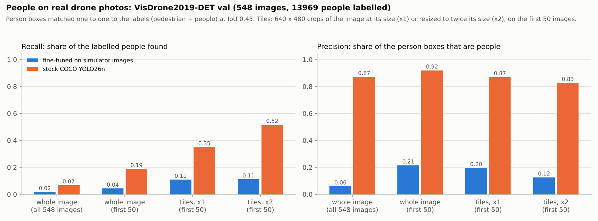
  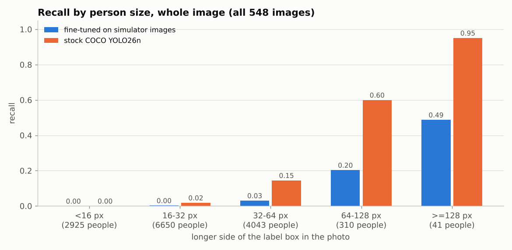
</p>

**All 548 photos, the whole image.** The fine-tuned detector finds 227 of the 13,969 people (recall 0.016) and
raises 3,616 false alarms (precision 0.059). The stock COCO model it was fine-tuned from finds 936 (recall 0.067) with
139 false alarms (precision 0.871). Both miss almost every person under 32 px, which is 69 % of the labels, and the
detector shrinks a 1360 px photo to 640 px before it looks. By size, the fine-tuned detector finds 20 % of the people
64-128 px long and 49 % of the longer ones, against 60 % and 95 % for the COCO model.

**Bigger people, the first 50 photos.** Tiles at the photo's own size (x1) give the detector the full resolution;
tiles of the photo resized to twice its size (x2) double every person again. These 50 photos hold larger people than
the rest (the COCO model's whole-image recall is 0.19 here and 0.07 over all 548), so compare the columns among
themselves:

| First 50 photos, 1,451 people | Whole image | Tiles x1 | Tiles x2 |
|---|---|---|---|
| Fine-tuned: recall / precision / false alarms | 0.043 / 0.214 / 227 | 0.108 / 0.195 / 648 | 0.111 / 0.125 / 1,127 |
| Stock COCO: recall / precision / false alarms | 0.188 / 0.919 / 24 | 0.349 / 0.870 / 76 | 0.515 / 0.827 / 157 |

The COCO model's recall rises with the magnification (0.19, 0.35, 0.52) while its precision stays above 0.82. The
fine-tuned detector gains from x1 but not from x2 (0.108 to 0.111), and its false alarms almost double. At x2 it finds
31 % of the people whose box is at least 128 px long in the resized photo; the COCO model finds 81 %. Its trouble with
real photos is not that the people are small.

**What it shows.** Fine-tuning on simulator images alone made the detector nearly perfect in the simulator (mAP50
0.995) and much worse than its starting point on real photos, both in what it finds and in what it invents. Remedies
to try, each a change to the training of section 6 that this test should then measure: mix labelled real images into
the fine-tuning, randomise the rendering further (textures, lighting, camera angles, backgrounds), or keep the COCO
model's person detections and fine-tune only for the classes the simulator adds. VisDrone is not the mission's
setting (oblique city scenes, not rubble seen from above), so the absolute numbers measure the gap between simulated
and real images more than the mission's success; the comparison between the two detectors is the result.

### 12.5 Rescue planning on the ground truth

**The tour.** `rescue_finale.py --tour` on the ground truth of the demo site (CPU, 13 s in all, 1.6 s for the tour):
one route from the landing pad past every person the custom quadruped can reach, in the cheapest order.

<p align="center">
  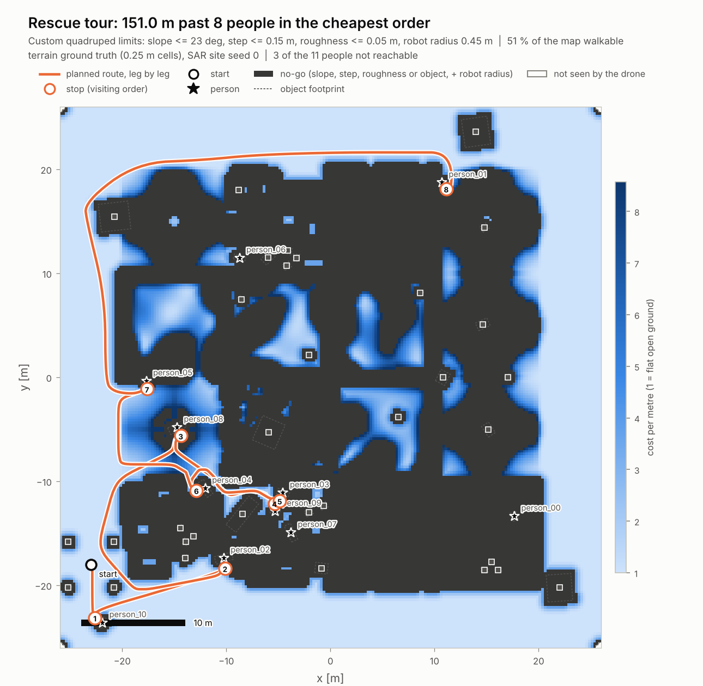
</p>

It visits 8 of the 11 people in 151.0 m, in the exact (Held-Karp) order person_10, 02, 08, 09, 03, 04, 05, 01: about
216 s of walking at the custom quadruped's 0.7 m/s cruise speed. person_07, person_06 and person_00 cannot be reached:
their nearest reachable cells are 3.02, 4.68 and 2.95 m from them, beyond the 2.5 m limit (`--max_goal_snap`). The leg
table is in [`results.md`](experiments/results.md). The tour is planned, not walked (section 13).

**Surface-map obstacles.** The stand-in report of the demo site (its terrain, objects and trees, not a flown mission)
holds a surface map. The planner marks every cell where it lies more than 0.2 m above the elevation map as no-go
(section 10); the figure shows which no-go cells exist only because of it.

<p align="center">
  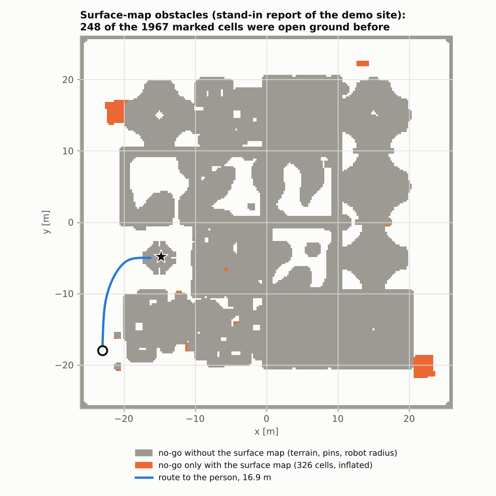
</p>

[`build_standin_report.py`](experiments/build_standin_report.py) writes the stand-in: the true terrain heights as
the elevation map, the terrain plus every object's top as the surface map, and a pin on every labelled object the
camera saw (the survey area and a few metres around it) except one crate: 37 pins (two cones and person_10 lie outside
that area); trees are never pinned, as the detector has no tree class. The surface map marks 1,967 cells; 248 of them
were open ground for the terrain limits and the pins, and after the robot-radius inflation they add 326 no-go cells,
mostly the trees on the border. The route to the planner's goal (person 13, 15.6 m from the landing pad) passes none
of them and stays 16.9 m long. The 0.2 m threshold has not been checked on the surface map of a flown mission.

### 12.6 How to reproduce

All from the repository root in the conda env `vision` (those of 12.5 in `env_isaaclab`, on the CPU with
`CUDA_VISIBLE_DEVICES=`; `build_standin_report.py` imports Isaac Lab too), then
`python docs/experiments/make_figures.py` for the figures and tables.

```bash
# 12.1 the stand-in missions, recorded (world seeds 0-4; only seed 0 keeps its dashboard video)
cd gcs
for seed in 0 1 2 3 4; do
  v=--no-video; [ $seed = 0 ] && v=
  python scripts/gcs.py --name exp_flight_s$seed --detector blob --headless --exit-on-end --linger 0 $v \
      --addr unix:/tmp/dgcs_exp$seed.sock --record runs/exp_flight_s$seed/link.dgcrec.gz &
  python scripts/fake_drone.py --addr unix:/tmp/dgcs_exp$seed.sock --seed $seed --speedup 2 --wait-gcs 30 -q
  wait
done
for r in a b; do                                         # the replay check, twice: compare with runs/exp_flight_s0
  python scripts/gcs.py --replay runs/exp_flight_s0/link.dgcrec.gz --detector blob --headless --no-video --linger 0 \
      --name exp_replay_$r
done

# 12.2 the noise sweeps on the seed-0 recording (lag with one seed: it is not random)
python scripts/noise_sweep.py --replay runs/exp_flight_s0/link.dgcrec.gz --param pos --values 0,0.1,0.25,0.5,1,2 \
    --seeds 0,1,2 --out runs/exp_sweep_pos -- --detector blob
python scripts/noise_sweep.py --replay runs/exp_flight_s0/link.dgcrec.gz --param att --values 0,0.5,1,2,5 \
    --seeds 0,1,2 --out runs/exp_sweep_att -- --detector blob
python scripts/noise_sweep.py --replay runs/exp_flight_s0/link.dgcrec.gz --param depth --values 0,0.01,0.02,0.05,0.1 \
    --seeds 0,1,2 --out runs/exp_sweep_depth -- --detector blob
python scripts/noise_sweep.py --replay runs/exp_flight_s0/link.dgcrec.gz --param lag --values 0,0.05,0.1,0.2,0.5 \
    --seeds 0 --out runs/exp_sweep_lag -- --detector blob

# 12.3 the benchmark tables, without and with noise
for seed in 0 1 2 3 4; do
  python scripts/gcs.py --replay runs/exp_flight_s$seed/link.dgcrec.gz --detector blob --headless --no-video \
      --linger 0 --noise pos=0.5,att=1,depth=0.02,seed=0 --name exp_noisy_s$seed
done
python scripts/aggregate_runs.py runs/exp_flight_s{0,1,2,3,4} --out runs/exp_bench_clean
python scripts/aggregate_runs.py runs/exp_noisy_s{0,1,2,3,4} --out runs/exp_bench_noisy

# 12.4 real photos: VisDrone2019-DET-val.zip from the Ultralytics assets releases, unpacked into ~/data;
# the COCO model is Ultralytics' yolo26n.pt, saved as gcs/models/yolo26n.pt (eval_external.py does not download it)
python scripts/visdrone_to_yolo.py --src ~/data/VisDrone2019-DET-val --out ~/data/VisDrone2019-DET-val/labels
V="--images $HOME/data/VisDrone2019-DET-val/images --labels $HOME/data/VisDrone2019-DET-val/labels --person-ids 0,1"
for model in sim coco; do
  w=../downloads/drone_sar_yolo26n.pt; [ $model = coco ] && w=models/yolo26n.pt
  python scripts/eval_external.py $V --weights $w --no-tile --out runs/exp_visdrone_${model}_whole
  python scripts/eval_external.py $V --weights $w --no-tile --limit 50 --out runs/exp_visdrone_${model}_whole_first50
  python scripts/eval_external.py $V --weights $w --scale 1 --limit 50 --out runs/exp_visdrone_${model}_scale1_first50
  python scripts/eval_external.py $V --weights $w --scale 2 --limit 50 --out runs/exp_visdrone_${model}_scale2_first50
done
cd ..

# 12.5 rescue planning on the CPU, in env_isaaclab
python docs/experiments/build_standin_report.py --out gcs/runs/exp_standin_report
cd sim
CUDA_VISIBLE_DEVICES= python scripts/rescue_finale.py --tour --out exp_tour_gt
CUDA_VISIBLE_DEVICES= python scripts/rescue_finale.py --report ../gcs/runs/exp_standin_report --plan_only \
    --out exp_surface_with
CUDA_VISIBLE_DEVICES= python scripts/rescue_finale.py --report ../gcs/runs/exp_standin_report --plan_only \
    --no_surface_obstacles --out exp_surface_without
cd ..
python docs/experiments/make_figures.py
```

On this machine the tiled evaluations ran with `OMP_NUM_THREADS=1`, one PyTorch thread each, so that four of them
could share the four cores.

### Questions an advisor might ask

**Why use a stand-in drone at all?** It goes through the same link, station, tracker and report as Isaac Sim, so
everything after the camera is tested for real; only the world and the detector are stand-ins. The noise experiments
measure that part of the pipeline: what a navigation or timing error does to the pins.

**Why is the depth noise harmless but the position drift not?** The depth noise is independent per pixel, and the
median over a window removes most of it ([`mapping.py:452-467`](../gcs/drone_gcs/mapping.py#L452-L467)); the drift is
one offset shared by every detection of a pass, which no averaging inside the pass can remove.

**Why do false alarms appear before people are missed?** A large offset first splits one object into two pins (the
tracker merges detections only within its merge radius, section 7), and the extra pin is a false alarm; a person is
missed only when even the best pin lands beyond the 2 m match radius of the evaluation (section 9).

**The fine-tuned detector found 99.6 % of the people in the simulator. Why so few here?** The real photos differ in
everything the simulator held fixed: oblique views of streets instead of a view straight down onto rubble, real
textures and lighting, and people mostly under 32 px. Fine-tuning on simulator images alone also cost the COCO model's
real-world knowledge: the stock model finds more people and raises far fewer false alarms on the same photos (table
above).

**Is VisDrone a fair test for a search-and-rescue detector?** Not a full one: it is the only labelled set of real drone
photos used here, and its scenes are cities, not disaster sites. It measures the gap between simulated and real
images, not the mission's success. A labelled set of top-down photos of people in rubble or wilderness would test the
mission's own setting.

**Can the tour be walked as planned?** Each leg is planned again with the tour's footprints, so it follows the tour's
path ([`rescue_finale.py`](../sim/scripts/rescue_finale.py), `--tour_footprints`; section 10), but nobody has walked it
yet; section 13 gives the command.

## 13. What needs a GPU, and how to run it at home

Everything in section 12 ran on four CPU cores with no simulator. These need Isaac Sim (an RTX GPU, the conda env
`env_isaaclab`) and, for the detector, the env `vision`. Run them from the repository root, in this order. The
missions and evaluations write their run folders under `gcs/runs/` or `sim/runs/`; `docs/experiments/make_figures.py`
only reads the CPU runs, so these results go into their own tables.

**1. The CPU checks first.** The tests that need Isaac Lab, PyTorch or Ultralytics skip when they cannot be imported
and run in the full environments ([`check.sh`](../scripts/check.sh)):

```bash
scripts/check.sh
```

**2. The benchmark over sites and terrains.** One headless mission per site seed (and terrain seed), then the table of
section 9's scorecard over all of them with a 95 % Wilson interval for the people found
([`run_benchmark.sh`](../scripts/run_benchmark.sh), [`aggregate_runs.py`](../gcs/scripts/aggregate_runs.py)):

```bash
scripts/run_benchmark.sh --seeds 0-9
```

Add `--terrain-seeds 17,3,5` for three terrains (17 is the standard one); the table is
`gcs/runs/bench_benchmark/benchmark.md`.

**3. Record one Isaac Sim mission, then replay it with noise.** The recording is about 8.1 GB (section 5); `gzip -1`
compresses it, and `--replay` reads `link.dgcrec.gz` as well:

```bash
scripts/run_demo.sh --headless --record --name flight
```

```bash
python gcs/scripts/noise_sweep.py --replay gcs/runs/flight/link.dgcrec --param pos --values 0,0.1,0.25,0.5,1,2 \
    --seeds 0,1,2 -- --weights downloads/drone_sar_yolo26n.pt
```

This is the experiment of section 12.2 on the real mission and the real detector; compare its pin error against the
stand-in's.

**4. The detector on corrupted simulator frames.** Needs the labelled dataset of section 6: the frames that
`sim/scripts/gen_yolo_dataset.py` renders, labelled by `gcs/scripts/seg_to_yolo.py`:

```bash
python gcs/scripts/eval_robustness.py --data datasets/drone_sar_yolo_v2/yolo/data.yaml \
    --weights downloads/drone_sar_yolo26n.pt --split val --device cuda:0
```

**5. The trajectory pilot.** Train the trajectory-tracking task (section 3), export it, then fly the mission with it.
In `sim/`:

```bash
isaaclab train --rl_library rsl_rl --task DroneLab-TrackTrajectory-ARL-Robot-1-v0 --num_envs 4096 --max_iterations 2000
```

The export command is in `sim/README.md` ("Fly the mission with a trajectory-tracking policy"). Then, from the
repository root:

```bash
scripts/run_demo.sh --pilot trajectory --policy sim/logs/rsl_rl/drone_lab_track_trajectory/<run>/exported/policy.pt
```

**6. Walk the rescue tour** of section 12.5. Plan it again on your machine (seconds, CPU; the leg script holds
absolute paths), then walk its legs, one simulator run each (`--video` records each leg):

```bash
(cd sim && CUDA_VISIBLE_DEVICES= python scripts/rescue_finale.py --tour --out tour)
```

```bash
bash sim/runs/tour/tour_legs.sh --video
```

With a report of your own mission instead of the ground truth, add `--report ../gcs/runs/flight` to the first command.

**7. Better GIFs from the full-resolution videos.** With `--video` a mission writes `sim/runs/<mission>/mission.mp4`
(1280 x 720) and the finale `sim/runs/<finale>/rescue.mp4`; the ground station writes
`gcs/runs/<mission>/dashboard.mp4` (1600 x 900); [`scripts/make_gif.sh`](../scripts/make_gif.sh) lists the exact crop
of each README GIF. For example the map panel:

```bash
scripts/make_gif.sh gcs/runs/sar_live/dashboard.mp4 docs/media/hero.gif --crop 937:851:663:49 --width 937 --fps 12 \
    --dashboard --start 30 --duration 15
```

## 14. Glossary

| Term | Meaning here | Section |
|---|---|---|
| A\* | Shortest-path search on the grid that expands the cell with the lowest cost so far plus an estimate of the cost still to go; with an estimate that never overestimates, the path it returns is the cheapest | 10 |
| Action | What a policy outputs every control step: the thrust targets of the drone's four rotors, the quadruped's joint targets | 3, 11 |
| Advantage, GAE | How much better an action turned out than the critic expected; GAE averages the n-step estimates with weights set by gamma and lambda | 3 |
| Carrot | A target point that slides along the survey path ahead of the drone; the hover policy flies to it, which makes it follow the path | 3 |
| Confirmed pin | A tracked object with enough detections (`--min-hits`) and, if set, a high enough detection rate (`--min-rate`) | 7 |
| Cost map, traversability | Per cell of the map: whether the robot may enter it and what a metre there costs, from slope, step, roughness and obstacles | 10 |
| Curriculum | Training that starts easy and gets harder as the policy improves, e.g. rougher terrain | 11 |
| Decimation | How many physics steps run per policy step | 3 |
| Detection rate | Hits of a pin divided by its views | 7 |
| DGC1 frame | One message on the link: a 16-byte prefix, a JSON header and a binary payload | 5 |
| Elevation map | Height per map cell, from the drone's ray hits | 8 |
| Episode, reset, termination, time-out | One training run of a robot from a reset until it fails (termination) or the time is up (time-out) | 3 |
| False alarm | A confirmed pin (or a detector box) that matches no real object | 6, 9, 12 |
| Footprint | The area around a pinned object that the planner treats as blocked | 10 |
| Gauss-Markov drift | A slowly varying random error: each step keeps a fraction of its value and adds fresh noise, like a GPS or odometry error | 5, 12 |
| Geolocation | Turning a detection box in an image into a point in the world, with the camera pose and the depth (or the elevation map) | 7 |
| Ground sample distance (GSD) | Ground width that one image pixel covers, in cm per pixel | 4 |
| Held-Karp, 2-opt | An exact order for visiting a few goals (dynamic programming over subsets), and a local improvement of an order for more goals | 10 |
| Inflation | Growing the blocked cells by the robot's radius, so the robot's centre can be planned as a point | 10 |
| IoU, IoS | Intersection over union of two boxes; intersection over the smaller box | 6, 12 |
| Lossless replay | Replaying a recorded link stream so that the station processes every frame, whatever the computer's speed | 5, 12 |
| mAP50 | Mean average precision of a detector with boxes counted as correct at IoU 0.5 or more | 6 |
| Nadir | Straight down from the camera | 2, 7 |
| NMS | Non-maximum suppression: of overlapping boxes of one class, keep the most confident | 6 |
| Observation | The vector a policy sees each step | 3, 11 |
| Orthomosaic | A top-down photo map stitched from the camera frames | 8 |
| Pin | One tracked object on the map: class, position, confidence, hits, views | 7 |
| Policy | The neural network that maps observations to actions | 3, 11 |
| PPO | Proximal policy optimisation: the RL algorithm (rsl_rl) that trains the drone's and the quadruped's policies | 3, 11 |
| Precision, recall | Share of the reported objects that are real; share of the real objects that were reported | 6, 9, 12 |
| Pure pursuit | Steering towards a point a fixed distance ahead on the route, along the arc through it | 10 |
| Reference pixel | The pixel of a box that stands for the object's ground point: the box centre, or near its bottom edge in oblique views | 7 |
| Reward term, weight | One part of the reward and how much it counts; the per-step reward is the weighted sum times the step time | 3, 11 |
| Spread | The confidence-weighted RMS horizontal distance of a pin's detections from the pin | 7 |
| Stand-in drone | `gcs/scripts/fake_drone.py`: a synthetic world flown through the real link, for tests and the CPU experiments | 12 |
| Surface map | Height per map cell from the camera's depth points: the ground plus what stands on it | 8 |
| TorchScript export | The trained policy saved as a standalone network that the mission loads without the training code | 3 |
| Views | Camera frames in which a pin should have been visible, detected or not | 7 |
| Wilson interval | A confidence interval for a proportion, such as the share of people found | 12, 13 |
| YOLO | "You only look once": a one-stage detector that outputs boxes, classes and scores for an image in one pass | 6 |
