# Drone search and rescue: how it works

> [!summary] What this note is
> A study note on the repository [Wavy-Hec/drone-search-rescue](https://github.com/Wavy-Hec/drone-search-rescue): a reinforcement-learning pilot flies a
> quadrotor over a simulated disaster site in Isaac Sim, a ground station maps the site live and pins every person a
> YOLO detector finds, and a quadruped walks to a person over the rubble.
> - **Part 1** explains the reinforcement learning in detail: the MDP, PPO, every reward, how to train and change it.
> - **Part 2** explains the rest of the pipeline: the world, the link, YOLO, pins, maps, the planner, and what the CPU
>   experiments showed.
> - **Part 3** is about taking it to a real drone and robot with SLAM: what must be measured, how well, with which
>   systems, and a roadmap.
>
> Numbers come from the code; each key number links to its line on GitHub (pinned to commit `080ced7`). The full,
> line-by-line walk-through is [docs/HOW_IT_WORKS.md](https://github.com/Wavy-Hec/drone-search-rescue/blob/080ced76e42b8b7a6eb4050b4a98214992865625/docs/HOW_IT_WORKS.md). Images load from GitHub, so they
> need an internet connection.

## Part 1: Reinforcement learning in detail

> [!summary] The three policies in one paragraph
> Three neural-network policies appear in this project, all set up for PPO, a reinforcement-learning (RL) algorithm, in Isaac Lab. The two that exist were trained with it and are frozen while the mission and the rescue run. The **hover pilot** flies the drone: ten times per second it reads 17 numbers and sets the thrust of the four rotors. It was trained only to fly to a point and hover there; a moving target, the *carrot*, makes it fly a whole survey. The **trajectory pilot** would read 26 numbers and follow moving references; its training task is in the repository and tested on the CPU, but no trained copy exists. The **walking policy** moves the quadruped: 235 numbers in (187 of them ground heights), 12 joint targets out, fifty times per second. The rescue task replaces its random training commands with those of a path follower.

This part builds the RL behind them from first principles, with this repository's numbers: 1.1 and 1.2 are the general machinery (the decision problem, one Isaac Lab step, PPO), 1.3 to 1.6 take each policy reward term by reward term, 1.7 is a lab manual, and 1.8 holds the key numbers and advisor questions. Numbers come from the code or from the fact-checked walk-through [HOW_IT_WORKS.md](https://github.com/Wavy-Hec/drone-search-rescue/blob/080ced76e42b8b7a6eb4050b4a98214992865625/docs/HOW_IT_WORKS.md) (its sections 3 and 11). Code outside the repository (Isaac Lab 3.0.0, rsl_rl 5.5.1) is cited by its path inside the installed package, without a link.

### 1.1 RL in one picture

The idea in one sentence: instead of writing a controller, you write a scoring rule (the *reward*) and let a network find the behaviour that scores well, by trying things in simulation millions of times. The network never reads the rule. It only learns which of its own actions turned out well.

#### The decision problem (MDP)

Formally the task is a *Markov decision process* (MDP). One turn of the loop is one *step*:

1. The world is in a **state** $s_t$: everything the simulator knows (poses, velocities, motor states, terrain).
2. The policy receives an **observation** $o_t$, the vector of numbers it is allowed to see. It is usually much less than the state: the hover pilot never sees where it is in the world, only where its target is relative to it.
3. The **policy** $\pi$ maps $o_t$ to an **action** $a_t$.
4. The **transition** applies the action and advances the physics (here PhysX) to the next state $s_{t+1}$.
5. The **reward** $r_t$, one number, scores what happened.

| Piece | Drone, hover task | Quadruped, rough-terrain task |
|---|---|---|
| Observation $o_t$ | 17 values | 235 values |
| Action $a_t$ | 4 raw values, one per rotor | 12 raw values, one per joint |
| Transition | 10 PhysX substeps of 0.01 s | 4 PhysX substeps of 0.005 s |
| Reward $r_t$ | 8 weighted terms | 8 active weighted terms |
| Discount $\gamma$ | 0.98 | 0.99 |
| Episode | 5 s = 50 steps | 20 s = 1,000 steps |
| Termination (failure) | falls below z = −3 m | trunk or a thigh touches the ground |
| Time-out (truncation) | 5 s elapsed | 20 s elapsed |

(Timing: [survey_env_cfg.py:199](https://github.com/Wavy-Hec/drone-search-rescue/blob/080ced76e42b8b7a6eb4050b4a98214992865625/sim/src/drone_lab/tasks/survey/config/arl_robot_1/survey_env_cfg.py#L199), [test_task_configs.py:140](https://github.com/Wavy-Hec/drone-search-rescue/blob/080ced76e42b8b7a6eb4050b4a98214992865625/quadruped/tests/test_task_configs.py#L140); discounts: [rsl_rl_ppo_cfg.py:33](https://github.com/Wavy-Hec/drone-search-rescue/blob/080ced76e42b8b7a6eb4050b4a98214992865625/sim/src/drone_lab/tasks/track_trajectory/config/arl_robot_1/agents/rsl_rl_ppo_cfg.py#L33), [rsl_rl_ppo_cfg.py:29](https://github.com/Wavy-Hec/drone-search-rescue/blob/080ced76e42b8b7a6eb4050b4a98214992865625/quadruped/src/quadruped_lab/tasks/locomotion/config/custom_quad/agents/rsl_rl_ppo_cfg.py#L29); the hover task's episode and terminations are upstream, `track_position_state_based_env_cfg.py:200-201,227-230`, Isaac Lab 3.0.0.)

**Return and discount.** Training maximises the expected *discounted return*

$$
G_t=\sum_{k=0}^{\infty}\gamma^{k}\,r_{t+k}
$$

The discount $\gamma$ sets how far ahead the policy plans: a reward $k$ steps ahead counts $\gamma^k$ times as much as one now, and the usual *effective horizon* is $1/(1-\gamma)$ steps. For the drone, $\gamma = 0.98$ gives 50 steps, 5 s at 10 Hz; a reward 5 s ahead counts $0.98^{50}\approx 0.36$. For the quadruped, $\gamma = 0.99$ gives 100 steps, but at 50 Hz that is only 2 s (derived). The horizon in seconds is what matters physically.

**Episode, reset, termination, time-out.** An *episode* is one run from a *reset* (the robot is put back into a start state and gets a new goal) to its end. A **termination** is a failure: the drone crashed, the quadruped fell. A **time-out** (also *truncation*) means time ran out, and the robot might have done fine afterwards. Isaac Lab keeps the two apart: only termination terms marked `time_out=True` count as time-outs (`isaaclab/managers/termination_manager.py:165-171`). This matters twice: a `termination_penalty` reward fires only on failures (`isaaclab/envs/mdp/rewards.py:38-40`), and PPO treats a time-out as "the future would have gone on" (section 1.2).

**The policy network.** All three policies are *multilayer perceptrons* (MLPs): linear layers with an ELU activation between them, $\mathrm{ELU}(x) = x$ for $x > 0$ and $e^x - 1$ otherwise. During training the network outputs the *mean* $\mu(o)$ of a Gaussian, and the action is sampled as $a \sim \mathcal N(\mu(o), \sigma^2)$ with a learned standard deviation $\sigma$ per action value. That noise is the exploration. The exported file keeps only the mean, so the deployed policy is deterministic.

#### Isaac Lab's managers

Isaac Lab builds a task from a configuration class whose fields are *managers*, each holding named *terms* (a function plus its parameters). Reading a task means reading these classes.

| Manager | What its terms do | Drone examples | Quadruped examples |
|---|---|---|---|
| Commands | the goal the policy must reach, updated every step | the carrot; the moving reference | `base_velocity`: $(v_x, v_y, \omega_z)$ to follow |
| Observations | functions concatenated into $o_t$ | offset to target, quaternion, velocities, last action | body velocities, gravity, command, joints, height scan |
| Actions | turn the raw network output into targets | rotor thrust targets | joint position targets |
| Rewards | weighted functions summed into $r_t$ | goal distance, yaw, smoothness | velocity tracking, torques, smoothness |
| Terminations | end the episode, as failure or time-out | crash, flipped, too far | trunk or thigh contact |
| Events | randomise and reset, at start-up, reset or intervals | reset near the start of a reference | trunk mass, centre of mass, reset pose |
| Curriculum | adapt the difficulty to the policy's progress | none | terrain level |

#### One env step

One env step in Isaac Lab 3.0.0 runs in this order (`isaaclab/envs/manager_based_rl_env.py:205-279`; the reset internals at `:379-423`):

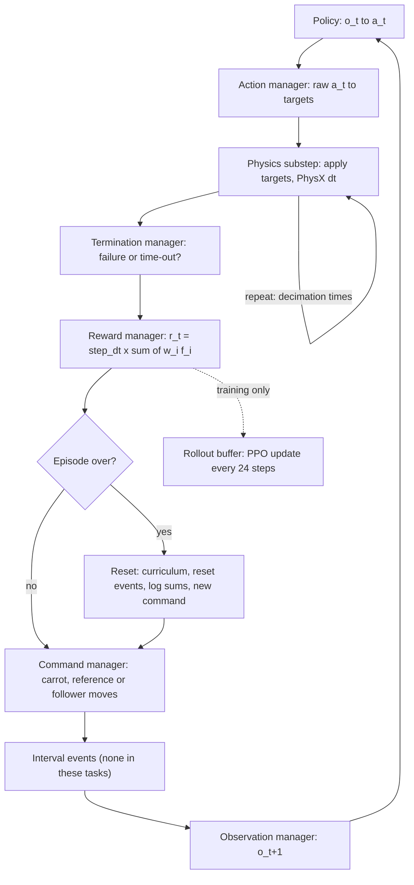

The policy acts once per env step, while physics runs *decimation* substeps underneath it:

| | Drone tasks | Quadruped |
|---|---|---|
| Physics step | 0.01 s (100 Hz) | 0.005 s (200 Hz) |
| Decimation | 10 | 4 |
| Policy step `step_dt` | 0.1 s (10 Hz) | 0.02 s (50 Hz) |
| Parallel envs in training | 4096 ([track_trajectory_env_cfg.py:127](https://github.com/Wavy-Hec/drone-search-rescue/blob/080ced76e42b8b7a6eb4050b4a98214992865625/sim/src/drone_lab/tasks/track_trajectory/config/arl_robot_1/track_trajectory_env_cfg.py#L127)) | 4096 by default (Isaac Lab 3.0.0); the README trains 1024 ([quadruped/README.md:87-90](https://github.com/Wavy-Hec/drone-search-rescue/blob/080ced76e42b8b7a6eb4050b4a98214992865625/quadruped/README.md#L87-L90)) |
| Episode | 5 s hover task, 12 s trajectory task | 20 s |

(Drone timing asserted in [test_env_cfgs.py:58](https://github.com/Wavy-Hec/drone-search-rescue/blob/080ced76e42b8b7a6eb4050b4a98214992865625/sim/tests/test_env_cfgs.py#L58).)

> [!info] Two consequences of the step order
> 1. The command (carrot, reference, follower) moves *after* physics and *before* the observation, so the next observation already measures the robot against the new target.
> 2. The reward is computed *before* the command update, so it scores the robot after physics against the target of the previous update, 0.1 s old for the drone. In the trajectory task this makes the reward highest for a drone that trails its reference by one step. The repository does not discuss this; it follows from the Isaac Lab 3.0.0 step order. Section 1.7 turns it into a reward-design idea.

**Thousands of copies at once.** Training runs 4096 copies of the robot side by side in one GPU simulation. Each copy is an *environment* (env) with its own episode that resets on its own; all copies share one policy. Isaac Lab's runner default `init_at_random_ep_len=True` starts every episode clock at a random value, so the envs do not all reset in the same step (`isaaclab_rl/rsl_rl/rl_cfg.py:248`).

### 1.2 PPO from scratch

PPO (*Proximal Policy Optimization*) is an *on-policy actor-critic* method. It collects fresh experience with the current policy, improves the policy a little on that experience, throws the experience away and repeats. *Proximal* means each improvement stays close to the policy that collected the data, so the data stays valid for the update. All three policies use rsl_rl's PPO; the internals below are read from rsl_rl 5.5.1, the version installed with Isaac Lab 3.0.0. One iteration, with the drone's numbers:

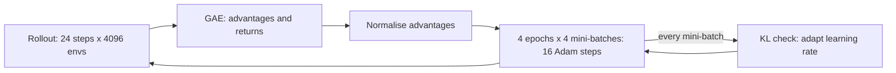

#### Two networks: actor and critic

- The **actor** is the policy: the MLP gives the mean of each action value, and a learned standard deviation per action value, independent of the observation, adds the exploration noise. It starts at 0.5 for the drone ([rsl_rl_ppo_cfg.py:17-22](https://github.com/Wavy-Hec/drone-search-rescue/blob/080ced76e42b8b7a6eb4050b4a98214992865625/sim/src/drone_lab/tasks/track_trajectory/config/arl_robot_1/agents/rsl_rl_ppo_cfg.py#L17-L22)) and 1.0 for the quadruped ([rsl_rl_ppo_cfg.py:59-64](https://github.com/Wavy-Hec/drone-search-rescue/blob/080ced76e42b8b7a6eb4050b4a98214992865625/quadruped/src/quadruped_lab/tasks/locomotion/config/custom_quad/agents/rsl_rl_ppo_cfg.py#L59-L64)).
- The **critic** is a second MLP of the same size that estimates the *value* $V(o)$, the expected discounted return from $o$. It is used only in training. In all three tasks it sees exactly what the actor sees, with no privileged information (only a `policy` observation group; the drone runners reach it through the fallback in `rsl_rl/utils/utils.py:192-271`, the quadruped's names it, [rsl_rl_ppo_cfg.py:56](https://github.com/Wavy-Hec/drone-search-rescue/blob/080ced76e42b8b7a6eb4050b4a98214992865625/quadruped/src/quadruped_lab/tasks/locomotion/config/custom_quad/agents/rsl_rl_ppo_cfg.py#L56)).

#### Step 1: the rollout

Every env runs `num_steps_per_env` = 24 steps with the current actor: 24 × 4096 = 98,304 transitions per iteration for the drone, 2.4 s of flight per env. Each transition stores $o_t$, $a_t$, $\log\pi(a_t\mid o_t)$, $V(o_t)$, $r_t$ and whether the episode ended. On a time-out rsl_rl adds $\gamma V(o_t)$ to $r_t$, so a truncated episode is not scored as if its future were worth nothing (`rsl_rl/algorithms/ppo.py:153-158`).

#### Step 2: advantages with GAE

The *advantage* $\hat A_t$ says how much better an action turned out than the critic expected: positive means do it more often, negative less often. Generalised Advantage Estimation (GAE) computes it backward over the 24 steps (`rsl_rl/algorithms/ppo.py:166-191`):

$$
\delta_t = r_t + \gamma(1-d_t)\,V(o_{t+1}) - V(o_t)
$$

$$
\hat A_t = \delta_t + \gamma\lambda(1-d_t)\,\hat A_{t+1},\qquad R_t = \hat A_t + V(o_t)
$$

Here $d_t = 1$ where an episode ended, $\gamma = 0.98$ and $\lambda = 0.95$ (`gamma`, `lam`, [rsl_rl_ppo_cfg.py:33-34](https://github.com/Wavy-Hec/drone-search-rescue/blob/080ced76e42b8b7a6eb4050b4a98214992865625/sim/src/drone_lab/tasks/track_trajectory/config/arl_robot_1/agents/rsl_rl_ppo_cfg.py#L33-L34)). $\delta_t$ is the one-step surprise: what the step paid plus the critic's estimate of what follows, minus what the critic expected before. $\lambda$ blends one-step surprises with longer sums of rewards: $\lambda = 0$ trusts the critic completely (low variance, biased by its errors), $\lambda = 1$ adds up the actual rewards (unbiased, noisy).

> [!example] A tiny GAE example (toy numbers, not from a run)
> Three steps with no episode end; $\gamma\lambda = 0.98\times 0.95 = 0.931$. The critic predicts $V(o_0..o_3)$ = 100, 101, 99, 100 ($o_3$ is the bootstrap after the rollout), and the rewards are 3.0, 2.0, 3.5. Work backward:
> - $t=2$: $\delta_2 = 3.5 + 0.98\times 100 - 99 = 2.50$, so $\hat A_2 = 2.50$ and $R_2 = 101.50$.
> - $t=1$: $\delta_1 = 2.0 + 0.98\times 99 - 101 = -1.98$, but $\hat A_1 = -1.98 + 0.931\times 2.50 = 0.35$ and $R_1 = 101.35$.
> - $t=0$: $\delta_0 = 3.0 + 0.98\times 101 - 100 = 1.98$, so $\hat A_0 = 1.98 + 0.931\times 0.35 = 2.30$ and $R_0 = 102.30$.
>
> Step 1 on its own disappointed the critic ($\delta_1 < 0$), but it led into a step that went well, and GAE passes part of that credit back: its advantage ends slightly positive.

rsl_rl then normalises the advantages over the whole batch to zero mean and unit standard deviation (`rsl_rl/algorithms/ppo.py:188-191`), so the update sees which actions were better than average, not the reward's scale.

#### Step 3: the clipped surrogate objective

The policy-gradient idea: raise the probability of actions with positive advantage, lower it for negative ones. PPO measures the change by the probability *ratio* between the policy being trained and the one that collected the data:

$$
\rho = \frac{\pi_{\mathrm{new}}(a\mid o)}{\pi_{\mathrm{old}}(a\mid o)},\qquad L_{\mathrm{surr}} = \mathrm{mean}\Big[\max\big(-\hat A\,\rho,\ -\hat A\,\mathrm{clip}(\rho,\,1-\epsilon,\,1+\epsilon)\big)\Big]
$$

with $\epsilon$ = `clip_param` = 0.2 (`rsl_rl/algorithms/ppo.py:268-274`). Minimising $L_{\mathrm{surr}}$ maximises the smaller of $\hat A\rho$ and $\hat A\,\mathrm{clip}(\rho)$, a pessimistic bound. The four cases show what the clip does:

| $\hat A$ | $\rho$ | $\hat A\rho$ | $\hat A\,\mathrm{clip}(\rho)$ | kept (smaller) | does the gradient still push? |
|---|---|---|---|---|---|
| +2 | 1.3 | 2.6 | 2.4 | 2.4, clipped | no: the good action is already more than 20 % more likely; stop |
| +2 | 0.7 | 1.4 | 1.6 | 1.4 | yes: make the good action more likely |
| −2 | 0.7 | −1.4 | −1.6 | −1.6, clipped | no: the bad action is already more than 20 % less likely; stop |
| −2 | 1.3 | −2.6 | −2.4 | −2.6 | yes: undo making a bad action more likely |

So within one batch no action's probability is pushed more than about 20 % in the "good" direction, while mistakes can always be undone. This keeps one noisy batch from wrecking the policy.

#### Step 4: value loss and entropy bonus

The loss of one gradient step is (`rsl_rl/algorithms/ppo.py:268-285`)

$$
L = L_{\mathrm{surr}} + c_V\,L_V - c_H\,\bar H
$$

- $L_V$ trains the critic: the squared error between $V(o)$ and the return $R$, also clipped to ±0.2 around the old value (`use_clipped_value_loss`). Its weight $c_V$ = `value_loss_coef` is 1.0 for the drone and 0.5 for the quadruped.
- $\bar H$ is the mean entropy of the Gaussian, $\sum_j \tfrac12\ln(2\pi e\,\sigma_j^2)$, which grows with $\sigma$. Subtracting $c_H\bar H$ pays the policy for keeping some exploration. $c_H$ = `entropy_coef` is 0.001 in the hover task, 0.002 in the trajectory task and 0.0025 for the quadruped. The scale is small: four action values at $\sigma = 0.5$ have $\bar H \approx 2.90$, worth 0.003 in the loss at 0.001 (derived).

#### Step 5: epochs, mini-batches and the adaptive learning rate

The 98,304 transitions are split into `num_mini_batches` = 4 mini-batches of 24,576 and passed over `num_learning_epochs` = 4 times: 16 gradient steps per iteration (the quadruped: 5 epochs, 20 steps). The optimiser is Adam (`isaaclab_rl/rsl_rl/rl_cfg.py:198`), and each network's gradient norm is clipped at 1.0 (`rsl_rl/algorithms/ppo.py:309-310`).

The learning rate adapts on every mini-batch to a target *KL divergence*, the distance between the old and the new Gaussian. For one action value,

$$
\mathrm{KL} = \ln\frac{\sigma_{\mathrm{new}}}{\sigma_{\mathrm{old}}} + \frac{\sigma_{\mathrm{old}}^{2} + (\mu_{\mathrm{old}}-\mu_{\mathrm{new}})^{2}}{2\sigma_{\mathrm{new}}^{2}} - \frac12
$$

summed over the action values and averaged over the batch (`rsl_rl/modules/distribution.py:234-238`). With `desired_kl` = 0.01: above 0.02 the rate is divided by 1.5 (floor 1e-5), below 0.005 it is multiplied by 1.5 (cap 1e-2) (`rsl_rl/algorithms/ppo.py:240-266`). The rate starts at 4e-4 for the drone and 1e-3 for the quadruped. Intuition: with $\sigma$ unchanged, a KL of 0.01 is a shift of the mean by $\sigma\sqrt{0.02}\approx 0.14\,\sigma$ in one action value (derived); the rule keeps every update about that size, whatever the gradient's scale.

**Repeat** for `max_iterations`: 1500 in the upstream hover task (147.5 M transitions) and 2000 in the trajectory task (196.6 M).

#### Observation normalisation

The first layer multiplies every input by a weight, so inputs on very different scales (metres, quaternion components, rad/s) learn at very different speeds. *Observation normalisation* keeps a running mean and variance of every input and feeds the network $(o - \mu)/\sigma$; an exported normalising policy carries these statistics inside its TorchScript file (`rsl_rl/models/mlp_model.py:60-64,196-213`).

- The **trajectory task** normalises actor and critic inputs, because "the 26-D observation mixes metres, metres per second and quaternions" ([rsl_rl_ppo_cfg.py:10-11](https://github.com/Wavy-Hec/drone-search-rescue/blob/080ced76e42b8b7a6eb4050b4a98214992865625/sim/src/drone_lab/tasks/track_trajectory/config/arl_robot_1/agents/rsl_rl_ppo_cfg.py#L10-L11)).
- The **released hover policy has none**: its `obs_normalizer` is `torch.nn.Identity`, so raw metres, quaternion components, m/s and rad/s enter the first layer ([rsl_rl_ppo_cfg.py:12](https://github.com/Wavy-Hec/drone-search-rescue/blob/080ced76e42b8b7a6eb4050b4a98214992865625/sim/src/drone_lab/tasks/survey/config/arl_robot_1/agents/rsl_rl_ppo_cfg.py#L12)). The survey's runner must build exactly the built-in network so that its checkpoints load.
- The **walking policy** has none either ([rsl_rl_ppo_cfg.py:59-69](https://github.com/Wavy-Hec/drone-search-rescue/blob/080ced76e42b8b7a6eb4050b4a98214992865625/quadruped/src/quadruped_lab/tasks/locomotion/config/custom_quad/agents/rsl_rl_ppo_cfg.py#L59-L69)).

#### Reading the training curves

Isaac Lab's rsl_rl runner logs to TensorBoard by default (`isaaclab_rl/rsl_rl/rl_cfg.py:311`), in `logs/rsl_rl/{experiment}/{run}/` under the folder you train from ([sim/README.md:395-396](https://github.com/Wavy-Hec/drone-search-rescue/blob/080ced76e42b8b7a6eb4050b4a98214992865625/sim/README.md#L395-L396), [quadruped/README.md:97](https://github.com/Wavy-Hec/drone-search-rescue/blob/080ced76e42b8b7a6eb4050b4a98214992865625/quadruped/README.md#L97)). No training log of any of the three policies is in the repository: `logs/` and `runs/` are git-ignored. The curves (tags from rsl_rl 5.5.1 `utils/logger.py:180-232` and the Isaac Lab 3.0.0 managers):

| Tag | What it is |
|---|---|
| `Train/mean_reward` | mean undiscounted return $\sum_t r_t$ of the last 100 finished episodes |
| `Train/mean_episode_length` | their mean length, in policy steps |
| `Episode_Reward/{term}` | per reward term: its episode sum divided by the *maximum* episode length in seconds (`reward_manager.py:116`) |
| `Episode_Termination/{term}` | share of all envs whose last finished episode ended through that term (`termination_manager.py:143-146`) |
| `Metrics/{command}/{metric}` | the command term's own measurements, e.g. `Metrics/reference/position_error` in the trajectory task ([commands.py:91-95](https://github.com/Wavy-Hec/drone-search-rescue/blob/080ced76e42b8b7a6eb4050b4a98214992865625/sim/src/drone_lab/tasks/track_trajectory/mdp/commands.py#L91-L95)) |
| `Curriculum/terrain_levels` | the quadruped's mean terrain row |
| `Loss/value`, `Loss/surrogate`, `Loss/entropy` | the three parts of $L$, averaged over the iteration's gradient steps |
| `Loss/learning_rate` | the adaptive learning rate |
| `Policy/mean_std` | mean exploration standard deviation $\sigma$ |
| `Perf/total_fps` | transitions per second of wall time |

> [!tip] Reading `Episode_Reward/{term}`
> Because the divisor is the maximum episode length, a full-length episode logs the time average of $w_i f_i$, so the logged value divided by the weight is the average score $f_i$, between 0 and 1 for the exponential kernels (derived). A perfect trajectory episode would log 15 on `tracking_fine`; episodes that end early log less. This is also why the quadruped's "reward per episode" of about 1.5 (section 1.6) and its training log's "mean reward" of about 13 are different quantities: one is the sum divided by 20 s, the other the plain sum, and training adds observation noise, mass randomisation and the curriculum on top.

The one recorded example of these curves: fine-tuning the converted walking policy for 20 iterations moved `Loss/value` from 0.0157 to 0.0068 and `Policy/mean_std` from 0.278 to 0.275, and at iteration 13,919 the mean reward was 13.24 against 13.02 for a control run with learning rate 0 ([PORT_NOTES.md:440-441](https://github.com/Wavy-Hec/drone-search-rescue/blob/080ced76e42b8b7a6eb4050b4a98214992865625/quadruped/PORT_NOTES.md#L440-L441)).

### 1.3 The hover pilot, the released drone policy

#### The network

The hover pilot is `downloads/arl-robot-1_policy.pt`, a release asset of 197,334 bytes fetched by [download_assets.sh:17](https://github.com/Wavy-Hec/drone-search-rescue/blob/080ced76e42b8b7a6eb4050b4a98214992865625/scripts/download_assets.sh#L17). It is a TorchScript archive whose code members and tensor shapes, read without executing anything, give this network:

| Part | Operation | Parameters |
|---|---|---|
| `obs_normalizer` | `torch.nn.Identity`: inputs pass unchanged | 0 |
| `mlp.0`, `mlp.1` | Linear 17 → 256, then ELU | 4,608 |
| `mlp.2`, `mlp.3` | Linear 256 → 128, then ELU | 32,896 |
| `mlp.4`, `mlp.5` | Linear 128 → 64, then ELU | 8,256 |
| `mlp.6` | Linear 64 → 4 | 260 |
| `deterministic_output` | returns the MLP output unchanged: the Gaussian's mean | 0 |
| **total** | | **46,020** |

No normalisation, no sampling, no tanh, no clip: four unbounded numbers come out. The mission loads the file with `torch.jit.load` in evaluation mode and calls it once per step inside `torch.inference_mode()` ([sar_mission.py:608-609](https://github.com/Wavy-Hec/drone-search-rescue/blob/080ced76e42b8b7a6eb4050b4a98214992865625/sim/scripts/sar_mission.py#L608-L609), [:450-455](https://github.com/Wavy-Hec/drone-search-rescue/blob/080ced76e42b8b7a6eb4050b4a98214992865625/sim/scripts/sar_mission.py#L450-L455)).

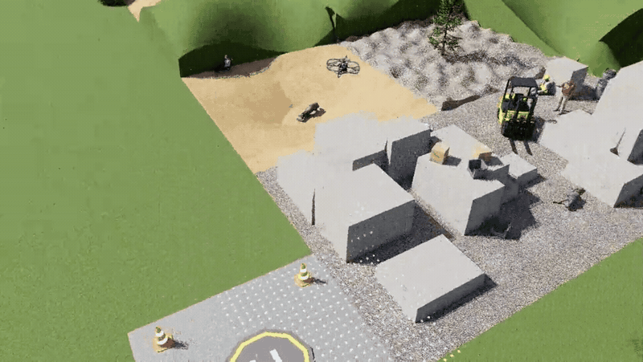

#### The 17 observations

The survey task keeps the training task's observation group and overrides only the first term ([survey_env_cfg.py:111-131](https://github.com/Wavy-Hec/drone-search-rescue/blob/080ced76e42b8b7a6eb4050b4a98214992865625/sim/src/drone_lab/tasks/survey/config/arl_robot_1/survey_env_cfg.py#L111-L131)); a test checks the order and that terms 2-5 are the built-in task's ([test_env_cfgs.py:32-51](https://github.com/Wavy-Hec/drone-search-rescue/blob/080ced76e42b8b7a6eb4050b4a98214992865625/sim/tests/test_env_cfgs.py#L32-L51)).

| # | Term | Dim | Index | Value | Frame, units |
|---|---|---|---|---|---|
| 1 | `base_link_position` | 3 | 0-2 | drone position minus carrot, clamped to a 1 m ball ([survey_terms.py:23-38](https://github.com/Wavy-Hec/drone-search-rescue/blob/080ced76e42b8b7a6eb4050b4a98214992865625/sim/src/drone_lab/tasks/survey/mdp/survey_terms.py#L23-L38)) | world axes, m |
| 2 | `base_orientation` | 4 | 3-6 | orientation quaternion (x, y, z, w) | world |
| 3 | `base_lin_vel` | 3 | 7-9 | linear velocity | body frame, m/s |
| 4 | `base_ang_vel` | 3 | 10-12 | angular velocity | body frame, rad/s |
| 5 | `last_action` | 4 | 13-16 | the previous step's raw output | unitless |

In training, term 1 was the drone's position minus the env origin, where the goal sat, so it too was "drone minus target". There is no observation noise: training ran with `enable_corruption=False`, and the survey sets every term's noise to `None` ([survey_env_cfg.py:124-129](https://github.com/Wavy-Hec/drone-search-rescue/blob/080ced76e42b8b7a6eb4050b4a98214992865625/sim/src/drone_lab/tasks/survey/config/arl_robot_1/survey_env_cfg.py#L124-L129)). No input depends on absolute position, so the policy behaves the same at the survey height of 7.515 m as near its training origin. The mapping rays and the camera are not inputs.

#### From action to thrust, and timing

Each action value sets one rotor's thrust target:

$$
T_i = \mathrm{clamp}(3a_i + 3,\ 0,\ 6)\ \mathrm{N}
$$

This is `ThrustActionCfg` with scale 3, offset 3 and clip 0 to 6, unchanged from training ([survey_env_cfg.py:12](https://github.com/Wavy-Hec/drone-search-rescue/blob/080ced76e42b8b7a6eb4050b4a98214992865625/sim/src/drone_lab/tasks/survey/config/arl_robot_1/survey_env_cfg.py#L12); asserted in [test_env_cfgs.py:54-57](https://github.com/Wavy-Hec/drone-search-rescue/blob/080ced76e42b8b7a6eb4050b4a98214992865625/sim/tests/test_env_cfgs.py#L54-L57)). A raw −1 gives 0 N, which the mission sends to stop the motors after touchdown ([sar_mission.py:158-159](https://github.com/Wavy-Hec/drone-search-rescue/blob/080ced76e42b8b7a6eb4050b4a98214992865625/sim/scripts/sar_mission.py#L158-L159)); 0 gives 3 N and +1 gives 6 N. The clamp is the only bound on the network's output. Upstream (not in the repository), the motor model clamps each target again to 0.1-10 N, so "0 N" leaves about 0.1 N per rotor; each rotor follows its target with a first-order lag, and an allocation matrix turns the four thrusts into a body force and torque (`isaaclab_assets/robots/arl_robot_1.py:26-33`, `isaaclab_contrib/actuators/thruster.py:122-177`, `isaaclab_contrib/assets/multirotor/multirotor.py:563-582`). Physics runs at 100 Hz with decimation 10, so the policy acts at 10 Hz ([test_env_cfgs.py:58-60](https://github.com/Wavy-Hec/drone-search-rescue/blob/080ced76e42b8b7a6eb4050b4a98214992865625/sim/tests/test_env_cfgs.py#L58-L60)).

Fed its own output back as `last_action` while level, at rest and on target, the network settles on $a_{\mathrm{hover}}$ = (0.0846, 0.0891, 0.0801, 0.0879): 3.24-3.27 N per rotor, 13.03 N in total (a numpy forward pass of the archive's weights, not a simulator). If that is the true hover thrust, the drone weighs about 1.33 kg and the 4 × 6 N ceiling gives a thrust-to-weight ratio of about 1.8 (inferences; the mass is in the drone's USD file, outside the repository).

#### The task it was trained on

The README names Isaac Lab's built-in `IsaacContrib-TrackPositionNoObstacles-ARL-Robot-1` and its one skill: "fly from up to 1 m away to a target point and hover there" ([sim/README.md:296-300](https://github.com/Wavy-Hec/drone-search-rescue/blob/080ced76e42b8b7a6eb4050b4a98214992865625/sim/README.md#L296-L300)). The survey's configuration subclasses that task's class `NoObstacleEnvCfg` ([survey_env_cfg.py:37-39](https://github.com/Wavy-Hec/drone-search-rescue/blob/080ced76e42b8b7a6eb4050b4a98214992865625/sim/src/drone_lab/tasks/survey/config/arl_robot_1/survey_env_cfg.py#L37-L39), [:187-188](https://github.com/Wavy-Hec/drone-search-rescue/blob/080ced76e42b8b7a6eb4050b4a98214992865625/sim/src/drone_lab/tasks/survey/config/arl_robot_1/survey_env_cfg.py#L187-L188)). The task's code is upstream; in Isaac Lab 3.0.0 (`track_position_state_based_env_cfg.py`):

- **Goal:** the env origin (every command range is 0).
- **Reset:** position ±1 m per axis around the goal; roll, pitch and yaw ±30°; linear and angular velocity ±0.2 per axis.
- **Terminations:** the time-out, and `crash` below z = −3.0 m, in an empty world with no ground.
- **Episode:** 5.0 s, 50 policy steps; observation noise configured but switched off.
- **PPO:** 4096 envs, 24 steps per env, 1500 iterations (section 1.2).

#### Every reward term

Each step pays

$$
r_t = \Delta t\sum_i w_i\,f_i,\qquad \Delta t = 0.1\ \mathrm{s}
$$

(`isaaclab/managers/reward_manager.py:143-152`). The hover task's terms in Isaac Lab 3.0.0 (`track_position_state_based_env_cfg.py:158-193`):

| Term | Weight $w_i$ | $f_i$ | What it pays for |
|---|---|---|---|
| `distance_to_goal_exp` | +25.0 | $\exp(-\lVert g-(p-o_{env})\rVert^2/1.5^2)$, goal $g = 0$ | being at the goal |
| `flat_orientation_l2` | **+1.0** | $g_{b,x}^2+g_{b,y}^2$: squared x and y of gravity in the body frame | tilt (see below) |
| `yaw_aligned` | +2.0 | $\exp(-\mathrm{wrap}(\psi)^2/1.0^2)$ | heading at yaw 0 |
| `lin_vel_xyz_exp` | +2.5 | $\exp(-\lVert v_w\rVert^2/2.0^2)$ | keeping still |
| `ang_vel_xyz_exp` | +10.0 | $\exp(-\lVert\omega_b\rVert^2/10^2)$ | not rotating |
| `action_rate_l2` | −0.05 | $\lVert a_t-a_{t-1}\rVert^2$ | smooth commands |
| `action_magnitude_l2` | −0.05 | $\lVert a_t\rVert^2$ | thrust near 3 N per rotor |
| `termination_penalty` | −5.0 | 1 when a failure ends the episode, 0 on a time-out | not crashing |

Symbols: $p$ drone position, $o_{env}$ env origin, $v_w$ world-frame velocity, $\omega_b$ body rates, $\psi$ yaw, $a$ raw action. How to read it:

- **Scale.** A perfect hover step (on the goal, level, still, at yaw 0) pays $0.1\times(25+2+2.5+10) = 3.95$, about 198 over a 5 s episode (derived). The goal term is most of it.
- **Exponential kernels.** $\exp(-e^2/\mathrm{std}^2)$ pays 1 at zero error and falls smoothly; the std sets the width. With std 1.5 m the goal term still pays well 1 m away, so every start in the ±1 m box gets a useful learning signal.
- **Keeping still is paid.** The two velocity terms reward low speed and low body rates: what a hover needs, and, as section 1.4 shows, part of why the pilot lags a moving target.
- **The +1.0 quirk.** `flat_orientation_l2` is never negative, so a positive weight *rewards* tilt, by at most 0.1 per step. The repository's trajectory task makes it a penalty ([sim/README.md:581-582](https://github.com/Wavy-Hec/drone-search-rescue/blob/080ced76e42b8b7a6eb4050b4a98214992865625/sim/README.md#L581-L582)).

The repository confirms parts of this independently of any Isaac Lab copy: the survey's reward class is "Training rewards with the goal term measured to the carrot", weight 25.0 and std 1.5 ([survey_env_cfg.py:145-153](https://github.com/Wavy-Hec/drone-search-rescue/blob/080ced76e42b8b7a6eb4050b4a98214992865625/sim/src/drone_lab/tasks/survey/config/arl_robot_1/survey_env_cfg.py#L145-L153)), and the README states the +1.0. In the survey these rewards are only logged ([survey_terms.py:67-69](https://github.com/Wavy-Hec/drone-search-rescue/blob/080ced76e42b8b7a6eb4050b4a98214992865625/sim/src/drone_lab/tasks/survey/mdp/survey_terms.py#L67-L69)).

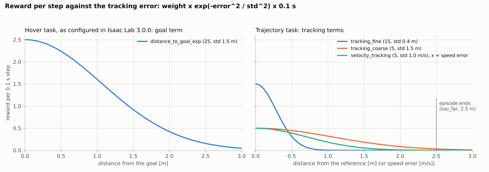

The figure plots weight × term × 0.1 s against the error ([make_figures.py:543-603](https://github.com/Wavy-Hec/drone-search-rescue/blob/080ced76e42b8b7a6eb4050b4a98214992865625/docs/experiments/make_figures.py#L543-L603)). Left: the hover goal term pays 2.5 per step on the goal and still about 0.9 at 1.5 m. Right: the trajectory task's fine term pays 1.5 on the reference but almost nothing beyond 0.8 m (0.03), where only the coarse term (0.38 at 0.8 m) still pulls the drone back.

#### What is and is not recorded about the training run

| Recorded | Not recorded (UNVERIFIED in the repository) |
|---|---|
| the training task's name ([sim/README.md:296-300](https://github.com/Wavy-Hec/drone-search-rescue/blob/080ced76e42b8b7a6eb4050b4a98214992865625/sim/README.md#L296-L300)) | which Isaac Lab version trained the file: the archive carries no version or run metadata, so the table above is a cross-check, not proof |
| the documented command, `--num_envs 4096 --max_iterations 1500 --seed 42` ([sim/README.md:399-403](https://github.com/Wavy-Hec/drone-search-rescue/blob/080ced76e42b8b7a6eb4050b4a98214992865625/sim/README.md#L399-L403)) | how long it trained: the README says the survey was flown "after 1300 training iterations (the release asset)" ([sim/README.md:322-323](https://github.com/Wavy-Hec/drone-search-rescue/blob/080ced76e42b8b7a6eb4050b4a98214992865625/sim/README.md#L322-L323)), while the command runs 1500 |
| the goal term's weight and std, and the +1.0 tilt weight | the envs and seed of the run that produced the file |
| no observation noise, starts within ±1 m per axis ([survey_env_cfg.py:11](https://github.com/Wavy-Hec/drone-search-rescue/blob/080ced76e42b8b7a6eb4050b4a98214992865625/sim/src/drone_lab/tasks/survey/config/arl_robot_1/survey_env_cfg.py#L11), [carrot.py:3-4](https://github.com/Wavy-Hec/drone-search-rescue/blob/080ced76e42b8b7a6eb4050b4a98214992865625/sim/src/drone_lab/carrot.py#L3-L4)) | any training curve; the drone's mass and inertia |

#### One control step with the released weights

The hover pilot in the survey, level, at rest and at yaw 0 on a line along +x, with the carrot 0.5 m ahead and the previous action at $a_{\mathrm{hover}}$ (numpy forward pass of the released weights, not a simulator run):

| Stage | Numbers |
|---|---|
| Observation | offset (−0.5, 0, 0); quaternion (0, 0, 0, 1); velocities 0; last action $a_{\mathrm{hover}}$ |
| Policy, 17 → 256 → 128 → 64 → 4 | $a$ = (−0.1215, 0.3288, 0.3152, −0.0869) |
| Thrust targets | (2.635, 3.986, 3.945, 2.739) N; total 13.31 N, 0.28 N above hover |
| Body wrench at the targets (Isaac Lab 3.0.0 allocation) | torque about body y of 0.332 N·m, which tips the thrust towards +x, where the carrot is |
| Logged reward, at the pre-step state (an approximation) | $0.1\times(22.371 + 0 + 2.0 + 2.5 + 10.0 - 0.0093 - 0.0115) = 3.685$ |
| Carrot update | the drone is within 0.7 m, so the carrot moves 1.0 m/s × 0.1 s = 0.1 m |

With the carrot 1.0 m ahead the total is 13.72 N, and 1.5 m ahead exactly the same, because the clamp maps both to (−1, 0, 0).

### 1.4 The carrot: how a hover policy flies a survey

#### The idea

The hover pilot's only notion of a goal is input 1, its offset from the target, so it cannot tell a fixed target from a moving one. The survey task makes the target a *carrot* that slides along the survey path, and the policy, still trying to reach its target and hover there, chases it ([carrot.py:1-16](https://github.com/Wavy-Hec/drone-search-rescue/blob/080ced76e42b8b7a6eb4050b4a98214992865625/sim/src/drone_lab/carrot.py#L1-L16)). Two safeguards keep the offset inside what the policy saw in training: the carrot slows down and waits when the drone lags, and the observed offset is clamped to 1 m. The same network then flies the survey and the mission unchanged.

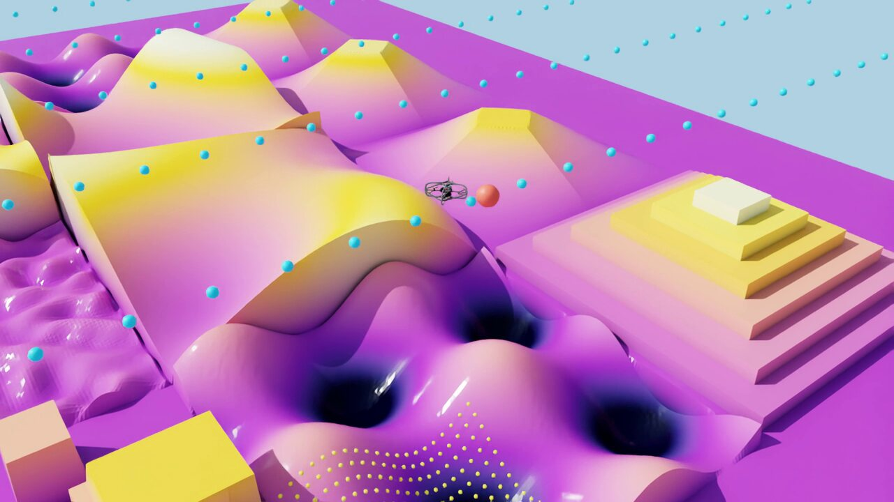

#### One carrot update

The command term resamples each env's waypoint path to points at most 0.25 m apart ([commands.py:61-78](https://github.com/Wavy-Hec/drone-search-rescue/blob/080ced76e42b8b7a6eb4050b4a98214992865625/sim/src/drone_lab/tasks/survey/mdp/commands.py#L61-L78), [commands_cfg.py:73](https://github.com/Wavy-Hec/drone-search-rescue/blob/080ced76e42b8b7a6eb4050b4a98214992865625/sim/src/drone_lab/tasks/survey/mdp/commands_cfg.py#L73)). The carrot's state is its arclength $s$ along the path; $c(s)$ is the path point there. Every step, after physics, with $p$ the drone position, $\Delta t$ = 0.1 s, $v_c$ the carrot speed, $L$ the path length, $L_{max}$ = `max_lead` and $L_{slow}$ = `slow_lead` ([commands.py:197-229](https://github.com/Wavy-Hec/drone-search-rescue/blob/080ced76e42b8b7a6eb4050b4a98214992865625/sim/src/drone_lab/tasks/survey/mdp/commands.py#L197-L229), [carrot.py:80-126](https://github.com/Wavy-Hec/drone-search-rescue/blob/080ced76e42b8b7a6eb4050b4a98214992865625/sim/src/drone_lab/carrot.py#L80-L126)):

1. distance $d = \lVert c(s)-p\rVert$;
2. **lead gate** $g = \mathrm{clamp}\big((L_{max}-d)/(L_{max}-L_{slow}),\ 0,\ 1\big)$;
3. step $\Delta s = v_c\,g\,\Delta t$ and trial $s' = \min(s+\Delta s,\ L)$;
4. if the trial carrot is more than $L_{max}$ from the drone, the step is **shortened** to $\min(\Delta s,\ L_{max}-d)$. A chord is never longer than its arc, so the carrot ends at most $L_{max}$ from the drone.

For the hover pilot $L_{max}$ = 1.0 m and $L_{slow}$ = 0.7 m ([commands_cfg.py:59-68](https://github.com/Wavy-Hec/drone-search-rescue/blob/080ced76e42b8b7a6eb4050b4a98214992865625/sim/src/drone_lab/tasks/survey/mdp/commands_cfg.py#L59-L68)):

```text
 gate g        carrot step = speed x g x 0.1 s
  1.0 +-----------------------------
      |                               \
  0.5 |                                  \
      |                                     \
  0.0 +----------------------------------------+------------->  d = |carrot - drone|  [m]
       0                          0.7         1.0
                           slow_lead        max_lead
```

The gate is 1 up to 0.7 m, 0.5 at 0.85 m and 0 at 1.0 m, so a drone that stops dead holds the carrot within 1 m ([test_carrot.py:49-60](https://github.com/Wavy-Hec/drone-search-rescue/blob/080ced76e42b8b7a6eb4050b4a98214992865625/sim/tests/test_carrot.py#L49-L60)). Shortening a step instead of rejecting it matters at high speed: rejecting would make the carrot stop and go above 3 m/s and stall for good once $v_c\Delta t \ge L_{max}$ ([test_carrot.py:84-99](https://github.com/Wavy-Hec/drone-search-rescue/blob/080ced76e42b8b7a6eb4050b4a98214992865625/sim/tests/test_carrot.py#L84-L99)).

#### The offset clamp

`clamp_offset` scales the offset onto a ball of radius 1 m, keeping its direction, then clips each axis to ±1 m ([carrot.py:162-181](https://github.com/Wavy-Hec/drone-search-rescue/blob/080ced76e42b8b7a6eb4050b4a98214992865625/sim/src/drone_lab/carrot.py#L162-L181), called from [survey_env_cfg.py:119-122](https://github.com/Wavy-Hec/drone-search-rescue/blob/080ced76e42b8b7a6eb4050b4a98214992865625/sim/src/drone_lab/tasks/survey/config/arl_robot_1/survey_env_cfg.py#L119-L122)); with these numbers the box never binds ([test_carrot.py:102-112](https://github.com/Wavy-Hec/drone-search-rescue/blob/080ced76e42b8b7a6eb4050b4a98214992865625/sim/tests/test_carrot.py#L102-L112)). Since the gate already keeps the carrot within 1 m, the clamp acts only after an overshoot or a disturbance. The ball is a little tighter than the training starts, whose ±1 m box has corners 1.73 m from the goal, so clamped offsets stay inside what the policy saw.

#### Speeds

In the survey task the carrot runs at 1.0 m/s ([commands_cfg.py:56-57](https://github.com/Wavy-Hec/drone-search-rescue/blob/080ced76e42b8b7a6eb4050b4a98214992865625/sim/src/drone_lab/tasks/survey/mdp/commands_cfg.py#L56-L57)). The mission sets the speed every step from the carrot's phase: 0 for the first 1.5 s so the drone first hovers, then 1.0 m/s for the climb, 1.5 m/s for transit, survey and return, 0.8 m/s for the descent and 0.3 m/s for the touchdown ([sar_mission.py:66-71](https://github.com/Wavy-Hec/drone-search-rescue/blob/080ced76e42b8b7a6eb4050b4a98214992865625/sim/scripts/sar_mission.py#L66-L71), [:440](https://github.com/Wavy-Hec/drone-search-rescue/blob/080ced76e42b8b7a6eb4050b4a98214992865625/sim/scripts/sar_mission.py#L440), [:454](https://github.com/Wavy-Hec/drone-search-rescue/blob/080ced76e42b8b7a6eb4050b4a98214992865625/sim/scripts/sar_mission.py#L454), [mission.py:128-131](https://github.com/Wavy-Hec/drone-search-rescue/blob/080ced76e42b8b7a6eb4050b4a98214992865625/sim/src/drone_lab/sar/mission.py#L128-L131)).

#### Why it lags and tops out near 1.3 m/s

The README reports two Isaac Sim measurements: the drone follows "about 0.75 s behind" the carrot (0.75 m at 1 m/s), and commands of 1.5, 2 and 3 m/s give 1.16, 1.23 and 1.31 m/s ([sim/README.md:335-337](https://github.com/Wavy-Hec/drone-search-rescue/blob/080ced76e42b8b7a6eb4050b4a98214992865625/sim/README.md#L335-L337)). The run logs are not in the repository, but the code shows the mechanism:

1. **No velocity input, no moving goal in training.** The 17 inputs hold the offset, not the target's velocity, and the training goal never moved ([sim/README.md:579](https://github.com/Wavy-Hec/drone-search-rescue/blob/080ced76e42b8b7a6eb4050b4a98214992865625/sim/README.md#L579)). The policy notices that the carrot moves only when the offset grows.
2. **It was paid to keep still.** A policy that damps its own velocity behaves like a spring and damper on the offset: to fly at a steady speed $V$ it needs a steady pull, an offset that grows with $V$. That is a constant time lag, about 0.75 s on the README's numbers (an interpretation, not a measurement).
3. **The lead limit and the clamp cap the pull.** At speed $V$ the drone needs a lead of about $0.75\,\mathrm{s}\times V$, but the carrot leads by at most 1.0 m and the policy sees at most 1 m. So $V \lesssim 1.0/0.75 \approx 1.33$ m/s, where the measured speeds level off. The CPU tests model the policy the same way ([test_carrot.py:63-79](https://github.com/Wavy-Hec/drone-search-rescue/blob/080ced76e42b8b7a6eb4050b4a98214992865625/sim/tests/test_carrot.py#L63-L79)).

The mission's camera-overlap numbers assume the hover pilot flies min(speed, 1.25) m/s ([sar_mission.py:389-390](https://github.com/Wavy-Hec/drone-search-rescue/blob/080ced76e42b8b7a6eb4050b4a98214992865625/sim/scripts/sar_mission.py#L389-L390)). The README's remedy is a policy trained on moving targets: the next task.

### 1.5 The trajectory-tracking task

#### Set-up

`DroneLab-TrackTrajectory-ARL-Robot-1-v0` ([__init__.py:11-20](https://github.com/Wavy-Hec/drone-search-rescue/blob/080ced76e42b8b7a6eb4050b4a98214992865625/sim/src/drone_lab/tasks/track_trajectory/config/arl_robot_1/__init__.py#L11-L20)) teaches a policy to follow a moving reference. Besides its position error, the policy sees its velocity error and where the reference will be 0.5 s and 1.0 s ahead: the *feed-forward* information the hover pilot lacks ([track_trajectory_env_cfg.py:1-15](https://github.com/Wavy-Hec/drone-search-rescue/blob/080ced76e42b8b7a6eb4050b4a98214992865625/sim/src/drone_lab/tasks/track_trajectory/config/arl_robot_1/track_trajectory_env_cfg.py#L1-L15)). It subclasses the same `NoObstacleEnvCfg`, so robot, thrust actions and timing are the hover task's. It runs 4096 envs 6.0 m apart in an empty world, with 12.0 s episodes (120 steps) and no curriculum: the random references alone set the difficulty ([track_trajectory_env_cfg.py:123-137](https://github.com/Wavy-Hec/drone-search-rescue/blob/080ced76e42b8b7a6eb4050b4a98214992865625/sim/src/drone_lab/tasks/track_trajectory/config/arl_robot_1/track_trajectory_env_cfg.py#L123-L137)).

#### Reference trajectories

Every reference is, per axis, a sum of two sinusoids around an offset, so its velocity is exact ([reference.py:37-45](https://github.com/Wavy-Hec/drone-search-rescue/blob/080ced76e42b8b7a6eb4050b4a98214992865625/sim/src/drone_lab/reference.py#L37-L45)):

$$
p(t) = o + \sum_{k=1}^{2} A_k\sin(\omega_k t+\phi_k),\qquad v(t) = \sum_{k=1}^{2} A_k\omega_k\cos(\omega_k t+\phi_k)
$$

At every reset each env draws ([commands_cfg.py:38-53](https://github.com/Wavy-Hec/drone-search-rescue/blob/080ced76e42b8b7a6eb4050b4a98214992865625/sim/src/drone_lab/tasks/track_trajectory/mdp/commands_cfg.py#L38-L53), [reference.py:47-150](https://github.com/Wavy-Hec/drone-search-rescue/blob/080ced76e42b8b7a6eb4050b4a98214992865625/sim/src/drone_lab/reference.py#L47-L150)): a shape, uniformly from circle, figure-eight, Lissajous and random; a size $a \sim U(0.8, 2.5)$ m and a peak speed $V \sim U(0.3, 1.5)$ m/s; a height offset $z_0 \sim U(-0.5, 0.5)$ m and a vertical wave of up to 0.5 m; a speed split $\alpha \sim U(0^\circ, 30^\circ)$ that gives the horizontal shape $V_h = V\cos\alpha$ and the vertical wave at most $V\sin\alpha$, so the 3-D speed never exceeds $V$; and a phase and a direction $d = \pm 1$.

| Shape | $x(t)$ | $y(t)$ | $\omega$ |
|---|---|---|---|
| circle | $a\cos(\omega t+\phi)$ | $d\,a\sin(\omega t+\phi)$ | $V_h/a$, constant speed |
| figure-eight | $a\sin(\omega t+\phi)$ | $d\,\frac{a}{2}\sin(2\omega t+2\phi)$ | $V_h/(a\sqrt{2})$, fastest at the crossing |
| Lissajous | $a\sin(\omega t+\phi)$ | $b\sin(r\omega t+\phi_2)$, $r\in\lbrace 1.5, 2, 3\rbrace$ | $V_h/\sqrt{a^2+(br)^2}$ |
| random | two sinusoids per axis | drawn separately | scaled so the speed bound is $V_h$ |

The command term advances its clock by 0.1 s per step, evaluates $p_{ref}(t)$, $v_{ref}(t)$ and the look-ahead points $p_{ref}(t+0.5)$ and $p_{ref}(t+1.0)$, and never resamples in mid-episode ([commands.py:82-89](https://github.com/Wavy-Hec/drone-search-rescue/blob/080ced76e42b8b7a6eb4050b4a98214992865625/sim/src/drone_lab/tasks/track_trajectory/mdp/commands.py#L82-L89), [:108-110](https://github.com/Wavy-Hec/drone-search-rescue/blob/080ced76e42b8b7a6eb4050b4a98214992865625/sim/src/drone_lab/tasks/track_trajectory/mdp/commands.py#L108-L110), [commands_cfg.py:35-36](https://github.com/Wavy-Hec/drone-search-rescue/blob/080ced76e42b8b7a6eb4050b4a98214992865625/sim/src/drone_lab/tasks/track_trajectory/mdp/commands_cfg.py#L35-L36)).

#### The 26 observations

Terms in [track_trajectory_env_cfg.py:57-71](https://github.com/Wavy-Hec/drone-search-rescue/blob/080ced76e42b8b7a6eb4050b4a98214992865625/sim/src/drone_lab/tasks/track_trajectory/config/arl_robot_1/track_trajectory_env_cfg.py#L57-L71), functions in [track_terms.py:26-57](https://github.com/Wavy-Hec/drone-search-rescue/blob/080ced76e42b8b7a6eb4050b4a98214992865625/sim/src/drone_lab/tasks/track_trajectory/mdp/track_terms.py#L26-L57):

| # | Term | Dim | Index | Value | Frame, units | Clip | Training noise |
|---|---|---|---|---|---|---|---|
| 1 | `reference_error` | 3 | 0-2 | $p - p_{ref}$ | world, m | ±2.0 | U(±0.02) |
| 2 | `velocity_error` | 3 | 3-5 | $v - v_{ref}$ | world, m/s | ±3.0 | U(±0.05) |
| 3 | `lookahead` | 6 | 6-11 | $p_{ref}(t+0.5)-p$, then $p_{ref}(t+1.0)-p$ | world, m | ±3.0 | none |
| 4 | `base_orientation` | 4 | 12-15 | quaternion, made unique (w ≥ 0) | world | none | none |
| 5 | `base_lin_vel` | 3 | 16-18 | linear velocity | body, m/s | none | U(±0.05) |
| 6 | `base_ang_vel` | 3 | 19-21 | angular velocity | body, rad/s | none | U(±0.05) |
| 7 | `last_action` | 4 | 22-25 | previous raw action | unitless | none | none |

The noise is on in training ([track_trajectory_env_cfg.py:73-75](https://github.com/Wavy-Hec/drone-search-rescue/blob/080ced76e42b8b7a6eb4050b4a98214992865625/sim/src/drone_lab/tasks/track_trajectory/config/arl_robot_1/track_trajectory_env_cfg.py#L73-L75)). Isaac Lab adds it after the term function, and these clips sit inside the functions, so in training the position error can read up to ±2.02 m.

#### Every reward term

Weights and parameters in [track_trajectory_env_cfg.py:91-110](https://github.com/Wavy-Hec/drone-search-rescue/blob/080ced76e42b8b7a6eb4050b4a98214992865625/sim/src/drone_lab/tasks/track_trajectory/config/arl_robot_1/track_trajectory_env_cfg.py#L91-L110); the two tracking functions in [track_terms.py:100-121](https://github.com/Wavy-Hec/drone-search-rescue/blob/080ced76e42b8b7a6eb4050b4a98214992865625/sim/src/drone_lab/tasks/track_trajectory/mdp/track_terms.py#L100-L121). Here $v$ is the world-frame velocity and $g_b$ the unit gravity direction in the body frame.

| Term | Weight $w_i$ | $f_i$ | std |
|---|---|---|---|
| `tracking_fine` | +15.0 | $\exp(-\lVert p-p_{ref}\rVert^2/0.4^2)$ | 0.4 m |
| `tracking_coarse` | +5.0 | $\exp(-\lVert p-p_{ref}\rVert^2/1.5^2)$ | 1.5 m |
| `velocity_tracking` | +5.0 | $\exp(-\lVert v-v_{ref}\rVert^2/1.0^2)$ | 1.0 m/s |
| `flat_orientation_l2` | **−1.0** | $g_{b,x}^2+g_{b,y}^2=\sin^2(\mathrm{tilt})$ | |
| `yaw_aligned` | +2.0 | $\exp(-\mathrm{wrap}(\psi)^2/1.0^2)$ | 1.0 rad |
| `ang_vel_xyz_exp` | +2.0 | $\exp(-\lVert\omega_b\rVert^2/5.0^2)$ | 5.0 rad/s |
| `action_rate_l2` | −0.05 | $\lVert a_t-a_{t-1}\rVert^2$ | |
| `action_magnitude_l2` | −0.05 | $\lVert a_t\rVert^2$ | |
| `termination_penalty` | −20.0 | 1 when a failure ends the episode | |

The step reward is again $r_t = 0.1\,\mathrm{s}\times\sum_i w_i f_i$. Why each choice:

- **Two position kernels.** The coarse one still pays when the drone is far off and pulls it back; the fine one pays most within a few tens of centimetres. At 0.4 m of error the fine term has fallen to $15e^{-1} = 5.5$, while the coarse term still pays $5e^{-0.07} = 4.7$ (see the figure in section 1.3).
- **Velocity, not stillness.** `velocity_tracking` pays for matching the reference's velocity, exactly what the hover reward lacks.
- **Tilt as a penalty.** It costs 0.03 at 10° and 0.25 at 30° (times 0.1 per step): it discourages needless tilt without forbidding the tilt that acceleration needs.
- **Body rates** fall off faster (std 5.0 against 10.0 upstream) but weigh less (2.0 against 10.0).
- **Scale.** The best step pays $0.1\times(15+5+5+2+2) = 2.9$, at most 348 per episode. A failure costs $20\times 0.1 = 2.0$ once, plus every reward the episode no longer collects: flying on at the best rate is worth up to $2.9/(1-0.98) = 145$, so ending early costs far more than the explicit penalty (derived).

#### Terminations and resets

The episode ends on ([track_trajectory_env_cfg.py:113-120](https://github.com/Wavy-Hec/drone-search-rescue/blob/080ced76e42b8b7a6eb4050b4a98214992865625/sim/src/drone_lab/tasks/track_trajectory/config/arl_robot_1/track_trajectory_env_cfg.py#L113-L120)): `time_out` after 12 s (a truncation); `too_far`, more than 2.5 m from the reference ([track_terms.py:129-137](https://github.com/Wavy-Hec/drone-search-rescue/blob/080ced76e42b8b7a6eb4050b4a98214992865625/sim/src/drone_lab/tasks/track_trajectory/mdp/track_terms.py#L129-L137)); `crash`, z below −3.0 m; `flipped`, tilt above 1.75 rad (100°).

The reset event `reset_near_reference` draws a new reference, then places the drone at $p_{ref}(0)$ plus U(±0.3 m) per axis, with roll, pitch and yaw each U(±0.26 rad) (about ±15°), linear velocity $v_{ref}(0)$ plus U(±0.2 m/s) per axis and angular velocity U(±0.2 rad/s) per axis ([track_terms.py:65-92](https://github.com/Wavy-Hec/drone-search-rescue/blob/080ced76e42b8b7a6eb4050b4a98214992865625/sim/src/drone_lab/tasks/track_trajectory/mdp/track_terms.py#L65-L92)). So every episode starts close to the reference and already moving with it.

#### PPO settings

[rsl_rl_ppo_cfg.py:13-37](https://github.com/Wavy-Hec/drone-search-rescue/blob/080ced76e42b8b7a6eb4050b4a98214992865625/sim/src/drone_lab/tasks/track_trajectory/config/arl_robot_1/agents/rsl_rl_ppo_cfg.py#L13-L37) matches the upstream hover runner except for observation normalisation (on, for actor and critic), the entropy coefficient (0.002 instead of 0.001) and the run length (2000 iterations with a checkpoint every 100, instead of 1500 and 50). Section 1.8 has all three runners side by side. The trained network would have 48,324 weights and biases (26 → 256 → 128 → 64 → 4, derived) plus the normaliser's running statistics, and its logs go to `logs/rsl_rl/drone_lab_track_trajectory/`.

#### A worked reward at one state

Take the state the repository's test builds ([test_trajectory_pilot.py:341-356](https://github.com/Wavy-Hec/drone-search-rescue/blob/080ced76e42b8b7a6eb4050b4a98214992865625/sim/tests/test_trajectory_pilot.py#L341-L356)): the reference moves along +x at 1 m/s; the drone is 0.3 m behind and 0.2 m below it, flying at (0.8, 0, 0.1) m/s. Assume, for illustration, that the drone is level, at yaw 0 and not rotating, and that the previous and new actions are both (0.1, 0.1, 0.1, 0.1). The 26 inputs, grouped as in the table, are

`[−0.3, 0, −0.2 | −0.2, 0, 0.1 | 0.8, 0, 0.2, 1.3, 0, 0.2 | 0, 0, 0, 1 | 0.8, 0, 0.1 | 0, 0, 0 | 0.1, 0.1, 0.1, 0.1]`

| Term | Computation | $w_i f_i$ |
|---|---|---|
| `tracking_fine` | $15\exp(-0.13/0.16)$, since $\lVert p-p_{ref}\rVert^2 = 0.3^2+0.2^2 = 0.13$ | 6.656 |
| `tracking_coarse` | $5\exp(-0.13/2.25)$ | 4.719 |
| `velocity_tracking` | $5\exp(-0.05/1.0)$, since $\lVert v-v_{ref}\rVert^2 = 0.2^2+0.1^2 = 0.05$ | 4.756 |
| tilt, yaw, body rates | level, yaw 0, no rotation | 0, 2.0, 2.0 |
| action rate, magnitude | $0$ and $-0.05\times 4\times 0.1^2$ | 0, −0.002 |

The sum is 20.13, so this step pays $0.1\times 20.13 = 2.013$ of the possible 2.9 (derived). Most of the shortfall is the fine position term: being 0.3 m behind and 0.2 m low leaves 44 % of it. Most of the reward still to gain is in closing the position gap.

#### How a trained trajectory pilot would fly the survey

> [!warning] Not trained, not flown
> The repository holds no trained trajectory policy: the download script fetches none ([download_assets.sh:16-22](https://github.com/Wavy-Hec/drone-search-rescue/blob/080ced76e42b8b7a6eb4050b4a98214992865625/scripts/download_assets.sh#L16-L22)) and the README says none has flown the mission ([sim/README.md:515-516](https://github.com/Wavy-Hec/drone-search-rescue/blob/080ced76e42b8b7a6eb4050b4a98214992865625/sim/README.md#L515-L516)). What exists are CPU tests of the reference math, the configurations and the carrot term. Below is how the code would feed such a policy.

`sar_mission.py --pilot trajectory` flies `DroneLab-SAR-Trajectory-ARL-Robot-1-v0` ([sar_mission.py:56-61](https://github.com/Wavy-Hec/drone-search-rescue/blob/080ced76e42b8b7a6eb4050b4a98214992865625/sim/scripts/sar_mission.py#L56-L61), [mission.py:47-52](https://github.com/Wavy-Hec/drone-search-rescue/blob/080ced76e42b8b7a6eb4050b4a98214992865625/sim/src/drone_lab/sar/mission.py#L47-L52)). It keeps the training task's seven observation terms, order and clips, with noise off, but points them at the survey carrot ([survey_trajectory_env_cfg.py:30-54](https://github.com/Wavy-Hec/drone-search-rescue/blob/080ced76e42b8b7a6eb4050b4a98214992865625/sim/src/drone_lab/tasks/survey/config/arl_robot_1/survey_trajectory_env_cfg.py#L30-L54)), which supplies the reference ([carrot.py:129-159](https://github.com/Wavy-Hec/drone-search-rescue/blob/080ced76e42b8b7a6eb4050b4a98214992865625/sim/src/drone_lab/carrot.py#L129-L159)):

- the reference position is the carrot itself;
- the reference velocity is the carrot's displacement over the last step divided by 0.1 s; across a corner this is the chord, so 2 m/s around a right angle gives (1, 1, 0) m/s, not 2 m/s along a tangent;
- the look-ahead points are where the carrot would be in 0.5 s and 1.0 s at its current speed; a waiting carrot gives zero velocity and look-ahead points on itself.

The carrot gets a wider lead, `max_lead` 1.5 m and `slow_lead` 1.0 m, matching the training task's 2 m clip and 2.5 m `too_far`, and an acceleration limit of 1.0 m/s², at most +0.1 m/s per step, so from rest to 1.5 m/s takes 15 steps ([survey_trajectory_env_cfg.py:57-65](https://github.com/Wavy-Hec/drone-search-rescue/blob/080ced76e42b8b7a6eb4050b4a98214992865625/sim/src/drone_lab/tasks/survey/config/arl_robot_1/survey_trajectory_env_cfg.py#L57-L65)). With the reference velocity as an input, the policy should not need a growing offset to move, so the 1.33 m/s cap of section 1.4 should not apply; that is the hypothesis to test, not a result. One caveat is known: training covers 3-D speeds of 0.3-1.5 m/s and vertical waves of at most 0.5 m with vertical speeds of at most 0.75 m/s, so the mission's 1.0 m/s climb, 0.8 m/s descent and default 1.5 m/s are at or beyond that edge ([sim/README.md:516-520](https://github.com/Wavy-Hec/drone-search-rescue/blob/080ced76e42b8b7a6eb4050b4a98214992865625/sim/README.md#L516-L520)).

### 1.6 The quadruped's walking policy

#### The robot

A custom quadruped with 12 revolute joints and 17 rigid bodies (trunk, and per leg a hip, thigh, calf and foot). The policy's joint inputs and outputs are ordered: the four hips (front-left, front-right, rear-left, rear-right), then the four thighs, then the four calves ([custom_quad.py:54-91](https://github.com/Wavy-Hec/drone-search-rescue/blob/080ced76e42b8b7a6eb4050b4a98214992865625/quadruped/src/quadruped_lab/assets/custom_quad.py#L54-L91)). A recorded run log gives the limits: hip ±35°, thigh −70° to 0°, calf 20° to 140°, 10 rad/s and 45 N·m per joint ([zero_agent_rough_excerpt.log:7-18](https://github.com/Wavy-Hec/drone-search-rescue/blob/080ced76e42b8b7a6eb4050b4a98214992865625/quadruped/tests/data/zero_agent_rough_excerpt.log#L7-L18)). It weighs about 22 kg, trunk 9.70 kg ([PORT_NOTES.md:109-111](https://github.com/Wavy-Hec/drone-search-rescue/blob/080ced76e42b8b7a6eb4050b4a98214992865625/quadruped/PORT_NOTES.md#L109-L111); UNVERIFIED, the USD files are Git LFS pointers in this checkout). The default pose is hips 4°, thighs −50°, calves 100° ([custom_quad.py:118-128](https://github.com/Wavy-Hec/drone-search-rescue/blob/080ced76e42b8b7a6eb4050b4a98214992865625/quadruped/src/quadruped_lab/assets/custom_quad.py#L118-L128)).

One DC-motor model drives all joints: $k_p$ = 60 N·m/rad, $k_d$ = 1.5 N·m·s/rad, 45 N·m limit, 21 rad/s no-load speed ([custom_quad.py:135-146](https://github.com/Wavy-Hec/drone-search-rescue/blob/080ced76e42b8b7a6eb4050b4a98214992865625/quadruped/src/quadruped_lab/assets/custom_quad.py#L135-L146)). Every physics substep a PD law turns the joint target $q^\ast$ into a torque, clipped to a torque-speed line (`isaaclab/actuators/actuator_pd.py:319-333,421-433`):

$$
\tau = \mathrm{clip}\Big(k_p\,(q^\ast - q) - k_d\,\dot q,\ \max\big({-45},\ 45(-1 - \dot q/21)\big),\ \min\big(45,\ 45(1 - \dot q/21)\big)\Big)
$$

So the policy does not command torques: it says where each joint should be, and the PD loop at 200 Hz pulls it there.

#### Observations and the height scan

235 values in this order (layout in [PORT_NOTES.md:121-136](https://github.com/Wavy-Hec/drone-search-rescue/blob/080ced76e42b8b7a6eb4050b4a98214992865625/quadruped/PORT_NOTES.md#L121-L136), asserted in [test_task_configs.py:116-140](https://github.com/Wavy-Hec/drone-search-rescue/blob/080ced76e42b8b7a6eb4050b4a98214992865625/quadruped/tests/test_task_configs.py#L116-L140)):

| Indices | Term | Content | Training noise |
|---|---|---|---|
| 0-2 | `base_lin_vel` | trunk linear velocity, body frame [m/s] | U(±0.1) |
| 3-5 | `base_ang_vel` | trunk angular velocity, body frame [rad/s] | U(±0.2) |
| 6-8 | `projected_gravity` | unit gravity vector in the body frame (the tilt) | U(±0.05) |
| 9-11 | `velocity_commands` | the command $(c_x, c_y, c_\omega)$ | none |
| 12-23 | `joint_pos` | $q - q_0$ [rad] | U(±0.01) |
| 24-35 | `joint_vel` | $\dot q$ [rad/s] | U(±1.5) |
| 36-47 | `actions` | the previous raw action | none |
| 48-234 | `height_scan` | 187 ground heights | U(±0.1) |

No term is scaled ([test_task_configs.py:131](https://github.com/Wavy-Hec/drone-search-rescue/blob/080ced76e42b8b7a6eb4050b4a98214992865625/quadruped/tests/test_task_configs.py#L131)). The **height scan** is the robot's view of the terrain; its settings are inherited from Isaac Lab, and the repository only mounts it on the trunk ([rough_env_cfg.py:87](https://github.com/Wavy-Hec/drone-search-rescue/blob/080ced76e42b8b7a6eb4050b4a98214992865625/quadruped/src/quadruped_lab/tasks/locomotion/config/custom_quad/rough_env_cfg.py#L87)). A grid 1.6 m along the body by 1.0 m across at 0.1 m spacing gives 17 × 11 = 187 vertical rays; it turns with the robot's heading but does not tilt with its pitch or roll. Each ray gives (`isaaclab/envs/mdp/observations.py:293-300`)

$$
h_i = z_{\mathrm{trunk}} - z_{\mathrm{hit},i} - 0.5,\qquad \text{clipped to } [-1, 1]
$$

so the scan sees ground from 1.5 m below to 0.5 m above the trunk origin. With the trunk 0.69 m up, as the policy walks ([PORT_NOTES.md:275-279](https://github.com/Wavy-Hec/drone-search-rescue/blob/080ced76e42b8b7a6eb4050b4a98214992865625/quadruped/PORT_NOTES.md#L275-L279)), flat ground reads about 0.19 on every ray, and a hole or a step down reads higher (derived). The scanner hits only the ground mesh, so the policy never sees people or props.

#### Action and timing

The 12 outputs become position targets around the default pose with scale 0.25 instead of the base task's 0.5 ([rough_env_cfg.py:94-95](https://github.com/Wavy-Hec/drone-search-rescue/blob/080ced76e42b8b7a6eb4050b4a98214992865625/quadruped/src/quadruped_lab/tasks/locomotion/config/custom_quad/rough_env_cfg.py#L94-L95)):

$$
q^\ast_j = q_{0,j} + 0.25\,a_j
$$

Nothing clips $a$. The trained policy's mean $\lvert a\rvert$ is 2.5 ([PORT_NOTES.md:275-277](https://github.com/Wavy-Hec/drone-search-rescue/blob/080ced76e42b8b7a6eb4050b4a98214992865625/quadruped/PORT_NOTES.md#L275-L277)), so its targets sit about 0.6 rad from the default pose on average (derived). Physics runs at 200 Hz with decimation 4, so the policy acts at 50 Hz, in episodes of 20 s (1,000 steps).

#### Commands during training

Every 10 s each robot draws $c_x, c_y \sim U(-1, 1)$ m/s and a target heading $\psi^\ast \sim U(-\pi, \pi)$. Every robot is a heading robot, so each step its yaw-rate command comes from the heading error, $c_\omega = \mathrm{clip}(0.5\,\mathrm{wrap}(\psi^\ast - \psi), -1, 1)$ rad/s. 2 % of the robots get the zero command and must stand. The command ranges have no curriculum (`isaaclab_tasks/core/velocity/velocity_env_cfg.py:137-148`).

#### Every reward term

$r_t = \Delta t \sum_i w_i f_i$ with $\Delta t$ = 0.02 s. Here $c$ is the command, $v^b$ and $\omega^b$ the trunk's velocities in the body frame, $\tau$ the motor torques and $\ddot q$ the joint accelerations. Weights set in [rough_env_cfg.py:120-127](https://github.com/Wavy-Hec/drone-search-rescue/blob/080ced76e42b8b7a6eb4050b4a98214992865625/quadruped/src/quadruped_lab/tasks/locomotion/config/custom_quad/rough_env_cfg.py#L120-L127); the rest is inherited from Isaac Lab 3.0.0 (IL3).

| Term | Weight | Where set | $f_i$ | Pays for or penalises |
|---|---|---|---|---|
| `track_lin_vel_xy_exp` | +1.5 | here (base 1.0) | $\exp(-\lVert c_{xy} - v^b_{xy}\rVert^2 / 0.25)$ | following the planar velocity command |
| `track_ang_vel_z_exp` | +0.75 | here (base 0.5) | $\exp(-(c_\omega - \omega^b_z)^2 / 0.25)$ | following the yaw-rate command |
| `lin_vel_z_l2` | −2.0 | IL3 | $(v^b_z)^2$ | bouncing |
| `ang_vel_xy_l2` | −0.05 | IL3 | $(\omega^b_x)^2 + (\omega^b_y)^2$ | rolling and pitching |
| `dof_torques_l2` | −2.0e-4 | here (base −1.0e-5) | $\sum_j \tau_j^2$ | motor effort |
| `dof_acc_l2` | −2.5e-7 | here | $\sum_j \ddot q_j^2$ | jerky joints |
| `action_rate_l2` | −0.01 | IL3 | $\sum_j (a_{t,j} - a_{t-1,j})^2$ | changing the action between steps |
| `feet_air_time` | +0.01 | here (base 0.125) | $\sum_{\mathrm{feet}}(t_{\mathrm{air}} - 0.5)$ at each touchdown, if $\lVert c_{xy}\rVert \gt 0.1$ | long steps; never pays here |
| `undesired_contacts` | removed | here (base −1.0) | thighs touching with more than 1 N | (off) |
| `flat_orientation_l2` | 0 | IL3 | $(g^b_x)^2 + (g^b_y)^2$ | trunk tilt (off) |
| `dof_pos_limits` | 0 | IL3 | distance beyond the soft joint limits | joint limits (off) |

The weights set here equal those of Isaac Lab's Go2 rough task, which in 3.0.0 also adds a base-height penalty and halves `action_rate_l2` to −0.005 (`isaaclab_tasks/core/velocity/config/go2/rough_env_cfg.py:63-75`); the configs started from Isaac Lab's Unitree A1 example ([quadruped/README.md:174-177](https://github.com/Wavy-Hec/drone-search-rescue/blob/080ced76e42b8b7a6eb4050b4a98214992865625/quadruped/README.md#L174-L177)). Written out, with $f_{\mathrm{air}} = 0$:

$$
r_t = 0.02\Big[1.5\,e^{-\lVert c_{xy} - v^b_{xy}\rVert^2/0.25} + 0.75\,e^{-(c_\omega - \omega^b_z)^2/0.25} - 2(v^b_z)^2 - 0.05\lVert\omega^b_{xy}\rVert^2 - 2\cdot 10^{-4}\lVert\tau\rVert^2 - 2.5\cdot 10^{-7}\lVert\ddot q\rVert^2 - 0.01\lVert a_t - a_{t-1}\rVert^2\Big]
$$

The design reads as "follow the command, and do it quietly": two positive tracking terms, and small penalties that shape the gait. The tracking kernel is lenient (std 0.5): standing still when asked for 0.2 m/s still keeps $e^{-0.16} = 85$ % of the linear tracking reward (derived). The follower's code gives this leniency as the reason for its 0.3 m/s floor: such policies "tend to stand still for commands below ~0.2 m/s" ([follower.py:62-65](https://github.com/Wavy-Hec/drone-search-rescue/blob/080ced76e42b8b7a6eb4050b4a98214992865625/sim/src/drone_lab/teaming/follower.py#L62-L65)).

> [!warning] `feet_air_time` never pays
> Each calf's collision mesh encloses the 1.5 cm foot sphere, so the feet never touch the ground and the robot walks on its calves. The term logged 0.0000 in every Isaac Lab 3.0 training run, and in 2.3.2 the largest foot force was 0.0 N ([PORT_NOTES.md:283-298](https://github.com/Wavy-Hec/drone-search-rescue/blob/080ced76e42b8b7a6eb4050b4a98214992865625/quadruped/PORT_NOTES.md#L283-L298)).

The exact reward and event settings of the original 2.x training run cannot be recovered: only the observation interface provably matches the weights ([PORT_NOTES.md:167-171](https://github.com/Wavy-Hec/drone-search-rescue/blob/080ced76e42b8b7a6eb4050b4a98214992865625/quadruped/PORT_NOTES.md#L167-L171)).

#### Terminations, curriculum and randomisation

**Terminations.** `time_out` after 1,000 steps (a truncation), and `base_contact`, a fall: more than 1 N of contact force on the trunk or any thigh in any of the last 3 contact samples ([rough_env_cfg.py:129-130](https://github.com/Wavy-Hec/drone-search-rescue/blob/080ced76e42b8b7a6eb4050b4a98214992865625/quadruped/src/quadruped_lab/tasks/locomotion/config/custom_quad/rough_env_cfg.py#L129-L130)). About 94 % of play-mode falls are thigh contacts ([PORT_NOTES.md:275-277](https://github.com/Wavy-Hec/drone-search-rescue/blob/080ced76e42b8b7a6eb4050b4a98214992865625/quadruped/PORT_NOTES.md#L275-L277)).

**Curriculum.** A *curriculum* starts easy and makes the task harder as the policy improves. The terrain is Isaac Lab's `ROUGH_TERRAINS_CFG`: 10 rows × 20 columns of 8 m tiles, one sub-terrain type per column, difficulty rising row by row. The only curriculum term, `terrain_levels_vel`, starts robots on rows 0-5; at each reset it moves a robot one row up if it walked more than 4 m (half a tile) and one row down if it walked less than half of what its command asked for (`isaaclab_tasks/core/velocity/mdp/curriculums.py:43-50`).

| Sub-terrain | Share | Range from easiest to hardest row |
|---|---|---|
| pyramid stairs up / down | 0.2 / 0.2 | steps 0.05-0.23 m high |
| boxes | 0.2 | heights 0.025-0.1 m (here; base 0.05-0.2) |
| random rough | 0.2 | noise 0.01-0.06 m (here; base 0.02-0.10) |
| pyramid slopes up / down | 0.1 / 0.1 | 0-0.4 rise/run (0-21.8°) |

(Overrides in [rough_env_cfg.py:88-92](https://github.com/Wavy-Hec/drone-search-rescue/blob/080ced76e42b8b7a6eb4050b4a98214992865625/quadruped/src/quadruped_lab/tasks/locomotion/config/custom_quad/rough_env_cfg.py#L88-L92).)

**Domain randomisation** varies the simulation so the policy cannot overfit one exact world ([rough_env_cfg.py:97-118](https://github.com/Wavy-Hec/drone-search-rescue/blob/080ced76e42b8b7a6eb4050b4a98214992865625/quadruped/src/quadruped_lab/tasks/locomotion/config/custom_quad/rough_env_cfg.py#L97-L118)): U(−1, 3) kg added to the trunk at start-up, the trunk's centre of mass moved U(±0.05) m in x and y, and a reset at a random position within ±0.5 m and a random yaw, at rest, in exactly the default joint pose. Friction is fixed (0.8 static, 0.6 dynamic) and the base task's random pushes are removed. With the observation noise, that is all.

#### PPO

[rsl_rl_ppo_cfg.py:20-70](https://github.com/Wavy-Hec/drone-search-rescue/blob/080ced76e42b8b7a6eb4050b4a98214992865625/quadruped/src/quadruped_lab/tasks/locomotion/config/custom_quad/agents/rsl_rl_ppo_cfg.py#L20-L70) keeps the 2.x values: actor MLP 235 → 512 → 256 → 128 → 12 with ELU (286,604 weights and biases, derived), a learned std per action starting at 1.0, a critic of the same size, no normalisation, 5 epochs × 4 mini-batches, learning rate 1e-3, $\gamma$ 0.99, value weight 0.5, entropy 0.0025 (full table in section 1.8). `max_iterations` is 80,000, kept from the 2.x config (the A1 template has 1,500), so pass `--max_iterations`. The env count of the original run is not recorded.

#### The checkpoint and its conversion

`scripts/download_assets.sh` fetches two files into `quadruped/checkpoints_2x/`. `height_scanner_model.pt` is the Isaac Lab 2.x checkpoint in rsl_rl 3.x format, at iteration 13,900, with std 0.249-0.313 and the Adam state at learning rate 1.139e-4. `height_scanner_model_rslrl5.pt` holds the same weights, optimiser state and iteration in the rsl_rl 5.5 layout, and the rescue uses it ([PORT_NOTES.md:175-178](https://github.com/Wavy-Hec/drone-search-rescue/blob/080ced76e42b8b7a6eb4050b4a98214992865625/quadruped/PORT_NOTES.md#L175-L178), [robots.py:65](https://github.com/Wavy-Hec/drone-search-rescue/blob/080ced76e42b8b7a6eb4050b4a98214992865625/sim/src/drone_lab/teaming/robots.py#L65)).

- **Why convert.** rsl_rl 3.x saved one `model_state_dict` of an `ActorCritic` module; rsl_rl 5.x, which Isaac Lab 3.0 uses, loads separate actor and critic state dicts with other key names ([convert_rslrl_checkpoint.py:4-19](https://github.com/Wavy-Hec/drone-search-rescue/blob/080ced76e42b8b7a6eb4050b4a98214992865625/quadruped/scripts/convert_rslrl_checkpoint.py#L4-L19)).
- **How.** Load on the CPU with the weights-only unpickler, read the architecture from the weights, rename the keys, copy the Adam state unchanged (both versions optimise the same tensors in the same order; every shape is checked), and write a new file atomically ([convert_rslrl_checkpoint.py:79-199](https://github.com/Wavy-Hec/drone-search-rescue/blob/080ced76e42b8b7a6eb4050b4a98214992865625/quadruped/scripts/convert_rslrl_checkpoint.py#L79-L199)).
- **Verification.** Load the new file as `isaaclab play` does and compare it, and its TorchScript export, with a hand-written Linear + ELU pass of the old weights on 4,096 random inputs: every difference 0.0, iteration 13,900 ([PORT_NOTES.md:188-196](https://github.com/Wavy-Hec/drone-search-rescue/blob/080ced76e42b8b7a6eb4050b4a98214992865625/quadruped/PORT_NOTES.md#L188-L196)).

Identical weights still walked worse under two Isaac Lab 3.0 defaults: stale joint positions in the actuator path, and the TGS solver's external forces on every iteration. With both 2.x settings restored, the project's default on PhysX, the policy falls in 18.9 % of play-mode episodes with reward 1.471 per episode, against 21.7 % and 1.117 under the 3.0 defaults; in Isaac Lab 2.3.2 it fell in 18.8 % of its first episodes ([PORT_NOTES.md:207-231](https://github.com/Wavy-Hec/drone-search-rescue/blob/080ced76e42b8b7a6eb4050b4a98214992865625/quadruped/PORT_NOTES.md#L207-L231), [rough_env_cfg.py:71-83](https://github.com/Wavy-Hec/drone-search-rescue/blob/080ced76e42b8b7a6eb4050b4a98214992865625/quadruped/src/quadruped_lab/tasks/locomotion/config/custom_quad/rough_env_cfg.py#L71-L83)).

#### How the rescue task drives it

Nothing is retrained. `apply_rescue_task` turns the training config into the rescue task in place and leaves the robot, its actions and its observations as trained ([rescue_env_cfg.py:148-214](https://github.com/Wavy-Hec/drone-search-rescue/blob/080ced76e42b8b7a6eb4050b4a98214992865625/sim/src/drone_lab/tasks/rescue/rescue_env_cfg.py#L148-L214)); a test asserts the parity ([test_teaming_task.py:70-96](https://github.com/Wavy-Hec/drone-search-rescue/blob/080ced76e42b8b7a6eb4050b4a98214992865625/sim/tests/test_teaming_task.py#L70-L96)). The one real change is the source of the command:

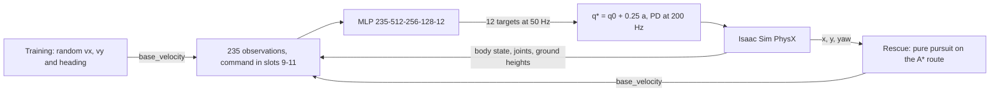

The command term `base_velocity` becomes a `PathFollowCommandCfg` with the same name and ranges ([rescue_env_cfg.py:178-187](https://github.com/Wavy-Hec/drone-search-rescue/blob/080ced76e42b8b7a6eb4050b4a98214992865625/sim/src/drone_lab/tasks/rescue/rescue_env_cfg.py#L178-L187)). The observation reads the command by that name, so the follower's output lands in slots 9-11, unscaled and noise-free. Each step the follower steers along the arc through a point 0.8 m further along the route, turns on the spot when that point is more than 1.0 rad off its heading, and stops at the route's end ([follower.py:180-242](https://github.com/Wavy-Hec/drone-search-rescue/blob/080ced76e42b8b7a6eb4050b4a98214992865625/sim/src/drone_lab/teaming/follower.py#L180-L242)). Every output is clipped to the training ranges, [−1, 1] each ([follower.py:239](https://github.com/Wavy-Hec/drone-search-rescue/blob/080ced76e42b8b7a6eb4050b4a98214992865625/sim/src/drone_lab/teaming/follower.py#L239)): forward 0.3-0.7 m/s while driving, sideways at most 0.25 m/s, yaw rate at most 1 rad/s ([commands_cfg.py:94-113](https://github.com/Wavy-Hec/drone-search-rescue/blob/080ced76e42b8b7a6eb4050b4a98214992865625/sim/src/drone_lab/tasks/rescue/mdp/commands_cfg.py#L94-L113)). The finale runs `actions = policy(obs["policy"])` and discards the reward ([rescue_finale.py:1206-1209](https://github.com/Wavy-Hec/drone-search-rescue/blob/080ced76e42b8b7a6eb4050b4a98214992865625/sim/scripts/rescue_finale.py#L1206-L1209)).

Around it, the terrain becomes the drone's survey terrain without curriculum, the dressed site is added, observation noise and mass randomisation are off, the robot resets on the route, and two terminations are added: `flipped` above 1.2 rad of tilt and `goal_reached` (a time-out) after 3 s at the goal ([rescue_env_cfg.py:203-207](https://github.com/Wavy-Hec/drone-search-rescue/blob/080ced76e42b8b7a6eb4050b4a98214992865625/sim/src/drone_lab/tasks/rescue/rescue_env_cfg.py#L203-L207)). Two gaps are worth knowing. The follower computes its command in a yaw-only frame, while training compared it with the velocity in the full body frame; on a slope they differ by the trunk's pitch and roll, uncompensated and unmeasured. And the survey terrain is harder than the training terrain (pyramids of 0.52-0.7 rise/run against at most 0.4; [terrain.py:150-167](https://github.com/Wavy-Hec/drone-search-rescue/blob/080ced76e42b8b7a6eb4050b4a98214992865625/sim/src/drone_lab/terrain.py#L150-L167), derived), so only the planner's limits, a 23° slope and a 0.15 m step, keep the robot on ground like the ground it trained on ([robots.py:66-79](https://github.com/Wavy-Hec/drone-search-rescue/blob/080ced76e42b8b7a6eb4050b4a98214992865625/sim/src/drone_lab/teaming/robots.py#L66-L79)).

The documentation reports 32 of 32 robots reaching the person in each of six configurations, for example in 23.9-24.7 s over a 16.5 m route planned on the live mission's report, with no falls; in one other configuration a robot tipped over 0.1 s after arriving ([teaming/README.md:142-165](https://github.com/Wavy-Hec/drone-search-rescue/blob/080ced76e42b8b7a6eb4050b4a98214992865625/sim/src/drone_lab/teaming/README.md#L142-L165); not re-run for this note). One finding shaped the planner: on ground of 17° and steeper, yaw-rate commands of 0.4 rad/s or more make this policy run away downhill, so the planner pays $6\,(\text{cross-slope}/\text{max slope})^2$ per metre to keep routes on the fall line ([teaming/README.md:128-140](https://github.com/Wavy-Hec/drone-search-rescue/blob/080ced76e42b8b7a6eb4050b4a98214992865625/sim/src/drone_lab/teaming/README.md#L128-L140)).

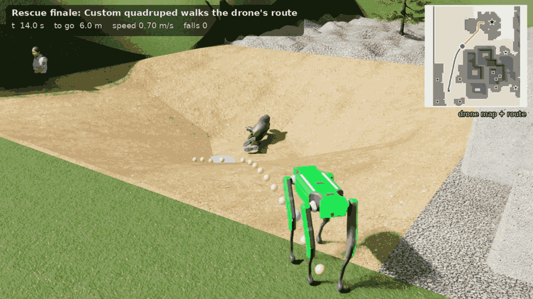

### 1.7 Doing RL yourself here

Everything here except the CPU tests needs an NVIDIA RTX GPU with Isaac Sim 6.2 and Isaac Lab 3.0 in the conda env `env_isaaclab`; the repository was validated on an RTX 5080 (16 GB).

#### Set up once

```bash
scripts/download_assets.sh                            # hover policy, detector, walking policy
cd sim && python -m pip install --no-deps -e .        # registers the DroneLab-* tasks
CUDA_VISIBLE_DEVICES= python tests/run_cpu_tests.py   # every CPU test, about 1 min
cd ../quadruped && git lfs pull && python -m pip install --no-deps -e .
```

([sim/README.md:453](https://github.com/Wavy-Hec/drone-search-rescue/blob/080ced76e42b8b7a6eb4050b4a98214992865625/sim/README.md#L453), [:541](https://github.com/Wavy-Hec/drone-search-rescue/blob/080ced76e42b8b7a6eb4050b4a98214992865625/sim/README.md#L541); [quadruped/README.md:57-58](https://github.com/Wavy-Hec/drone-search-rescue/blob/080ced76e42b8b7a6eb4050b4a98214992865625/quadruped/README.md#L57-L58).)

#### Hover pilot: train, export, evaluate

From `sim/` ([sim/README.md:399-418](https://github.com/Wavy-Hec/drone-search-rescue/blob/080ced76e42b8b7a6eb4050b4a98214992865625/sim/README.md#L399-L418)):

```bash
# train the built-in task (no physics= token: this task declares no presets)
isaaclab train --rl_library rsl_rl --task IsaacContrib-TrackPositionNoObstacles-ARL-Robot-1 \
    --num_envs 4096 --max_iterations 1500 --seed 42
# export: play writes exported/policy.pt and policy.onnx first, so a timeout is enough
timeout --signal=INT 600 isaaclab play --rl_library rsl_rl \
    --task IsaacContrib-TrackPositionNoObstacles-ARL-Robot-1 --num_envs 16 --checkpoint latest
RUN=$(ls -td logs/rsl_rl/arl_robot_1_track_position_state_based/*/ | head -1)
# evaluate on the survey: 1 minute, then the full lawnmower with video
python scripts/survey_map.py --checkpoint ${RUN}exported/policy.pt --max_time 60 --out smoke
python scripts/survey_map.py --checkpoint ${RUN}exported/policy.pt --pattern lawnmower \
    --altitude 4 --spacing 4 --speed 1.0 --video --out lawnmower_v1
```

`survey_map.py` writes the drone-carrot distance, the cross-track error and the map error to `runs/{name}/` ([sim/README.md:522-534](https://github.com/Wavy-Hec/drone-search-rescue/blob/080ced76e42b8b7a6eb4050b4a98214992865625/sim/README.md#L522-L534)); the released file works in place of `${RUN}exported/policy.pt`.

#### Trajectory pilot: train, evaluate, export, fly

From `sim/` ([sim/README.md:471-507](https://github.com/Wavy-Hec/drone-search-rescue/blob/080ced76e42b8b7a6eb4050b4a98214992865625/sim/README.md#L471-L507)):

```bash
isaaclab train --rl_library rsl_rl --task DroneLab-TrackTrajectory-ARL-Robot-1-v0 --num_envs 4096 --max_iterations 2000
TRUN=$(ls -td logs/rsl_rl/drone_lab_track_trajectory/*/ | head -1)
python scripts/eval_trajectory.py --checkpoint ${TRUN}model_1999.pt --shape figure8 --size 2 --speed 1.0 --duration 30
timeout --signal=INT 600 isaaclab play --rl_library rsl_rl --task DroneLab-TrackTrajectory-ARL-Robot-1-v0 \
    --num_envs 16 --checkpoint ${TRUN}model_1999.pt
python scripts/sar_mission.py --checkpoint ${TRUN}exported/policy.pt --pilot trajectory --out sar_trajectory
```

`eval_trajectory.py` flies one fixed figure-eight of 2.0 m at 1.0 m/s for 30 s with reset and observation noise off and `too_far` relaxed to 5.0 m, and reports position, horizontal and velocity RMSE ([eval_trajectory.py:34-38](https://github.com/Wavy-Hec/drone-search-rescue/blob/080ced76e42b8b7a6eb4050b4a98214992865625/sim/scripts/eval_trajectory.py#L34-L38), [:102-115](https://github.com/Wavy-Hec/drone-search-rescue/blob/080ced76e42b8b7a6eb4050b4a98214992865625/sim/scripts/eval_trajectory.py#L102-L115), [:199-216](https://github.com/Wavy-Hec/drone-search-rescue/blob/080ced76e42b8b7a6eb4050b4a98214992865625/sim/scripts/eval_trajectory.py#L199-L216)). For the mission, start the ground station first as in the quick start, or run `scripts/run_demo.sh --pilot trajectory --policy sim/${TRUN}exported/policy.pt` from the repository root.

#### Walking policy: watch, evaluate, fine-tune, train, convert

From `quadruped/` ([quadruped/README.md:71-90](https://github.com/Wavy-Hec/drone-search-rescue/blob/080ced76e42b8b7a6eb4050b4a98214992865625/quadruped/README.md#L71-L90), [:150-151](https://github.com/Wavy-Hec/drone-search-rescue/blob/080ced76e42b8b7a6eb4050b4a98214992865625/quadruped/README.md#L150-L151)):

```bash
CK="$PWD/checkpoints_2x/height_scanner_model_rslrl5.pt"
isaaclab play --rl_library rsl_rl --task Isaac-Velocity-Rough-Custom-Quad-v0 --num_envs 32 \
    --checkpoint "$CK" --viz kit --real-time
python scripts/eval_policy.py --task Isaac-Velocity-Rough-Custom-Quad-v0 --num_envs 128 --episodes 2 \
    --policy checkpoint --checkpoint "$CK" --seed 42 --out logs/eval/rough_s42.json
#   expect: base_contact 0.180, lin_vel_err 0.187 m/s, episode_reward_total 1.491 (deterministic)
isaaclab train --task Isaac-Velocity-Rough-Custom-Quad-v0 --num_envs 1024 --max_iterations 100 --checkpoint "$CK"
isaaclab train --task Isaac-Velocity-Rough-Custom-Quad-v0 --num_envs 1024 --max_iterations 1500
python scripts/convert_rslrl_checkpoint.py checkpoints_2x/height_scanner_model.pt \
    checkpoints_2x/height_scanner_model_rslrl5.pt --force --verify
```

The first `train` fine-tunes from the converted checkpoint with its optimiser state; the second trains from scratch. Adding `physics=newton_mjwarp` trains on Newton, which ran 56,444 env-steps/s against 14,362 on Isaac Sim PhysX at 1,024 envs ([PORT_NOTES.md:333-336](https://github.com/Wavy-Hec/drone-search-rescue/blob/080ced76e42b8b7a6eb4050b4a98214992865625/quadruped/PORT_NOTES.md#L333-L336)); at the PhysX rate a 1,500-iteration run is 36.9 M env-steps, roughly 43 minutes (derived, if the rate holds). Compare policies with `eval_policy.py` (falls, tracking error, reward per term), not with the training reward: it runs a fixed number of complete, noise-free episodes, deterministically for a fixed seed ([eval_policy.py:4-19](https://github.com/Wavy-Hec/drone-search-rescue/blob/080ced76e42b8b7a6eb4050b4a98214992865625/quadruped/scripts/eval_policy.py#L4-L19)).

#### Trying a new reward term

| Policy | File | Class | Note |
|---|---|---|---|
| Trajectory pilot | [track_trajectory_env_cfg.py:91-110](https://github.com/Wavy-Hec/drone-search-rescue/blob/080ced76e42b8b7a6eb4050b4a98214992865625/sim/src/drone_lab/tasks/track_trajectory/config/arl_robot_1/track_trajectory_env_cfg.py#L91-L110) | `TrajectoryRewardsCfg` | new functions go in [track_terms.py](https://github.com/Wavy-Hec/drone-search-rescue/blob/080ced76e42b8b7a6eb4050b4a98214992865625/sim/src/drone_lab/tasks/track_trajectory/mdp/track_terms.py), exported in [mdp/__init__.py:4-12](https://github.com/Wavy-Hec/drone-search-rescue/blob/080ced76e42b8b7a6eb4050b4a98214992865625/sim/src/drone_lab/tasks/track_trajectory/mdp/__init__.py#L4-L12) |
| Walking policy | [rough_env_cfg.py:120-127](https://github.com/Wavy-Hec/drone-search-rescue/blob/080ced76e42b8b7a6eb4050b4a98214992865625/quadruped/src/quadruped_lab/tasks/locomotion/config/custom_quad/rough_env_cfg.py#L120-L127) | `CustomQuadRoughEnvCfg.__post_init__` | sets `self.rewards.{term}.weight`; the terms are inherited from Isaac Lab's velocity task |
| Hover pilot | upstream Isaac Lab (`track_position_state_based_env_cfg.py`) | `RewardsCfg` | the survey task is not for training; to experiment, make a new task that subclasses `NoObstacleEnvCfg`, as the trajectory task does (proposal) |

A reward term is a function that takes the env and returns one number per env, a tensor of shape `(num_envs,)`; the manager multiplies it by the weight and by `step_dt`. To add one: write the function, export it from the task's `mdp` package, add `RewTerm(func=..., weight=..., params={...})` to the rewards class, and train. Keep the original task intact by subclassing the config and registering a new task id with `gym.register`, as in [__init__.py:11-20](https://github.com/Wavy-Hec/drone-search-rescue/blob/080ced76e42b8b7a6eb4050b4a98214992865625/sim/src/drone_lab/tasks/track_trajectory/config/arl_robot_1/__init__.py#L11-L20) or the quadruped's [__init__.py:37-47](https://github.com/Wavy-Hec/drone-search-rescue/blob/080ced76e42b8b7a6eb4050b4a98214992865625/quadruped/src/quadruped_lab/tasks/locomotion/config/custom_quad/__init__.py#L37-L47). The READMEs pass Hydra tokens after the command, such as `env.sim.use_newton_actuators=true` and `agent.check_for_nan=false`; by the same pattern `env.rewards.tracking_fine.weight=10.0` should change a weight without editing a file (not tried in the repository).

> [!warning] Sketch, not in the repository and not tested
> The function below would score the drone against the reference at the drone's own time, removing the one-step lag of section 1.1. It follows the style of [track_terms.py:100-109](https://github.com/Wavy-Hec/drone-search-rescue/blob/080ced76e42b8b7a6eb4050b4a98214992865625/sim/src/drone_lab/tasks/track_trajectory/mdp/track_terms.py#L100-L109) and uses the command's `reference_at` ([commands.py:77-80](https://github.com/Wavy-Hec/drone-search-rescue/blob/080ced76e42b8b7a6eb4050b4a98214992865625/sim/src/drone_lab/tasks/track_trajectory/mdp/commands.py#L77-L80)).

```python
def reference_tracking_now_exp(env, command_name="reference", std=0.4, asset_cfg=SceneEntityCfg("robot")):
    """exp(-|p - p_ref(t + step_dt)|^2 / std^2): the reward runs before the command clock advances."""
    asset = env.scene[asset_cfg.name]
    term = env.command_manager.get_term(command_name)
    ids = torch.arange(env.num_envs, device=env.device)
    p_now, _ = term.reference_at(term.t + env.step_dt, ids)
    err = torch.sum(torch.square(asset.data.root_pos_w.torch - p_now), dim=1)
    return torch.exp(-err / std**2)

# in TrajectoryRewardsCfg, in place of tracking_fine:
# tracking_fine = RewTerm(func=mdp.reference_tracking_now_exp, weight=15.0,
#                         params={"command_name": COMMAND_NAME, "std": 0.4})
```

For the walking policy a change is one line in `__post_init__`, for example `self.rewards.feet_air_time.params["sensor_cfg"].body_names = ".*_calf"`, the fix PORT_NOTES suggests. Rewards can change freely, but keep the observation and action interface as trained if you want to fine-tune from the 2.x checkpoint or use the result in the rescue task ([test_teaming_task.py:70-96](https://github.com/Wavy-Hec/drone-search-rescue/blob/080ced76e42b8b7a6eb4050b4a98214992865625/sim/tests/test_teaming_task.py#L70-L96)).

#### What to watch in the logs

Open TensorBoard on `logs/rsl_rl/` (`tensorboard --logdir logs/rsl_rl`, if it is installed), then look, in roughly this order, at:

1. **`Train/mean_episode_length`.** It should climb to the maximum (50, 120 or 1,000 steps); until it does, the policy still fails early.
2. **`Episode_Termination/{term}`.** Which failure dominates: `too_far`, `crash` or `flipped` for the drone, `base_contact` for the quadruped. The `time_out` share should rise.
3. **`Episode_Reward/{term}` divided by its weight.** The average score $f_i$ of each term over full episodes, between 0 and 1 for the exponential kernels. If a penalty grows while the tracking terms stall, the penalty may be too strong.
4. **`Metrics/reference/position_error` and `velocity_error`.** The drone's actual tracking errors, in m and m/s, independent of the reward's weights.
5. **`Policy/mean_std`.** In general PPO practice it falls slowly as the policy grows confident; a collapse within a few iterations suggests too little exploration (raise the entropy coefficient), a rise suggests a reward too flat to learn from (general experience, not measured here).
6. **`Loss/learning_rate`.** Pinned at the 1e-5 floor, every update overshoots the KL target; pinned at the 1e-2 cap, updates barely change the policy (general experience).
7. **`Loss/value`.** It spikes when anything changes the reward's scale and should settle again.

Then evaluate with the task's own script (`eval_trajectory.py`, `eval_policy.py`, `survey_map.py`), because the training reward includes noise, randomisation and exploration.

#### Reward-design ideas worth testing

> [!tip] Ideas, none implemented or tested
> **Drone**
> 1. *Remove the one-step lag* in the trajectory reward with the sketch above, and compare the `eval_trajectory.py` RMSE with and without it.
> 2. *Cover the mission's envelope.* Widen the reference speeds beyond 1.5 m/s and the vertical waves to the mission's 1.0 m/s climb and 0.8 m/s descent, perhaps with a speed curriculum; the task has none now.
> 3. *Train on survey-shaped references:* straight legs with right-angle turns and the carrot's chord velocity, the inputs the pilot will actually see on the mission.
> 4. *Prepare for real hardware:* wind gusts as an external-force event, a one-step observation delay, mass randomisation, and observation noise for the hover task, which trained with none.
>
> **Quadruped**
> 5. *Make `feet_air_time` pay* by pointing it at `.*_calf`, which breaks parity with the 2.x checkpoint ([PORT_NOTES.md:296-298](https://github.com/Wavy-Hec/drone-search-rescue/blob/080ced76e42b8b7a6eb4050b4a98214992865625/quadruped/PORT_NOTES.md#L296-L298)).
> 6. *Cut thigh-contact falls* (94 % of falls) with a base-height reward as in Isaac Lab's Go2 task, as PORT_NOTES suggests ([PORT_NOTES.md:524-526](https://github.com/Wavy-Hec/drone-search-rescue/blob/080ced76e42b8b7a6eb4050b4a98214992865625/quadruped/PORT_NOTES.md#L524-L526)), or with a small `undesired_contacts` penalty on the thighs again.
> 7. *Train turning on steep slopes,* where the policy runs away downhill, with the command in the yaw-only frame the follower uses.
> 8. *Sharpen the tracking kernel* (smaller std) so small commands are not ignored, which could let the follower drop its 0.3 m/s floor.

### 1.8 Key numbers and advisor questions

#### Key numbers

| Quantity | Value | Source |
|---|---|---|
| Drone physics / decimation / policy rate | 0.01 s / 10 / 10 Hz | [survey_env_cfg.py:199](https://github.com/Wavy-Hec/drone-search-rescue/blob/080ced76e42b8b7a6eb4050b4a98214992865625/sim/src/drone_lab/tasks/survey/config/arl_robot_1/survey_env_cfg.py#L199) |
| Hover network | 17-256-128-64-4, ELU, 46,020 parameters, no normaliser | release archive |
| Thrust mapping | $T=\mathrm{clamp}(3a+3,0,6)$ N per rotor | [survey_env_cfg.py:12](https://github.com/Wavy-Hec/drone-search-rescue/blob/080ced76e42b8b7a6eb4050b4a98214992865625/sim/src/drone_lab/tasks/survey/config/arl_robot_1/survey_env_cfg.py#L12) |
| Hover thrust (offline) | about 3.26 N per rotor, 13.03 N total | forward pass of the archive |
| Hover task reward weights | 25, +1, 2, 2.5, 10, −0.05, −0.05, −5 | Isaac Lab 3.0.0 |
| Best hover step | 3.95, about 198 per 5 s episode | derived |
| Carrot lead (hover) | `max_lead` 1.0 m, `slow_lead` 0.7 m, clamp 1 m | [commands_cfg.py:59-68](https://github.com/Wavy-Hec/drone-search-rescue/blob/080ced76e42b8b7a6eb4050b4a98214992865625/sim/src/drone_lab/tasks/survey/mdp/commands_cfg.py#L59-L68) |
| Hover pilot lag / top speed | about 0.75 s / about 1.3 m/s | [sim/README.md:335-337](https://github.com/Wavy-Hec/drone-search-rescue/blob/080ced76e42b8b7a6eb4050b4a98214992865625/sim/README.md#L335-L337) |
| Trajectory inputs / episode | 26 / 12 s (120 steps) | [track_trajectory_env_cfg.py:57-71](https://github.com/Wavy-Hec/drone-search-rescue/blob/080ced76e42b8b7a6eb4050b4a98214992865625/sim/src/drone_lab/tasks/track_trajectory/config/arl_robot_1/track_trajectory_env_cfg.py#L57-L71), [:136](https://github.com/Wavy-Hec/drone-search-rescue/blob/080ced76e42b8b7a6eb4050b4a98214992865625/sim/src/drone_lab/tasks/track_trajectory/config/arl_robot_1/track_trajectory_env_cfg.py#L136) |
| Reference size / speed | 0.8-2.5 m / 0.3-1.5 m/s | [commands_cfg.py:38-53](https://github.com/Wavy-Hec/drone-search-rescue/blob/080ced76e42b8b7a6eb4050b4a98214992865625/sim/src/drone_lab/tasks/track_trajectory/mdp/commands_cfg.py#L38-L53) |
| Trajectory reward weights | 15, 5, 5, −1, 2, 2, −0.05, −0.05, −20 | [track_trajectory_env_cfg.py:95-110](https://github.com/Wavy-Hec/drone-search-rescue/blob/080ced76e42b8b7a6eb4050b4a98214992865625/sim/src/drone_lab/tasks/track_trajectory/config/arl_robot_1/track_trajectory_env_cfg.py#L95-L110) |
| Best trajectory step | 2.9, 348 per episode | derived |
| Quadruped physics / decimation / policy rate | 0.005 s / 4 / 50 Hz | [test_task_configs.py:140](https://github.com/Wavy-Hec/drone-search-rescue/blob/080ced76e42b8b7a6eb4050b4a98214992865625/quadruped/tests/test_task_configs.py#L140) |
| Quadruped inputs | 235 = 48 + 187 height scan | [PORT_NOTES.md:121-136](https://github.com/Wavy-Hec/drone-search-rescue/blob/080ced76e42b8b7a6eb4050b4a98214992865625/quadruped/PORT_NOTES.md#L121-L136) |
| Joint target | $q^\ast = q_0 + 0.25\,a$; PD $k_p$ 60, $k_d$ 1.5, 45 N·m | [rough_env_cfg.py:94-95](https://github.com/Wavy-Hec/drone-search-rescue/blob/080ced76e42b8b7a6eb4050b4a98214992865625/quadruped/src/quadruped_lab/tasks/locomotion/config/custom_quad/rough_env_cfg.py#L94-L95), [custom_quad.py:135-146](https://github.com/Wavy-Hec/drone-search-rescue/blob/080ced76e42b8b7a6eb4050b4a98214992865625/quadruped/src/quadruped_lab/assets/custom_quad.py#L135-L146) |
| Quadruped reward weights | 1.5, 0.75, −2, −0.05, −2e-4, −2.5e-7, −0.01, +0.01 | [rough_env_cfg.py:120-127](https://github.com/Wavy-Hec/drone-search-rescue/blob/080ced76e42b8b7a6eb4050b4a98214992865625/quadruped/src/quadruped_lab/tasks/locomotion/config/custom_quad/rough_env_cfg.py#L120-L127); −2, −0.05, −0.01 Isaac Lab 3.0.0 |
| Walking checkpoint | iteration 13,900; conversion error 0.0 | [PORT_NOTES.md:175-196](https://github.com/Wavy-Hec/drone-search-rescue/blob/080ced76e42b8b7a6eb4050b4a98214992865625/quadruped/PORT_NOTES.md#L175-L196) |
| Play-mode falls / reward per episode | 18.9 % / 1.471 (2.x settings) | [PORT_NOTES.md:207-231](https://github.com/Wavy-Hec/drone-search-rescue/blob/080ced76e42b8b7a6eb4050b4a98214992865625/quadruped/PORT_NOTES.md#L207-L231) |
| Rescue follower | cruise 0.7 m/s, floor 0.3 m/s, look-ahead 0.8 m | [commands_cfg.py:94-113](https://github.com/Wavy-Hec/drone-search-rescue/blob/080ced76e42b8b7a6eb4050b4a98214992865625/sim/src/drone_lab/tasks/rescue/mdp/commands_cfg.py#L94-L113) |

PPO settings of the three runners side by side ([rsl_rl_ppo_cfg.py:13-37](https://github.com/Wavy-Hec/drone-search-rescue/blob/080ced76e42b8b7a6eb4050b4a98214992865625/sim/src/drone_lab/tasks/track_trajectory/config/arl_robot_1/agents/rsl_rl_ppo_cfg.py#L13-L37); the hover runner upstream, Isaac Lab 3.0.0; [rsl_rl_ppo_cfg.py:20-70](https://github.com/Wavy-Hec/drone-search-rescue/blob/080ced76e42b8b7a6eb4050b4a98214992865625/quadruped/src/quadruped_lab/tasks/locomotion/config/custom_quad/agents/rsl_rl_ppo_cfg.py#L20-L70)):

| Setting | Hover (upstream) | Trajectory | Quadruped |
|---|---|---|---|
| Steps per env per iteration | 24 | 24 | 24 |
| Iterations / save interval | 1500 / 50 | 2000 / 100 | 80,000 / 50 (pass `--max_iterations`) |
| Actor and critic MLP | 256-128-64, ELU | 256-128-64, ELU | 512-256-128, ELU |
| Observation normalisation | no | **yes** | no |
| Initial action std | 0.5 | 0.5 | 1.0 |
| Clip $\epsilon$ / value weight | 0.2 / 1.0 | 0.2 / 1.0 | 0.2 / 0.5 |
| Entropy coefficient | 0.001 | 0.002 | 0.0025 |
| Epochs × mini-batches | 4 × 4 | 4 × 4 | 5 × 4 |
| Learning rate, schedule, KL target | 4e-4, adaptive, 0.01 | 4e-4, adaptive, 0.01 | 1e-3, adaptive, 0.01 |
| $\gamma$ / $\lambda$ | 0.98 / 0.95 | 0.98 / 0.95 | 0.99 / 0.95 |
| Max gradient norm | 1.0 | 1.0 | 1.0 |
| Log folder | `arl_robot_1_track_position_state_based` | `drone_lab_track_trajectory` | `custom_quad_rough` |

#### Questions an advisor might ask

> [!question]- Your drone policy only learned to hover. Why can it fly a survey several hundred metres long?
> Its only goal input is the 3-D offset to its target ([survey_terms.py:23-38](https://github.com/Wavy-Hec/drone-search-rescue/blob/080ced76e42b8b7a6eb4050b4a98214992865625/sim/src/drone_lab/tasks/survey/mdp/survey_terms.py#L23-L38)), and the survey moves that target, the carrot, along the path every step ([commands.py:197-229](https://github.com/Wavy-Hec/drone-search-rescue/blob/080ced76e42b8b7a6eb4050b4a98214992865625/sim/src/drone_lab/tasks/survey/mdp/commands.py#L197-L229)): "go to the target" becomes "chase the carrot". The lead gate keeps the carrot within 1 m and the clamp keeps the observed offset within 1 m, inside the ±1 m starts it trained on ([carrot.py:80-126](https://github.com/Wavy-Hec/drone-search-rescue/blob/080ced76e42b8b7a6eb4050b4a98214992865625/sim/src/drone_lab/carrot.py#L80-L126), [carrot.py:162-181](https://github.com/Wavy-Hec/drone-search-rescue/blob/080ced76e42b8b7a6eb4050b4a98214992865625/sim/src/drone_lab/carrot.py#L162-L181)). No input depends on absolute position, so the flight height does not matter.

> [!question]- Which reward trained the released drone policy? Can you prove it?
> Not from the repository: it is UNVERIFIED. The repository implies a goal term of weight 25 and std 1.5 ([survey_env_cfg.py:145-153](https://github.com/Wavy-Hec/drone-search-rescue/blob/080ced76e42b8b7a6eb4050b4a98214992865625/sim/src/drone_lab/tasks/survey/config/arl_robot_1/survey_env_cfg.py#L145-L153)) and +1.0 on `flat_orientation_l2` ([sim/README.md:581-582](https://github.com/Wavy-Hec/drone-search-rescue/blob/080ced76e42b8b7a6eb4050b4a98214992865625/sim/README.md#L581-L582)). The Isaac Lab 3.0.0 task has the eight terms of section 1.3, but the archive records no Isaac Lab version or run metadata, and the README's "1300 training iterations" do not match its 1500-iteration command ([sim/README.md:322-323](https://github.com/Wavy-Hec/drone-search-rescue/blob/080ced76e42b8b7a6eb4050b4a98214992865625/sim/README.md#L322-L323), [:399-403](https://github.com/Wavy-Hec/drone-search-rescue/blob/080ced76e42b8b7a6eb4050b4a98214992865625/sim/README.md#L399-L403)).

> [!question]- Why does the drone lag 0.75 s and top out near 1.3 m/s?
> Those are README measurements ([sim/README.md:335-337](https://github.com/Wavy-Hec/drone-search-rescue/blob/080ced76e42b8b7a6eb4050b4a98214992865625/sim/README.md#L335-L337)). The policy has no target-velocity input, never saw a moving goal and was paid to keep still, so its pull grows with the offset; the offset is capped at 1 m by the lead gate and the clamp, and 1.0 m / 0.75 s ≈ 1.33 m/s. The CPU tests model it the same way ([test_carrot.py:63-79](https://github.com/Wavy-Hec/drone-search-rescue/blob/080ced76e42b8b7a6eb4050b4a98214992865625/sim/tests/test_carrot.py#L63-L79)). The fix is the trajectory task, which adds velocity-error and look-ahead inputs.

> [!question]- Why PPO, and not an off-policy method like SAC, or a classical controller?
> The repository does not compare algorithms; it uses the rsl_rl PPO runners that Isaac Lab ships with these tasks ([rsl_rl_ppo_cfg.py:1-16](https://github.com/Wavy-Hec/drone-search-rescue/blob/080ced76e42b8b7a6eb4050b4a98214992865625/sim/src/drone_lab/tasks/survey/config/arl_robot_1/agents/rsl_rl_ppo_cfg.py#L1-L16)). The usual argument (background, not tested here): on-policy PPO suits massively parallel GPU simulation, where 98,304 fresh transitions per iteration make data cheap, and the clip and the KL-adaptive learning rate keep training stable without much tuning. The project's premise is a learned pilot (the README's first line), and the same pipeline can retrain it, as the trajectory task shows; no classical controller is compared.

> [!question]- Why is the tilt term weighted +1 upstream but −1 in your task?
> The function returns $g_{b,x}^2+g_{b,y}^2 \ge 0$ (`isaaclab/envs/mdp/rewards.py:114-120`, Isaac Lab 3.0.0), so a positive weight rewards tilt, by at most 0.1 per step. The repository makes it a penalty ([track_trajectory_env_cfg.py:104-105](https://github.com/Wavy-Hec/drone-search-rescue/blob/080ced76e42b8b7a6eb4050b4a98214992865625/sim/src/drone_lab/tasks/track_trajectory/config/arl_robot_1/track_trajectory_env_cfg.py#L104-L105)). It does not say why upstream chose +1.

> [!question]- A good step pays 2.9 but a crash costs only 20 × 0.1 = 2. Is the penalty too small?
> The explicit penalty is the smaller part of the cost. A failure also ends the episode, and with $\gamma = 0.98$ flying on at the best rate is worth up to $2.9/0.02 = 145$; `too_far` ends the episode as soon as the drone is 2.5 m off ([track_trajectory_env_cfg.py:110](https://github.com/Wavy-Hec/drone-search-rescue/blob/080ced76e42b8b7a6eb4050b4a98214992865625/sim/src/drone_lab/tasks/track_trajectory/config/arl_robot_1/track_trajectory_env_cfg.py#L110), [:118](https://github.com/Wavy-Hec/drone-search-rescue/blob/080ced76e42b8b7a6eb4050b4a98214992865625/sim/src/drone_lab/tasks/track_trajectory/config/arl_robot_1/track_trajectory_env_cfg.py#L118); derived).

> [!question]- Has the trajectory pilot been trained or flown? What would you check first?
> Neither: no checkpoint ships ([download_assets.sh:16-22](https://github.com/Wavy-Hec/drone-search-rescue/blob/080ced76e42b8b7a6eb4050b4a98214992865625/scripts/download_assets.sh#L16-L22)) and the README says none has flown ([sim/README.md:515-516](https://github.com/Wavy-Hec/drone-search-rescue/blob/080ced76e42b8b7a6eb4050b4a98214992865625/sim/README.md#L515-L516)). After training: `eval_trajectory.py` on its fixed figure-eight ([eval_trajectory.py:34-38](https://github.com/Wavy-Hec/drone-search-rescue/blob/080ced76e42b8b7a6eb4050b4a98214992865625/sim/scripts/eval_trajectory.py#L34-L38)), then the mission at reduced climb, descent and survey speeds, since the defaults are at or beyond the training ranges ([sim/README.md:516-520](https://github.com/Wavy-Hec/drone-search-rescue/blob/080ced76e42b8b7a6eb4050b4a98214992865625/sim/README.md#L516-L520)).

> [!question]- How can a walking policy trained on random commands follow a planned route without retraining?
> Only the source of the command changes. `PathFollowCommandCfg` replaces the random command under the same name `base_velocity` ([rescue_env_cfg.py:178-187](https://github.com/Wavy-Hec/drone-search-rescue/blob/080ced76e42b8b7a6eb4050b4a98214992865625/sim/src/drone_lab/tasks/rescue/rescue_env_cfg.py#L178-L187)), so the policy reads the follower's $(v_x, v_y, \omega_z)$ in the same observation slots 9-11. Every output is clipped to the training ranges ([follower.py:239](https://github.com/Wavy-Hec/drone-search-rescue/blob/080ced76e42b8b7a6eb4050b4a98214992865625/sim/src/drone_lab/teaming/follower.py#L239)), and a test asserts that every other input and the action interface are those of training ([test_teaming_task.py:70-96](https://github.com/Wavy-Hec/drone-search-rescue/blob/080ced76e42b8b7a6eb4050b4a98214992865625/sim/tests/test_teaming_task.py#L70-L96)).

> [!question]- How do you know the checkpoint conversion is exact, and why does the same policy walk worse under the Isaac Lab 3.0 defaults?
> Loaded as `isaaclab play` loads it, the converted file matches an independent Linear + ELU pass of the old weights on 4,096 inputs with difference 0.0, for actions, values, std and the TorchScript export ([convert_rslrl_checkpoint.py:244-310](https://github.com/Wavy-Hec/drone-search-rescue/blob/080ced76e42b8b7a6eb4050b4a98214992865625/quadruped/scripts/convert_rslrl_checkpoint.py#L244-L310); [PORT_NOTES.md:188-196](https://github.com/Wavy-Hec/drone-search-rescue/blob/080ced76e42b8b7a6eb4050b4a98214992865625/quadruped/PORT_NOTES.md#L188-L196)). The walking difference comes from the simulator, not the weights: stale joint positions in 3.0's actuator path and TGS forces on every solver iteration cut the reward from 1.471 to 1.117 and raise falls from 18.9 % to 21.7 %; the project restores both 2.x settings on PhysX ([PORT_NOTES.md:207-254](https://github.com/Wavy-Hec/drone-search-rescue/blob/080ced76e42b8b7a6eb4050b4a98214992865625/quadruped/PORT_NOTES.md#L207-L254)).

> [!question]- Would these policies work on a real drone and a real quadruped?
> Nothing in the repository has run on hardware. The code shows the gaps to close first. The hover pilot trained without observation noise ([survey_env_cfg.py:11](https://github.com/Wavy-Hec/drone-search-rescue/blob/080ced76e42b8b7a6eb4050b4a98214992865625/sim/src/drone_lab/tasks/survey/config/arl_robot_1/survey_env_cfg.py#L11)), and in the Isaac Lab 3.0.0 task its only event is the reset: no wind, no mass randomisation. Its inputs (offset to target, attitude, velocities) would have to come from a real state estimator. The walking policy trained with observation noise and trunk-mass randomisation ([rough_env_cfg.py:97-118](https://github.com/Wavy-Hec/drone-search-rescue/blob/080ced76e42b8b7a6eb4050b4a98214992865625/quadruped/src/quadruped_lab/tasks/locomotion/config/custom_quad/rough_env_cfg.py#L97-L118)), but its 187 ground heights would have to come from a real elevation map around the robot. Section 1.7 lists ideas aimed at this.

## Part 2: The rest of the pipeline

> [!summary] What this part covers
> Part 1 explained the two learned controllers, the drone's pilot and the quadruped's walking policy. This part covers
> everything around them, in the order the data flows: the simulated site and the flight plan, the link, the YOLO
> detector, the geometry from boxes to pins, the maps and the scorecard, the rescue planner and the CPU experiments. It
> ends with the error budget a real drone must meet, where Part 3 (the real environment and SLAM) begins. Numbers come
> from the code or from the fact-checked walk-through [HOW_IT_WORKS.md](https://github.com/Wavy-Hec/drone-search-rescue/blob/080ced76e42b8b7a6eb4050b4a98214992865625/docs/HOW_IT_WORKS.md), which cites a
> line of code for each.

### 2.1 The big picture

The repository is one chain of programs. A reinforcement-learning (RL) policy flies a quadrotor over a simulated
disaster site, and the simulator streams the drone's pose, ray hits and camera frames to a second program, the
**ground station** (GCS, ground control station). The station builds maps and puts a **pin** on every person and object it finds: one
tracked object with a class, a position and a confidence. After the landing, a planner turns the maps and pins into a
route, and an RL walking policy takes a four-legged robot along it to a person.

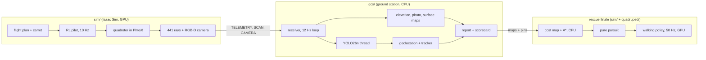

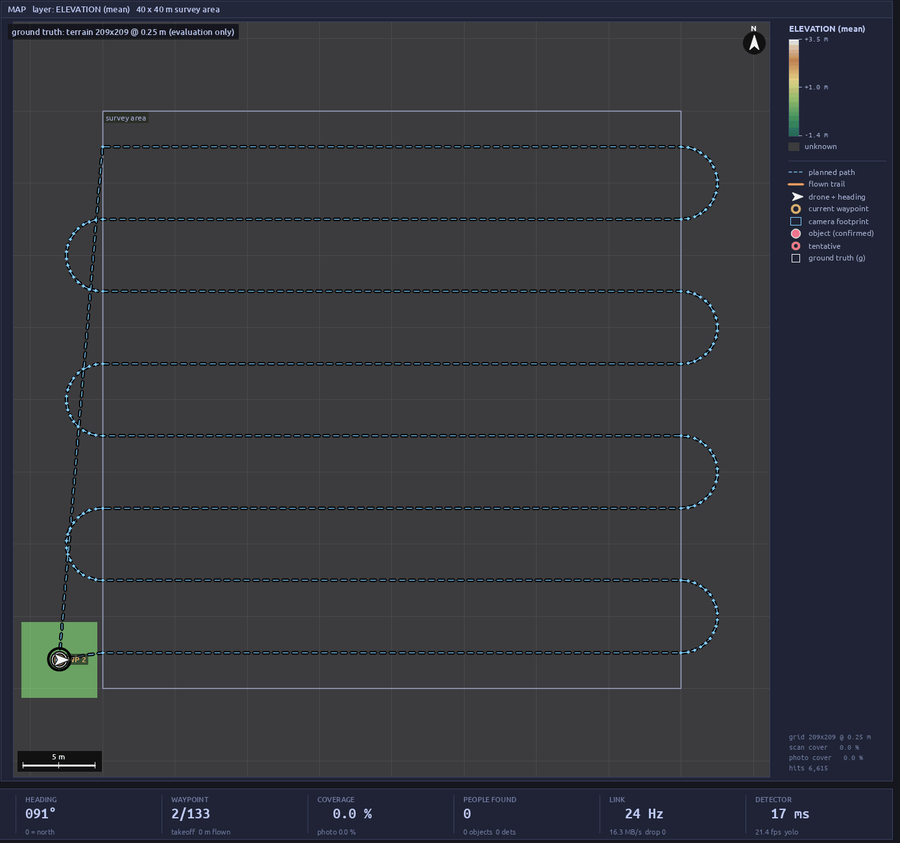

*The station's map panel during the recorded Isaac Sim mission: the planned path, the flown trail, the elevation map
filling in, and a pin with class and mean confidence on every object found.*

#### What runs where

| Step | Runs on | Code |
|---|---|---|
| terrain, site and flight plan, before the simulator starts | CPU | [sar_mission.py:368-374](https://github.com/Wavy-Hec/drone-search-rescue/blob/080ced76e42b8b7a6eb4050b4a98214992865625/sim/scripts/sar_mission.py#L368-L374) |
| the mission: PhysX physics, the RTX render of the camera, the flight policy | GPU (Isaac Sim) | [sim/README.md:384](https://github.com/Wavy-Hec/drone-search-rescue/blob/080ced76e42b8b7a6eb4050b4a98214992865625/sim/README.md#L384) |
| rendering the detector's training images; training YOLO and the RL policies | GPU | [sim/README.md:385](https://github.com/Wavy-Hec/drone-search-rescue/blob/080ced76e42b8b7a6eb4050b4a98214992865625/sim/README.md#L385), [train_detector.py:112](https://github.com/Wavy-Hec/drone-search-rescue/blob/080ced76e42b8b7a6eb4050b4a98214992865625/gcs/scripts/train_detector.py#L112) |
| the ground station, YOLO inference included | CPU (YOLO on a GPU only with `--device cuda:0` or `auto`) | [gcs.py:58-61](https://github.com/Wavy-Hec/drone-search-rescue/blob/080ced76e42b8b7a6eb4050b4a98214992865625/gcs/scripts/gcs.py#L58-L61) |
| rescue planning | CPU, seconds | [rescue_finale.py:9-16](https://github.com/Wavy-Hec/drone-search-rescue/blob/080ced76e42b8b7a6eb4050b4a98214992865625/sim/scripts/rescue_finale.py#L9-L16) |
| the quadruped's walk | GPU (Isaac Sim PhysX) | [rescue_finale.py:17-21](https://github.com/Wavy-Hec/drone-search-rescue/blob/080ced76e42b8b7a6eb4050b4a98214992865625/sim/scripts/rescue_finale.py#L17-L21) |
| the stand-in drone, link replays, tests, the CPU experiments | CPU | [fake_drone.py:2-7](https://github.com/Wavy-Hec/drone-search-rescue/blob/080ced76e42b8b7a6eb4050b4a98214992865625/gcs/scripts/fake_drone.py#L2-L7) |

The code lives in `sim/` (with the rescue planner in `src/drone_lab/teaming/`), `gcs/` and `quadruped/`, in two
conda environments, `env_isaaclab` and `vision` ([README.md:104-109](https://github.com/Wavy-Hec/drone-search-rescue/blob/080ced76e42b8b7a6eb4050b4a98214992865625/README.md#L104-L109)). In simulated
time the drone's physics runs at 100 Hz and its policy and camera at 10 Hz
([survey_env_cfg.py:199](https://github.com/Wavy-Hec/drone-search-rescue/blob/080ced76e42b8b7a6eb4050b4a98214992865625/sim/src/drone_lab/tasks/survey/config/arl_robot_1/survey_env_cfg.py#L199),
[sar_env_cfg.py:74-75](https://github.com/Wavy-Hec/drone-search-rescue/blob/080ced76e42b8b7a6eb4050b4a98214992865625/sim/src/drone_lab/tasks/sar/config/arl_robot_1/sar_env_cfg.py#L74-L75)); the
quadruped's policy runs at 50 Hz on 200 Hz physics
([test_task_configs.py:140](https://github.com/Wavy-Hec/drone-search-rescue/blob/080ced76e42b8b7a6eb4050b4a98214992865625/quadruped/tests/test_task_configs.py#L140)). In wall-clock time the station's loop runs at 12 Hz
([app.py:41](https://github.com/Wavy-Hec/drone-search-rescue/blob/080ced76e42b8b7a6eb4050b4a98214992865625/gcs/drone_gcs/app.py#L41)), YOLO takes 16-24 ms per frame on a CPU
([gcs/README.md:675](https://github.com/Wavy-Hec/drone-search-rescue/blob/080ced76e42b8b7a6eb4050b4a98214992865625/gcs/README.md#L675)), and the recorded mission ran at 1.45 times real time
([sim/README.md:28](https://github.com/Wavy-Hec/drone-search-rescue/blob/080ced76e42b8b7a6eb4050b4a98214992865625/sim/README.md#L28)).

> [!info] Two facts that surprise people
> Nothing learns during a mission: the pilot, the detector and the walking policy are all frozen. And the drone and the
> quadruped never share a simulation: the walk is a second Isaac Sim run after the mission, on the same seeded world
> ([rescue_env_cfg.py:7-11](https://github.com/Wavy-Hec/drone-search-rescue/blob/080ced76e42b8b7a6eb4050b4a98214992865625/sim/src/drone_lab/tasks/rescue/rescue_env_cfg.py#L7-L11)).

### 2.2 The world and the mission

> [!tip] Intuition
> Two seeds build the whole world, identical on every run. The drone flies a lawnmower at one height that clears the
> highest ground by 4 m, with lines close enough that neighbouring photos overlap by half.

The world runs in Isaac Sim 6.2 (PhysX physics, RTX rendering) under Isaac Lab 3.0, as the task
`DroneLab-SAR-ARL-Robot-1-v0` ([\_\_init\_\_.py:9-19](https://github.com/Wavy-Hec/drone-search-rescue/blob/080ced76e42b8b7a6eb4050b4a98214992865625/sim/src/drone_lab/tasks/sar/config/arl_robot_1/__init__.py#L9-L19)).
Axes: +x east, +y north, z up.

#### The terrain

Isaac Lab's terrain generator builds 4 × 4 tiles of 10 m, so x and y run from −20 to 20 m, inside a flat border 6 m
wide: the site spans −26 to 26 m ([terrain.py:172-176](https://github.com/Wavy-Hec/drone-search-rescue/blob/080ced76e42b8b7a6eb4050b4a98214992865625/sim/src/drone_lab/terrain.py#L172-L176),
[scenario.py:356-357](https://github.com/Wavy-Hec/drone-search-rescue/blob/080ced76e42b8b7a6eb4050b4a98214992865625/sim/src/drone_lab/sar/scenario.py#L356-L357)). Each tile
draws a type and a difficulty from one generator seeded with 17, the *standard terrain*
([terrain.py:137-168](https://github.com/Wavy-Hec/drone-search-rescue/blob/080ced76e42b8b7a6eb4050b4a98214992865625/sim/src/drone_lab/terrain.py#L137-L168)):

| y \ x | −20 to −10 m | −10 to 0 m | 0 to 10 m | 10 to 20 m |
|---|---|---|---|---|
| **10 to 20 m** | pyramid | blocks | waves | pyramid |
| **0 to 10 m** | hills | hills | hills (highest point) | pyramid |
| **−10 to 0 m** | pit (the crater) | rough | hills | pyramid |
| **−20 to −10 m** | blocks | blocks | waves | stairs |

*Blocks* are the repository's own "collapsed buildings" ([terrain.py:90-134](https://github.com/Wavy-Hec/drone-search-rescue/blob/080ced76e42b8b7a6eb4050b4a98214992865625/sim/src/drone_lab/terrain.py#L90-L134)).
The ground spans −1.43 m (the crater floor) to 3.515 m ([camera.py:9-13](https://github.com/Wavy-Hec/drone-search-rescue/blob/080ced76e42b8b7a6eb4050b4a98214992865625/sim/src/drone_lab/sar/camera.py#L9-L13)).
The site generator and the flight planner use a CPU copy of the terrain, which per-tile seeding keeps identical to the
simulator's mesh. A test checks that the mesh does not depend on numpy's global random state
([test_terrain.py:17-26](https://github.com/Wavy-Hec/drone-search-rescue/blob/080ced76e42b8b7a6eb4050b4a98214992865625/sim/tests/test_terrain.py#L17-L26)), and in Isaac Sim the spawner warns if the
two differ by more than 1 mm ([scene.py:635-659](https://github.com/Wavy-Hec/drone-search-rescue/blob/080ced76e42b8b7a6eb4050b4a98214992865625/sim/src/drone_lab/sar/scene.py#L635-L659)).

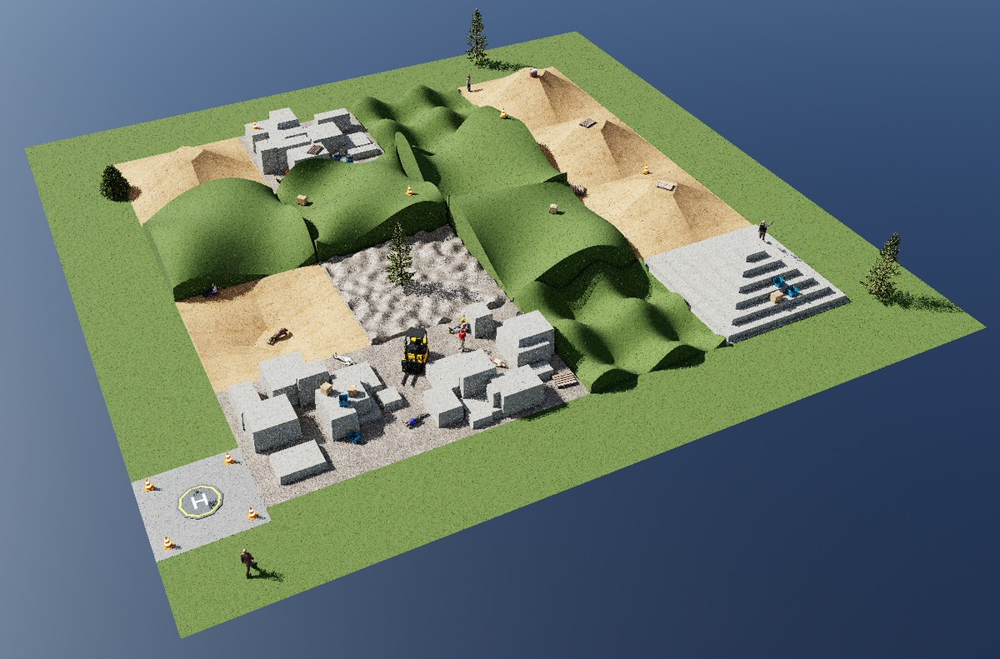

*The demo site in Isaac Sim: the pad and its cones at the bottom left, the collapsed buildings and the forklift along
the south edge, the crater north of them, hills across the middle, pyramids and stairs in the east.*

#### The disaster site

A second seed dresses the terrain; seed 0 is the *demo site*. `generate_scenario` places each object by **rejection
sampling**: draw a pose, test the rules (inside the area, apart from the others, on flat enough ground, the first 40 %
of the victims next to a step, tree tops 2 m below the flight height), and retry, up to 3000 times
([scenario.py:969-1013](https://github.com/Wavy-Hec/drone-search-rescue/blob/080ced76e42b8b7a6eb4050b4a98214992865625/sim/src/drone_lab/sar/scenario.py#L969-L1013)).

The demo site holds 45 objects: 11 people (9 victims, 2 responders), a forklift, 9 crates, 6 barrels, 5 pallets, 8
cones, 4 trees and the landing pad at (−23, −18) m. 41 carry one of seven class labels (person, vehicle, crate,
barrel, pallet, cone, landing_pad; ids 0-6): 35 inside the survey area, all 10 people there among them, and 6 around
the pad ([sar/README.md:7-13](https://github.com/Wavy-Hec/drone-search-rescue/blob/080ced76e42b8b7a6eb4050b4a98214992865625/sim/src/drone_lab/sar/README.md#L7-L13),
[gcs/README.md:637-638](https://github.com/Wavy-Hec/drone-search-rescue/blob/080ced76e42b8b7a6eb4050b4a98214992865625/gcs/README.md#L637-L638),
[assets.py:31-35](https://github.com/Wavy-Hec/drone-search-rescue/blob/080ced76e42b8b7a6eb4050b4a98214992865625/sim/src/drone_lab/sar/assets.py#L31-L35)). Trees are unlabelled occluders. person_08,
lying on the crater floor at (−14.73, −4.82) m, is the goal of the recorded rescue finale.

#### The sensors

The drone, ARL-Robot-1, is a quadrotor from NTNU that ships with Isaac Lab; its policy flies on its state alone
(Part 1, section 1.3). Two sensors feed the station:

| Sensor | Gives | Geometry and rate |
|---|---|---|
| mapping scanner ([survey_env_cfg.py:83-93](https://github.com/Wavy-Hec/drone-search-rescue/blob/080ced76e42b8b7a6eb4050b4a98214992865625/sim/src/drone_lab/tasks/survey/config/arl_robot_1/survey_env_cfg.py#L83-L93)) | where 441 vertical rays hit the terrain | 21 × 21 rays 0.25 m apart (5 × 5 m), always vertical; terrain mesh only; 10 Hz |
| camera ([camera.py:51-59](https://github.com/Wavy-Hec/drone-search-rescue/blob/080ced76e42b8b7a6eb4050b4a98214992865625/sim/src/drone_lab/sar/camera.py#L51-L59)) | colour, depth, instance segmentation | 640 × 480 px, $f$ = 480 px, field of view 67.38° × 53.13°, looking straight down (*nadir*), image top towards the nose; 10 Hz |

The **depth** of a pixel is its distance to the image plane (the point's z in the camera frame), not the length of the
ray ([camera.py:120](https://github.com/Wavy-Hec/drone-search-rescue/blob/080ced76e42b8b7a6eb4050b4a98214992865625/sim/src/drone_lab/sar/camera.py#L120)). **Instance segmentation** names, for each pixel,
the labelled object it shows, which gives the detector's training labels for free.

> [!warning] The scanner is blind to objects
> The mapping rays hit only the terrain mesh
> ([survey_env_cfg.py:89](https://github.com/Wavy-Hec/drone-search-rescue/blob/080ced76e42b8b7a6eb4050b4a98214992865625/sim/src/drone_lab/tasks/survey/config/arl_robot_1/survey_env_cfg.py#L89)), so the
> elevation map is bare terrain. People, crates and trees reach the map only through the camera: as pins, and in the
> depth-based surface map.

#### The flight plan

With $s$ = 5 m line spacing, $a$ = 4 m clearance, $E$ = 40 m area width, $f$ = 480 px, $W \times H$ = 640 × 480 px,
$v$ the flown speed and $r$ = 10 frames/s ([sar_mission.py:368-399](https://github.com/Wavy-Hec/drone-search-rescue/blob/080ced76e42b8b7a6eb4050b4a98214992865625/sim/scripts/sar_mission.py#L368-L399),
[mission.py:190-225](https://github.com/Wavy-Hec/drone-search-rescue/blob/080ced76e42b8b7a6eb4050b4a98214992865625/sim/src/drone_lab/sar/mission.py#L190-L225)):

**Height.** The U-turns reach $s/2$ outside the area, so the highest terrain over the area grown by
$b = s/2 + 0.5 = 3$ m sets the height ([sar_mission.py:377-379](https://github.com/Wavy-Hec/drone-search-rescue/blob/080ced76e42b8b7a6eb4050b4a98214992865625/sim/scripts/sar_mission.py#L377-L379)):

$$z_f = \max_{\text{area}+b} z_\text{terrain} + a = 3.515 + 4 = 7.515\ \text{m}$$

**Lines.** $n = \lceil E/s \rceil = 8$ lines along x, at $y_i = y_\text{min} + (E/n)(i + \tfrac12)$ = −17.5, −12.5,
…, 17.5 m, in alternating directions, joined by semicircles of radius 2.5 m
([paths.py:129-149](https://github.com/Wavy-Hec/drone-search-rescue/blob/080ced76e42b8b7a6eb4050b4a98214992865625/sim/src/drone_lab/paths.py#L129-L149)).

**Camera.** The **ground sample distance** (GSD), the ground width one pixel covers, is $h/f$ for a nadir camera at
height $h$. Over flat ground at $v$ = 1.25 m/s ([mission.py:211-221](https://github.com/Wavy-Hec/drone-search-rescue/blob/080ced76e42b8b7a6eb4050b4a98214992865625/sim/src/drone_lab/sar/mission.py#L211-L221),
tested in [test_sar_mission.py:51-57](https://github.com/Wavy-Hec/drone-search-rescue/blob/080ced76e42b8b7a6eb4050b4a98214992865625/sim/tests/test_sar_mission.py#L51-L57)):

| Quantity | Formula | Value |
|---|---|---|
| camera height | $h = z_f - 0.1$ | 7.415 m |
| ground sample distance | $h/f$ | 1.545 cm/px |
| footprint across / along the track | $W \cdot \text{GSD}$, $H \cdot \text{GSD}$ | 9.887 m × 7.415 m |
| side overlap | $(W\,\text{GSD} - s)/(W\,\text{GSD})$ | 49.4 % |
| distance between frames | $v/r$ | 0.125 m |
| forward overlap | $1 - (v/r)/(H\,\text{GSD})$ | 98.3 % |
| time a point stays in view | $H\,\text{GSD}/v$ | 5.93 s |
| narrowest swath, over the highest point | $W\,(a - 0.1)/f$ | 5.20 m |

A lying adult is then 104-117 × 26-29 px; over the crater floor the GSD is 1.84 cm/px
([camera.py:12-17](https://github.com/Wavy-Hec/drone-search-rescue/blob/080ced76e42b8b7a6eb4050b4a98214992865625/sim/src/drone_lab/sar/camera.py#L12-L17)). The 5 m spacing overlaps neighbouring photos by
half, leaves no photo gap even over the highest point, and matches the scanner's 5 m grid, so ray rows land on the
station's 0.25 m lattice ([mission.py:11-14](https://github.com/Wavy-Hec/drone-search-rescue/blob/080ced76e42b8b7a6eb4050b4a98214992865625/sim/src/drone_lab/sar/mission.py#L11-L14)). The 1.25 m/s is an
assumption; survey runs measured 1.16 m/s ([sim/README.md:330](https://github.com/Wavy-Hec/drone-search-rescue/blob/080ced76e42b8b7a6eb4050b4a98214992865625/sim/README.md#L330)).

#### Phases and landing

`plan_mission` joins the pad, the climb and the lawnmower into one path of 133 waypoints. The *carrot*, a target that
slides along the path and that the policy chases (Part 1, section 1.4), picks the phase, and the phase sets its speed
([mission.py:154-166](https://github.com/Wavy-Hec/drone-search-rescue/blob/080ced76e42b8b7a6eb4050b4a98214992865625/sim/src/drone_lab/sar/mission.py#L154-L166)):

| Phase | Path | Length | Carrot speed |
|---|---|---|---|
| `takeoff` | straight up over the pad to 7.515 m | 6.97 m | 1.0 m/s |
| `transit` | to the start of line 1 at (−20, −17.5) | 3.04 m | 1.5 m/s |
| `survey` | 8 lines of 40 m and 7 U-turns | 374.90 m | 1.5 m/s |
| `return` | back over the pad | 35.63 m | 1.5 m/s |
| `descent` | straight down to 0.549 m | 6.97 m | 0.8 m/s |
| `touchdown` | towards 0.099 m, lower than the body allows | 0.45 m | 0.3 m/s |
| total | | 427.95 m | |

Each 0.1 s step runs the policy, 10 physics steps and one camera render, then streams the data
([sar_mission.py:427-522](https://github.com/Wavy-Hec/drone-search-rescue/blob/080ced76e42b8b7a6eb4050b4a98214992865625/sim/scripts/sar_mission.py#L427-L522)). A contact above 1 N is a **touchdown** in
the last two phases (the motors stop) and a **crash** in any other; the run ends `landed` 1 s later and writes
`mission.json` and `trajectory.csv`; `ground_truth.json` was written before the flight
([sar_mission.py:466-519](https://github.com/Wavy-Hec/drone-search-rescue/blob/080ced76e42b8b7a6eb4050b4a98214992865625/sim/scripts/sar_mission.py#L466-L519),
[sar_mission.py:555-559](https://github.com/Wavy-Hec/drone-search-rescue/blob/080ced76e42b8b7a6eb4050b4a98214992865625/sim/scripts/sar_mission.py#L555-L559),
[sar_mission.py:614](https://github.com/Wavy-Hec/drone-search-rescue/blob/080ced76e42b8b7a6eb4050b4a98214992865625/sim/scripts/sar_mission.py#L614)).

#### The seed-0 mission

The README reports the recorded demo mission: take-off to touchdown in **6 min 16 s** along **428 m**, landing
**7 mm** from the pad's centre. Over the survey the drone held 7.68 m (standard deviation 0.10 m; planned 7.515 m),
tilted 0.7° on average and came no closer than 2.4 m to an obstacle, a tree crown. On one RTX 5080 machine with the
window, the video and the station, a step with its RTX render took 61 ms and the link 0.9 ms
([sim/README.md:131-141](https://github.com/Wavy-Hec/drone-search-rescue/blob/080ced76e42b8b7a6eb4050b4a98214992865625/sim/README.md#L131-L141)). The phase lengths, flown at 1.16 m/s on the level and
at the carrot speed on the climb and descent, give a touchdown near 375 s, close to the reported 376 s ([HOW_IT_WORKS.md §4.6](https://github.com/Wavy-Hec/drone-search-rescue/blob/080ced76e42b8b7a6eb4050b4a98214992865625/docs/HOW_IT_WORKS.md#46-the-demo-mission-in-time-site-seed-0));
the run folder itself is not in the repository.


*Chase view of the demo mission over the collapsed buildings. The glowing dots are the mapping-ray hits, drawn only in
this viewer, never in the drone camera ([chase_view.py:146-159](https://github.com/Wavy-Hec/drone-search-rescue/blob/080ced76e42b8b7a6eb4050b4a98214992865625/sim/src/drone_lab/sar/chase_view.py#L146-L159)).*

Full detail: [HOW_IT_WORKS.md §2](https://github.com/Wavy-Hec/drone-search-rescue/blob/080ced76e42b8b7a6eb4050b4a98214992865625/docs/HOW_IT_WORKS.md#2-the-simulated-world) and
[§4](https://github.com/Wavy-Hec/drone-search-rescue/blob/080ced76e42b8b7a6eb4050b4a98214992865625/docs/HOW_IT_WORKS.md#4-the-mission).

### 2.3 The link

> [!tip] Intuition
> Two processes, one socket, one direction. The simulator never waits for the station; when the station falls
> behind, old data is dropped instead.

The station never answers ([PROTOCOL.md:3-5](https://github.com/Wavy-Hec/drone-search-rescue/blob/080ced76e42b8b7a6eb4050b4a98214992865625/gcs/PROTOCOL.md#L3-L5)). The sender needs only the standard
library and numpy, so it runs inside Isaac Sim's Python; the address is a UNIX socket, or TCP port 47800 across
machines ([link.py:65-79](https://github.com/Wavy-Hec/drone-search-rescue/blob/080ced76e42b8b7a6eb4050b4a98214992865625/gcs/drone_gcs/link.py#L65-L79)).

#### Messages and rates

| Message | When | Key content | Size |
|---|---|---|---|
| HELLO | first frame of every connection | sender name, protocol version 1 | 0.3 kB |
| MISSION | once, before the flight; latched | area, cell size 0.25 m, planned path (133 × 3), `mission_id`, home | 4.2 kB |
| GT_OBJECTS | once; latched; for scoring only | the 41 labelled objects: class, footprint centre, size, yaw | 5.7 kB |
| GT_TERRAIN | once; latched; for scoring only | true heights, 209 × 209 float32 on the 0.25 m lattice | 175 kB |
| TELEMETRY | every step, 10 Hz | time, position, quaternion, velocities, waypoint, carrot, phase | 0.6 kB |
| SCAN | every step, 10 Hz | 441 × 3 ray hits, origin | 5.7 kB |
| CAMERA | every step by default, 10 Hz | RGB 480 × 640 × 3 uint8, depth 480 × 640 float32, intrinsics $K$, camera pose | 2.15 MB |
| END | once, after the flight | outcome, statistics | 0.5 kB |

A *latched* message is re-sent after every reconnect. `t` is simulation time, and a `mission_id` keeps another
mission's data out ([link.py:487-709](https://github.com/Wavy-Hec/drone-search-rescue/blob/080ced76e42b8b7a6eb4050b4a98214992865625/gcs/drone_gcs/link.py#L487-L709),
[state.py:288-303](https://github.com/Wavy-Hec/drone-search-rescue/blob/080ced76e42b8b7a6eb4050b4a98214992865625/gcs/drone_gcs/state.py#L288-L303)). A camera frame is 2,150,400 B (921,600 of colour,
1,228,800 of depth), about 21.6 MB per second of flight and 8.1 GB per mission
([PROTOCOL.md:35-36](https://github.com/Wavy-Hec/drone-search-rescue/blob/080ced76e42b8b7a6eb4050b4a98214992865625/gcs/PROTOCOL.md#L35-L36), [gcs/README.md:674](https://github.com/Wavy-Hec/drone-search-rescue/blob/080ced76e42b8b7a6eb4050b4a98214992865625/gcs/README.md#L674)).

#### The DGC1 frame

Every message is one length-prefixed frame ([protocol.py:6-23](https://github.com/Wavy-Hec/drone-search-rescue/blob/080ced76e42b8b7a6eb4050b4a98214992865625/gcs/drone_gcs/protocol.py#L6-L23)):

```text
offset   size          field
0        4             magic b"DGC1"
4        4             header_len    uint32, little-endian
8        8             payload_len   uint64, little-endian
16       header_len    header: UTF-8 JSON object
16 + H   payload_len   payload: the raw buffers, each at an 8-byte-aligned offset
```

The JSON header names the type, a sequence number, the scalar fields and, per array, its dtype (such as `<f4`), shape
and offset. Nothing is pickled, so the two ends may run different numpy versions; the receiver checks every bound and
returns zero-copy numpy views ([protocol.py:213-355](https://github.com/Wavy-Hec/drone-search-rescue/blob/080ced76e42b8b7a6eb4050b4a98214992865625/gcs/drone_gcs/protocol.py#L213-L355)).

#### Threads and dropped data

`send_*` copies the data, queues it and returns, 0.9 ms per step; a background thread writes it to the socket
([link.py:455-485](https://github.com/Wavy-Hec/drone-search-rescue/blob/080ced76e42b8b7a6eb4050b4a98214992865625/gcs/drone_gcs/link.py#L455-L485)). At the station a reader thread per connection decodes
frames, the main loop drains them 12 times a second, and YOLO runs in its own thread. Data is dropped in three places
([link.py:341-344](https://github.com/Wavy-Hec/drone-search-rescue/blob/080ced76e42b8b7a6eb4050b4a98214992865625/gcs/drone_gcs/link.py#L341-L344), [link.py:880-888](https://github.com/Wavy-Hec/drone-search-rescue/blob/080ced76e42b8b7a6eb4050b4a98214992865625/gcs/drone_gcs/link.py#L880-L888),
[detector.py:377-384](https://github.com/Wavy-Hec/drone-search-rescue/blob/080ced76e42b8b7a6eb4050b4a98214992865625/gcs/drone_gcs/detector.py#L377-L384)):

| Where | What it keeps |
|---|---|
| sender queue (station slow or absent) | the newest 2 CAMERA, 256 SCAN and 512 TELEMETRY messages: 0.2 s, 25.6 s and 51.2 s of flight; MISSION, ground truth and END are never dropped |
| station's inbound queue (main loop slow) | the newest 3 CAMERA frames |
| detector thread (inference slower than the camera) | the newest frame per drone |

The station itself drops only camera frames, so every scan that arrives reaches the elevation map. The README
reports 0 messages dropped in every Isaac Sim run ([gcs/README.md:674](https://github.com/Wavy-Hec/drone-search-rescue/blob/080ced76e42b8b7a6eb4050b4a98214992865625/gcs/README.md#L674)).

#### Recording, replay and noise

`gcs.py --record` saves every frame as received, before the station's queue can drop it, and `--replay FILE` plays
it back. At the default `--replay-speed 0` the replay is **lossless**: the station waits for the detector after every
camera frame, so a recording gives the same report on any computer
([app.py:432-446](https://github.com/Wavy-Hec/drone-search-rescue/blob/080ced76e42b8b7a6eb4050b4a98214992865625/gcs/drone_gcs/app.py#L432-L446)). No Isaac Sim mission has been recorded and replayed yet.

`--noise SPEC`, for example `pos=0.5,att=1,depth=0.02,seed=1`, corrupts TELEMETRY, SCAN and CAMERA on arrival, never
the ground truth ([noise.py:1-13](https://github.com/Wavy-Hec/drone-search-rescue/blob/080ced76e42b8b7a6eb4050b4a98214992865625/gcs/drone_gcs/noise.py#L1-L13)). The navigation error drifts like a GPS or
odometry error, as a first-order **Gauss-Markov** process: each step keeps a fraction of the old error and adds fresh
noise ([noise.py:126-140](https://github.com/Wavy-Hec/drone-search-rescue/blob/080ced76e42b8b7a6eb4050b4a98214992865625/gcs/drone_gcs/noise.py#L126-L140)):

$$b_k = e^{-\Delta t/\tau}\, b_{k-1} + \sqrt{1 - e^{-2\Delta t/\tau}}\ \sigma\, n_k,\qquad n_k \sim \mathcal N(0, I),\qquad \tau = 30\ \text{s}$$

The square root keeps the standard deviation at $\sigma$, so `pos=0.5` is a drift of 0.5 m per axis. `att` is the
roll, pitch and yaw drift in degrees, `depth` a per-pixel noise as a fraction of the depth, and `lag` pairs each frame
with the pose that many seconds later ([noise.py:27-55](https://github.com/Wavy-Hec/drone-search-rescue/blob/080ced76e42b8b7a6eb4050b4a98214992865625/gcs/drone_gcs/noise.py#L27-L55)). An attitude error
turns the camera but not the scan points, because the scanner is modelled as gimballed
([noise.py:194-208](https://github.com/Wavy-Hec/drone-search-rescue/blob/080ced76e42b8b7a6eb4050b4a98214992865625/gcs/drone_gcs/noise.py#L194-L208)).

Full detail: [HOW_IT_WORKS.md §5](https://github.com/Wavy-Hec/drone-search-rescue/blob/080ced76e42b8b7a6eb4050b4a98214992865625/docs/HOW_IT_WORKS.md#5-the-link).

### 2.4 Finding people with YOLO

> [!info] Background: detectors and their scores
> **YOLO** ("you only look once") is a one-stage detector: one pass of a convolutional network predicts boxes and
> class scores over the whole image, and **non-maximum suppression** (NMS) keeps the best of overlapping boxes of a
> class. Overlap is the **IoU** (intersection over union): shared area over combined area. **Precision** is the share
> of reported objects that are real, **recall** the share of real objects reported. **mAP50** is the area under the
> precision-recall curve, averaged over classes, with a match at IoU 0.5; **mAP50-95** averages over IoU 0.50 to 0.95.
> In Ultralytics a perfect ranking scores 0.995, not 1.

The station uses YOLO26n, the nano model of Ultralytics' YOLO26, fine-tuned from its COCO weights (COCO is a large set
of everyday photos) on renders of the simulated site, with nothing labelled by hand
([gcs/README.md:447-448](https://github.com/Wavy-Hec/drone-search-rescue/blob/080ced76e42b8b7a6eb4050b4a98214992865625/gcs/README.md#L447-L448)).

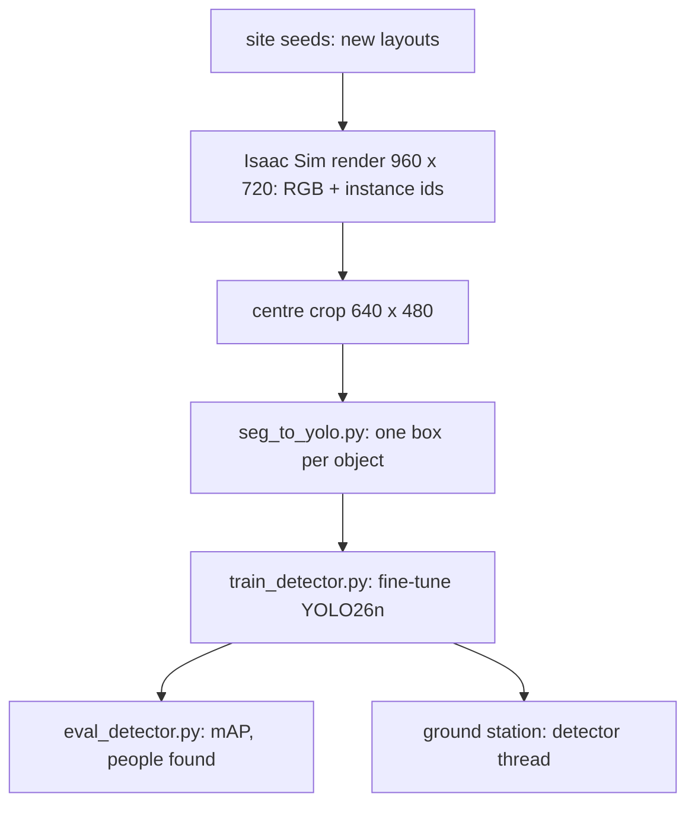

#### The task

Input: a 640 × 480 RGB frame looking straight down, 10 a second. Output: boxes of the seven classes; the people are 10
characters in 16 poses ([assets.py:94-226](https://github.com/Wavy-Hec/drone-search-rescue/blob/080ced76e42b8b7a6eb4050b4a98214992865625/sim/src/drone_lab/sar/assets.py#L94-L226)). From the survey
height a lying adult is 104-117 × 26-29 px and a standing person a blob of head and shoulders. The stock COCO model
learned people at eye level, which the README gives as the reason it misses most of them
([gcs/README.md:493-495](https://github.com/Wavy-Hec/drone-search-rescue/blob/080ced76e42b8b7a6eb4050b4a98214992865625/gcs/README.md#L493-L495)).

#### Training images

`gen_yolo_dataset.py` renders whole *sites* (the standard terrain dressed by one scenario seed) and never puts one
site in two splits ([gen_yolo_dataset.py:100-104](https://github.com/Wavy-Hec/drone-search-rescue/blob/080ced76e42b8b7a6eb4050b4a98214992865625/sim/scripts/gen_yolo_dataset.py#L100-L104)):

| Split | Scenario seeds | Views per site | Frames |
|---|---|---|---|
| train | 1000-1035 (36 sites) | 45 random views | 1620 |
| val | 2000-2006 (7 sites) | 45 random views | 315 |
| test | 0, the demo site | one every 2.5 m along the survey task's 4 m lawnmower | 183 |

The drone is placed, not flown: a random view takes a height of 5-12 m, a tilt up to 15° and any heading, aimed at
an object 65 % of the time; light and ground materials vary too
([capture.py:134-268](https://github.com/Wavy-Hec/drone-search-rescue/blob/080ced76e42b8b7a6eb4050b4a98214992865625/sim/src/drone_lab/sar/capture.py#L134-L268)). The camera
renders 960 × 720 px and keeps the centre 640 × 480, exactly the mission camera's image, so the margin gives the full
box of an object the frame cuts (a lower bound for one that also leaves the wider render)
([capture.py:276-311](https://github.com/Wavy-Hec/drone-search-rescue/blob/080ced76e42b8b7a6eb4050b4a98214992865625/sim/src/drone_lab/sar/capture.py#L276-L311)).

#### Labels from segmentation

Each labelled object carries its class in the scene, and the instance segmentation gives every pixel the id of the
object it shows ([scene.py:163-171](https://github.com/Wavy-Hec/drone-search-rescue/blob/080ced76e42b8b7a6eb4050b4a98214992865625/sim/src/drone_lab/sar/scene.py#L163-L171)). `seg_to_yolo.py` then
([dataset.py:137-258](https://github.com/Wavy-Hec/drone-search-rescue/blob/080ced76e42b8b7a6eb4050b4a98214992865625/gcs/drone_gcs/dataset.py#L137-L258)):

1. makes one tight box per id;
2. drops boxes with fewer than 100 pixels or a side under 6 px;
3. drops a box cut by the border if its visible area is under 40 % of its full box;
4. paints every dropped object over with the frame's mean colour, so the network never sees an unlabelled object,
   which would teach it to call that object background.

A label line is `class cx cy w h`, normalized by the image size. Pixels $x_0$ to $x_1$ inclusive cover the interval
$[x_0, x_1 + 1)$, so ([dataset.py:191-195](https://github.com/Wavy-Hec/drone-search-rescue/blob/080ced76e42b8b7a6eb4050b4a98214992865625/gcs/drone_gcs/dataset.py#L191-L195)):

$$c_x = \frac{x_0 + x_1 + 1}{2W},\qquad c_y = \frac{y_0 + y_1 + 1}{2H},\qquad w = \frac{x_1 - x_0 + 1}{W},\qquad h = \frac{y_1 - y_0 + 1}{H}$$

> [!example] A worked label
> A lying person filling columns 251-360 and rows 300-327 of a 640 × 480 frame (110 × 28 px) becomes
> `0 0.478125 0.654167 0.171875 0.058333`: $c_x = 612/1280$, $c_y = 628/960$, $w = 110/640$, $h = 28/480$.

#### Training

`train_detector.py` calls Ultralytics' `YOLO(weights).train(...)`
([train_detector.py:76-101](https://github.com/Wavy-Hec/drone-search-rescue/blob/080ced76e42b8b7a6eb4050b4a98214992865625/gcs/scripts/train_detector.py#L76-L101)):

| Setting | Value |
|---|---|
| start, epochs | YOLO26n with COCO weights, nothing frozen; 100 epochs (the shipped command, [gcs/README.md:524-525](https://github.com/Wavy-Hec/drone-search-rescue/blob/080ced76e42b8b7a6eb4050b4a98214992865625/gcs/README.md#L524-L525); the script's default is 120), stop after 30 without improvement |
| image size, batch | 640 px, 32 images |
| optimizer, schedule | AdamW at 0.000909 (Ultralytics' automatic choice); 3 warm-up epochs, then cosine decay |
| augmentation | mosaic (off for the last 15 epochs), left-right and up-down flips, zoom 0.5-1.5, colour jitter; no rotation |

Up-down flips are valid because "nadir imagery has no 'up'"
([train_detector.py:10-16](https://github.com/Wavy-Hec/drone-search-rescue/blob/080ced76e42b8b7a6eb4050b4a98214992865625/gcs/scripts/train_detector.py#L10-L16)). The best epoch, 73 of 100, scored val
mAP50 0.9947, precision 0.9964 and recall 0.9935; the 100 epochs took 316 s (the epoch:
[gcs/README.md:530-531](https://github.com/Wavy-Hec/drone-search-rescue/blob/080ced76e42b8b7a6eb4050b4a98214992865625/gcs/README.md#L530-L531); the scores and the time are read from the released
checkpoint, [HOW_IT_WORKS.md §6.4](https://github.com/Wavy-Hec/drone-search-rescue/blob/080ced76e42b8b7a6eb4050b4a98214992865625/docs/HOW_IT_WORKS.md#64-training)).

#### Evaluation

Besides mAP, `eval_detector.py` counts what the station would see: its settings (confidence 0.25, NMS IoU 0.45) on
every frame, boxes matched one to one to labels at IoU 0.45, most confident first
([eval_detector.py:105-162](https://github.com/Wavy-Hec/drone-search-rescue/blob/080ced76e42b8b7a6eb4050b4a98214992865625/gcs/scripts/eval_detector.py#L105-L162)). The README's results
([gcs/README.md:469-489](https://github.com/Wavy-Hec/drone-search-rescue/blob/080ced76e42b8b7a6eb4050b4a98214992865625/gcs/README.md#L469-L489)):

| | val: 7 held-out sites, 315 frames | test: demo site, 183 frames |
|---|---|---|
| all classes, mAP50 / mAP50-95 | 0.995 / 0.939 | 0.995 / 0.967 |
| all classes: found / missed / false alarms | 961 / 7 / 18 | 173 / 0 / 1 |
| people, fine-tuned: found / false alarms | **255 of 256** / 1 | **54 of 54** / 0 |
| people, stock COCO `yolo26n.pt`: found / false alarms | 107 of 256 / 33 | 31 of 54 / 8 |

The 256 are person labels in 315 frames, not distinct people. The one person missed is a 22 × 15 px sliver at the
frame edge, and 17 of the 18 val false alarms lie at the image border, 12 on painted-over remains
([gcs/README.md:497-501](https://github.com/Wavy-Hec/drone-search-rescue/blob/080ced76e42b8b7a6eb4050b4a98214992865625/gcs/README.md#L497-L501)).


*Three test frames at confidence 0.25: the fine-tuned model (left) draws 6, 5 and 6 boxes, the stock COCO model
(right, people only) 2, 0 and 1.*

> [!warning] What 0.995 does and does not say
> The val sites have new layouts but the same terrain, characters, poses and props as training. 0.995 is the ceiling,
> reached in distribution: the model handles new layouts of the same simulated world. Real photos are another matter;
> the experiments below measure it.

#### Inference in the station

The station runs `--weights` on the CPU by default, since the GPU belongs to Isaac Sim: confidence 0.25, NMS IoU 0.45,
640 px input, at most 100 boxes, 16-24 ms per frame against a frame every 100 ms
([detector.py:3-14](https://github.com/Wavy-Hec/drone-search-rescue/blob/080ced76e42b8b7a6eb4050b4a98214992865625/gcs/drone_gcs/detector.py#L3-L14), [gcs.py:46-67](https://github.com/Wavy-Hec/drone-search-rescue/blob/080ced76e42b8b7a6eb4050b4a98214992865625/gcs/scripts/gcs.py#L46-L67),
[gcs/README.md:675](https://github.com/Wavy-Hec/drone-search-rescue/blob/080ced76e42b8b7a6eb4050b4a98214992865625/gcs/README.md#L675)).
A worker thread keeps only the newest frame per drone, so the dashboard never waits
([detector.py:352-436](https://github.com/Wavy-Hec/drone-search-rescue/blob/080ced76e42b8b7a6eb4050b4a98214992865625/gcs/drone_gcs/detector.py#L352-L436)). A box within 3 px of the image border shows
only part of an object, so it is drawn, marked "edge", and not mapped
([state.py:458-484](https://github.com/Wavy-Hec/drone-search-rescue/blob/080ced76e42b8b7a6eb4050b4a98214992865625/gcs/drone_gcs/state.py#L458-L484)). YOLO26's one-to-one head could skip NMS, but the
Ultralytics version checked (8.4.213) runs NMS unless `predict` gets `nms=False`, which the station does not pass
([detector.py:197-207](https://github.com/Wavy-Hec/drone-search-rescue/blob/080ced76e42b8b7a6eb4050b4a98214992865625/gcs/drone_gcs/detector.py#L197-L207)). For tests, `--detector blob` finds colour blobs
and `--detector gt` uses the simulator's own boxes, which leaves only geometry errors in the pins.

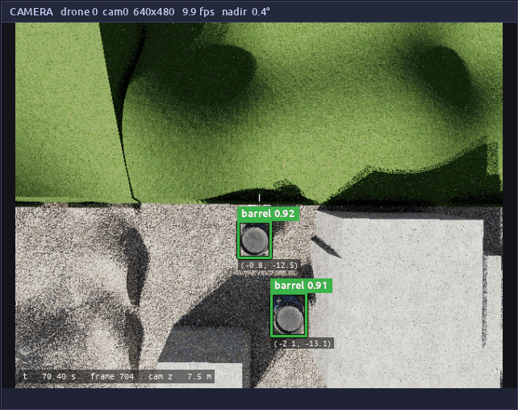

*The station's camera panel: each box shows its class, its confidence and the map position it geolocates to; a box at
the border is drawn thin, marked "edge" and not mapped
([dashboard.py:830-839](https://github.com/Wavy-Hec/drone-search-rescue/blob/080ced76e42b8b7a6eb4050b4a98214992865625/gcs/drone_gcs/dashboard.py#L830-L839)).*

Full detail: [HOW_IT_WORKS.md §6](https://github.com/Wavy-Hec/drone-search-rescue/blob/080ced76e42b8b7a6eb4050b4a98214992865625/docs/HOW_IT_WORKS.md#6-finding-people-with-yolo).

### 2.5 From pixels to pins

> [!tip] Intuition
> A box says "a person, here in the image". To place it on the map you need the ray from the camera through the box and
> a distance along it, which the depth image gives. Many frames of one person are then averaged into one pin.

#### The camera model

Each CAMERA message carries the intrinsics $K$, the optical centre $\mathbf t$ and the rotation $R$ from the camera
frame (ROS optical: x right, y down, z forward) to the world
([geometry.py:175-186](https://github.com/Wavy-Hec/drone-search-rescue/blob/080ced76e42b8b7a6eb4050b4a98214992865625/gcs/drone_gcs/geometry.py#L175-L186)). Pixel $(u, v)$ covers
$[u, u+1) \times [v, v+1)$, so its centre needs the offset $p_c = 0.5$
([geometry.py:6-14](https://github.com/Wavy-Hec/drone-search-rescue/blob/080ced76e42b8b7a6eb4050b4a98214992865625/gcs/drone_gcs/geometry.py#L6-L14)):

$$\mathbf r(u, v) = R\,K^{-1}\,[u + p_c,\ v + p_c,\ 1]^\top,\qquad \mathbf X = \mathbf t + d\,\mathbf r(u, v)$$

The ray's camera-frame z is 1 because the depth $d$ is the distance to the image plane, so $\mathbf X$ is exact for
every pixel ([geometry.py:207-220](https://github.com/Wavy-Hec/drone-search-rescue/blob/080ced76e42b8b7a6eb4050b4a98214992865625/gcs/drone_gcs/geometry.py#L207-L220)). The **nadir angle**, between the
optical axis and straight down, is $\arccos(-R_{33})$.

#### Geolocating one box

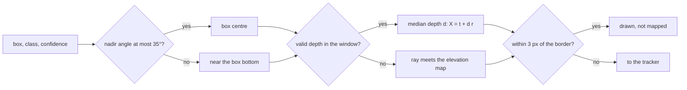

`Geolocator.locate` ([mapping.py:438-473](https://github.com/Wavy-Hec/drone-search-rescue/blob/080ced76e42b8b7a6eb4050b4a98214992865625/gcs/drone_gcs/mapping.py#L438-L473)):

1. **Reference pixel:** the box centre while the nadir angle is at most 35°, since from above the centre is the
   object's centre; otherwise a point near the bottom of the box, nearer the ground contact in an oblique view. The
   camera is fixed to the body, so this angle is the drone's tilt.
2. **Depth:** the median of the valid depths (0.5-1000 m; nearer is the drone's own legs) in a window spanning 30 % of
   the box each way ([mapping.py:452-465](https://github.com/Wavy-Hec/drone-search-rescue/blob/080ced76e42b8b7a6eb4050b4a98214992865625/gcs/drone_gcs/mapping.py#L452-L465)). A median ignores a minority
   of bad pixels, such as ground beside a thin object.
3. **Back-projection:** $\mathbf X = \mathbf t + d\,\mathbf r$.
4. **No depth:** the ray is intersected with the elevation map by fixed-point iteration, at most 8 steps to 1 mm
   ([mapping.py:257-290](https://github.com/Wavy-Hec/drone-search-rescue/blob/080ced76e42b8b7a6eb4050b4a98214992865625/gcs/drone_gcs/mapping.py#L257-L290)).
5. **Border:** a box within 3 px of the edge is not mapped.

The depth hit is the object's visible top, while the ground truth is the centre of its footprint on the ground, so
pin error is scored horizontally ([PROTOCOL.md:203-205](https://github.com/Wavy-Hec/drone-search-rescue/blob/080ced76e42b8b7a6eb4050b4a98214992865625/gcs/PROTOCOL.md#L203-L205)).

> [!example] Worked example, computed with the repository's `Geolocator`
> The camera hangs level at (0, 0, 7.4) m. A person lies on flat ground, the top of the body 0.25 m up (depth 7.15 m),
> and the box is (385, 250, 415, 350), so the reference pixel is (400, 300). The ray is $(0.1667, 0.125, 1)$ in the
> camera frame and $(-0.125, -0.1667, -1)$ in the world, and the pin lands at (−0.894, −1.192, 0.250). Without depth
> the ray runs on to the ground, 5 cm further out; the bottom rule would be 0.67 m off.

#### The tracker

`ObjectTracker` merges the points of one object over many frames
([mapping.py:549-641](https://github.com/Wavy-Hec/drone-search-rescue/blob/080ced76e42b8b7a6eb4050b4a98214992865625/gcs/drone_gcs/mapping.py#L549-L641)). A detection can join a pin only if both have the
same class and lie within the class's radius $r$, measured horizontally
([state.py:36-47](https://github.com/Wavy-Hec/drone-search-rescue/blob/080ced76e42b8b7a6eb4050b4a98214992865625/gcs/drone_gcs/state.py#L36-L47)):

| Class | person | vehicle | crate, barrel, cone | pallet | other (`--merge-radius`) |
|---|---|---|---|---|---|
| $r$ [m] | 1.5 | 3.0 | 0.8 | 1.0 | 2.0 |

Crates and barrels stand in piles; a forklift is large. Each frame, detection-pin pairs within $r$ are matched
greedily, nearest first, one to one. A matched pin with mean $\mu$, weight sum $W$ and spread sum $S$ absorbs the
detection $\mathbf x$ with the weight $w = \max(c, 10^{-3})$, where $c$ is the confidence:

$$\mu' = \frac{W\mu + w\,\mathbf x}{W + w},\qquad S' = S + w\,(\mathbf x_{xy} - \mu_{xy})\cdot(\mathbf x_{xy} - \mu'_{xy}),\qquad W' = W + w,\qquad \text{spread} = \sqrt{S'/W'}$$

So a pin is the confidence-weighted mean of its detections, and its **spread** their weighted RMS horizontal distance
from it, updated exactly (the weighted form of Welford's running-variance algorithm, tested against brute force in
[test_tracker_views.py:85-138](https://github.com/Wavy-Hec/drone-search-rescue/blob/080ced76e42b8b7a6eb4050b4a98214992865625/gcs/tests/test_tracker_views.py#L85-L138)). An unmatched detection starts a new
pin, and two pins of one class within **half** their radius merge
([mapping.py:613-641](https://github.com/Wavy-Hec/drone-search-rescue/blob/080ced76e42b8b7a6eb4050b4a98214992865625/gcs/drone_gcs/mapping.py#L613-L641)). The spread is only reported, never used to match
or confirm.

> [!example] Three detections of one person
> From [test_tracker_views.py:67-77](https://github.com/Wavy-Hec/drone-search-rescue/blob/080ced76e42b8b7a6eb4050b4a98214992865625/gcs/tests/test_tracker_views.py#L67-L77): (0, 0) at confidence 0.5
> makes a pin at (0, 0). (1, 0) at 0.5 moves it to (0.5, 0), spread 0.5 m. (0.5, 1.5) at 1.0
> moves it to (0.5, 0.75): $W = 2$, $S = 0.25 + 1 \cdot 1.5 \cdot 0.75 = 1.375$, spread $\sqrt{1.375/2} = 0.829$ m.

#### Views and confirmation

An object stays in the image for 60 frames or more per pass, so hits alone say little
([gcs/README.md:416-418](https://github.com/Wavy-Hec/drone-search-rescue/blob/080ced76e42b8b7a6eb4050b4a98214992865625/gcs/README.md#L416-L418)). Each pin also counts its **views**, the detected frames
whose image should show it (inside the image, not hidden by anything more than 1.0 m nearer), and its **detection
rate**, hits / max(views, hits, 1) ([state.py:491-523](https://github.com/Wavy-Hec/drone-search-rescue/blob/080ced76e42b8b7a6eb4050b4a98214992865625/gcs/drone_gcs/state.py#L491-L523)). A pin is
**confirmed** at `--min-hits` hits (default 2) and, if `--min-rate` is set, at least that rate; the rate check is off
by default ([mapping.py:652-659](https://github.com/Wavy-Hec/drone-search-rescue/blob/080ced76e42b8b7a6eb4050b4a98214992865625/gcs/drone_gcs/mapping.py#L652-L659)). Unconfirmed pins are *tentative* and
never scored, so one false detection never becomes a confirmed pin.

Full detail: [HOW_IT_WORKS.md §7](https://github.com/Wavy-Hec/drone-search-rescue/blob/080ced76e42b8b7a6eb4050b4a98214992865625/docs/HOW_IT_WORKS.md#7-from-pixels-to-pins).

### 2.6 Maps and the report

#### The grid and the elevation map

Cells are 0.25 m. The station pads the 40 m area by $\max(4,\ 0.15 \times 40) = 6$ m for the U-turns and shifts the
grid half a cell, so cell centres sit on multiples of 0.25 m, where the rays land: 209 × 209 cells from −26.125 m. The
photo grid is twice as fine, 418 × 418 cells of 0.125 m ([state.py:228-255](https://github.com/Wavy-Hec/drone-search-rescue/blob/080ced76e42b8b7a6eb4050b4a98214992865625/gcs/drone_gcs/state.py#L228-L255)).

`ElevationMap` keeps per cell the hit count $n$, $\Sigma z$, $\Sigma z^2$, the max and the min, so the mean, the
standard deviation and the extremes update in constant time per hit
([mapping.py:131-199](https://github.com/Wavy-Hec/drone-search-rescue/blob/080ced76e42b8b7a6eb4050b4a98214992865625/gcs/drone_gcs/mapping.py#L131-L199)). A cell without hits is *unknown*, drawn as fog;
**scan coverage** is the share of area cells with a hit. The mean is the height everything else uses. It is a
**2.5D** map, one height per cell and no overhangs, and in Isaac Sim it holds the bare terrain only.

#### The orthomosaic and the surface map

An **orthomosaic** is a top-down photo map stitched from the frames. Every frame is back-projected: at the survey
height every 4th pixel (19,200 samples) is placed at $\mathbf t + d\,\mathbf r$ with its own depth and given a quality
$q = -r_z/\lVert\mathbf r\rVert$, the cosine of its ray's angle from straight down
([mapping.py:354-407](https://github.com/Wavy-Hec/drone-search-rescue/blob/080ced76e42b8b7a6eb4050b4a98214992865625/gcs/drone_gcs/mapping.py#L354-L407)). A cell keeps its most top-down sample, which shows
the least of the sides of tall objects. **Photo coverage** is the share of area cells with a colour.

The **surface map** is a second `ElevationMap` fed with the same samples' 3D points
([state.py:439-440](https://github.com/Wavy-Hec/drone-search-rescue/blob/080ced76e42b8b7a6eb4050b4a98214992865625/gcs/drone_gcs/state.py#L439-L440)). Its max layer is the terrain plus whatever stands on
it; the report writes it for the rescue planner. It has been checked only on synthetic frames and the stand-in drone;
no Isaac Sim mission has written one yet ([gcs/README.md:701-703](https://github.com/Wavy-Hec/drone-search-rescue/blob/080ced76e42b8b7a6eb4050b4a98214992865625/gcs/README.md#L701-L703)).

#### The report and the scorecard

At the end `write_report` writes `report.md`, `summary.json`, the map images, the raw arrays (`maps/*.npy` with
`maps/grid.json`) and every pin in `detections.csv` and `detections.json`
([report.py:34-239](https://github.com/Wavy-Hec/drone-search-rescue/blob/080ced76e42b8b7a6eb4050b4a98214992865625/gcs/drone_gcs/report.py#L34-L239)). Only confirmed pins are scored: pin-object pairs of
one class within 2 m horizontally are matched greedily, nearest first, one to one, giving $tp$ matches,
$fp = N_p - tp$ false positives among $N_p$ pins and $fn = N_g - tp$ misses among $N_g$ objects
([mapping.py:663-728](https://github.com/Wavy-Hec/drone-search-rescue/blob/080ced76e42b8b7a6eb4050b4a98214992865625/gcs/drone_gcs/mapping.py#L663-L728)). The scorecard
([report.py:251-288](https://github.com/Wavy-Hec/drone-search-rescue/blob/080ced76e42b8b7a6eb4050b4a98214992865625/gcs/drone_gcs/report.py#L251-L288)):

| Key | How it is computed |
|---|---|
| `people_found` / `people_total` | true persons **inside** the survey area matched by a confirmed pin / all true persons inside |
| `false_alarms` | $fp$: confirmed pins of **any** class, anywhere, left unmatched; a second pin on a matched object counts too |
| `pin_error_m` | mean horizontal distance over all matches; `people_pin_error_m` over persons only |
| `map_height_error_m` | RMSE of the elevation map's mean layer against the true terrain inside the area |
| `map_height_error_smooth_m` | the same away from steps (cells within 0.1 m of all 8 neighbours), since a cell across a wall cannot hold both heights |
| `coverage_pct`, `photo_coverage_pct` | 100 × scan and photo coverage |
| `flight_time_s`, `closest_approach_m` | first to last time stamp; the drone's smallest distance to terrain and objects, from its END message |

#### The seed-0 scorecard

The README reports three runs of the demo mission that differ only in the detector
([gcs/README.md:640-667](https://github.com/Wavy-Hec/drone-search-rescue/blob/080ced76e42b8b7a6eb4050b4a98214992865625/gcs/README.md#L640-L667)); their run folders are not in the repository.

| | fine-tuned YOLO26n | stock COCO YOLO26n | simulator boxes (geometry check) |
|---|---|---|---|
| people found | 10 / 10 | 10 / 10 | 10 / 10 |
| false alarms | 0 | 31 (kites, birds, sports balls, ...) | 0 |
| objects found, of 41 | 40 | 10 | 40 |
| mean pin error | 0.04 m (people 0.06 m) | 0.12 m (people) | 0.04 m |

All three share one map: 0.10 m RMSE, 4 mm where the true height changes by less than 10 cm from cell to cell (31 % of
the area), 100 % scanned and 99.8 % photographed. The one object missed is a responder outside the survey area.


*The report's photo map: the orthomosaic, the path from the pad (bottom left) and back, and the confirmed pins. The
hollow square below the pad is the missed responder.*

> [!tip] Per-frame recall is not mission recall
> Frame by frame the stock COCO model finds only 31 of the 54 person labels in the demo site's test frames, yet it
> found all 10 people in the mission: a person stays in view for dozens of frames, and 2 hits confirm a pin. Its failure is the other
> kind, 31 confirmed false alarms.

Full detail: [HOW_IT_WORKS.md §8](https://github.com/Wavy-Hec/drone-search-rescue/blob/080ced76e42b8b7a6eb4050b4a98214992865625/docs/HOW_IT_WORKS.md#8-mapping) and
[§9](https://github.com/Wavy-Hec/drone-search-rescue/blob/080ced76e42b8b7a6eb4050b4a98214992865625/docs/HOW_IT_WORKS.md#9-the-mission-report).

### 2.7 The rescue planner

> [!tip] Intuition
> Turn the drone's map into "where may a dog-sized robot step, and what does each metre cost", find the cheapest
> route, smooth it, and steer along it with velocity commands the walking policy understands.

The planner lives in `sim/src/drone_lab/teaming/`, driven by `rescue_finale.py`, and needs no GPU: numpy and scipy,
plus Isaac Lab's terrain code (not the simulator) for the ground truth and the flat border
([teaming/\_\_init\_\_.py:17-19](https://github.com/Wavy-Hec/drone-search-rescue/blob/080ced76e42b8b7a6eb4050b4a98214992865625/sim/src/drone_lab/teaming/__init__.py#L17-L19),
[inputs.py:343-344](https://github.com/Wavy-Hec/drone-search-rescue/blob/080ced76e42b8b7a6eb4050b4a98214992865625/sim/src/drone_lab/teaming/inputs.py#L343-L344)).

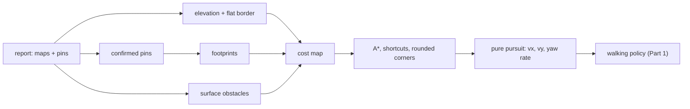

#### Inputs

- **Heights and pins:** `maps/elevation_mean.npy`, `maps/grid.json` and the confirmed pins in `detections.json`;
  without a report, the site's ground truth ([inputs.py:287-362](https://github.com/Wavy-Hec/drone-search-rescue/blob/080ced76e42b8b7a6eb4050b4a98214992865625/sim/src/drone_lab/teaming/inputs.py#L287-L362)).
  A person pin less than 0.7 m above the local ground counts as lying
  ([inputs.py:253-283](https://github.com/Wavy-Hec/drone-search-rescue/blob/080ced76e42b8b7a6eb4050b4a98214992865625/sim/src/drone_lab/teaming/inputs.py#L253-L283)).
- **Footprints:** each pin blocks a circle of its object's size, by radius: person 0.6 m, but the goal person 1.2 m lying (body,
  arms and about 0.3 m of pin error) or 0.7 m standing; vehicle 2.2 m; crate and pallet 0.8 m; barrel 0.45 m; cone
  0.25 m ([inputs.py:68-91](https://github.com/Wavy-Hec/drone-search-rescue/blob/080ced76e42b8b7a6eb4050b4a98214992865625/sim/src/drone_lab/teaming/inputs.py#L68-L91)).
- **Border:** unknown cells lying entirely on the flat 6 m border, where the pad stands, get z = 0; unseen terrain
  stays unknown ([inputs.py:390-445](https://github.com/Wavy-Hec/drone-search-rescue/blob/080ced76e42b8b7a6eb4050b4a98214992865625/sim/src/drone_lab/teaming/inputs.py#L390-L445)).
- **Surface obstacles:** cells where the surface map stands more than 0.2 m above the elevation map become no-go,
  which catches a tree or a crate the detector missed; no walk has used this yet
  ([inputs.py:449-486](https://github.com/Wavy-Hec/drone-search-rescue/blob/080ced76e42b8b7a6eb4050b4a98214992865625/sim/src/drone_lab/teaming/inputs.py#L449-L486)).
- **Start:** the pad's centre, (−23, −18) m.

#### Traversability

**Traversability** is where the robot may walk and at what cost. `compute_traversability` fills isolated holes, then
gives each cell a cost per metre or marks it no-go
([traversability.py:475-555](https://github.com/Wavy-Hec/drone-search-rescue/blob/080ced76e42b8b7a6eb4050b4a98214992865625/sim/src/drone_lab/teaming/traversability.py#L475-L555)). **Slope** $\beta$ and
**roughness** $\rho$ come from a least-squares plane fitted over a disk around each cell: $\beta$ from its gradient,
$\rho$ the RMS residual. The **step** $\delta$, the largest height jump to a neighbour once the local gradient is
taken out, is measured separately because a plane fit smooths a ledge into a slope
([traversability.py:301-406](https://github.com/Wavy-Hec/drone-search-rescue/blob/080ced76e42b8b7a6eb4050b4a98214992865625/sim/src/drone_lab/teaming/traversability.py#L301-L406)).

| Limit ([robots.py:60-93](https://github.com/Wavy-Hec/drone-search-rescue/blob/080ced76e42b8b7a6eb4050b4a98214992865625/sim/src/drone_lab/teaming/robots.py#L60-L93)) | custom quadruped (default) | Unitree Go2 |
|---|---|---|
| steepest slope $\beta_\text{max}$ | 23° | 22° |
| highest step $\delta_\text{max}$ | 0.15 m | 0.12 m |
| roughest ground $\rho_\text{max}$ | 0.05 m | 0.05 m |
| robot radius $r$ | 0.45 m | 0.35 m |
| cross-slope weight $w_\perp$ | 6 | 0 |

A cell beyond any limit, or unknown, is no-go. The no-go cells are then **inflated**: a distance transform gives each
cell its clearance $d$ to the nearest no-go cell, and cells with $d < r$ become no-go too, so the planner can treat
the robot as a point ([traversability.py:520-525](https://github.com/Wavy-Hec/drone-search-rescue/blob/080ced76e42b8b7a6eb4050b4a98214992865625/sim/src/drone_lab/teaming/traversability.py#L520-L525)).
With $q(u) = \min(\max(u, 0), 1)^2$, a free cell costs per metre
([traversability.py:527-538](https://github.com/Wavy-Hec/drone-search-rescue/blob/080ced76e42b8b7a6eb4050b4a98214992865625/sim/src/drone_lab/teaming/traversability.py#L527-L538)):

$$c = 1 + 6\,q\!\left(\frac{\beta}{\beta_\text{max}}\right) + 4\,q\!\left(\frac{\delta}{\delta_\text{max}}\right) + 3\,q\!\left(\frac{\rho}{\rho_\text{max}}\right) + 3\,q\!\left(1 - \frac{d - r}{0.8}\right)$$

Flat open ground costs 1 and a 15° slope 3.55; the last term keeps routes off edges where there is room (2.64 extra at
0.5 m of clearance, nothing beyond 1.25 m). The custom quadruped also pays a **cross-slope** cost,
$w_\perp\,q(\text{cross slope}/\beta_\text{max})$ per metre, zero along the fall line
([traversability.py:171-184](https://github.com/Wavy-Hec/drone-search-rescue/blob/080ced76e42b8b7a6eb4050b4a98214992865625/sim/src/drone_lab/teaming/traversability.py#L171-L184)): in GPU walks this
policy ran away downhill when it turned fast on slopes of 17° or more, so its routes come straight down the fall line
and turn on flat ground ([teaming/README.md:128-135](https://github.com/Wavy-Hec/drone-search-rescue/blob/080ced76e42b8b7a6eb4050b4a98214992865625/sim/src/drone_lab/teaming/README.md#L128-L135); the walk logs are not in the
repository).

#### Route search: A\* and smoothing

**A\*** finds the cheapest path on a graph by always expanding the node with the smallest cost so far plus an estimate
of the cost still to go; if the estimate never overestimates, the path it returns is optimal.

- **Snapping:** the start moves to a free cell within 2.0 m. The goal, inside the person's own footprint, moves to the
  nearest reachable free cell, and the person is *unreachable* if that cell is more than 2.5 m away
  ([planner.py:468-493](https://github.com/Wavy-Hec/drone-search-rescue/blob/080ced76e42b8b7a6eb4050b4a98214992865625/sim/src/drone_lab/teaming/planner.py#L468-L493),
  [rescue_finale.py:148-154](https://github.com/Wavy-Hec/drone-search-rescue/blob/080ced76e42b8b7a6eb4050b4a98214992865625/sim/scripts/rescue_finale.py#L148-L154)).
- **Graph:** cells link to their 8 neighbours; a move of length $\ell$ costs $\ell\,(c_u + c_v)/2$ plus the
  cross-slope cost ([planner.py:127-147](https://github.com/Wavy-Hec/drone-search-rescue/blob/080ced76e42b8b7a6eb4050b4a98214992865625/sim/src/drone_lab/teaming/planner.py#L127-L147)).
- **Heuristic:** the octile distance (the shortest 8-connected length with nothing in the way) times the cheapest cell
  cost. It never overestimates, so the grid route is optimal; tests compare it with Dijkstra's algorithm
  ([planner.py:198-204](https://github.com/Wavy-Hec/drone-search-rescue/blob/080ced76e42b8b7a6eb4050b4a98214992865625/sim/src/drone_lab/teaming/planner.py#L198-L204)).
- **Smoothing:** shortcuts to the farthest vertex within 8 m whose straight segment is free and costs at most 2 %
  more; three rounds of Chaikin corner cutting, kept only if free of no-go cells; resampling to 0.1 m steps
  ([planner.py:346-432](https://github.com/Wavy-Hec/drone-search-rescue/blob/080ced76e42b8b7a6eb4050b4a98214992865625/sim/src/drone_lab/teaming/planner.py#L346-L432)).

Without `--goal_pin`, the script prefers people 15-25 m from the start, lying ones first, then the one nearest 20 m
([rescue_finale.py:343-352](https://github.com/Wavy-Hec/drone-search-rescue/blob/080ced76e42b8b7a6eb4050b4a98214992865625/sim/scripts/rescue_finale.py#L343-L352)). On the demo site's ground truth it
tries person_07, unreachable within 2.5 m, then takes person_08 in the crater, 15.6 m away. On the recorded mission's
report the rule picks a sitting person 18.4 m away (pin #37), so the recorded finale names pin #32 with `--goal_pin`
([sim/README.md:187-193](https://github.com/Wavy-Hec/drone-search-rescue/blob/080ced76e42b8b7a6eb4050b4a98214992865625/sim/README.md#L187-L193)).

#### Pure pursuit

**Pure pursuit** steers towards a point a fixed distance ahead on the path, along the circular arc through it. Every
policy step the follower turns the route into the command $(v_x, v_y, \omega)$ the walking policy reads
([follower.py:180-242](https://github.com/Wavy-Hec/drone-search-rescue/blob/080ced76e42b8b7a6eb4050b4a98214992865625/sim/src/drone_lab/teaming/follower.py#L180-L242)). The target lies 0.8 m ahead, at
angle $\alpha$ and distance $L$ in the robot's frame. Above $\lvert\alpha\rvert$ = 1.0 rad the robot turns on the spot
($\omega = 1.2\,\alpha$) until $\lvert\alpha\rvert$ drops below 0.5 rad; otherwise:

$$\kappa = \frac{2\sin\alpha}{L},\qquad v_x = \max\Big(0.3,\ \min\big(0.7\max(\cos\alpha, 0),\ \tfrac{0.9}{\lvert\kappa\rvert},\ 0.7\,\tfrac{d_\text{go}}{1.2}\big)\Big),\qquad \omega = v_x\,\kappa$$

$\kappa$ is the curvature of the circle tangent to the robot's heading through the target. The 0.7 m/s cruise speed
drops for a target off to the side, on tight arcs ($\omega \le 0.9$ rad/s) and over the last 1.2 m ($d_\text{go}$
left), but never below 0.3 m/s: policies tend to stand still for tiny commands
([follower.py:60-87](https://github.com/Wavy-Hec/drone-search-rescue/blob/080ced76e42b8b7a6eb4050b4a98214992865625/sim/src/drone_lab/teaming/follower.py#L60-L87)). A sideways $v_y = 0.6\,e$ (at most
0.25 m/s, $e$ the offset) pulls the robot back onto the route, and it stops within 0.35 m of the end.

#### The tour

`--tour` plans one route past every reachable person. With the A\* costs between all stops, **Held-Karp** dynamic
programming finds the best order exactly for up to 12 stops ($n^2 2^n$ steps, 589,824 for 12); beyond that, a
nearest-neighbour order is improved by **2-opt**, reversing stretches while that lowers the cost
([tour.py:119-192](https://github.com/Wavy-Hec/drone-search-rescue/blob/080ced76e42b8b7a6eb4050b4a98214992865625/sim/src/drone_lab/teaming/tour.py#L119-L192)). Each leg becomes one walk command in
`tour_legs.sh`; no tour has been walked yet.

#### The recorded finale

On the report of the recorded mission the planner routed the custom quadruped 16.5 m from the pad to pin #32, the
drone's pin on person_08 in the crater, 0.05 m from the person's true centre. The route turns on the flat border and comes straight down
the crater's west wall, as the cross-slope cost asks. The robot arrived in 24.3 s without a fall, and 32 robots at once
all arrived in 23.9-24.7 s ([sim/README.md:163-185](https://github.com/Wavy-Hec/drone-search-rescue/blob/080ced76e42b8b7a6eb4050b4a98214992865625/sim/README.md#L163-L185); the walk outputs are not in the
repository).

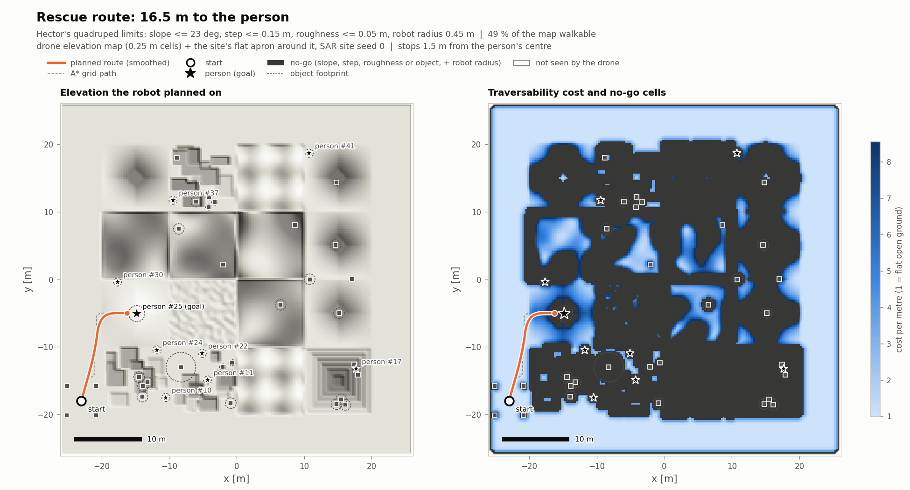

*Left: the heights the robot planned on. Right: cost per metre (1 = flat open ground) and no-go cells (dark). Orange:
the route, 16.5 m from the pad (circle) to a stop 1.6 m from pin #32 (star).*


*The last 10 s of the recorded finale: the robot walks down into the crater and stops beside the person.*

Full detail: [HOW_IT_WORKS.md §10](https://github.com/Wavy-Hec/drone-search-rescue/blob/080ced76e42b8b7a6eb4050b4a98214992865625/docs/HOW_IT_WORKS.md#10-the-rescue-planner).

### 2.8 What the CPU experiments showed

These experiments ran on four CPU cores with no GPU and no Isaac Sim, using three inputs that need no simulator: the
**stand-in drone**, **real drone photos** and the **ground truth of the demo site** (planning only).
[make_figures.py](https://github.com/Wavy-Hec/drone-search-rescue/blob/080ced76e42b8b7a6eb4050b4a98214992865625/docs/experiments/make_figures.py) draws the figures and
[results.md](https://github.com/Wavy-Hec/drone-search-rescue/blob/080ced76e42b8b7a6eb4050b4a98214992865625/docs/experiments/results.md) holds the numbers.

#### The stand-in mission

The stand-in drone, `fake_drone.py`, flies a 40 × 40 m lawnmower (lines 4 m apart, 3 m/s) over a seeded synthetic
world with 10 coloured objects (3 people, 3 cars, 2 tents, 2 tarps), with a 5 × 5 m ray grid and a 640 × 480 RGB-D
camera at 5 Hz, through the real link ([fake_drone.py:69-90](https://github.com/Wavy-Hec/drone-search-rescue/blob/080ced76e42b8b7a6eb4050b4a98214992865625/gcs/scripts/fake_drone.py#L69-L90)). The station
uses `--detector blob`, since YOLO never saw these objects; everything after the camera is the real pipeline. World
seed 0 gave 10 of 10 objects (3 of 3 people, no false alarm), a 0.047 m pin error, 99.9 % scanned and 100 %
photographed, and two lossless replays of its recording were bit-identical to the live run.

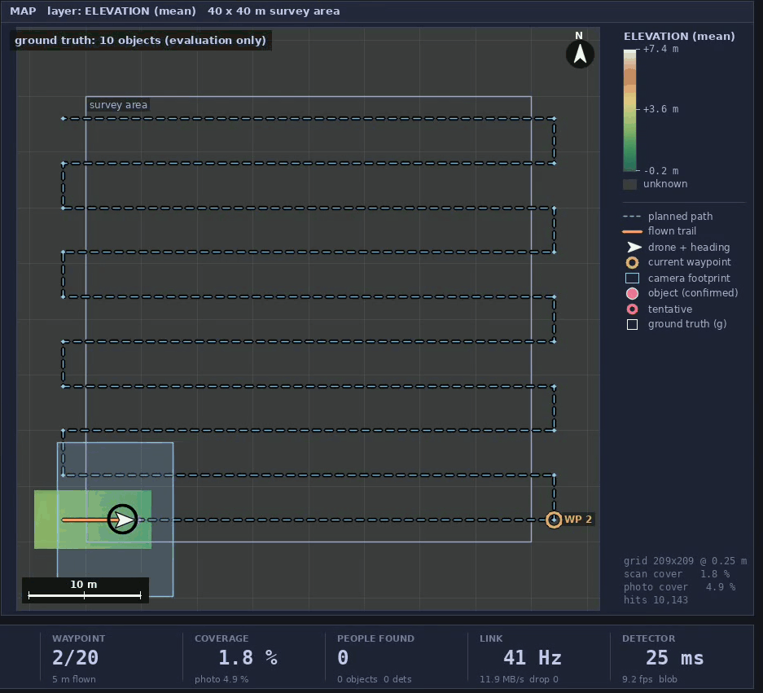

*The station's map panel during the stand-in mission: the lawnmower path, the elevation map filling in and a pin on
each coloured object.*

#### Sensor-noise sweeps

In the simulator the pose, the depth and the ray hits are exact, which is why the Isaac mission's pins are 4 cm from
the truth. `noise_sweep.py` replays the recording at each level with 3 noise seeds (1 for the lag, which is not random).

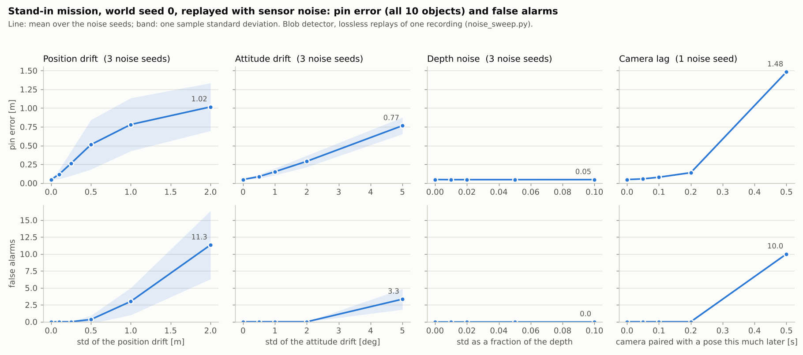

| Noise | Level → mean pin error, all objects | False alarms |
|---|---|---|
| position drift (std) | 0.1 m → 0.12 m; 0.25 → 0.26; 0.5 → 0.51; 1 → 0.78; 2 → 1.02 | 3.0 at 1 m; 11.3 at 2 m, where only 2.3 of 3 people are found |
| attitude drift (std) | 0.5° → 0.087 m; 1° → 0.152; 2° → 0.291; 5° → 0.766 | 3.3 at 5° |
| depth noise (fraction) | 0.01 to 0.10 → 0.046-0.047 m | none |
| camera lag | 0.05 s → 0.056 m; 0.1 → 0.079; 0.2 → 0.139; 0.5 → 1.48 | 10 at 0.5 s |

- **Up to 0.5 m, position drift moves pins one for one.** A pass lasts seconds, far less than the 30 s correlation time, so its
  detections share one offset. Past about 1 m two passes disagree by more than the merge radius and the object splits
  into two pins, one of them a false alarm; at 2 m pins fall outside the 2 m match radius and people are missed.
- **Attitude drift turns every camera ray**, moving a ground point by about $h\tan\delta\theta$:
  $9.8 \times \tan 1° = 0.17$ m at the stand-in's mean height, near the measured 0.15 m per degree. The scanner is
  gimballed, so the elevation map does not move ([noise.py:198](https://github.com/Wavy-Hec/drone-search-rescue/blob/080ced76e42b8b7a6eb4050b4a98214992865625/gcs/drone_gcs/noise.py#L198)).
- **Depth noise hardly matters:** the window median removes independent per-pixel noise
  ([mapping.py:452-467](https://github.com/Wavy-Hec/drone-search-rescue/blob/080ced76e42b8b7a6eb4050b4a98214992865625/gcs/drone_gcs/mapping.py#L452-L467)). Correlated errors, such as a wrong depth scale,
  were not modelled.
- **Camera lag splits lines.** It shifts one line's detections forward and the next line's, flown the other way,
  backward. The gap, $2 \times 3\ \text{m/s} \times \text{lag}$, is 1.2 m at 0.2 s, still under the merge radius; at
  0.5 s it is 3 m, and each line gets its own pin, 1.5 m off.

#### The stand-in benchmark

Five stand-in worlds (seeds 0-4), flown once each, were replayed with `pos=0.5,att=1,depth=0.02`
([aggregate_runs.py](https://github.com/Wavy-Hec/drone-search-rescue/blob/080ced76e42b8b7a6eb4050b4a98214992865625/gcs/scripts/aggregate_runs.py)):

| | Without noise | With noise |
|---|---|---|
| people found | 15 / 15 (95 % interval 79.6-100 %) | 15 / 15 |
| false alarms | 0 | 0 |
| objects found | 49 / 50 | 49 / 50 |
| pin error, all objects | 0.053 ± 0.014 m | 0.82 ± 0.06 m |

Noise of this size leaves detection unchanged but multiplies the pin error by about 15. And 15 of 15 is weak
evidence: the **Wilson score interval**, a confidence interval for a proportion that behaves well near 0 and 1, gives a
perfect $n$ of $n$ the 95 % lower bound $n/(n + z^2)$ with $z = 1.96$, here $15/18.84 = 0.796$. A lower bound of 95 %
would take 73 of 73 people (both derived).

#### Real drone photos

The test set is the VisDrone2019-DET validation set: 548 real drone photos, mostly oblique views of city streets, with
13,969 people labelled, 69 % of them under 32 px on their longer side. A label counts as found when a person box
overlaps it at IoU 0.45 or more, one to one ([external_eval.py:146-164](https://github.com/Wavy-Hec/drone-search-rescue/blob/080ced76e42b8b7a6eb4050b4a98214992865625/gcs/drone_gcs/external_eval.py#L146-L164)):

| All 548 photos, whole image | Found | Recall | False alarms | Precision |
|---|---|---|---|---|
| fine-tuned on simulator images | 227 | 0.016 | 3,616 | 0.059 |
| stock COCO YOLO26n | 936 | 0.067 | 139 | 0.871 |

Both miss nearly every person under 32 px, but size is not the whole story: on people 64-128 px long the fine-tuned
model finds 20 % and the COCO model 60 %, on longer ones 49 % against 95 %. On tiles of the first 50 photos enlarged
twice, the COCO model's recall rises to 0.515 at precision 0.827; the fine-tuned model reaches only 0.111, at
precision 0.125.

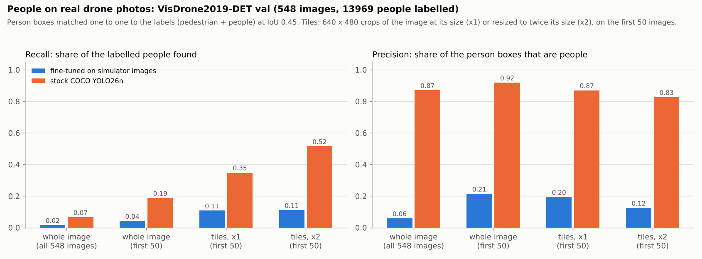

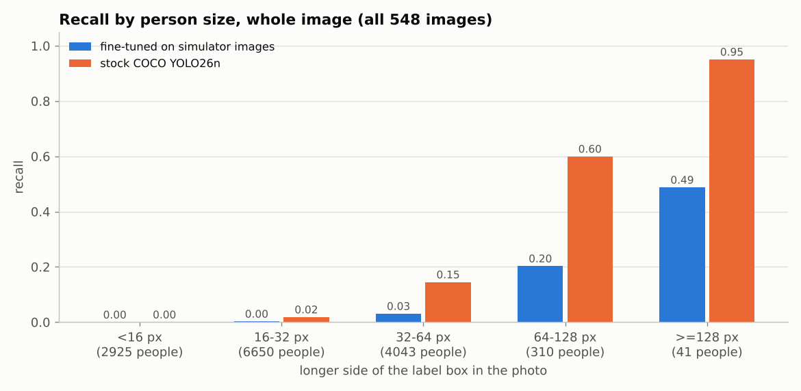

> [!warning] The sim-to-real gap
> Fine-tuning on simulator images alone made the detector nearly perfect in the simulator and much worse than its own
> starting point on real photos, in what it finds and in what it invents. VisDrone is not the mission's setting (city
> scenes, not rubble from above), so the comparison between the two detectors is the result, not the absolute numbers.
> Remedies to try, none implemented: mix labelled real images into the fine-tuning, randomize the rendering further,
> or keep COCO's person detector and fine-tune only for the classes the simulator adds.

#### Planning on the CPU

**The tour** on the demo site's ground truth took 13 s on the CPU. It visits 8 of the 11 people in 151.0 m, in the
exact Held-Karp order person_10, 02, 08, 09, 03, 04, 05, 01 (about 216 s at 0.7 m/s). person_07, person_06 and
person_00 are unreachable: their nearest reachable cells are 3.02, 4.68 and 2.95 m away, beyond the 2.5 m limit.

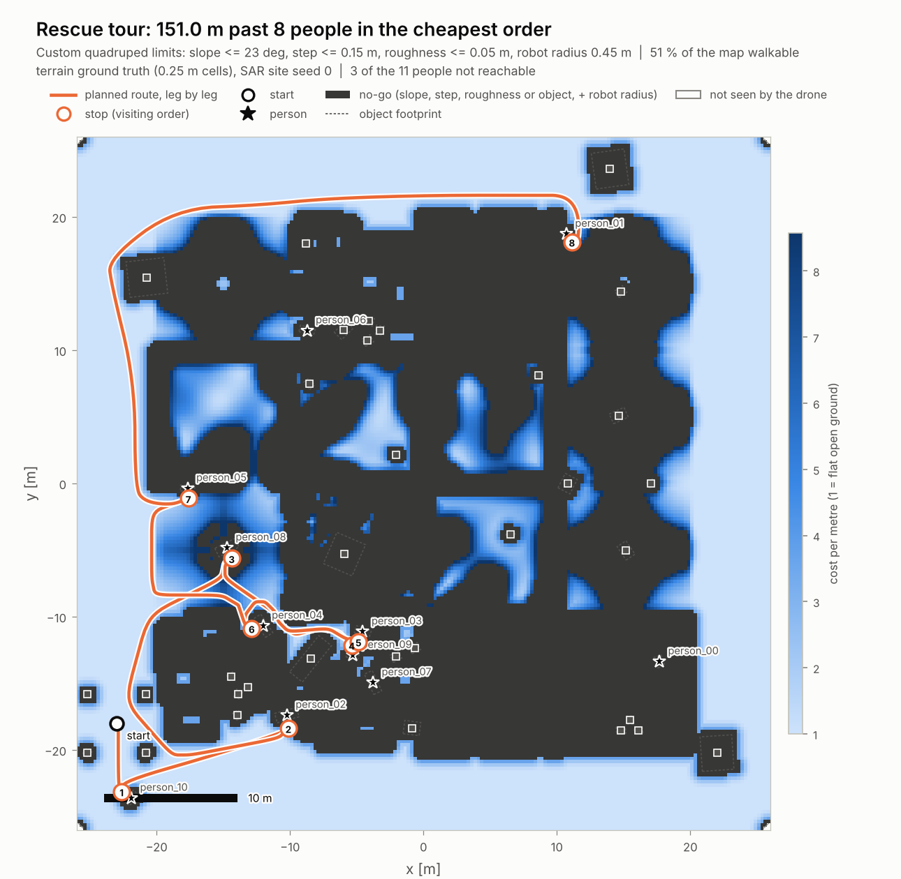

**Surface-map obstacles**, tested on a stand-in report of the demo site: the surface map marks 1,967 cells, 248 of
them open ground before; after inflation they add 326 no-go cells, mostly trees on the border. The route to the person
15.6 m from the pad avoids them all and stays 16.9 m long.

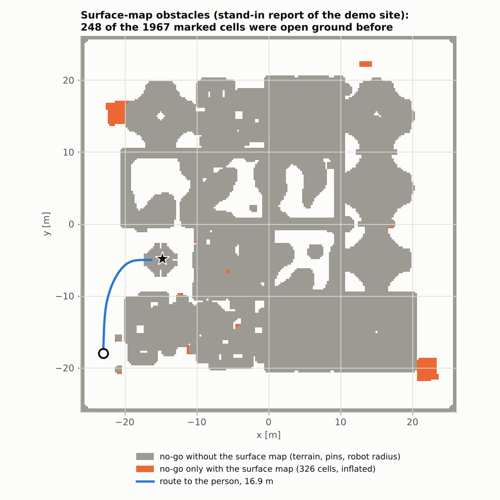

#### Measured tolerances

The Isaac mission's 4 cm pin error measures the geometry, not a drone: in simulation the pose, the depth and the time
stamps are exact. A real drone gets its pose from a state estimator, such as GNSS with an inertial unit, visual
odometry, or SLAM (simultaneous localization and mapping), the subject of Part 3 (sections 3.2 and 3.3). The
stand-in's sweeps, at 9.8 m above the ground and 3 m/s, say what that estimator must deliver:

- **Position:** the pin error is about the drift's standard deviation (0.12, 0.26, 0.51 m at 0.1, 0.25, 0.5 m).
- **Large drift:** beyond about 1 m, objects split into duplicate pins (3.0 false alarms at 1 m, 11.3 at 2 m) before
  people are missed.
- **Attitude:** about 0.15 m of pin error per degree at 9.8 m, from $h\tan\delta\theta$.
- **Timing:** a camera lag of 0.2 s costs 0.14 m at 3 m/s, and 0.5 s costs 1.48 m and 10 false alarms, so frames must
  be paired with the pose to well under 0.2 s.
- **Depth:** independent per-pixel noise up to 10 % is harmless.
- **Detector:** the simulator-trained model does not transfer yet: VisDrone recall 0.016 and precision 0.059, against
  0.067 and 0.871 for the stock COCO model.

Scaled with the same rules (derived, not measured): at the Isaac mission's 7.415 m the attitude rule gives about
0.13 m per degree, and at its 1.16 m/s a 0.1 s lag moves detections about 12 cm along the track.

> [!tip] What Part 3 must solve
> Read as a specification (an interpretation of the stand-in's numbers, not a tested requirement): keep the position
> drift over a survey well under 1 m, ideally a few tenths; keep the attitude error near a degree or less; pair each
> camera frame with the pose to well under 0.2 s (at 0.1 s the stand-in's pins were 0.08 m off); and give the
> detector real images to learn from. Duplicate pins, counted as false alarms, are the first symptom of a drifting
> estimate.

Full detail: [HOW_IT_WORKS.md §12](https://github.com/Wavy-Hec/drone-search-rescue/blob/080ced76e42b8b7a6eb4050b4a98214992865625/docs/HOW_IT_WORKS.md#12-experiments-run-on-the-cpu); the commands for the
GPU parts at home are in [§13](https://github.com/Wavy-Hec/drone-search-rescue/blob/080ced76e42b8b7a6eb4050b4a98214992865625/docs/HOW_IT_WORKS.md#13-what-needs-a-gpu-and-how-to-run-it-at-home).

### 2.9 Key numbers and advisor questions

#### Key numbers

| Quantity | Value | Source |
|---|---|---|
| site | 40 × 40 m area in a 52 × 52 m site; terrain seed 17, site seed 0; 45 objects, 11 people | [sar/README.md:7-13](https://github.com/Wavy-Hec/drone-search-rescue/blob/080ced76e42b8b7a6eb4050b4a98214992865625/sim/src/drone_lab/sar/README.md#L7-L13) |
| sensors | 441 terrain rays; camera 640 × 480 px, f = 480 px, 10 Hz | [camera.py:51-59](https://github.com/Wavy-Hec/drone-search-rescue/blob/080ced76e42b8b7a6eb4050b4a98214992865625/sim/src/drone_lab/sar/camera.py#L51-L59) |
| flight plan | 7.515 m = 3.515 + 4; 8 lines 5 m apart; 133 waypoints, 427.95 m | [sar_mission.py:377-379](https://github.com/Wavy-Hec/drone-search-rescue/blob/080ced76e42b8b7a6eb4050b4a98214992865625/sim/scripts/sar_mission.py#L377-L379) |
| camera geometry | GSD 1.545 cm/px at 7.415 m; footprint 9.887 × 7.415 m; overlap 49.4 % side, 98.3 % forward | [mission.py:211-221](https://github.com/Wavy-Hec/drone-search-rescue/blob/080ced76e42b8b7a6eb4050b4a98214992865625/sim/src/drone_lab/sar/mission.py#L211-L221) |
| recorded mission | 6 min 16 s, 428 m, landed 7 mm from the pad's centre | [sim/README.md:131-134](https://github.com/Wavy-Hec/drone-search-rescue/blob/080ced76e42b8b7a6eb4050b4a98214992865625/sim/README.md#L131-L134) |
| link | 2.15 MB per camera frame; 21.6 MB/s; 8.1 GB per mission | [PROTOCOL.md:35-36](https://github.com/Wavy-Hec/drone-search-rescue/blob/080ced76e42b8b7a6eb4050b4a98214992865625/gcs/PROTOCOL.md#L35-L36) |
| YOLO | 1620 training frames; mAP50 0.995; 255 of 256 people (stock COCO 107) | [gcs/README.md:469-489](https://github.com/Wavy-Hec/drone-search-rescue/blob/080ced76e42b8b7a6eb4050b4a98214992865625/gcs/README.md#L469-L489) |
| YOLO in the station | CPU, confidence 0.25, NMS IoU 0.45, 16-24 ms per frame | [gcs/README.md:675](https://github.com/Wavy-Hec/drone-search-rescue/blob/080ced76e42b8b7a6eb4050b4a98214992865625/gcs/README.md#L675) |
| tracker and scoring | person radius 1.5 m; confirmed at 2 hits; a match within 2 m | [state.py:36-48](https://github.com/Wavy-Hec/drone-search-rescue/blob/080ced76e42b8b7a6eb4050b4a98214992865625/gcs/drone_gcs/state.py#L36-L48), [report.py:41](https://github.com/Wavy-Hec/drone-search-rescue/blob/080ced76e42b8b7a6eb4050b4a98214992865625/gcs/drone_gcs/report.py#L41) |
| mission scorecard | 10 / 10 people, 0 false alarms, 0.04 m pin error, 0.10 m map RMSE (4 mm off steps) | [gcs/README.md:640-648](https://github.com/Wavy-Hec/drone-search-rescue/blob/080ced76e42b8b7a6eb4050b4a98214992865625/gcs/README.md#L640-L648) |
| robot limits | 23° slope, 0.15 m step, 0.05 m roughness, 0.45 m radius | [robots.py:60-93](https://github.com/Wavy-Hec/drone-search-rescue/blob/080ced76e42b8b7a6eb4050b4a98214992865625/sim/src/drone_lab/teaming/robots.py#L60-L93) |
| pure pursuit | look-ahead 0.8 m, cruise 0.7 m/s, at least 0.3 m/s | [follower.py:60-87](https://github.com/Wavy-Hec/drone-search-rescue/blob/080ced76e42b8b7a6eb4050b4a98214992865625/sim/src/drone_lab/teaming/follower.py#L60-L87) |
| recorded finale | 16.5 m; 32 / 32 robots in 23.9-24.7 s, 0 falls | [sim/README.md:171-185](https://github.com/Wavy-Hec/drone-search-rescue/blob/080ced76e42b8b7a6eb4050b4a98214992865625/sim/README.md#L171-L185) |
| noise tolerances | pin error ≈ position drift; 0.15 m per degree at 9.8 m; lag well under 0.2 s | [results.md](https://github.com/Wavy-Hec/drone-search-rescue/blob/080ced76e42b8b7a6eb4050b4a98214992865625/docs/experiments/results.md) |
| real photos | people recall 0.016 (stock COCO 0.067) | [results.md](https://github.com/Wavy-Hec/drone-search-rescue/blob/080ced76e42b8b7a6eb4050b4a98214992865625/docs/experiments/results.md) |

#### Questions an advisor might ask

> [!question]- Why fly at 7.515 m, and at one height for the whole survey?
> It is the highest terrain over the area and its U-turn band, 3.515 m, plus 4 m of clearance
> ([sar_mission.py:377-379](https://github.com/Wavy-Hec/drone-search-rescue/blob/080ced76e42b8b7a6eb4050b4a98214992865625/sim/scripts/sar_mission.py#L377-L379)). One height keeps the plan simple; the GSD
> then follows the ground (1.545 cm/px on flat ground, 1.84 over the crater floor).

> [!question]- The mapping rays never hit a person. How do people and obstacles reach the map?
> Through the camera. Detections become pins through the depth image, and the depth points build the surface map,
> which the planner compares with the bare-terrain elevation map to block anything more than 0.2 m tall
> ([inputs.py:449-486](https://github.com/Wavy-Hec/drone-search-rescue/blob/080ced76e42b8b7a6eb4050b4a98214992865625/sim/src/drone_lab/teaming/inputs.py#L449-L486)).

> [!question]- Can a slow ground station slow the simulation down?
> No. `send_*` copies and returns in 0.9 ms and a background thread writes; when the station falls behind, the oldest
> data is dropped, never a control message ([link.py:341-344](https://github.com/Wavy-Hec/drone-search-rescue/blob/080ced76e42b8b7a6eb4050b4a98214992865625/gcs/drone_gcs/link.py#L341-L344)). The README
> reports 0 drops in every Isaac Sim run.

> [!question]- Nobody labelled the images, and mAP50 is 0.995. What does that prove?
> The labels are exact by construction: one class and one id per object, one tight box per id, checked by unit tests
> ([test_dataset.py:28-90](https://github.com/Wavy-Hec/drone-search-rescue/blob/080ced76e42b8b7a6eb4050b4a98214992865625/gcs/tests/test_dataset.py#L28-L90)). The 0.995 is the ceiling, reached on new
> layouts of the same simulated world: it shows generalization to layouts, not to reality. On real VisDrone photos the
> same model finds 1.6 % of the people.

> [!question]- Why does depth noise barely matter while position drift does?
> Depth noise is independent per pixel, and the window median removes it
> ([mapping.py:452-467](https://github.com/Wavy-Hec/drone-search-rescue/blob/080ced76e42b8b7a6eb4050b4a98214992865625/gcs/drone_gcs/mapping.py#L452-L467)). Position drift is one offset shared by every
> detection of a pass, so no averaging within the pass can remove it: the pin inherits it.

> [!question]- Can two people become one pin, or one person two pins?
> Both. Pins of one class within half the merge radius merge, so two people less than 0.75 m apart become one pin
> ([mapping.py:613-641](https://github.com/Wavy-Hec/drone-search-rescue/blob/080ced76e42b8b7a6eb4050b4a98214992865625/gcs/drone_gcs/mapping.py#L613-L641)). A pose error larger than the merge radius
> between two passes splits one person into two pins, and the extra one counts as a false alarm.

> [!question]- When is a pin a find, and why can the dashboard disagree with the scorecard?
> A find is a confirmed pin of the right class within 2 m horizontally of a true object, matched one to one; a pin
> 2.1 m away is a false alarm, and the person is missed. The dashboard counts confirmed person pins without ground
> truth; the scorecard counts the true persons inside the area that a pin matched
> ([report.py:271-276](https://github.com/Wavy-Hec/drone-search-rescue/blob/080ced76e42b8b7a6eb4050b4a98214992865625/gcs/drone_gcs/report.py#L271-L276)).

> [!question]- Is the route optimal, and why does the robot stop about 1.6 m from the person?
> On the grid, yes: the heuristic never overestimates, and tests compare A\* with Dijkstra
> ([planner.py:198-204](https://github.com/Wavy-Hec/drone-search-rescue/blob/080ced76e42b8b7a6eb4050b4a98214992865625/sim/src/drone_lab/teaming/planner.py#L198-L204)); a smoothing shortcut may then cost
> up to 2 % more. The robot stops short because a lying person's pin blocks a 1.2 m circle, grown by the 0.45 m robot
> radius, and the goal snaps to the nearest free cell.

> [!question]- The stand-in benchmark found 15 of 15 people. Is detection proven?
> No. 15 of 15 has a 95 % Wilson lower bound of 79.6 %, and the stand-in uses a colour-blob detector, not YOLO. It
> shows that the link, geometry, tracker and scoring work end to end.

> [!question]- What would a real drone have to deliver for the pins to stay useful?
> A position drift of a few tenths of a metre (pins are about that far off; beyond about 1 m they split into
> duplicates), attitude within about a degree (0.15 m per degree at 9.8 m), camera frames paired with the pose to well
> under 0.2 s, and a detector trained on real images. Part 3 (sections 3.2 and 3.3) covers how SLAM or
> visual-inertial odometry could meet this.

## Part 3: Using it in a real environment, with SLAM

> [!summary] In short
> The ground station never asks where its data comes from. It reads TELEMETRY, SCAN and CAMERA messages in the DGC1 format, and a real drone could send them through the same numpy-only `Sender` the simulator uses. What a real drone lacks is what Isaac Sim hands out for free: an exact pose, exact depth, exact time stamps and a known ground truth. The CPU experiments measured the tolerance: pins inherit the position error one to one, gain about 0.15 m per degree of attitude error at 9.8 m above the ground, survive camera lag under about 0.2 s at 3 m/s, and split into duplicates once the drift reaches 0.5-1 m. This part turns those numbers into an error budget, compares state estimators for a survey drone, proposes a starting stack (RTK GNSS in PX4's estimator, with stereo-inertial odometry for smoothness), sketches the ROS 2 bridge that does not exist yet, and lays out a roadmap from SLAM inside Isaac Sim to field flights with surveyed ground truth.

> [!info] Words used in this part
> - **State estimate**: the drone's position, attitude and velocity as its computer believes them.
> - **Odometry**: estimating motion step by step from the drone's own sensors. Small errors add up, so the estimate **drifts**.
> - **SLAM** (simultaneous localisation and mapping): odometry plus a map. When the robot recognises a place seen before, a **loop closure** removes the drift accumulated since.
> - **VIO**, **LIO**: visual-inertial and LiDAR-inertial odometry, a camera or a LiDAR fused with an **IMU** (gyroscopes and accelerometers).
> - **GNSS**: satellite navigation (GPS, Galileo, ...). **RTK** (real-time kinematic) corrects it with a nearby base station, down to centimetres.
> - **EKF**: extended Kalman filter, the usual sensor fusion in a flight controller.
> - **ENU / NED**: east-north-up and north-east-down world frames. **FLU / FRD**: forward-left-up and forward-right-down body frames.
> - **Intrinsics**: the camera's own model (focal length, principal point, distortion). **Extrinsics**: where a sensor sits relative to another.

### 3.1 What the simulator gives for free

The station is a geometry machine: it places every pixel, depth point and detection with the pose that came with the frame ([state.py:424-440](https://github.com/Wavy-Hec/drone-search-rescue/blob/080ced76e42b8b7a6eb4050b4a98214992865625/gcs/drone_gcs/state.py#L424-L440)). In Isaac Sim that pose is the truth, depth is exact, every sensor ticks on one 0.1 s clock, and the simulator even sends the answer sheet. A real system must measure or estimate every input:

| Input (wire fields) | In Isaac Sim | Real source |
|---|---|---|
| Position: TELEMETRY `pos` [m, world] ([PROTOCOL.md:148-160](https://github.com/Wavy-Hec/drone-search-rescue/blob/080ced76e42b8b7a6eb4050b4a98214992865625/gcs/PROTOCOL.md#L148-L160)) | the robot's root position, exact ([isaac_bridge.py:136-150](https://github.com/Wavy-Hec/drone-search-rescue/blob/080ced76e42b8b7a6eb4050b4a98214992865625/gcs/drone_gcs/isaac_bridge.py#L136-L150)) | the state estimator: RTK GNSS fused with the IMU, or VIO / LIO, in a local ENU frame |
| Attitude: TELEMETRY `quat` (w, x, y, z), body FLU to world | exact | the estimator; yaw needs a magnetometer, dual-antenna GNSS or vision |
| `vel` [m/s, world], `ang_vel` [rad/s] | exact; the Isaac adapter sends world-frame rates | estimator and gyroscopes, rotated into the world frame |
| `wp_index`, `carrot`, `phase` | the mission script | the offboard node that flies the plan (3.6) |
| Ray hits: SCAN `points` (N × 3 float32, world, `inf` = miss), `origin` ([PROTOCOL.md:162-171](https://github.com/Wavy-Hec/drone-search-rescue/blob/080ced76e42b8b7a6eb4050b4a98214992865625/gcs/PROTOCOL.md#L162-L171)) | 441 vertical rays that hit only the terrain mesh ([survey_env_cfg.py:89](https://github.com/Wavy-Hec/drone-search-rescue/blob/080ced76e42b8b7a6eb4050b4a98214992865625/sim/src/drone_lab/tasks/survey/config/arl_robot_1/survey_env_cfg.py#L89)) | a LiDAR or depth camera, each point moved into the world with the pose at its own time |
| Image: CAMERA `rgb`, uint8, RGB order ([PROTOCOL.md:173-190](https://github.com/Wavy-Hec/drone-search-rescue/blob/080ced76e42b8b7a6eb4050b4a98214992865625/gcs/PROTOCOL.md#L173-L190)) | an RTX render: no distortion, blur or rolling shutter | a real camera, rectified (undistorted) first |
| Depth: CAMERA `depth`, float32 m, distance to the image plane; 0, negative, NaN, inf = invalid ([PROTOCOL.md:181](https://github.com/Wavy-Hec/drone-search-rescue/blob/080ced76e42b8b7a6eb4050b4a98214992865625/gcs/PROTOCOL.md#L181)) | exact | stereo, time-of-flight or LiDAR depth registered to the image: noise that grows with range, holes |
| Intrinsics: CAMERA `K`, `pixel_center` | exact: $f$ = 480 px, principal point (320, 240) ([camera.py:53](https://github.com/Wavy-Hec/drone-search-rescue/blob/080ced76e42b8b7a6eb4050b4a98214992865625/sim/src/drone_lab/sar/camera.py#L53), [:87-89](https://github.com/Wavy-Hec/drone-search-rescue/blob/080ced76e42b8b7a6eb4050b4a98214992865625/sim/src/drone_lab/sar/camera.py#L87-L89)) | camera calibration |
| Camera pose: CAMERA `pos`, `quat` of the ROS optical frame | read from Isaac Lab per capture ([isaac_bridge.py:196-204](https://github.com/Wavy-Hec/drone-search-rescue/blob/080ced76e42b8b7a6eb4050b4a98214992865625/gcs/drone_gcs/isaac_bridge.py#L196-L204)) | estimated body pose at the exposure time, times the calibrated camera-to-body extrinsics |
| Time: `t` in every data message | simulation time, one clock ([PROTOCOL.md:53](https://github.com/Wavy-Hec/drone-search-rescue/blob/080ced76e42b8b7a6eb4050b4a98214992865625/gcs/PROTOCOL.md#L53)) | hardware time stamps on one synchronised clock |
| MISSION `area`, `resolution`, `planned_path`, `home`, `ground_z`, `geo_origin` ([PROTOCOL.md:113-139](https://github.com/Wavy-Hec/drone-search-rescue/blob/080ced76e42b8b7a6eb4050b4a98214992865625/gcs/PROTOCOL.md#L113-L139)) | the site generator | the flight plan in local ENU; `geo_origin` = surveyed latitude, longitude, altitude of its origin |
| Scoring only: GT_OBJECTS, GT_TERRAIN, `gt_boxes` ([PROTOCOL.md:190-218](https://github.com/Wavy-Hec/drone-search-rescue/blob/080ced76e42b8b7a6eb4050b4a98214992865625/gcs/PROTOCOL.md#L190-L218)) | the generator's exact answer | an RTK survey of test targets (mannequins, volunteers), a reference terrain model, hand-labelled boxes |

Three changes matter most. **The pose**: every pin, mosaic cell and surface point uses it (3.2). **The clock**: real sensors run on separate clocks, and a frame paired with a pose from another moment is misplaced by speed times offset. **What the rays see**: the simulated scanner ignores people, crates and trees, so the elevation map is bare terrain; a real LiDAR sees everything (3.4).

### 3.2 How good the state estimate must be

#### What the CPU experiments measured

The stand-in mission was recorded once and replayed with `--noise`, which perturbs TELEMETRY, SCAN and CAMERA on arrival ([noise.py:1-13](https://github.com/Wavy-Hec/drone-search-rescue/blob/080ced76e42b8b7a6eb4050b4a98214992865625/gcs/drone_gcs/noise.py#L1-L13)). Position and attitude errors are a **first-order Gauss-Markov drift**, an offset that keeps a fraction of its old value each step ([noise.py:133-136](https://github.com/Wavy-Hec/drone-search-rescue/blob/080ced76e42b8b7a6eb4050b4a98214992865625/gcs/drone_gcs/noise.py#L133-L136)):

$$b_{k+1} = e^{-\Delta t/\tau}\,b_k + \sqrt{1 - e^{-2\Delta t/\tau}}\;\sigma\,\xi_k,\qquad \xi_k \sim \mathcal N(0, 1),\quad \tau = 30\ \text{s}$$

with $\sigma$ the standard deviation per axis and $\tau$ the correlation time ([noise.py:51](https://github.com/Wavy-Hec/drone-search-rescue/blob/080ced76e42b8b7a6eb4050b4a98214992865625/gcs/drone_gcs/noise.py#L51)). The walk-through explains the runs ([HOW_IT_WORKS.md, 12.2](https://github.com/Wavy-Hec/drone-search-rescue/blob/080ced76e42b8b7a6eb4050b4a98214992865625/docs/HOW_IT_WORKS.md#122-sensor-noise-what-pins-are-made-of)); means over noise seeds ([results.md](https://github.com/Wavy-Hec/drone-search-rescue/blob/080ced76e42b8b7a6eb4050b4a98214992865625/docs/experiments/results.md#L5-L46)):

| Error | Pin error | Where it breaks |
|---|---|---|
| Position drift 0.1 / 0.25 / 0.5 m | 0.12 / 0.26 / 0.51 m | 1 m: passes split objects, 3.0 false alarms; 2 m: 11.3 false alarms, 2.3 of 3 people found |
| Attitude drift 0.5 / 1 / 2° (9.8 m above ground) | 0.087 / 0.152 / 0.291 m | 5°: 3.3 false alarms |
| Depth noise up to 10 % per pixel | 0.046-0.047 m, no change | not reached |
| Camera lag 0.05 / 0.1 / 0.2 s at 3 m/s | 0.056 / 0.079 / 0.139 m | 0.5 s: 1.48 m, 10 false alarms |


The rule of thumb: a pin is about as wrong as the position estimate. Attitude error tips the camera's rays and moves a ground point by height times the tangent of the error, $9.8\ \text{m} \times \tan 1^\circ = 0.17$ m against the measured 0.152 m. Depth noise is harmless because the median over a window of pixels removes most of it ([mapping.py:452-467](https://github.com/Wavy-Hec/drone-search-rescue/blob/080ced76e42b8b7a6eb4050b4a98214992865625/gcs/drone_gcs/mapping.py#L452-L467)). Lag shifts neighbouring lines in opposite directions; the tracker averages them until the gap exceeds the merge radius. These are the stand-in's numbers with its blob detector; the same sweep has not run on an Isaac Sim recording ([HOW_IT_WORKS.md, 13](https://github.com/Wavy-Hec/drone-search-rescue/blob/080ced76e42b8b7a6eb4050b4a98214992865625/docs/HOW_IT_WORKS.md#13-what-needs-a-gpu-and-how-to-run-it-at-home)).

#### Hard limits in the code

| Limit | Value | Beyond it | Code |
|---|---|---|---|
| Pin error the planner allows for | about 0.3 m | the lying person's 1.2 m footprint covers body and arms plus about 0.3 m of pin error; more eats the robot's clearance | [rescue_finale.py:266-268](https://github.com/Wavy-Hec/drone-search-rescue/blob/080ced76e42b8b7a6eb4050b4a98214992865625/sim/scripts/rescue_finale.py#L266-L268) |
| Half the person merge radius | 0.75 m | two pins of one class this close merge: two people become one pin | [mapping.py:613-641](https://github.com/Wavy-Hec/drone-search-rescue/blob/080ced76e42b8b7a6eb4050b4a98214992865625/gcs/drone_gcs/mapping.py#L613-L641) |
| Person merge radius | 1.5 m | two passes whose offsets differ by more make a second pin, a false alarm | [state.py:40](https://github.com/Wavy-Hec/drone-search-rescue/blob/080ced76e42b8b7a6eb4050b4a98214992865625/gcs/drone_gcs/state.py#L40) |
| Scoring match radius | 2.0 m | false alarm, and the person counts as missed | [report.py:41](https://github.com/Wavy-Hec/drone-search-rescue/blob/080ced76e42b8b7a6eb4050b4a98214992865625/gcs/drone_gcs/report.py#L41) |
| Goal snap | 2.5 m | the robot cannot get this close: unreachable | [rescue_finale.py:148-154](https://github.com/Wavy-Hec/drone-search-rescue/blob/080ced76e42b8b7a6eb4050b4a98214992865625/sim/scripts/rescue_finale.py#L148-L154) |

The first limit is about safety. With the 0.45 m robot radius, the robot's centre stays about $1.2 + 0.45$ m from the pin and its edge about 1.2 m. A lying person reaches about 0.9 m from their centre, so the margin is about $0.3\ \text{m} - e$ for a pin error $e$ (derived; the 0.25 m cells blur it a little).

#### A budget for a real flight

If the errors are independent, they add roughly in quadrature (an approximation):

$$e_\text{pin} \approx \sqrt{e_0^2 + \sigma_p^2 + \left(h\tan\sigma_\theta\right)^2 + \left(r\,\sigma_\psi\right)^2 + \left(v\,\delta t\right)^2}$$

with $e_0$ the error left with a perfect pose, $\sigma_p$ the position error, $h$ the camera height above ground, $\sigma_\theta$ the roll and pitch error, $r$ the object's ground distance from the image centre, $\sigma_\psi$ the yaw error in radians, $v$ the speed and $\delta t$ the time-stamp error.

> [!example] Error budget for the mission geometry (proposal; derived unless marked measured)
> Camera 7.415 m above flat ground, 1.5 m/s commanded.
> 
> | Source | Allowance | Pin error | Basis |
> |---|---|---|---|
> | Geometry, detector, tracker with a perfect pose | | 0.04 m (people 0.06 m) | measured, Isaac Sim mission ([gcs/README.md:645](https://github.com/Wavy-Hec/drone-search-rescue/blob/080ced76e42b8b7a6eb4050b4a98214992865625/gcs/README.md#L645)) |
> | Position, held between two passes | 0.20 m per axis | about 0.20 m | measured: pin error ≈ drift |
> | Roll and pitch, camera mount included | 1° | 0.13 m | $7.415 \tan 1^\circ$ |
> | Yaw | 1° | up to 0.09 m | $4.94\ \text{m} \times 1^\circ$, edge of the 9.9 m swath |
> | Time stamp of the camera pose | 20 ms | up to 0.03 m | $1.5\ \text{m/s} \times 0.02$ s, one pass |
> | Depth noise, independent per pixel | 10 % | under 0.005 m | measured |
> | **Total** | | **about 0.26 m** | quadrature, inside the 0.3 m |

What this asks of the hardware: 0.2 m over the minute between passes is RTK territory, or SLAM with loop closures. One degree of attitude must include the camera's mounting error, so the camera-to-body rotation needs calibrating. Twenty milliseconds rules out "the time the message arrived" and needs hardware time stamps on a shared clock. A constant mounting error shifts every pin the same way while the drone keeps its heading, but flips sign if it turns around between lines, and then splits pins like camera lag (derived).

#### Why drift matters most on a multi-pass survey

The mission flies 8 lines 5 m apart under a 9.9 m swath, so over flat ground almost every object between two lines is seen from both (49.4 % side overlap; [HOW_IT_WORKS.md, 4.2](https://github.com/Wavy-Hec/drone-search-rescue/blob/080ced76e42b8b7a6eb4050b4a98214992865625/docs/HOW_IT_WORKS.md#42-the-flight-plan-math)). With 34.5 s lines and 6.8 s U-turns, the two passes lie between about 7 s (next to a U-turn) and 76 s apart (derived from [HOW_IT_WORKS.md, 4.6](https://github.com/Wavy-Hec/drone-search-rescue/blob/080ced76e42b8b7a6eb4050b4a98214992865625/docs/HOW_IT_WORKS.md#46-the-demo-mission-in-time-site-seed-0)).

Within one pass all detections share one offset. Between passes the offsets differ: two drift values $\Delta t$ apart have the correlation $\rho = e^{-\Delta t/\tau}$, so their difference has the per-axis standard deviation $s = \sigma\sqrt{2(1-\rho)}$, and the chance that it exceeds the 1.5 m merge radius is the Rayleigh tail $P = e^{-1.5^2/(2s^2)}$ (derived):

| Drift $\sigma$ | Passes 7 s apart | 41 s | 76 s | Measured false alarms, stand-in |
|---|---|---|---|---|
| 0.25 m | under 0.1 % | under 0.1 % | under 0.1 % | 0.0 |
| 0.5 m | under 0.1 % | 5 % | 9 % | 0.3 |
| 1.0 m | 7 % | 47 % | 54 % | 3.0 |

Model and measurement agree that duplicates start between 0.5 and 1 m of drift. Odometry alone cannot hold that on a long survey: visual-inertial odometry cannot observe the global position and the yaw, four directions in which its error grows without bound ([Li and Mourikis, ICRA 2012](https://intra.ece.ucr.edu/~mourikis/papers/Li2012-ICRA.pdf)). Straight lines at constant speed excite the IMU little, and monocular VIO can then lose its scale, which a range sensor restores ([Range-Visual-Inertial Odometry](https://arxiv.org/pdf/2103.15215)). Two remedies bound the drift between passes. **Loop closure**: the second pass sees the same ground half a swath to the side, exactly what place recognition needs. **GNSS fusion**: an absolute position every step, whatever the path; with RTK the position line of the budget becomes small, and attitude and timing dominate.

### 3.3 State estimation and SLAM for a survey drone

#### What is special about this mission

- **Texture.** At 1.5 cm per pixel, rubble and gravel are full of texture; sand, water, snow and smooth concrete are not, and the drone's shadow moves with it.
- **Scale.** One camera cannot measure distance; the IMU or a range sensor must, and constant-speed lines help little (3.2).
- **Stereo at range.** Depth error grows with the square of distance, $\sigma_z \approx z^2\sigma_d/(f\,b)$ for disparity error $\sigma_d$, focal length $f$, baseline $b$. Illustrative values ($f$ = 480 px, $b$ = 0.12 m, $\sigma_d$ = 0.25 px) give 0.24 m at 7.4 m; $b$ = 0.25 m and 0.1 px give 0.05 m (derived, not a specific camera).
- **LiDAR looking down.** A single flat plane fixes height, roll and pitch but not horizontal position or yaw: the scan looks the same after any slide along it (geometry). Rubble and walls restore the constraints.
- **Compute.** The estimator shares a Jetson-class computer with the detector.

#### The options

| Family | System (confirmed) | Sensors | Bounds drift by | ROS 2 | Licence | Fit for this mission |
|---|---|---|---|---|---|---|
| VIO, filter | [OpenVINS](https://github.com/rpng/open_vins) | mono or stereo + IMU; calibrates camera-IMU transform and time offset | nothing | yes | GPL-3.0 | light CPU research baseline |
| VIO, optimisation | [VINS-Fusion](https://github.com/HKUST-Aerial-Robotics/VINS-Fusion) | mono + IMU, stereo, stereo + IMU | visual loop closure; "toy example" GPS fusion | ROS 1 (Kinetic, Melodic) | GPL-3.0 | loops suit the lawnmower; ROS 1 |
| Visual(-inertial) SLAM | [ORB-SLAM3](https://github.com/UZ-SLAMLab/ORB_SLAM3) | mono, stereo, RGB-D, ± IMU | multi-map SLAM, place recognition | examples for ROS Melodic | GPL-3.0 | accurate; needs texture |
| VIO with meshing | [Kimera-VIO](https://github.com/MIT-SPARK/Kimera-VIO) | stereo (or mono) + IMU | loop closure, off by default | separate wrapper | BSD-2-Clause | permissive licence |
| GPU stereo VIO | [Isaac ROS Visual SLAM](https://github.com/NVIDIA-ISAAC-ROS/isaac_ros_visual_slam) on [cuVSLAM](https://github.com/NVlabs/PyCuVSLAM) | stereo pairs, optional IMU; cuVSLAM also mono, RGB-D, multi-camera | loop closure | yes | package Apache-2.0; cuVSLAM NVIDIA Community License: commercial use allowed, NVIDIA hardware only | Jetson GPU (Orin with JetPack 6, Thor with JetPack 7) |
| LIO | [FAST-LIO2](https://github.com/hku-mars/FAST_LIO) | spinning or solid-state LiDAR + IMU | nothing | ROS 1; ROS 2 branch by a fork maintainer | GPL-2.0 | light- and texture-proof; LiDAR weight; flat ground degenerate |
| LIO with GNSS | [LIO-SAM](https://github.com/TixiaoShan/LIO-SAM) | mechanical LiDAR + 9-axis IMU, optional GPS | GPS factor, optional loop closure | `ros2` branch | BSD-3-Clause | needs a 9-axis IMU |
| LiDAR odometry | [KISS-ICP](https://github.com/PRBonn/kiss-icp) | LiDAR | nothing | yes | MIT | simple baseline |
| Graph SLAM | [RTAB-Map](https://github.com/introlab/rtabmap_ros) | RGB-D, stereo or LiDAR | appearance-based loop closure | Humble to Lyrical | BSD-3-Clause | builds a map too |
| Flight-controller EKF | [PX4 EKF2](https://github.com/PX4/PX4-Autopilot/blob/main/docs/en/advanced_config/tuning_the_ecl_ekf.md) | IMU, magnetometer, barometer, GNSS (RTK fix types, dual-antenna yaw), external vision, optical flow, range finder | GNSS is absolute | over uXRCE-DDS | BSD-3-Clause | the natural fusion point |
| Learned SLAM | [DROID-SLAM](https://github.com/princeton-vl/DROID-SLAM), [DPVO / DPV-SLAM](https://github.com/princeton-vl/DPVO), [MASt3R-SLAM](https://github.com/rmurai0610/MASt3R-SLAM) | camera only (mono, stereo, RGB-D; video) | SLAM; DPV-SLAM has a loop-closure option | not provided | BSD-3; MIT; MASt3R-SLAM and the MASt3R code CC BY-NC-SA 4.0 ([naver/mast3r](https://github.com/naver/mast3r)) | robust visuals; heavy GPU (DROID-SLAM demos need 11 GB); no IMU |

ROS 2 versions matter in November 2026: Jazzy is supported to May 2029 and Lyrical Luth, released May 2026, to May 2031 ([ROS 2 releases](https://github.com/ros2/ros2_documentation/blob/rolling/source/Releases.rst)). PX4 recommends Jazzy on Ubuntu 24.04 ([PX4 ROS 2 guide](https://github.com/PX4/PX4-Autopilot/blob/main/docs/en/ros2/user_guide.md)); Isaac ROS 5.0 (September 2026) moved to Lyrical according to release coverage ([The Robot Report](https://www.therobotreport.com/isaac-ros-5-0-brings-ai-agents-robotics-development-says-nvidia/); [releases](https://github.com/NVIDIA-ISAAC-ROS/isaac_ros_visual_slam/releases)). Pick one distribution for the companion computer before buying hardware.

Learned SLAM is an experiment, not the first flight: it holds up where hand-made features fail, but wants a large GPU, gives no uncertainty an EKF could weigh, ignores the IMU, and MASt3R's licence rules out commercial use.

> [!tip] Recommended starting stack (proposal, not implemented)
> 1. **PX4 with an RTK GNSS receiver as the pose source.** A u-blox ZED-F9P-class receiver specifies 0.01 m + 1 ppm horizontal accuracy in RTK ([product summary](https://incremental-content.u-blox.com/sites/default/files/ZED-F9P_ProductSummary_UBX-17005151.pdf)). EKF2 fuses it with IMU, barometer and magnetometer, or a dual-antenna heading. Reason: position is the largest line of the budget, and RTK removes it.
> 2. **Stereo-inertial VIO fused into EKF2 as velocity** (bit 2 of `EKF2_EV_CTRL`, [EKF2 docs](https://github.com/PX4/PX4-Autopilot/blob/main/docs/en/advanced_config/tuning_the_ecl_ekf.md)): cuVSLAM via Isaac ROS on the GPU, or OpenVINS on the CPU. Reason: smoothness and GNSS dropouts next to walls; fusing velocity avoids aligning a second position frame.
> 3. **A downward range finder** for height above ground, which EKF2 also fuses.
> 4. **A hardware-triggered camera on one clock.** Calibrate intrinsics, camera-IMU extrinsics and time offset with [Kalibr](https://github.com/ethz-asl/kalibr) (BSD; ROS 1 tooling). PX4's uXRCE-DDS client synchronises time stamps by default ([uXRCE-DDS docs](https://github.com/PX4/PX4-Autopilot/blob/main/docs/en/middleware/uxrce_dds.md)); [linuxptp](https://linuxptp.nwtime.org/documentation/ptp4l/) (PTP, IEEE 1588) syncs Ethernet sensors.
> 5. **Depth optional at first.** Without it the station intersects rays with its elevation map ([mapping.py:468-473](https://github.com/Wavy-Hec/drone-search-rescue/blob/080ced76e42b8b7a6eb4050b4a98214992865625/gcs/drone_gcs/mapping.py#L468-L473)): 5 cm of pin error per 0.25 m of object height in the walk-through's example.
> 6. **An independent reference**: surveyed control points, or a second receiver logged raw and post-processed with [RTKLIB](https://github.com/tomojitakasu/RTKLIB) (BSD-2-Clause), compared with [evo](https://github.com/MichaelGrupp/evo) (GPL-3.0). Never the RTK stream the estimator uses.
> 
> Why: each on-board part is maintained and has a ROS 2 path, and the budget is met mostly by RTK plus good attitude; SLAM supplies smoothness and robustness, not absolute accuracy. Under a bridge or inside a hall the order flips, and SLAM with loop closure becomes the pose source.

### 3.4 Mapping with real sensors

The three maps take any points in the world frame. What changes is what the points mean.

#### The elevation map

Per 0.25 m cell the map keeps the count, mean, spread, maximum and minimum of the SCAN hits ([mapping.py:144-207](https://github.com/Wavy-Hec/drone-search-rescue/blob/080ced76e42b8b7a6eb4050b4a98214992865625/gcs/drone_gcs/mapping.py#L144-L207)). A real LiDAR or depth camera also hits people, crates and vegetation, so the mean becomes a **DSM** (digital surface model, the top of everything) instead of a **DTM** (digital terrain model, bare ground). The planner assumes terrain and finds obstacles by comparing it with the surface map. Two ways out:

- **Split the points.** Ground segmentation sorts each scan: [Patchwork++](https://github.com/url-kaist/patchwork-plusplus) (BSD-2-Clause, ROS 2 and Python) for LiDAR scans, the [Cloth Simulation Filter](https://github.com/jianboqi/CSF) (Apache-2.0) for airborne point clouds. Ground points go into SCAN, the rest into the surface map (proposal).
- **Accept a DSM** and let the planner's step and slope limits block what stands up: safe, but a person and a rock then look alike.

Noise mostly averages out in the mean. Holes do not: water, glass and dark surfaces may return nothing, and unknown cells are no-go for the planner ([traversability.py:105-109](https://github.com/Wavy-Hec/drone-search-rescue/blob/080ced76e42b8b7a6eb4050b4a98214992865625/sim/src/drone_lab/teaming/traversability.py#L105-L109)), which fills only isolated holes with at least 5 known neighbours ([traversability.py:272-298](https://github.com/Wavy-Hec/drone-search-rescue/blob/080ced76e42b8b7a6eb4050b4a98214992865625/sim/src/drone_lab/teaming/traversability.py#L272-L298)).

#### The orthomosaic

The mosaic back-projects pixels and keeps the most top-down view per cell ([mapping.py:354-407](https://github.com/Wavy-Hec/drone-search-rescue/blob/080ced76e42b8b7a6eb4050b4a98214992865625/gcs/drone_gcs/mapping.py#L354-L407)). The station's camera is a plain pinhole without distortion terms ([geometry.py:162-186](https://github.com/Wavy-Hec/drone-search-rescue/blob/080ced76e42b8b7a6eb4050b4a98214992865625/gcs/drone_gcs/geometry.py#L162-L186)), so images must be rectified before sending. Pose errors show as seams and doubled objects where lines meet: a cheap check of the estimator. For a survey-grade reference, run [OpenDroneMap](https://github.com/OpenDroneMap/ODM) (AGPL-3.0) on the same images after the flight; it makes georeferenced orthophotos, elevation models and point clouds.

#### The surface map

The surface map keeps the highest depth point per cell, and the planner marks an obstacle where it lies over 0.2 m above the elevation map ([inputs.py:468-486](https://github.com/Wavy-Hec/drone-search-rescue/blob/080ced76e42b8b7a6eb4050b4a98214992865625/sim/src/drone_lab/teaming/inputs.py#L468-L486)). A maximum is the wrong statistic for noisy data.

> [!warning] The maximum will not survive real depth noise (derived, not measured)
> Each frame drops about 16 samples into a 0.25 m cell (19,200 samples over a 73 m² footprint), and a point stays in view for about 60 frames: about 1,000 samples per cell per pass. The expected maximum of 1,000 independent Gaussian errors is about $3.2\sigma$ (Monte Carlo). With the first illustrative stereo error of 3.3, 0.24 m at 7.4 m, flat ground would read about 0.8 m high, far above the 0.2 m threshold, and the planner would see obstacles everywhere; even the 0.05 m case reads 0.16 m, close to it. The sweeps of 3.2 scored pins, not this map. Remedies to test: a high percentile or the median of per-frame maxima, LiDAR depth, or a larger `--obstacle_height`. The repository already notes that 0.2 m is unchecked on a real report ([teaming/README.md:96-98](https://github.com/Wavy-Hec/drone-search-rescue/blob/080ced76e42b8b7a6eb4050b4a98214992865625/sim/src/drone_lab/teaming/README.md#L96-L98)) and that the surface map has been checked on synthetic frames only ([gcs/README.md:701-703](https://github.com/Wavy-Hec/drone-search-rescue/blob/080ced76e42b8b7a6eb4050b4a98214992865625/gcs/README.md#L701-L703)).

#### People, vegetation and other moving things

- **Moving people.** Simulated responders are posed meshes. The tracker assumes static objects within 1.5 m ([state.py:36-47](https://github.com/Wavy-Hec/drone-search-rescue/blob/080ced76e42b8b7a6eb4050b4a98214992865625/gcs/drone_gcs/state.py#L36-L47)); a walking person leaves that circle during the 6 s a point stays in view ([HOW_IT_WORKS.md, 4.2](https://github.com/Wavy-Hec/drone-search-rescue/blob/080ced76e42b8b7a6eb4050b4a98214992865625/docs/HOW_IT_WORKS.md#42-the-flight-plan-math)), drops a trail of pins and smears the surface map.
- **Vegetation.** Grass and leaves move with wind and downwash, so their depth flickers. Canopy hides people; the tracker stops counting a pin as in view when the depth at its pixel is over 1 m nearer than the pin ([state.py:23-25](https://github.com/Wavy-Hec/drone-search-rescue/blob/080ced76e42b8b7a6eb4050b4a98214992865625/gcs/drone_gcs/state.py#L23-L25)), so a hidden person is not a missed detection.
- **Light.** Shadows and glare change what the detector sees (3.7); what they do to real depth depends on the sensor (not measured here).

#### Mapping packages worth comparing

| Package | What it builds | ROS 2 | Licence | Compare with |
|---|---|---|---|---|
| [elevation_mapping_cupy](https://github.com/leggedrobotics/elevation_mapping_cupy) | GPU elevation map from point clouds and images, traversability and semantic layers, for legged robots | `ros2` branch | MIT | the station's elevation map; the robot's own map (3.8) |
| [grid_map](https://github.com/ANYbotics/grid_map) | multi-layer 2D grids (elevation, variance, traversability) | `humble`, `iron`, `jazzy`, `rolling` | BSD-3-Clause | an exchange format for maps |
| [Isaac ROS Nvblox](https://github.com/NVIDIA-ISAAC-ROS/isaac_ros_nvblox) | 3D reconstruction and a Nav2 costmap from depth and/or 3D LiDAR, with people and dynamic modes; benchmarked on AGX Thor, AGX Orin, Orin Nano | yes | Apache-2.0 | the surface map and the planner's obstacles |
| [OctoMap](https://github.com/OctoMap/octomap) | probabilistic 3D occupancy in an octree | ROS packages; ROS 2 not stated | BSD (library) | noise and free-space handling |
| [RTAB-Map](https://github.com/introlab/rtabmap_ros) | SLAM with a 3D map | yes | BSD-3-Clause | consistency across passes |
| [OpenDroneMap](https://github.com/OpenDroneMap/ODM) | orthophoto, elevation models, point cloud, offline | no | AGPL-3.0 | orthomosaic and elevation map |

### 3.5 Architecture of a real system

The aim is to leave the ground station unchanged. A new ROS 2 node, the bridge, turns the drone's topics into DGC1 messages with the repository's `Sender`, which needs only the standard library and numpy ([link.py:4](https://github.com/Wavy-Hec/drone-search-rescue/blob/080ced76e42b8b7a6eb4050b4a98214992865625/gcs/drone_gcs/link.py#L4), [PROTOCOL.md:3-5](https://github.com/Wavy-Hec/drone-search-rescue/blob/080ced76e42b8b7a6eb4050b4a98214992865625/gcs/PROTOCOL.md#L3-L5)). The same conversions, run offline on a rosbag, write a `.dgcrec` recording for the existing lossless replay.

> [!warning] Not built yet
> Neither the bridge node nor the rosbag converter exists; no file in the repository mentions ROS 2 topics or rosbags. This section is a proposal.

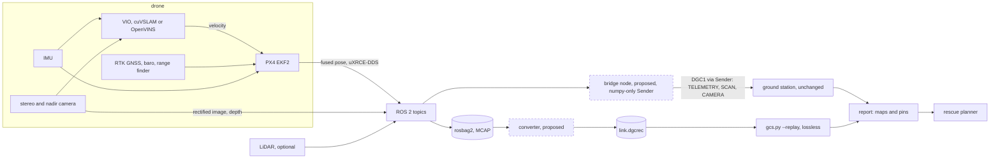

#### What the bridge must fill and convert

| Wire field | Typical ROS 2 source | What the bridge does |
|---|---|---|
| world frame | the estimator's map frame | the protocol's world is local ENU, +x east, +y north, z up, without geodetic coordinates ([PROTOCOL.md:54](https://github.com/Wavy-Hec/drone-search-rescue/blob/080ced76e42b8b7a6eb4050b4a98214992865625/gcs/PROTOCOL.md#L54)): choose an origin (the surveyed landing pad), subtract it from every position, send its latitude, longitude, altitude as MISSION `geo_origin` ([link.py:534-535](https://github.com/Wavy-Hec/drone-search-rescue/blob/080ced76e42b8b7a6eb4050b4a98214992865625/gcs/drone_gcs/link.py#L534-L535)) |
| TELEMETRY `pos`, `quat` | `nav_msgs/Odometry`, or PX4's odometry topic | wire quaternions are **(w, x, y, z)**, body FLU into world ([PROTOCOL.md:55-56](https://github.com/Wavy-Hec/drone-search-rescue/blob/080ced76e42b8b7a6eb4050b4a98214992865625/gcs/PROTOCOL.md#L55-L56)); ROS names the fields x, y, z, w, so reorder, as the Isaac adapter does ([isaac_bridge.py:142](https://github.com/Wavy-Hec/drone-search-rescue/blob/080ced76e42b8b7a6eb4050b4a98214992865625/gcs/drone_gcs/isaac_bridge.py#L142)). PX4 topics are NED and FRD ([PX4 ROS 2 guide](https://github.com/PX4/PX4-Autopilot/blob/main/docs/en/ros2/user_guide.md)): $p_\text{ENU} = A\,p_\text{NED}$ and $R_\text{ENU,FLU} = A\,R_\text{NED,FRD}\,B$, where $A$ swaps x and y and flips z, and $B = \mathrm{diag}(1, -1, -1)$ flips y and z |
| TELEMETRY `vel`, `ang_vel` | the odometry twist | a twist with `child_frame_id` = `base_link` is in the body frame ([PX4 external vision](https://github.com/PX4/PX4-Autopilot/blob/main/docs/en/ros/external_position_estimation.md)); the protocol's `vel` is world-frame ([PROTOCOL.md:156](https://github.com/Wavy-Hec/drone-search-rescue/blob/080ced76e42b8b7a6eb4050b4a98214992865625/gcs/PROTOCOL.md#L156)), and the Isaac adapter sends world rates: rotate both by $R$ |
| SCAN `points`, `origin` | `sensor_msgs/PointCloud2`, ideally the estimator's motion-corrected cloud | each point into the world with the pose at its own time; float32 N × 3, `inf` for no return ([link.py:571-596](https://github.com/Wavy-Hec/drone-search-rescue/blob/080ced76e42b8b7a6eb4050b4a98214992865625/gcs/drone_gcs/link.py#L571-L596)); ground points only, if the map should stay terrain (3.4) |
| CAMERA `rgb` | `sensor_msgs/Image` | rectified, uint8, RGB not BGR ([PROTOCOL.md:59](https://github.com/Wavy-Hec/drone-search-rescue/blob/080ced76e42b8b7a6eb4050b4a98214992865625/gcs/PROTOCOL.md#L59)) |
| CAMERA `depth` | aligned depth image | float32 metres of z-depth (as in ROS's [REP 118](https://reps.openrobotics.org/rep-0118/)), the image's size or `send_camera` refuses it ([link.py:631-637](https://github.com/Wavy-Hec/drone-search-rescue/blob/080ced76e42b8b7a6eb4050b4a98214992865625/gcs/drone_gcs/link.py#L631-L637)); 16-bit millimetre depth needs × 0.001 |
| CAMERA `K`, `pixel_center` | `sensor_msgs/CameraInfo` | intrinsics of the rectified image (in ROS, the left 3 × 3 of the projection matrix, [CameraInfo](https://github.com/ros2/common_interfaces/blob/rolling/sensor_msgs/msg/CameraInfo.msg)); OpenCV puts pixel centres at integers, and ROS calibration most likely follows it (not verified): `pixel_center = 0` ([PROTOCOL.md:58](https://github.com/Wavy-Hec/drone-search-rescue/blob/080ced76e42b8b7a6eb4050b4a98214992865625/gcs/PROTOCOL.md#L58)) |
| CAMERA `pos`, `quat` | estimator pose and extrinsics | $T_\text{world,cam}(t) = T_\text{world,body}(t)\,T_\text{body,cam}$ at the exposure time; the frame is ROS optical, x right, y down, z forward ([PROTOCOL.md:57](https://github.com/Wavy-Hec/drone-search-rescue/blob/080ced76e42b8b7a6eb4050b4a98214992865625/gcs/PROTOCOL.md#L57)) |
| `t` | `header.stamp` | seconds since mission start on the synchronised clock, the exposure time for CAMERA ([PROTOCOL.md:179](https://github.com/Wavy-Hec/drone-search-rescue/blob/080ced76e42b8b7a6eb4050b4a98214992865625/gcs/PROTOCOL.md#L179)) |
| CAMERA `frame_id` | a counter | each frame once: repeats count as extra sightings ([PROTOCOL.md:189](https://github.com/Wavy-Hec/drone-search-rescue/blob/080ced76e42b8b7a6eb4050b4a98214992865625/gcs/PROTOCOL.md#L189)) |
| MISSION | the flight plan | `area`, `resolution`, `planned_path`, `home`, `ground_z` in the same ENU frame ([link.py:487-539](https://github.com/Wavy-Hec/drone-search-rescue/blob/080ced76e42b8b7a6eb4050b4a98214992865625/gcs/drone_gcs/link.py#L487-L539)) |

The `Sender` makes the node simple: each `send_*` call checks and copies its input, returns at once and never raises; a background thread writes ([link.py:13-19](https://github.com/Wavy-Hec/drone-search-rescue/blob/080ced76e42b8b7a6eb4050b4a98214992865625/gcs/drone_gcs/link.py#L13-L19)).

#### The rosbag converter

A **rosbag** is ROS's recording; rosbag2 stores MCAP by default ([rosbag2](https://github.com/ros2/rosbag2)). The converter reads it with [rosbags](https://gitlab.com/ternaris/rosbags), a pure-Python library (Apache-2.0) that should run in the station's environment without ROS. It applies the bridge's conversions, encodes each message with `encode_frame`, which returns prefix, header and buffers ([protocol.py:213-277](https://github.com/Wavy-Hec/drone-search-rescue/blob/080ced76e42b8b7a6eb4050b4a98214992865625/gcs/drone_gcs/protocol.py#L213-L277)), and writes them with `LinkRecorder` as `DGCREC1` records: a float64 receive time, a uint32 connection id, the frame ([recording.py:4-15](https://github.com/Wavy-Hec/drone-search-rescue/blob/080ced76e42b8b7a6eb4050b4a98214992865625/gcs/drone_gcs/recording.py#L4-L15), [:61-86](https://github.com/Wavy-Hec/drone-search-rescue/blob/080ced76e42b8b7a6eb4050b4a98214992865625/gcs/drone_gcs/recording.py#L61-L86)). At `--replay-speed 0` the station waits for the detector after every frame, so a field recording gives the same report on any computer ([app.py:432-446](https://github.com/Wavy-Hec/drone-search-rescue/blob/080ced76e42b8b7a6eb4050b4a98214992865625/gcs/drone_gcs/app.py#L432-L446)). A first version needs no converter: play the bag through the bridge into a station started with `--record`.

#### Where the station runs

One CAMERA message carries 2,150,400 bytes of image and depth ([PROTOCOL.md:35-36](https://github.com/Wavy-Hec/drone-search-rescue/blob/080ced76e42b8b7a6eb4050b4a98214992865625/gcs/PROTOCOL.md#L35-L36)): with telemetry and scans, about 21.6 MB/s or 173 Mbit/s at 10 Hz (derived). `--jpeg` compresses only the colour image ([sar_mission.py:81-82](https://github.com/Wavy-Hec/drone-search-rescue/blob/080ced76e42b8b7a6eb4050b4a98214992865625/sim/scripts/sar_mission.py#L81-L82)). That is a lot for a radio link at range, so run the station on the companion computer and send down the report, record on board and replay after landing, or send every N-th frame as `sar_mission.py --camera_every` does.

### 3.6 Flying the real drone

#### Why the RL pilot should not fly first

The released policy flies at motor level: ten times a second it maps 17 numbers to four rotor thrusts, $T_i = \mathrm{clamp}(3a_i + 3, 0, 6)$ N ([survey_env_cfg.py:7-12](https://github.com/Wavy-Hec/drone-search-rescue/blob/080ced76e42b8b7a6eb4050b4a98214992865625/sim/src/drone_lab/tasks/survey/config/arl_robot_1/survey_env_cfg.py#L7-L12)).

- **The plant is the simulator's.** Mass, inertia, thrust coefficients and motor lags come from the USD model and Isaac Lab's thruster model ([HOW_IT_WORKS.md, 3.3](https://github.com/Wavy-Hec/drone-search-rescue/blob/080ced76e42b8b7a6eb4050b4a98214992865625/docs/HOW_IT_WORKS.md#33-the-released-hover-policy)). At motor level every mismatch goes straight into the attitude.
- **It never saw noise**: observation noise was off in training ([survey_env_cfg.py:124-129](https://github.com/Wavy-Hec/drone-search-rescue/blob/080ced76e42b8b7a6eb4050b4a98214992865625/sim/src/drone_lab/tasks/survey/config/arl_robot_1/survey_env_cfg.py#L124-L129)).
- **It is slow**: 10 Hz, about 0.75 s behind the carrot, topping out near 1.3 m/s ([sim/README.md:335-337](https://github.com/Wavy-Hec/drone-search-rescue/blob/080ced76e42b8b7a6eb4050b4a98214992865625/sim/README.md#L335-L337)).
- **The literature agrees.** Policies commanding collective thrust and body rates transferred more robustly than single-rotor-thrust policies ([Kaufmann et al., ICRA 2022](https://arxiv.org/abs/2202.10796)). Motor-level policies can transfer, but in [Learning to Fly in Seconds](https://arxiv.org/pdf/2311.13081) a Crazyflie flew 0 of 10 times when motor delay was left out of the simulation.

#### The carrot as a PX4 offboard setpoint

The carrot is the part that transfers. It slides along the path and waits when the drone lags ([carrot.py:3-10](https://github.com/Wavy-Hec/drone-search-rescue/blob/080ced76e42b8b7a6eb4050b4a98214992865625/sim/src/drone_lab/carrot.py#L3-L10)), and its code needs PyTorch, not Isaac Lab ([carrot.py:80-126](https://github.com/Wavy-Hec/drone-search-rescue/blob/080ced76e42b8b7a6eb4050b4a98214992865625/sim/src/drone_lab/carrot.py#L80-L126)). A companion-computer node can run it on the estimated position and send it to PX4 as an **offboard setpoint**, a target PX4's own controllers track (proposal):

1. Plan the lawnmower in local ENU with the repository's `lawnmower` ([paths.py:91-149](https://github.com/Wavy-Hec/drone-search-rescue/blob/080ced76e42b8b7a6eb4050b4a98214992865625/sim/src/drone_lab/paths.py#L91-L149)) at one absolute height (its `altitude` is a world z, not a height above ground).
2. Each cycle, advance the carrot from the EKF2 position, convert to NED, and publish a `TrajectorySetpoint` (position, with the carrot's velocity as feed-forward) plus the `OffboardControlMode` heartbeat. PX4 needs the heartbeat at 2 Hz or more and fails safe after `COM_OF_LOSS_T` ([PX4 offboard mode](https://github.com/PX4/PX4-Autopilot/blob/main/docs/en/flight_modes/offboard.md)); over ROS 2 it does not fail safe when only the setpoints stop, so the node must watch itself.
3. Keep the lead limit, which bounds how far the target runs ahead (1.0 m for the hover pilot; [commands_cfg.py:59-68](https://github.com/Wavy-Hec/drone-search-rescue/blob/080ced76e42b8b7a6eb4050b4a98214992865625/sim/src/drone_lab/tasks/survey/mdp/commands_cfg.py#L59-L68)): a cheap safety property with any controller.
4. Re-check the overlap at a new speed: at 3 m/s a ground point stays in view 2.5 s, about 25 frames at 10 Hz (derived from [HOW_IT_WORKS.md, 4.2](https://github.com/Wavy-Hec/drone-search-rescue/blob/080ced76e42b8b7a6eb4050b4a98214992865625/docs/HOW_IT_WORKS.md#42-the-flight-plan-math)).

ArduPilot ([GPL-3.0](https://github.com/ArduPilot/ardupilot)) offers the same through Guided mode, which companion computers can command ([Guided mode](https://github.com/ArduPilot/ardupilot_wiki/blob/master/copter/source/docs/ac2_guidedmode.rst)).

#### What deploying an RL pilot would take (research directions)

- **Train one level higher**: body rates and collective thrust over PX4's rate controller, which accepts `VehicleRatesSetpoint` ([offboard mode](https://github.com/PX4/PX4-Autopilot/blob/main/docs/en/flight_modes/offboard.md)). The repository's trajectory task already adds velocity and look-ahead inputs and trains with observation noise ([track_trajectory_env_cfg.py:73-75](https://github.com/Wavy-Hec/drone-search-rescue/blob/080ced76e42b8b7a6eb4050b4a98214992865625/sim/src/drone_lab/tasks/track_trajectory/config/arl_robot_1/track_trajectory_env_cfg.py#L73-L75)); no checkpoint ships yet.
- **Randomise the plant**: mass, inertia, motor constants, latency, sensor noise; then identify the real drone and fit models of the remaining gap to real data, as the champion-level racing drone Swift did ([Kaufmann et al., Nature 2023](https://pmc.ncbi.nlm.nih.gov/articles/10468397)).
- **Test in the loop**: PX4 software-in-the-loop in Isaac Sim, for example with [Pegasus Simulator](https://github.com/PegasusSimulator/PegasusSimulator) (BSD-3-Clause, latest release for Isaac Sim 5.1: check it against the repository's 6.2), then hardware-in-the-loop, a tether, and free flight with a pilot ready to take over.

### 3.7 The detector in the real world

#### The measured gap

On the VisDrone validation photos, the detector fine-tuned on simulator images found 1.6 % of 13,969 people at precision 0.059; the stock COCO model it started from found 6.7 % at 0.871 ([results.md:114-123](https://github.com/Wavy-Hec/drone-search-rescue/blob/080ced76e42b8b7a6eb4050b4a98214992865625/docs/experiments/results.md#L114-L123)). On the first 50 photos, tiled at twice their size: 11.1 % against 51.5 %. Fine-tuning made the detector nearly perfect in simulation (mAP50 0.995) and worse than its starting point on real photos ([HOW_IT_WORKS.md, 12.4](https://github.com/Wavy-Hec/drone-search-rescue/blob/080ced76e42b8b7a6eb4050b4a98214992865625/docs/HOW_IT_WORKS.md#124-people-on-real-drone-photos)). VisDrone is mostly oblique city scenes, so the absolute numbers say little about a mission; the comparison is the result: simulator-only fine-tuning cost the model its real-world knowledge of people.


#### A plan to close it

1. **Start from COCO and keep it.** Fine-tune on mixed simulator and real images; Ultralytics' dataset file takes a list of folders per split ([dataset format](https://github.com/ultralytics/ultralytics/blob/main/docs/en/datasets/detect/index.md)). Alternatives: freeze early layers (the shipped run froze none; [HOW_IT_WORKS.md, 6.4](https://github.com/Wavy-Hec/drone-search-rescue/blob/080ced76e42b8b7a6eb4050b4a98214992865625/docs/HOW_IT_WORKS.md#64-training)), or keep COCO for people and fine-tune only the simulator's other classes.
2. **Randomise the renders further.** Domain randomisation trains on deliberately varied, even unrealistic renders, so reality looks like one more variation ([Tobin et al., 2017](https://arxiv.org/abs/1703.06907v1)). The capture already varies light and ground materials ([HOW_IT_WORKS.md, 6.2](https://github.com/Wavy-Hec/drone-search-rescue/blob/080ced76e42b8b7a6eb4050b4a98214992865625/docs/HOW_IT_WORKS.md#62-rendering-the-training-images-in-isaac-sim)); clothes and rubble textures, exposure, blur and more characters come next.
3. **Add real aerial people** from the datasets below, in the YOLO format the repository writes.
4. **Add thermal** where practice uses it.

#### Real person datasets

| Dataset | What it shows | Licence |
|---|---|---|
| [HERIDAL](https://github.com/Accenture/AIR) | wilderness search and rescue in Croatia and Bosnia and Herzegovina, from 40-65 m ([Pyrrö et al. 2021](https://arxiv.org/abs/2111.09406)) | CC BY 3.0, as stated by the AIR repository |
| [NOMAD](https://github.com/ArtRuss/NOMAD) | 100 actors walking, lying, hiding; 10 visibility levels; 42,825 frames from five distances | CC BY 4.0 |
| [SeaDronesSee](https://github.com/Ben93kie/SeaDronesSee) | people in open water | dataset CC0 1.0, code MIT |
| [Semantic Drone Dataset](https://ivc.tugraz.at/research-project/semantic-drone-dataset/) | nadir views from 5-30 m with person labels, closest to the mission's view | non-commercial only |
| [HIT-UAV](https://github.com/suojiashun/HIT-UAV-Infrared-Thermal-Dataset) | thermal, 2,898 images from 60-130 m, day and night | CC BY 4.0 |
| [WiSARD](https://sites.google.com/uw.edu/wisard/) | visual and thermal wilderness SAR imagery, Washington, USA | not stated on the pages checked |
| [C2A](https://github.com/Ragib-Amin-Nihal/C2A) | synthetic: human poses pasted onto real disaster scenes (fire, flood, collapsed buildings, traffic accidents), 10,215 images | not stated on the pages checked |
| VisDrone | the set of the walk-through's 12.4 | research use, per the station's README ([gcs/README.md:594](https://github.com/Wavy-Hec/drone-search-rescue/blob/080ced76e42b8b7a6eb4050b4a98214992865625/gcs/README.md#L594)) |

None shows people in rubble, straight down, from 7.5 m. A small test set of your own, flown over volunteers or mannequins on a rubble training ground, is worth more than any of them.

#### Thermal imaging

SAR teams already fly thermal drones. A pilot study with Bay Search and Rescue concluded that thermal cameras give drones the potential to detect people automatically, and set out the limits of current systems ([Burke et al., Drones 2019](https://doaj.org/article/0c8b93d1a3464e0194a3e1a2452ca4c9)). Thermal contrast can be low, at sea for example ([Low Contrast Challenge and Limitations of Thermal Drones in Maritime Search and Rescue](https://ouci.dntb.gov.ua/works/4EjNpZ2l), Drones 2024), and rescue blankets change how a victim appears to a thermal camera ([Isser et al., SN Applied Sciences 2020](https://doaj.org/article/be2ceb8d1c014523b7241f17de6efa0a)). For the station, thermal is one more CAMERA stream, converted to the three-channel uint8 the protocol expects (proposal; the detector would need training on it).

#### How to measure it

`eval_external.py` scores people on any labelled set in YOLO format ([eval_external.py:1-30](https://github.com/Wavy-Hec/drone-search-rescue/blob/080ced76e42b8b7a6eb4050b4a98214992865625/gcs/scripts/eval_external.py#L1-L30)). `--scale` makes people as large as in the mission camera, the dataset's centimetres per pixel over the mission's 1.54 ([eval_external.py:112-118](https://github.com/Wavy-Hec/drone-search-rescue/blob/080ced76e42b8b7a6eb4050b4a98214992865625/gcs/scripts/eval_external.py#L112-L118)), and tiling cuts images into the camera's 640 × 480 frames ([external_eval.py:73-94](https://github.com/Wavy-Hec/drone-search-rescue/blob/080ced76e42b8b7a6eb4050b4a98214992865625/gcs/drone_gcs/external_eval.py#L73-L94)). Report recall and precision by label size, as the walk-through's 12.4 does. For SAR a box roughly covering a group may matter more than a tight box per person; the AIR detector's evaluation scheme for this task is an option ([AIR](https://github.com/Accenture/AIR), Apache-2.0). The end-to-end measure remains the scorecard of a field flight over surveyed targets.

### 3.8 The ground robot in the real world

#### One map frame for drone and robot

The planner works in the drone's map frame, and the robot must know its place there to a fraction of the 0.45 m inflation. Three ways, best combined:

| Method | How | Strength | Weakness |
|---|---|---|---|
| Shared RTK frame | both carry RTK receivers on one base station; the map origin is surveyed and sent as `geo_origin` | absolute, simple | no RTK next to walls; heading still needed |
| Map registration | the robot builds its own elevation map, with [elevation_mapping_cupy](https://github.com/leggedrobotics/elevation_mapping_cupy) for example, and aligns it with the drone's by ICP ([small_gicp](https://github.com/koide3/small_gicp), MIT), from an outlier-robust initial guess ([TEASER++](https://github.com/MIT-SPARK/TEASER-plusplus), MIT) | uses the terrain itself | needs structure in view |
| Fiducial at the pad | an [AprilTag](https://github.com/AprilRobotics/apriltag) (BSD-2-Clause) on the landing pad, which the drone maps and the robot starts on | a known start pose | only at the start |

The pad is already a detector class ([assets.py:31-35](https://github.com/Wavy-Hec/drone-search-rescue/blob/080ced76e42b8b7a6eb4050b4a98214992865625/sim/src/drone_lab/sar/assets.py#L31-L35)), so its pin gives the start in the drone's map.

#### Walking and re-planning on board

The finale's walking policy should not walk on a real robot either. Its 187-ray height scan is cast against the simulator's terrain mesh ([test_teaming_task.py:93](https://github.com/Wavy-Hec/drone-search-rescue/blob/080ced76e42b8b7a6eb4050b4a98214992865625/sim/tests/test_teaming_task.py#L93)), it walks on its calves because a collision-mesh artefact keeps its feet off the ground ([PORT_NOTES.md:283-296](https://github.com/Wavy-Hec/drone-search-rescue/blob/080ced76e42b8b7a6eb4050b4a98214992865625/quadruped/PORT_NOTES.md#L283-L296)), and it falls in 18.9 % of play-mode episodes ([quadruped/README.md:31-34](https://github.com/Wavy-Hec/drone-search-rescue/blob/080ced76e42b8b7a6eb4050b4a98214992865625/quadruped/README.md#L31-L34)). Use the robot maker's controller instead and send it the pure-pursuit follower's $(v_x, v_y, \omega)$: Unitree's SDK, for example, has a velocity mode in its sport-mode example ([unitree_sdk2_python](https://github.com/unitreerobotics/unitree_sdk2_python), BSD-3-Clause), and the Go2 carries a 360° × 90° LiDAR ([Unitree Go2](https://www.unitree.com/go2/)). Learned policies reading an onboard height map do work on hardware: ANYmal's completed an hour-long hike in the Alps ([Miki et al., Science Robotics 2022](https://arxiv.org/abs/2201.08117)), and the repository's experimental depth-camera task points that way ([quadruped/README.md:47](https://github.com/Wavy-Hec/drone-search-rescue/blob/080ced76e42b8b7a6eb4050b4a98214992865625/quadruped/README.md#L47)).

The drone's map is a prior, not the truth. The robot should re-plan as its own sensors see what the drone missed, for example with [Nav2](https://github.com/ros-navigation/navigation2) on a costmap from its own elevation map or Nvblox. The repository's A* plans in seconds on a CPU ([sim/README.md:224](https://github.com/Wavy-Hec/drone-search-rescue/blob/080ced76e42b8b7a6eb4050b4a98214992865625/sim/README.md#L224)), so re-planning on a merged map every few metres is affordable.

#### What the planner can take from a real report

An unchanged station's report holds what the planner reads: `maps/elevation_mean.npy`, `maps/grid.json`, `detections.json` with the confirmed pins, and `maps/surface_max.npy` ([HOW_IT_WORKS.md, 10.1](https://github.com/Wavy-Hec/drone-search-rescue/blob/080ced76e42b8b7a6eb4050b4a98214992865625/docs/HOW_IT_WORKS.md#101-inputs-from-a-ground-station-report)). Three defaults assume the simulated site (overrides untested on a real report):

- **Start.** Without `--start X Y` the planner builds the simulated site from its seed and starts at its landing pad ([rescue_finale.py:406-436](https://github.com/Wavy-Hec/drone-search-rescue/blob/080ced76e42b8b7a6eb4050b4a98214992865625/sim/scripts/rescue_finale.py#L406-L436)). Pass the robot's real position, and `--plain_terrain` so that no simulated site is built.
- **Apron.** By default the planner adds the simulated site's flat border at z = 0 around a drone map ([rescue_finale.py:437-451](https://github.com/Wavy-Hec/drone-search-rescue/blob/080ced76e42b8b7a6eb4050b4a98214992865625/sim/scripts/rescue_finale.py#L437-L451)); pass `--no_apron`.
- **Thresholds.** `--obstacle_height` (0.2 m) must sit above the surface map's real noise (3.4), and the slope, step and roughness limits must be the real robot's ([robots.py:60-93](https://github.com/Wavy-Hec/drone-search-rescue/blob/080ced76e42b8b7a6eb4050b4a98214992865625/sim/src/drone_lab/teaming/robots.py#L60-L93)).

The lying-or-standing guess transfers: a person pin under 0.7 m above the local ground counts as lying ([inputs.py:253-283](https://github.com/Wavy-Hec/drone-search-rescue/blob/080ced76e42b8b7a6eb4050b4a98214992865625/sim/src/drone_lab/teaming/inputs.py#L253-L283)), which needs pins on the visible top of the body, as depth gives.

### 3.9 Roadmap from simulation to field tests

Each step has a measurable outcome and a pass criterion (proposals).

| Step | What | Measurable outcome | Pass when |
|---|---|---|---|
| 0. CPU baseline (done) | the stand-in sweeps (walk-through 12.2) | pin error against drift, attitude, depth noise, lag | done: table of 3.2 |
| 1. SLAM in the loop in Isaac Sim | add a stereo pair and an IMU to the SAR task (Isaac Lab has an [IMU sensor](https://github.com/isaac-sim/IsaacLab/tree/main/source/isaaclab/isaaclab/sensors)); publish through Isaac Sim's [ROS 2 bridge](https://github.com/isaac-sim/IsaacSim/blob/main/source/extensions/isaacsim.ros2.bridge/docs/Overview.md) or record; run cuVSLAM or OpenVINS; replace the true pose in TELEMETRY and CAMERA by the estimate and shift SCAN points by the difference, as `NoiseInjector` moves poses ([noise.py:103-107](https://github.com/Wavy-Hec/drone-search-rescue/blob/080ced76e42b8b7a6eb4050b4a98214992865625/gcs/drone_gcs/noise.py#L103-L107), [:194-208](https://github.com/Wavy-Hec/drone-search-rescue/blob/080ced76e42b8b7a6eb4050b4a98214992865625/gcs/drone_gcs/noise.py#L194-L208)) | trajectory error against `trajectory.csv` (evo) and the replay's scorecard: the real version of the noise sweeps | pin error under 0.3 m, no duplicates, 10 of 10 people |
| 2. Bridge on simulated topics | drive the bridge from Isaac Sim's ROS 2 topics with true poses | its recording against a direct `IsaacLabStreamer` recording | same pins and maps: frames, quaternions, units and $K$ are right |
| 3. Rosbag replays | bags from the real sensor rig, converted and replayed | end-to-end run on real data; mosaic seams; time offsets | no doubled objects; no repeated `frame_id` |
| 4. Handheld or pole-mounted rig | carry the rig over mannequins surveyed by RTK | pin error and false alarms against the survey | inside the budget of 3.2 |
| 5. Tethered or low flights | the PX4 offboard carrot (3.6) | tracking error, setpoint timing, failsafes | stable tracking, failsafes tested |
| 6. Survey flights with RTK ground truth | the full lawnmower about 7.5 m above ground | full scorecard against surveyed targets and a reference terrain model | enough targets for a narrow Wilson interval (walk-through 12.3: 15 of 15 still admits 79.6 %) |
| 7. Air-ground trial | the robot plans on the report and walks to a mannequin | stop distance, success rate, interventions | stops beside the right target with clearance |

Two cautions for step 1, neither tried. The drone's physics runs at 100 Hz ([survey_env_cfg.py:199](https://github.com/Wavy-Hec/drone-search-rescue/blob/080ced76e42b8b7a6eb4050b4a98214992865625/sim/src/drone_lab/tasks/survey/config/arl_robot_1/survey_env_cfg.py#L199)), so a simulated IMU gives at most 100 samples per second, while NVIDIA suggests 200-300 Hz IMU and 30 or 60 frames per second of stereo for cuVSLAM ([cuVSLAM docs](https://docs.nvidia.com/isaac/doc/extensions/vslam/doc/cuvslam.html)): shorten the physics step or check that the estimator copes. And the camera renders once per 0.1 s step ([sar_env_cfg.py:74-75](https://github.com/Wavy-Hec/drone-search-rescue/blob/080ced76e42b8b7a6eb4050b4a98214992865625/sim/src/drone_lab/tasks/sar/config/arl_robot_1/sar_env_cfg.py#L74-L75)), a step with its render already taking 45 ms headless ([gcs/README.md:673](https://github.com/Wavy-Hec/drone-search-rescue/blob/080ced76e42b8b7a6eb4050b4a98214992865625/gcs/README.md#L673)); a stereo pair at three times the rate will slow the simulation.


### 3.10 Research questions worth a paper

Suggestions, each with the experiment that would answer it.

1. **How much real data closes the detector gap?** Fine-tune from COCO on the simulator set plus 0, 50, 200 and 1,000 real nadir images; score each with `eval_external.py` on held-out real nadir images and on the simulator's validation set. An early plateau would show that simulation does most of the work.
2. **How does state-estimation drift propagate to rescue success?** Sweep drift in replay (`--noise`) or swap estimators (step 1), then plan and walk the finale on each report with the 32-robot setup. Measure pin error, duplicates, stop distance to the true person and clearance: a tolerance curve from estimator error to air-ground success.
3. **Which estimator is good enough per gram and watt?** RTK only, VIO only, VIO with RTK, LIO, on the same bags and station: pin error and duplicates per kilometre.
4. **Which statistic should the surface map keep?** Inject depth noise; compare the maximum with percentiles and per-frame medians by false no-go cells and route length against the ground truth.
5. **Is Gauss-Markov drift a good proxy for real estimator error?** Compare replays with real estimator poses against `--noise` replays of equal RMS error. If they agree, cheap sweeps can stand in for flights.
6. **Thermal and RGB for people under canopy or at night.** Train on WiSARD and HIT-UAV, with and without simulated thermal frames (the repository's drone has no thermal camera), and measure recall by NOMAD's visibility levels.
7. **What survey height is best?** Lower means bigger people and better recall (the walk-through's 12.4 measures recall by size) but narrower swaths and longer missions; model it with the overlap formulas of the walk-through's section 4.2 and test in Isaac Sim.
8. **Does a higher-level RL pilot transfer?** Train the trajectory task at body-rate level, fly the survey in software-in-the-loop with PX4, and compare tracking error and energy with PX4's controllers.

### 3.11 Risks, safety and regulation

> [!warning] Safety first
> - **Flight.** Geofence the site, keep a pilot with manual override, test the offboard-loss failsafe on the ground, and stop the offboard node when the estimator reports poor quality.
> - **People.** This mission flies over people, a case most rulebooks restrict. Volunteers need consent, and images of identifiable people need the data-protection care your institution requires.
> - **The robot near a person.** The footprint protects the person only while the pin error stays under about 0.3 m (3.2). A field robot needs an emergency stop, a speed limit and its own obstacle detection.

**Regulation, in brief.** In the EU the "open" category allows flights in visual line of sight below 120 m (subcategories A1-A3); beyond that, for instance beyond visual line of sight, the "specific" category needs an operational authorisation based on a risk assessment, usually SORA, or a declared standard scenario ([EASA FAQ](https://www.easa.europa.eu/en/the-agency/faqs/open-category)). In the US, Part 107 governs small drones and flights beyond visual line of sight need a waiver; the Part 108 rule for them was still under final review at the White House in mid-September 2026, according to trade press ([UAV Coach](https://uavcoach.com/part-108-stuck/)). Check with your national authority and your university's flight-safety office before the first field test.

#### Open questions

- Which time synchronisation does the hardware allow: a camera trigger into the flight controller, PTP over Ethernet, or only software stamps?
- Does the detector's box centre fall on the person's centre in real images as in renders? The budget's 0.04 m floor is a simulator number.
- Is there a labelled nadir dataset of people in rubble with a permissive licence? None was found.
- How should a moving person be tracked? The tracker assumes static objects.
- Can the station keep up on a Jetson next to the estimator? Not measured.

### 3.12 Questions an advisor might ask

> [!question]- Why not fly the RL policy you already have?
> It commands rotor thrusts at 10 Hz from 17 inputs ([survey_env_cfg.py:7-12](https://github.com/Wavy-Hec/drone-search-rescue/blob/080ced76e42b8b7a6eb4050b4a98214992865625/sim/src/drone_lab/tasks/survey/config/arl_robot_1/survey_env_cfg.py#L7-L12)), trained without noise on the simulator's airframe. Thrust-level policies transfer worse than body-rate ones ([Kaufmann et al., ICRA 2022](https://arxiv.org/abs/2202.10796)) and failed every real flight when the motor delay was left out of the simulation ([Eschmann et al.](https://arxiv.org/pdf/2311.13081)). The carrot transfers; the network does not. Fly the carrot as a PX4 setpoint (3.6).

> [!question]- If RTK gives centimetre positions, why do you need SLAM?
> For smoothness, for GNSS dropouts next to walls, and as the pose source where the sky is blocked. RTK does not fix the budget's other lines: 0.13 m per degree of tilt, up to 0.09 m per degree of yaw, 0.03 m per 20 ms of timing error.

> [!question]- Your pins were 4 cm off in simulation. What will they be in the field?
> The 4 cm measures the geometry with a perfect pose ([gcs/README.md:645](https://github.com/Wavy-Hec/drone-search-rescue/blob/080ced76e42b8b7a6eb4050b4a98214992865625/gcs/README.md#L645)). With a real pose the pin error follows the position error one to one, plus about 0.15 m per degree of attitude at 9.8 m (walk-through 12.2). The proposed budget predicts about 0.26 m: a prediction to test, not a result.

> [!question]- Why is depth noise harmless for pins but dangerous for the surface map?
> Pins take the median depth over a window and average many frames, which removes independent pixel noise ([mapping.py:452-467](https://github.com/Wavy-Hec/drone-search-rescue/blob/080ced76e42b8b7a6eb4050b4a98214992865625/gcs/drone_gcs/mapping.py#L452-L467)). The surface map keeps the maximum of about 1,000 samples per cell, about 3.2 standard deviations above the truth (derived), which crosses the planner's 0.2 m threshold at the illustrative 0.24 m stereo noise (3.4).

> [!question]- What must change in the ground station for real data?
> Nothing in principle: a bridge fills the same DGC1 fields. In practice three things should follow the first tests: ground segmentation before SCAN, a robust statistic for the surface map, and a decision on where the station runs, since raw frames need about 173 Mbit/s.

> [!question]- How do you know your field ground truth beats your estimate?
> Survey targets and control points with RTK independently of the drone, and judge the trajectory against a reference the estimator never saw: a second receiver post-processed with RTKLIB, or control points visible in the images.

> [!question]- How does the robot know where it is on the drone's map?
> A shared RTK frame anchored by `geo_origin`, registration of its own elevation map to the drone's, and an AprilTag on the pad for the start (3.8). Then `--start`, `--no_apron` and `--plain_terrain` stop the planner assuming the simulated site.

> [!question]- How will you close the detector gap, and how will you know?
> Fine-tune from COCO on mixed simulator and real images, randomise renders further, and score each variant with `eval_external.py` at the mission's scale on held-out real nadir images, by label size. VisDrone shows that simulator-only fine-tuning must not be the plan (3.7).

> [!question]- What is the single biggest risk?
> Time stamps. A pose paired with the wrong frame looks like drift: misplaced pins first, duplicates later. It is also cheapest to fix early, with a camera trigger, one clock and Kalibr's time-offset calibration.

> [!question]- Can five missions with every person found show that the system works?
> No. Fifteen of fifteen still has a 95 % Wilson interval reaching down to 79.6 % ([HOW_IT_WORKS.md, 12.3](https://github.com/Wavy-Hec/drone-search-rescue/blob/080ced76e42b8b7a6eb4050b4a98214992865625/docs/HOW_IT_WORKS.md#123-the-stand-in-benchmark-five-worlds)). A field claim needs more missions or more targets per flight.
