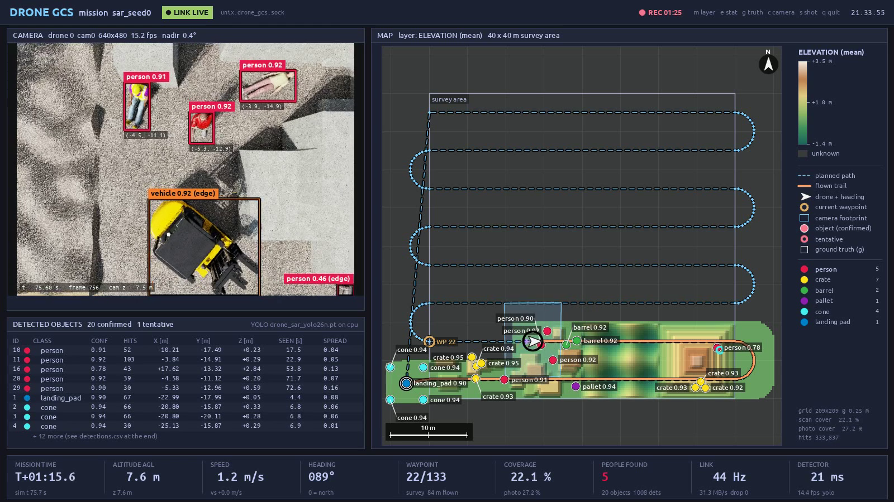
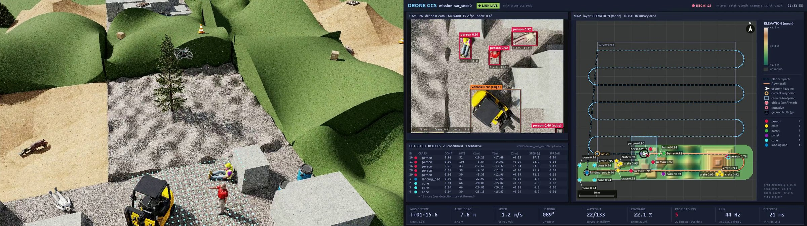
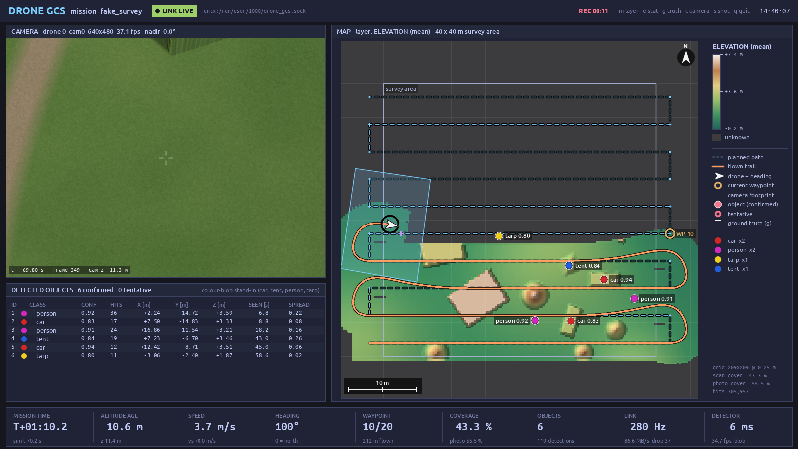
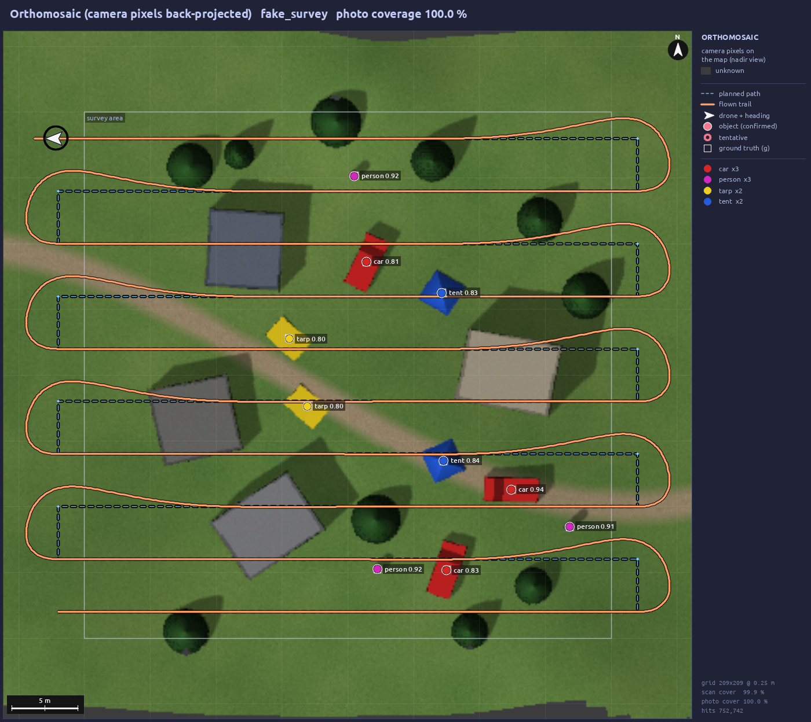

# drone_gcs: ground control station for the simulated drone survey

The simulator flies the drone. **drone_gcs** is the ground-control station and companion computer for it.
It receives the drone's telemetry, mapping ray hits and camera frames over a local socket, and **builds the map
live while the drone uncovers the area**. Unknown ground stays as dark-grey fog until a sensor has seen it. It
also runs object detection (YOLO) on the camera feed, places each detection on the map in world coordinates,
merges repeated sightings into an object list, shows everything in a ground-control style dashboard
(recorded to mp4) and writes a mission report with a scorecard: people found, false alarms, pin error, map
height error, coverage, flight time and closest approach to obstacles.

The drone is either the search-and-rescue mission of the sibling project `drone_lab` (Isaac Sim 6.2 / Isaac Lab
3.0: an RL-flown quadrotor over a disaster site with people, a forklift, crates, barrels, pallets and cones) or a
CPU stand-in (`scripts/fake_drone.py`) for development and tests.



*75 s into the Isaac Sim mission: the fine-tuned detector's boxes on the drone camera (three people, sitting,
pointing and lying, and the forklift; "edge" boxes touch the image border and are not mapped), the elevation map
uncovered so far (grey = not scanned yet) with the flown trail, the planned path, the camera footprint and the
pins, and the HUD with five people found.*

## Live demo: the search-and-rescue mission in Isaac Sim

Two terminals. Start the ground station first (it waits for the drone; either side may start first):

```bash
# terminal 1: ground station (window + recording), conda env 'vision'
source ~/anaconda3/etc/profile.d/conda.sh && conda activate vision
cd ~/isaac_ws/projects/drone_gcs
python scripts/gcs.py --name sar_live

# terminal 2: the mission in Isaac Sim, with a window that follows the drone, conda env 'env_isaaclab'
source ~/anaconda3/etc/profile.d/conda.sh && conda activate env_isaaclab
cd ~/isaac_ws/projects/drone_lab
python scripts/sar_mission.py --viz kit --video --out sar_live --checkpoint \
    ~/isaac_ws/IsaacLab/logs/rsl_rl/arl_robot_1_track_position_state_based/2026-11-01_14-45-20_demo_drone_track/exported/policy.pt

# afterwards, terminal 1: the demo video, both recordings side by side and in step
python scripts/compose_video.py --gcs runs/sar_live --sim ~/isaac_ws/projects/drone_lab/runs/sar_live
```



*Frame of the demo video, 75 s into the mission: the Isaac Sim window (a follow camera over the drone, its
mapping rays glowing on the ground) and the ground station, whose detector has just boxed three people and the
forklift and pinned five people so far.*

The drone takes off from its landing pad, flies a lawnmower over the 40 × 40 m site (8 lines, 5 m apart, 7.5 m
up), comes back and lands on the pad: about 6 minutes of flight. The flight plan and its camera-overlap math are
in drone_lab (`src/drone_lab/sar/mission.py`). The ground station uses the YOLO26n fine-tuned on simulator images
(`~/isaac_ws/assets/models/drone_sar_yolo26n.pt`) when it exists, otherwise the stock COCO model; `--weights`
picks another one. From the touchdown on, the camera panel shows a LANDED card instead of the camera (a hand's
width above the pad it sees only noise): how far from the centre of the pad the drone landed, when, and how far it
flew. After the landing the window shows MISSION END and stays open; `q` (or closing it) writes the report to
`runs/sar_live/` (`report.md` first); `--exit-on-end` does that by itself a few seconds after the landing.

**The demo video.** The two sides record on their own clocks: the simulator one frame per 0.1 s step
(`mission.mp4`), the ground station its dashboard in wall-clock time (`dashboard.mp4`); each writes the sim time
of every frame next to its video (`mission_frames.csv`, `dashboard_frames.csv`). `scripts/compose_video.py` puts
them side by side on the simulator's clock: next to every simulator frame it shows the newest dashboard frame of
that moment or an earlier one, and after the touchdown the dashboard plays on for 4 s (MISSION END). `--speed 3`
makes a 2-minute version with every frame kept (30 frames/s), `--layout stack` puts the two views on top of each
other, `--crf` trades size for quality (the default 28 gives about 660 MB for the 6-minute mission at
3200 × 900; text stays sharp).

* Two monitors: `gcs.py --window-pos X Y` and `sar_mission.py --window_pos X Y` place the two windows. The
  Isaac Sim window shows only its viewport (`--kit_ui` brings back the menus and panels); on this GNOME desktop
  it takes the size of the monitor it opens on, whatever size it asks for.

* Without windows (record only; both sides exit at the end and the report is written right away):
  `python scripts/gcs.py --headless` and `python scripts/sar_mission.py --checkpoint ...` (headless is the
  default there).
* `sar_mission.py --max_time 90` flies the first 90 s only; `--seed 3` another site; `--video` records the
  Isaac Sim view to `drone_lab/runs/<out>/mission.mp4`; `--gt_boxes` adds the simulator's own object boxes to
  every frame, and `gcs.py --detector gt` maps those instead of running YOLO (a check of the geometry with
  perfect detections).
* The link carries 2.15 MB per camera frame (640 × 480 RGB + depth, raw), about 22 MB per second of flight;
  that is 20-45 MB/s on the UNIX socket depending on how fast the simulation runs. `--jpeg` sends the images
  as JPEG instead.

## Architecture

```
  SIMULATOR (env_isaaclab: Isaac Sim 6.2 / Isaac Lab 3.0,              GCS (conda env 'vision': numpy, OpenCV,
  drone_lab/scripts/sar_mission.py; or scripts/fake_drone.py)           Ultralytics) - scripts/gcs.py
 +-----------------------------------------+                         +--------------------------------------------+
 | RL flight policy -> multirotor physics   |                         | Receiver (reader threads, decode frames)    |
 | downward RayCaster (mapping grid)        |  drone_gcs.link.Sender  |   |                                         |
 | RGB(+depth) camera                       |  ---------------------> |   v                                         |
 |                                          |  UNIX socket            | GCSState --> ElevationMap (2.5D, running    |
 | Sender: send_mission / send_telemetry /  |  /run/user/1000/        |   |          stats, fog-of-war mask)         |
 |   send_scan / send_camera / send_end     |  drone_gcs.sock         |   |      --> Orthomosaic (pixels -> world)    |
 |   (stdlib + numpy only; non-blocking:    |  (or tcp://host:47800)  |   |      --> DetectorWorker (YOLO, thread)    |
 |   bounded queue, drops oldest frames,    |                         |   |           -> Geolocator -> ObjectTracker  |
 |   auto-reconnect, never raises)          |  length-prefixed frames |   v                                         |
 +-----------------------------------------+  JSON header + raw LE   | Dashboard (cv2 window 12 FPS + mp4)         |
                                              buffers (PROTOCOL.md)  | Report: maps, detections, trajectory, summary|
                                                                     +--------------------------------------------+
```

* **Link** (`drone_gcs/link.py`, `drone_gcs/protocol.py`): MISSION, TELEMETRY, SCAN, CAMERA, END and, for
  the evaluation only, GT_OBJECTS and GT_TERRAIN messages. No pickle: dtype and shape travel in a JSON header,
  so the two ends can run different numpy versions (env_isaaclab has 2.3, vision has 2.5; a test checks this).
  Frames, units and conventions are in [PROTOCOL.md](PROTOCOL.md).
* **Mapping** (`drone_gcs/mapping.py`, numpy only):
  * elevation map: per-cell count, mean, min, max, std and coverage mask
  * orthomosaic: camera pixels back-projected with depth, or with the elevation map when there is no depth
  * detection geolocation: box → pixel → ray → depth or map intersection
  * tracker: same class within a radius means the same object (2 m; person 1.5 m, vehicle 3 m, crates, barrels
    and cones 0.8 m, pallets 1 m), with confidence, hits, first/last seen
  * evaluation against ground truth: precision / recall / pin error, map height error
* **Detector** (`drone_gcs/detector.py`):
  * Ultralytics YOLO on the CPU; default weights: `$DRONE_GCS_WEIGHTS`, else the fine-tuned
    `~/isaac_ws/assets/models/drone_sar_yolo26n.pt` when it exists, else the stock COCO `yolo26n.pt` next to it
  * `--detector gt`: the boxes the simulator sends with each frame (instance segmentation), no model
  * a colour-blob stand-in for the fake world
  * a worker thread that always runs the newest frame, so the UI never waits on the detector
* **Dashboard** (`drone_gcs/dashboard.py`): OpenCV canvas 1600×900 (Tokyo Night colours), window plus mp4.
  `--headless` only records.
* **Report** (`drone_gcs/report.py`): written at END or on quit: `report.md` (scorecard, maps, finds), maps,
  detections, trajectory, summary.

## Run the demo (fake drone, no Isaac Sim)



*Mid-mission with the fake drone: coloured stand-in objects, the colour-blob detector, the same map and HUD.*

Two terminals, both `conda activate vision`, in `~/isaac_ws/projects/drone_gcs`:

```bash
python scripts/gcs.py --detector blob --name my_demo   # 1) the GCS window (waits for the sim)
python scripts/fake_drone.py --speedup 4                # 2) the stand-in simulator (3 min survey at 1x)
```

The fake drone flies a lawnmower survey over a synthetic 40 × 40 m world: hills, buildings, trees, a dirt
road, and 10 objects (car = red, tent = blue, person = magenta, tarp = yellow). It sends 20 Hz telemetry,
10 Hz scans from a 5 × 5 m grid of downward rays at 0.25 m spacing (like Isaac Lab's `RayCaster` +
`GridPatternCfg`), 5 Hz camera frames (640×480, 75° FOV, RGB + depth, rendered from the height field) and
the ground-truth objects. COCO YOLO does not know these coloured shapes, so use `--detector blob` with the
fake drone. With the default `--detector yolo` you get false positives such as "sports ball" for round trees.

* Headless, record only, exits after END: `python scripts/gcs.py --headless --detector blob`
* Other fake drone options: `--no-depth` (the GCS then intersects rays with its own map), `--jpeg`,
  `--mount fixed` (camera tilts with the drone), `--area 60 40`, `--spacing 6`, `--speed 5`, `--seed 1`.
  See `--help`.
* Either side can start first. The link reconnects, and MISSION (and GT_OBJECTS) are re-sent on every
  reconnect. A GCS restarted **mid-mission** starts a new, empty map for that mission: earlier data is not
  replayed (only what was still queued on the sim side while no GCS was listening).

### Keys

| key | action |
|---|---|
| `m` | map layer: **elevation** → **photo** (orthomosaic) → **coverage** (ray hits per cell / photo-only) |
| `e` | elevation statistic: mean ↔ max |
| `g` | show the ground-truth objects (evaluation only; hollow squares) |
| `c` | camera of the next drone (with several drones) |
| `s` | screenshot of the canvas → `runs/<name>/screenshots/` |
| `q` / `Esc` | quit (writes the report). Closing the window does the same |

Arrow keys and other non-character keys are ignored. (With OpenCV's Qt backend they arrive as X key codes
whose low byte is a letter: Left used to read as `q` and quit, Right as `s`.)

HUD (bottom bar):

| Cell | Shows |
|---|---|
| Mission time | sim time since the mission started |
| Altitude AGL | height above the mapped ground under the drone |
| Speed | horizontal and vertical speed |
| Heading | 0° = north = +Y |
| Waypoint | waypoint i/N, mission phase (take-off, survey, landing, ...) and distance flown |
| Coverage | scan % and photo %, inside the survey area |
| People found | confirmed people (red once there is one), all confirmed objects and raw detections |
| Link | message rate, MB/s, inbound frames dropped; after the mission's END, the data received |
| Detector | detector ms and fps |

## Connecting a simulator

`drone_lab/scripts/sar_mission.py` is the complete example. The sender only needs the standard library and
numpy, so it imports inside Isaac Sim's Python:

```python
import os, sys

sys.path.insert(0, os.path.expanduser("~/isaac_ws/projects/drone_gcs"))  # or: pip install --no-deps -e <this repo>
from drone_gcs.link import Sender
from drone_gcs.isaac_bridge import IsaacLabStreamer  # duck-typed Isaac Lab 3.0 adapter

stream = IsaacLabStreamer(Sender(name="isaac-survey"), env_id=0)  # default unix:/run/user/1000/drone_gcs.sock
stream.mission(
    area=(-20, 20, -20, 20), resolution=0.25, planned_path=path_xyz, survey_altitude=8.0, name="survey_lawnmower"
)  # local frame; world=True subtracts origin
stream.gt_objects([{"class": "person", "pos": [x, y, z]}, ...])  # optional, evaluation only (after mission)
stream.gt_terrain(heights, x_min, y_min, 0.25)  # optional, evaluation only: true terrain for the map error
for step in range(n_steps):
    obs, *_ = env.step(policy(obs))
    t = step * env.unwrapped.step_dt
    stream.telemetry(t, robot, wp_index=k, carrot=carrot_xyz)  # robot = env.unwrapped.scene["robot"]
    stream.scan(t, scanner)  # scene["mapping_scanner"] (RayCaster)
    stream.camera(t, camera)  # scene["camera"]: rgb + distance_to_image_plane; sends new captures only
stream.end("complete")
```

`stream.camera()` sends a frame only when Isaac Lab's capture counter (`camera.frame`) has advanced, so it
can be called every step whatever the camera's `update_period` (it returns `False` otherwise). Under OVRTX
`async_rendering` it takes the image's pose from `camera.data.info["rgb"]["capture"]`.
`IsaacLabStreamer(origin=env.scene.env_origins[i])` subtracts the env origin from everything it reads from
Isaac Lab; positions you pass to `mission()` / `gt_objects()` are local unless you add `world=True`.

Or call the `Sender` methods directly with numpy arrays, CPU or GPU torch tensors, or Isaac Lab `ProxyArray`s:
`send_telemetry(t, pos, quat_wxyz, vel, wp_index=, carrot=)`, `send_scan(t, points_Nx3, origin=)`,
`send_camera(t, rgb, K, pos, quat_wxyz_ros, depth=, jpeg=False)`, `send_gt_objects([...])`,
`send_gt_terrain(heights, x_min, y_min, resolution)`, `send_end()`.

* Every `send_*` call copies its data (arrays and extra keyword fields) and returns at once. It **never
  raises**: it returns `False` and logs instead. A background thread does the I/O, in call order. When the GCS
  is slow or absent, the oldest camera frames are dropped.
* Each data message and END carries the current `mission_id`; the GCS ignores ones from another mission. With
  several drones, use one `mission_id` for all of them (END from any drone ends the mission).
* **Quaternions are (w, x, y, z) on the wire. Isaac Lab 3.0 gives (x, y, z, w).**
  `drone_gcs.geometry.quat_xyzw_to_wxyz` converts. The camera orientation is the **ROS optical** frame
  (`camera.data.quat_w_ros`). PROTOCOL.md has the conversion from `quat_w_world` and `quat_w_opengl` too.
* Ray-caster misses (`inf`) can be sent as they are.
* TCP instead of the UNIX socket (for example from a container): `Sender("tcp://127.0.0.1:47800")` with
  `python scripts/gcs.py --addr tcp://0.0.0.0:47800`, or set `DRONE_GCS_ADDR` on both sides.
* Import check (it passes, see the tests):
  `conda activate env_isaaclab && python -c "import os, sys; sys.path.insert(0, os.path.expanduser('~/isaac_ws/projects/drone_gcs')); from drone_gcs.link import Sender"`.
  `pip install --no-deps -e .` also works (base dependency: numpy only). It was **not** done, to leave
  env_isaaclab untouched.

## Outputs: `runs/<name>/`

| file | content |
|---|---|
| `report.md` | the mission report: scorecard, photo and elevation maps with the flight path and the pins, list of finds with coordinates and their ground-truth match |
| `dashboard.mp4` | the exact dashboard canvas at the dashboard rate. OpenCV writes it (mp4v), then system ffmpeg re-encodes it to H.264 so it plays in browsers and Obsidian (`--no-transcode` keeps mp4v) |
| `dashboard_frames.csv` | the sim time shown in every frame of `dashboard.mp4` (empty before the first message) |
| `demo.mp4` | written by `scripts/compose_video.py`: the simulator's view and the dashboard side by side, in step |
| `final_map_elevation.png`, `final_map_photo.png`, `coverage.png` | final maps, each with the flown trajectory, planned path, detections and (if known) ground truth |
| `maps/` | raw arrays: `elevation_{mean,max,min}.npy`, `hit_count.npy`, `photo_rgb.png`, `photo_filled.npy`, `grid.json`. Arrays are (ny, nx), row 0 = south |
| `detections.csv` / `.json` | objects: class, x, y, z (world / local ENU, m), confidence (mean, max), hits, first/last seen, spread, confirmed. Also the matched ground-truth id and error when GT_OBJECTS was sent |
| `trajectory.csv` | t, position, quaternion (wxyz), velocity, waypoint index, carrot, AGL |
| `coverage_timeline.csv` | scan and photo coverage vs sim time |
| `summary.json` | `scorecard` (people found x / y in the survey area and, apart, the people outside it, false alarms, pin error, map height error, coverage, flight time, closest approach), area, path length, speeds, detection counts, precision / recall / localization error per class, map error vs the true terrain (all cells and away from steps), the drone's END statistics, link and detector statistics |
| `screenshots/` | `s` key or `--screenshot-at` |

`runs/` is git-ignored. Final maps of the 40 × 40 m fake survey (`runs/demo_headless`, copied to `docs/images/`):

| elevation | orthomosaic | coverage |
|---|---|---|
|  |  |  |

## Detection and fine-tuning on simulator images

* Weights: `--weights <file.pt>`; by default `$DRONE_GCS_WEIGHTS`, else the YOLO26n fine-tuned on simulator
  images (`~/isaac_ws/assets/models/drone_sar_yolo26n.pt`: person, vehicle, crate, barrel, pallet, cone,
  landing_pad) when it exists, else the stock COCO model (`yolo26n.pt`, same folder). Defaults
  `--conf 0.25 --iou 0.45 --imgsz 640 --device cpu`. YOLO runs on the **CPU** by default (about 19 ms per 640×480 frame, plenty for a 5–10 Hz camera): the GPU
  belongs to Isaac Sim and the RL jobs. `--device cuda:0` opts in; `--device auto` uses the GPU only when
  `nvidia-smi` shows at least 2 GiB free on it.
* `--classes person,car` keeps only those classes; a name matches the model's class name or the name after
  `--class-map` (`--classes car --class-map truck=car` keeps cars and trucks). A name the model does not
  have is an error if nothing would be left, else a warning. `--class-map truck=car,bench=` renames or drops
  classes.
* The GCS process sets `YOLO_OFFLINE=1` (no update checks or analytics from the GCS). The env-local
  `YOLO_CONFIG_DIR` of 'vision' is left as it is.
* With several drones every camera gets detection: the worker keeps the newest frame per drone and serves
  the drones in turn.
* Boxes that touch the image border are partial views. They are shown, but not put on the map
  (`--edge-margin 0` changes that).
* `--detector gt` runs no model: it maps the object boxes that `sar_mission.py --gt_boxes` computes from the
  simulator's instance segmentation and sends with every frame. With perfect boxes, every pin error comes from
  the geometry (pose, intrinsics, depth, geolocation, tracker), which is how the Isaac Sim link was verified
  (see Results).
* Fine-tuning on other captures: `scripts/seg_to_yolo.py` turns RGB + instance segmentation (+ the annotator's
  `info` JSON; the capture snippet is in its docstring) into YOLO labels and `data.yaml`,
  `scripts/train_detector.py` trains from the nano weights (`--dry-run` checks the dataset first) and
  `scripts/eval_detector.py` scores the result. Objects cut off by the image border keep their visible box
  unless `--max-truncation` drops them. Tiny and dropped objects of a wanted class are painted over with the
  image's mean colour, so the detector is not taught that a visible object is background (`--no-mask-dropped`
  keeps the pixels). A capture without `train/` and `val/` folders is split in blocks of consecutive frames
  (no near-duplicate leakage; val stays near 15 %).

### Fine-tuned detector for the search-and-rescue site

`~/isaac_ws/assets/models/drone_sar_yolo26n.pt` is YOLO26n fine-tuned on the downward camera of the dressed
drone_lab site. It knows the site's seven classes, in this id order: person, vehicle, crate, barrel, pallet,
cone, landing_pad. `scripts/gcs.py` uses it by default once the file exists (17 ms per frame on the CPU).

The images are Isaac Sim renders of the mission camera (640 × 480, f = 480 px). The labels come from the
camera's instance segmentation, so nothing was labelled by hand:

| Split | Sites (scenario seeds) | Frames | Objects (people) | Views |
|---|---|---|---|---|
| train | 36 (1000-1035) | 1620 | 5048 (1321) | 5-12 m above the ground, up to 15° off nadir, any heading; 2 in 3 aimed at an object |
| val | 7 others (2000-2006) | 315 | 968 (256) | the same, with layouts never seen in training |
| test | the demo mission's site (seed 0) | 183 | 173 (54) | every 2.5 m along the survey path, at the mission's height and light |

A site is the survey terrain dressed by one scenario seed: the seed places the people and the objects, while
the terrain itself is the same for every seed (its generator seed is fixed). The people are posed as in the
drone_lab missions: victims lie on their back or in the recovery position, sit or wave, and responders stand,
point or walk by the forklift and the helipad. Train and val frames also vary the light (sun azimuth and strength
at the mission's 43° elevation, overcast sky) and the ground (materials swapped between terrain types, tinted,
rescaled). Objects with less than 40 % inside the frame (measured on a render with a wider margin) or fewer than
100 visible pixels are dropped and painted over. Train and val never use a seed below 1000, so the layout of any
site picked with `--seed` in drone_lab is new to the detector.

Scores: mAP50 / mAP50-95 from the Ultralytics validator, and the objects found, missed and the false alarms
of the ground station's own detector on the whole frames at its threshold (confidence 0.25; a label is found
when a box of its class overlaps it with an IoU above 0.45):

| Class | val: held-out sites | test: mission site | val at 0.25: found / missed / false alarms | test at 0.25 |
|---|---|---|---|---|
| person | 0.995 / 0.884 | 0.995 / 0.928 | 255 / 1 / 1 | 54 / 0 / 0 |
| vehicle | 0.995 / 0.939 | 0.995 / 0.976 | 30 / 0 / 1 | 6 / 0 / 0 |
| crate | 0.995 / 0.899 | 0.995 / 0.975 | 227 / 3 / 12 | 36 / 0 / 1 |
| barrel | 0.993 / 0.922 | 0.995 / 0.940 | 132 / 3 / 2 | 29 / 0 / 0 |
| pallet | 0.995 / 0.972 | 0.995 / 0.985 | 102 / 0 / 0 | 23 / 0 / 0 |
| cone | 0.995 / 0.963 | 0.995 / 0.970 | 182 / 0 / 2 | 23 / 0 / 0 |
| landing_pad | 0.995 / 0.995 | 0.995 / 0.995 | 33 / 0 / 0 | 2 / 0 / 0 |
| **all** | **0.995 / 0.939** | **0.995 / 0.967** | **961 / 7 / 18** | **173 / 0 / 1** |

The people, with the same counts at confidence 0.25, next to the stock COCO model (person class) and the first
version of this model, trained the same way when the site's people stood or lay in Isaac Sim's rest T-pose
(`drone_sar_yolo26n_tpose_v1.pt`, kept next to it):

| People | fine-tuned | first model (T-pose people) | stock COCO |
|---|---|---|---|
| val: found of 256 / false alarms | **255** / 1 | 243 / 2 | 107 / 33 |
| test: found of 54 / false alarms | **54** / 0 | 53 / 1 | 31 / 8 |
| val: mAP50 / mAP50-95 | **0.995 / 0.884** | 0.986 / 0.821 | 0.621 / 0.431 |
| test: mAP50 / mAP50-95 | **0.995 / 0.928** | 0.995 / 0.898 | 0.783 / 0.520 |

So the station finds 99.6 % of the people on held-out sites and all of them on the mission site. The first model
still finds most of them, but 8 of its 13 misses on val are responders on their feet: it learned standing people
with their arms out, and from straight above a person with the arms down is a head and two shoulders, which it
calls a barrel or a crate, or nothing; the other 5 sit (3), wave or lie in the recovery position. The COCO model
learned people from photos taken at eye level; from above it finds 42 % of them on val and 57 % on test.

The fine-tuned model's one false alarm on test is a crate box on the painted-over remains of a crate cut by the
frame edge (painting keeps the outline and the shadow). On val it has 18: one inside the frame (a small cardboard
crate called a cone) and 17 at the image border, 12 of them on such painted remains (crates, people, barrels, the
forklift), 4 on terrain edges and shadows, and one on the sliver of a person cut by the edge, 22 × 15 px in the
frame, which is also its only missed person. The GCS does not put boxes that touch the border on the map.


*Mission frames of the demo site (test split), confidence 0.25. Left: the fine-tuned model. Right: the stock
COCO model, person class only.*


*Frames where the first model (right, T-pose people) misses people that the fine-tuned model (left) finds,
confidence 0.25: a victim lying at the edge of the frame, called a pallet; a victim sitting in the shadow of a
block; a responder standing by the helipad.*

To build it again (about 15 minutes on the RTX 5080):

```bash
# 1. Render the frames: drone_lab, conda env env_isaaclab (about 7 min)
cd ~/isaac_ws/projects/drone_lab && python scripts/gen_yolo_dataset.py
# 2. Labels, 3. training (about 6 min), 4. scores: this repo, conda env vision
cd ~/isaac_ws/projects/drone_gcs
python scripts/seg_to_yolo.py --src ~/isaac_ws/datasets/drone_sar_yolo_v2/capture \
    --out ~/isaac_ws/datasets/drone_sar_yolo_v2/yolo --classes person,vehicle,crate,barrel,pallet,cone,landing_pad \
    --min-area 100 --min-side 6 --max-truncation 0.6
python scripts/train_detector.py --data ~/isaac_ws/datasets/drone_sar_yolo_v2/yolo/data.yaml --epochs 100 \
    --name drone_sar_yolo26n_v2 --out ~/isaac_ws/assets/models/drone_sar_yolo26n.pt --offline
python scripts/eval_detector.py --data ~/isaac_ws/datasets/drone_sar_yolo_v2/yolo/data.yaml \
    --weights ~/isaac_ws/assets/models/drone_sar_yolo26n.pt \
    --previous ~/isaac_ws/assets/models/drone_sar_yolo26n_tpose_v1.pt
```

Next to the weights: `drone_sar_yolo26n_metrics.json` and the training curves `drone_sar_yolo26n_training.png`
and `.csv` (best epoch 73 of 100), `drone_sar_yolo26n_eval.json` (every score above), the confusion matrices of
the station's detector and the precision-recall curves of val and test, and the figures above. The first model
keeps its files under the name `drone_sar_yolo26n_tpose_v1`; its frames are in `~/isaac_ws/datasets/drone_sar_yolo`
(`gen_yolo_dataset.py --people_style tpose --out ~/isaac_ws/datasets/drone_sar_yolo/capture`).

## Tests

```bash
./run_tests.sh                      # all tests, ~25 s, CPU only (activates 'vision' itself)
DRONE_GCS_SKIP_E2E=1 ./run_tests.sh # without the end-to-end run
```

| Area | What the tests check |
|---|---|
| Wire format | Round trips of all dtypes and shapes, JPEG, rejection of bad frames, ProxyArray-like objects converted without touching their implicit-torch bridge |
| Link | Exact call order with MISSION / GT_OBJECTS / GT_TERRAIN, mission_id on data. A mission change while the GCS is absent arrives as MISSION A, A's data, END A, MISSION B. A GCS restarted mid-mission gets the MISSION of the queued data. Extra fields are copied at call time. No gap between taking and writing an item (flush). A sender with no GCS never blocks or raises. A GCS that stops reading makes the sender drop camera frames without blocking the sim loop. TCP. Stale socket cleanup |
| Geometry | Isaac Lab xyzw → wxyz, and the world/opengl → ROS camera conversion checked against Isaac Lab 3.0's fixed constants and a re-implementation of its matrix formula (no Isaac Lab import). Projection round trips |
| Mapping | Running statistics vs brute force. Cell centres on the area lattice for any area size and padding. Grid cap for huge missions. Orthomosaic from depth and from the map, self-occlusion depth ignored. Geolocation by depth, map and plane. Tracker merging. Precision and recall. Map height error, all cells and away from steps |
| Isaac adapter | Only one env row leaves the GPU. Each capture is sent once (`camera.frame`). Async-rendering capture pose. `world=True` origin handling, terrain truth included |
| App | Arrow keys neither quit nor take screenshots. Data / END of another mission ignored; a new mission clears an old END. Rollover keeps ground truth and drops the old mission's late detections. Every drone gets detection. Boxes sent by the simulator (`--detector gt`) land on the map. Short link label. Video keeps real time through stalls and logs the sim time of every frame. `compose_video` pairs each simulator frame with the newest dashboard frame not ahead of it, and joins the two videos in step |
| Fake world | Rays and depth lie on the height field |
| Detectors | The blob detector finds every object. The worker keeps the newest frame. Default weights: `$DRONE_GCS_WEIGHTS`, else the fine-tuned model if present, else COCO. YOLO wrapper: 2 CPU inferences on Ultralytics' `bus.jpg`; class filters validated (typos raise) and matched after `--class-map` |
| Dataset tools | `seg_to_yolo` on synthetic segmentation gives exact labels, keeps cut-off boxes, paints over tiny ones. Split capture folders stay the splits, and the full box of a cut-off object decides whether it stays. Block split gives train data and ~15 % val from 8 to 2000 frames. `train_detector --dry-run`. `eval_detector` counts found, missed and false alarms from the station detector's boxes, and the people it finds in each frame |
| Sender import | The sender imports without cv2, torch or PIL. **A sender process in env_isaaclab** sends to a receiver in vision, and arrays arrive bit-exact |
| Dashboard and report | All three layers render. Labels take the first spot inside the image that hides nothing (else the one that hides least); map labels keep clear of each other and of a landed drone. Once the drone has landed, the camera panel shows the LANDED card and the map drops the waypoint marker; after the END the link cell shows the data received instead of a rate falling to 0. All report files are written, `report.md` included; the scorecard counts people (in the survey area, the ones outside it apart) and false alarms against the ground truth, and the map height error against the true terrain is under 5 cm on smooth ground |
| End to end | Fake drone process → socket → headless GCS process. Coverage grows monotonically to over 98 %. Elevation error is under 1 cm RMSE on smooth cells (measured 2.6 mm) and under 5 mm median. All synthetic objects are found with no false positives and a mean horizontal error under 25 cm |

## Results

### Isaac Sim mission (site seed 0)

The same policy flies the same plan every time: 428 m in 6 min 16 s from take-off to touchdown, 7 mm from the
centre of the pad. Only the detector changes. The first column is the recorded live mission of the demo video
(both windows open, the Isaac Sim view recorded; report in `runs/sar_mission_hero`); the other two ran headless
on both sides. The third maps the boxes from the simulator's instance segmentation instead of a detector
(`sar_mission.py --gt_boxes` with `gcs.py --detector gt`): perfect detections, so what is left of the pin error is
the geometry (pose, intrinsics, depth, geolocation, tracker). The site has 41 objects: 35 in the survey area, 10 of
them people, and 6 around the landing pad, outside it (the pad, four cones and a responder walking by).

| | fine-tuned YOLO26n (the recorded mission) | stock COCO YOLO26n | simulator boxes (geometry check) |
|---|---|---|---|
| People found (in the survey area) | **10 / 10** | 10 / 10 | 10 / 10 |
| False alarms | **0** | 31 (kites, birds, sports balls, ...) | 0 |
| Objects found (41 on the site) | **40** (all but the responder outside the survey area, never in view) | 10 (it only knows the people) | 40 |
| Mean pin error | **0.04 m** (people 0.06 m) | 0.12 m (people) | 0.04 m (median 0.03 m) |
| Map height error | 0.10 m RMSE; 4 mm where the ground has no step | same map | same map |
| Coverage | 100 % scanned, 99.8 % photographed | same | same |
| Closest approach to obstacles | 2.4 m (the crown of a tree) | same | same |


*The report's photo map of the recorded mission: the orthomosaic built from the drone camera, the flown path from
the landing pad (bottom left) and back, and the 40 pins. The hollow square below the pad marks the one object
missed, the responder walking outside the survey area.*

* With perfect boxes, rigid objects land within millimetres to centimetres (landing pad 4 mm, pallets 2-8 mm,
  crates 0-5 cm, barrels 0.1-8 cm, cones 0.5-11 cm): the pose sent with each frame matches its image, with no
  frame of lag (at 1.25 m/s one frame would show as 12 cm along the flight line). People (2-11 cm) and the
  forklift (28 cm) are off because the centre of their box in the image is not the centre of their footprint.
  The fine-tuned detector's pins are as accurate as the perfect boxes.
* The map height error compares the ray-hit elevation map with the true terrain (GT_TERRAIN) over the survey
  area. A 0.25 m cell across a block wall or a stair edge is ambiguous by nature; where the true height changes
  by less than 10 cm from cell to cell (31 % of the area) the map is within 4 mm RMSE.
* The tracker keeps a separate pin per object: same class within 1.5 m for people, 0.8 m for crates, barrels and
  cones (they stand in piles), 1 m for pallets, 3 m for the forklift.
* A headless run with the same fine-tuned detector (`runs/sar_final_natural`) found the same 40 objects, again
  without a false alarm, and pins 0.04 m from the truth (people 0.06 m).

Loop rates (RTX 5080, Ryzen 7 9800X3D, nothing else on the GPU unless noted):

| | |
|---|---|
| Simulation | 17-22 env steps/s headless (1.7-2.2x real time; one step = 0.1 s of flight: 10 physics steps and the RTX render of the drone camera, 45 ms mean); 14.5 steps/s (1.45x real time) with the Isaac Sim window, its chase view (2.4 ms per step) and the video recording (3.9 ms per frame); 6-10 steps/s while a YOLO training job shares the GPU |
| Link, simulator side | 0.9 ms per step (p95 1.1 ms) to copy and queue telemetry, scan and the camera frame; a background thread writes them. 0 messages dropped in every run, 8.1 GB per mission |
| Ground station | dashboard 18-26 ms per frame, drawn at 12 fps; YOLO on the CPU 16-24 ms per frame (21 ms in the recorded mission, next to the Isaac Sim window; 74 ms in an earlier windowed run, when the worker skipped 6 % of the frames) |
| GPU memory | Isaac Sim with the drone camera: 5.2 GiB after the start, 6.0 GiB peak over a full headless mission, 6.3 GiB with window and video. The ground station uses none |

### Fake drone

Measured on the 40 × 40 m fake survey (`runs/demo_headless`):

| Metric | Value |
|---|---|
| Scan coverage | 99.9 % |
| Photo coverage | 100 % |
| Objects | 10 / 10 found, precision 1.0, recall 1.0 |
| Mean horizontal error | 4–5 cm (max 6 cm) |
| Elevation, smooth cells | 2.5 mm RMSE (median error 0.7 mm) |
| Elevation, all cells | 8 cm RMSE |
| GCS loop | 14–30 ms per frame (fake drone at 8× speed; depends on the CPU load from other jobs) |
| Fake camera render | about 20 ms per frame |
| YOLO26n inference | about 19 ms on CPU |

Elevation RMSE over all cells is higher because cells that straddle a wall are sampled by the 0.25 m ray
lattice on one side only.

## Notes and limitations

* The elevation map is 2.5D (one height per cell: no overhangs). The mean is the right statistic for terrain.
  Use `e` (max) to see roofs and canopy edges.
* The orthomosaic is a back-projection with a "most top-down view wins" rule, not a true orthophoto. With
  depth it is geometrically correct. Without depth it uses the elevation map, so cells not yet scanned use
  a ground plane.
* Geolocation uses the visible surface at the box centre (nadir view) or the box bottom centre (oblique
  view). For tall objects, z is the top of the object. Horizontal error is the primary metric.
* The fake world is a stand-in. Walls are rendered from the height field (streaky textures on vertical faces).
  Its job is to exercise the geometry and the pipeline, not to look photoreal.
* Several drones are supported on the map (`drone_id`), and every drone's camera gets detection. The camera
  panel shows one drone (`c` cycles). All drones share one mission: one `mission_id`, and END from any
  drone ends it. No run so far used more than one drone.
* Depth closer than 0.5 m (`--depth-min`) is treated as the drone itself (legs, propellers) and not mapped.
* Very large missions: grids above 4 M elevation cells get a coarser resolution (logged), and a large map
  layer is redrawn at most every few hundred ms instead of on every frame (250 m at 0.25 m: about 18 ms per
  dashboard frame instead of 60 ms; a 40 m map still updates every frame).

## License note: Ultralytics is AGPL-3.0

The detector uses [Ultralytics](https://github.com/ultralytics/ultralytics) (AGPL-3.0) and the YOLO26 weights
(AGPL-3.0, see `~/isaac_ws/assets/models/yolo26n.pt.provenance.txt`). Models fine-tuned from them are under the
same terms. That is fine for this private, local project. If you ever distribute this software, or offer it
as a network service, the AGPL obligations apply (release the source under the AGPL). Closed or commercial
use needs an Ultralytics Enterprise License. Everything except `drone_gcs/detector.py`'s YOLO path and
`scripts/train_detector.py` runs without Ultralytics (`--detector blob|none`).

## Layout

```
drone_gcs/        protocol.py link.py geometry.py isaac_bridge.py   <- sender side: stdlib + numpy only
                  mapping.py state.py detector.py dashboard.py text.py report.py app.py dataset.py
                  sim/fake_world.py sim/flight.py                   <- stand-in simulator
scripts/          gcs.py  fake_drone.py  compose_video.py  seg_to_yolo.py  train_detector.py  eval_detector.py
tests/            unittest suite (./run_tests.sh)
PROTOCOL.md       message types, fields, units, frames, Isaac Lab conversions
models/           fine-tuned detector goes here (Git LFS)
docs/images/      README images (Git LFS)
```
