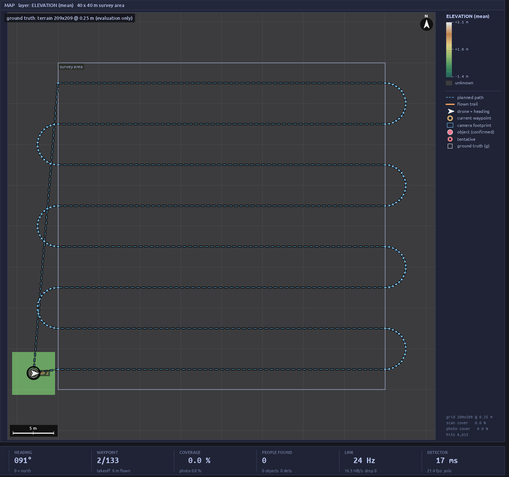
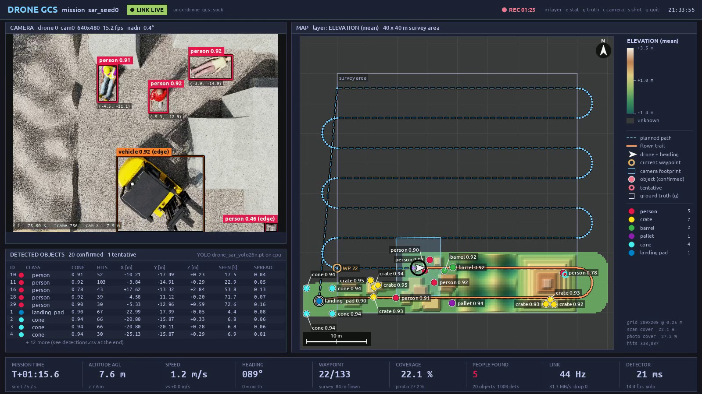
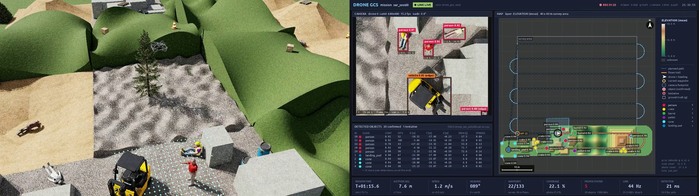
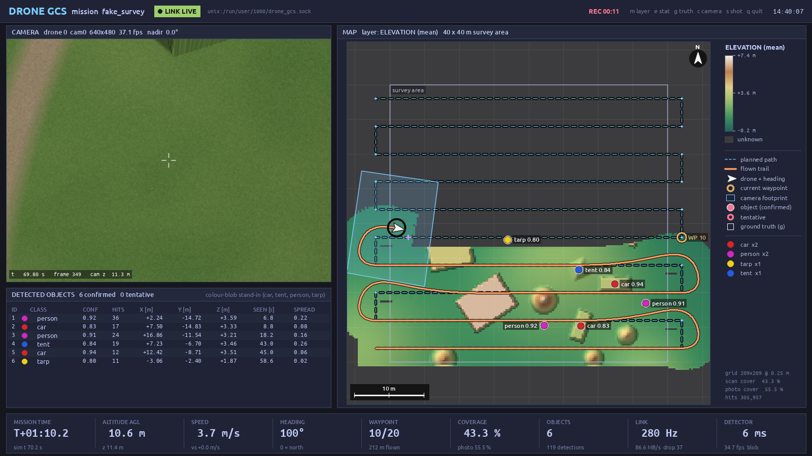
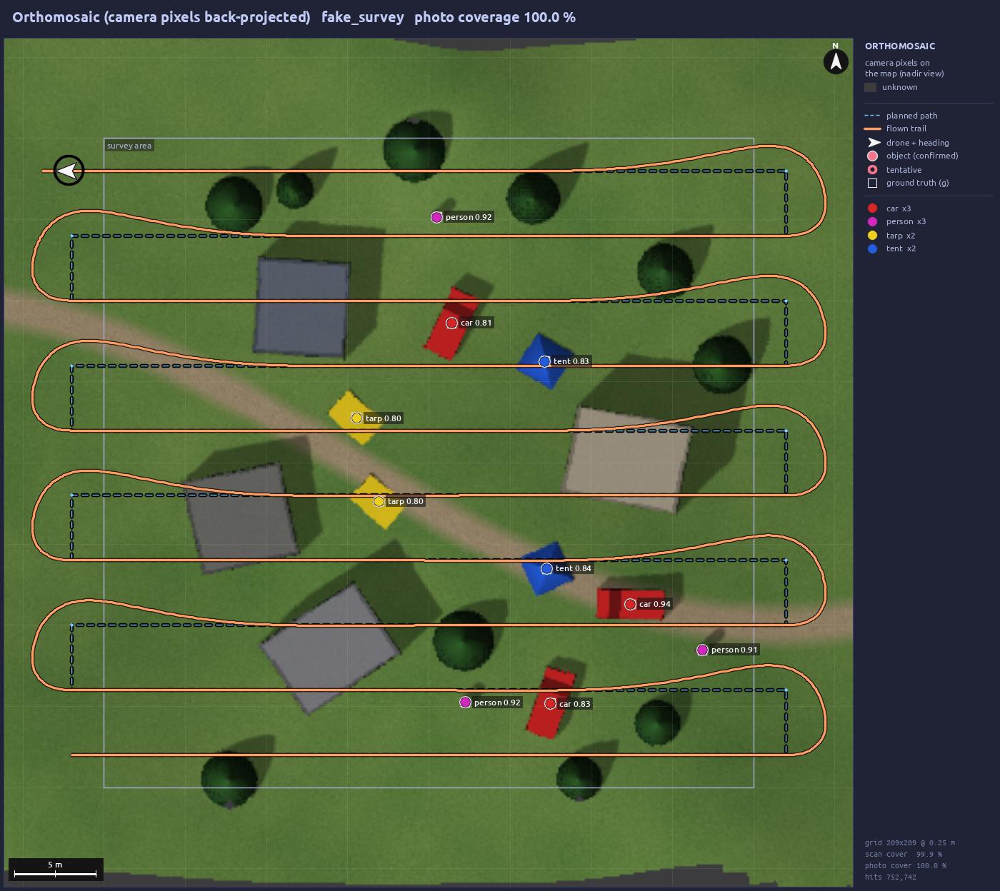
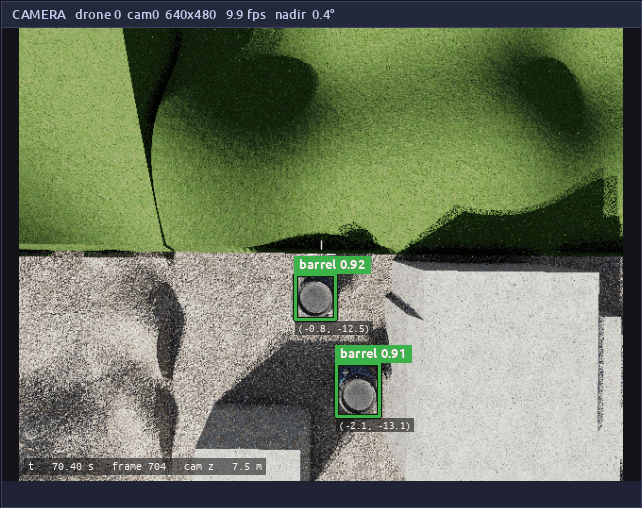

# drone_gcs: ground control station for the simulated drone survey

The simulator flies the drone. **drone_gcs** is the ground-control station and companion computer for it.
It receives the drone's telemetry, mapping ray hits and camera frames over a local socket, and **builds the map
live while the drone uncovers the area**. Unknown ground stays as dark-grey fog until a sensor has seen it. It
also runs object detection (YOLO) on the camera feed, places each detection on the map in world coordinates,
merges repeated sightings into an object list, shows everything in a ground-control style dashboard
(recorded to mp4) and writes a mission report with a scorecard: people found, false alarms, pin error, map
height error, coverage, flight time and closest approach to obstacles.

The drone is either the search-and-rescue mission of the simulator project ([`../sim`](../sim/README.md),
`drone_lab`: Isaac Sim 6.2 / Isaac Lab 3.0, an RL-flown quadrotor over a disaster site with people, a forklift,
crates, barrels, pallets and cones) or a CPU stand-in (`scripts/fake_drone.py`) for development and tests.

<p align="center">
  
</p>

*The recorded mission from take-off to landing (time-lapse): the elevation map fills in as the drone uncovers the
site, with the flown trail and a pin on every find; the HUD counts the people found (10), the coverage and the
link.*

## Live demo: the search-and-rescue mission in Isaac Sim



*75 s into the Isaac Sim mission: the fine-tuned detector's boxes on the drone camera (three people, sitting,
pointing and lying, and the forklift; "edge" boxes touch the image border and are not mapped), the elevation map
uncovered so far (grey = not scanned yet) with the flown trail, the planned path, the camera footprint and the
pins, and the HUD with five people found.*

Two terminals; start the ground station first (it waits for the drone; either side may start first). The trained
models are release assets: `../scripts/download_assets.sh` puts them in `../downloads/`.

```bash
# terminal 1, in gcs/ (conda env vision): the ground station, window + recording
python scripts/gcs.py --name sar_live --weights ../downloads/drone_sar_yolo26n.pt --exit-on-end

# terminal 2, in sim/ (conda env env_isaaclab): the mission in Isaac Sim, with a window that follows the drone
python scripts/sar_mission.py --checkpoint ../downloads/arl-robot-1_policy.pt --viz kit --video --out sar_live

# afterwards, in gcs/: the demo video, both recordings side by side and in step
python scripts/compose_video.py --gcs runs/sar_live --sim ../sim/runs/sar_live
```



*Frame of the demo video, 75 s into the mission: the Isaac Sim window (a follow camera over the drone, its
mapping rays glowing on the ground) and the ground station, whose detector has just boxed three people and the
forklift and pinned five people so far.*

The drone takes off from its landing pad, flies a lawnmower over the 40 × 40 m site (8 lines, 5 m apart, 7.5 m
up), comes back and lands on the pad: about 6 minutes of flight. The flight plan and its camera-overlap math are
in the simulator project (`src/drone_lab/sar/mission.py`). `--weights` names the detector, here the YOLO26n
fine-tuned on simulator images (below); without it the station takes `$DRONE_GCS_WEIGHTS`, else the default of
`drone_gcs/detector.py`. From the touchdown on, the camera panel shows a LANDED card instead of the camera (a
hand's width above the pad it sees only noise): how far from the centre of the pad the drone landed, when, and how
far it flew. After the landing the window shows MISSION END. With `--exit-on-end` the station then writes the
report to `runs/sar_live/` (`report.md` first) and quits a few seconds later; without it the window stays open
until `q` (or closing it) writes the report.

**The demo video.** The two sides record on their own clocks: the simulator one frame per 0.1 s step
(`mission.mp4`), the ground station its dashboard in wall-clock time (`dashboard.mp4`); each writes the sim time
of every frame next to its video (`mission_frames.csv`, `dashboard_frames.csv`). `scripts/compose_video.py` puts
them side by side on the simulator's clock: next to every simulator frame it shows the newest dashboard frame of
that moment or an earlier one, and after the touchdown the dashboard plays on for 4 s (MISSION END). `--speed 3`
makes a 2-minute version with every frame kept (30 frames/s), `--layout stack` puts the two views on top of each
other, `--crf` trades size for quality (the default 28 gives about 660 MB for the 6-minute mission at
3200 × 900; text stays sharp).

* Two monitors: `gcs.py --window-pos X Y` and `sar_mission.py --window_pos X Y` place the two windows. The
  Isaac Sim window shows only its viewport (`--kit_ui` brings back the menus and panels); on GNOME it takes the
  size of the monitor it opens on, whatever size it asks for.
* Without windows (record only; both sides exit at the end and the report is written right away):
  `python scripts/gcs.py --headless` and `python scripts/sar_mission.py --checkpoint ...` (headless is the
  default there).
* `sar_mission.py --max_time 90` flies the first 90 s only; `--seed 3` another site; `--terrain_seed 3`
  another terrain under it (MISSION carries the seed, and `summary.json` records both); `--video` records the
  Isaac Sim view to `sim/runs/<out>/mission.mp4`; `--gt_boxes` adds the simulator's own object boxes to
  every frame, and `gcs.py --detector gt` maps those instead of running YOLO (a check of the geometry with
  perfect detections).
* `gcs.py --record` also saves the link stream to `runs/<name>/link.dgcrec`, so the mission can be processed
  again later without the simulator (`--replay`, see [Record and replay](#record-and-replay)).
* The link carries 2.15 MB per camera frame (640 × 480 RGB + depth, raw), about 22 MB per second of flight;
  that is 20-45 MB/s on the UNIX socket depending on how fast the simulation runs. `--jpeg` sends the images
  as JPEG instead.

## Architecture

```
  SIMULATOR (env_isaaclab: Isaac Sim 6.2 / Isaac Lab 3.0,              GCS (conda env 'vision': numpy, OpenCV,
  drone_lab/scripts/sar_mission.py; or scripts/fake_drone.py)           Ultralytics) - scripts/gcs.py
 +-----------------------------------------+                         +--------------------------------------------+
 | RL flight policy -> multirotor physics   |                         | Receiver (reader threads, decode frames)    |
 | downward RayCaster (mapping grid)        |  drone_gcs.link.Sender  |   |                                         |
 | RGB(+depth) camera                       |  ---------------------> |   v                                         |
 |                                          |  UNIX socket            | GCSState --> ElevationMap (2.5D, running    |
 | Sender: send_mission / send_telemetry /  |  /run/user/1000/        |   |          stats, fog-of-war mask)         |
 |   send_scan / send_camera / send_end     |  drone_gcs.sock         |   |      --> Orthomosaic (pixels -> world)    |
 |   (stdlib + numpy only; non-blocking:    |  (or tcp://host:47800)  |   |      --> DetectorWorker (YOLO, thread)    |
 |   bounded queue, drops oldest frames,    |                         |   |           -> Geolocator -> ObjectTracker  |
 |   auto-reconnect, never raises)          |  length-prefixed frames |   v                                         |
 +-----------------------------------------+  JSON header + raw LE   | Dashboard (cv2 window 12 FPS + mp4)         |
                                              buffers (PROTOCOL.md)  | Report: maps, detections, trajectory, summary|
                                                                     +--------------------------------------------+
```

* **Link** (`drone_gcs/link.py`, `drone_gcs/protocol.py`): MISSION, TELEMETRY, SCAN, CAMERA, END and, for
  the evaluation only, GT_OBJECTS and GT_TERRAIN messages. No pickle: dtype and shape travel in a JSON header,
  so the two ends can run different numpy versions (env_isaaclab has 2.3, vision has 2.5; a test checks this).
  Frames, units and conventions are in [PROTOCOL.md](PROTOCOL.md).
* **Mapping** (`drone_gcs/mapping.py`, numpy only):
  * elevation map: per-cell count, mean, min, max, std and coverage mask
  * surface map: a second height map on the same grid from the camera's depth points, the terrain and what
    stands on it (in Isaac Sim the mapping rays hit only the terrain mesh, so crates, vehicles, trees and people
    are not on the elevation map). About 2 ms per camera frame; `--no-surface-map` switches it off
  * orthomosaic: camera pixels back-projected with depth, or with the elevation map when there is no depth
  * detection geolocation: box → pixel → ray → depth or map intersection
  * tracker: same class within a radius means the same object (2 m; person 1.5 m, vehicle 3 m, crates, barrels
    and cones 0.8 m, pallets 1 m), with confidence, hits, first/last seen, spread, and the views: the camera
    frames whose image should show the object, detected or not (see [Pins](#pins-views-and-detection-rate))
  * evaluation against ground truth: precision / recall / pin error, map height error
* **Detector** (`drone_gcs/detector.py`):
  * Ultralytics YOLO on the CPU; `--weights`, else `$DRONE_GCS_WEIGHTS`, else the fine-tuned
    `drone_sar_yolo26n.pt` in the detector's models folder when it exists, else the stock COCO `yolo26n.pt` there
  * `--detector gt`: the boxes the simulator sends with each frame (instance segmentation), no model
  * a colour-blob stand-in for the fake world
  * a worker thread that always runs the newest frame, so the UI never waits on the detector
* **Dashboard** (`drone_gcs/dashboard.py`): OpenCV canvas 1600×900 (Tokyo Night colours), window plus mp4.
  `--headless` only records.
* **Report** (`drone_gcs/report.py`): written at END or on quit: `report.md` (scorecard, maps, finds), maps,
  detections, trajectory, summary.

## Run the demo (fake drone, no Isaac Sim)



*Mid-mission with the fake drone: coloured stand-in objects, the colour-blob detector, the same map and HUD.*

Two terminals, both in this folder with `conda activate vision`:

```bash
python scripts/gcs.py --detector blob --name my_demo   # 1) the GCS window (waits for the sim)
python scripts/fake_drone.py --speedup 4                # 2) the stand-in simulator (3 min survey at 1x)
```

The fake drone flies a lawnmower survey over a synthetic 40 × 40 m world: hills, buildings, trees, a dirt
road, and 10 objects (car = red, tent = blue, person = magenta, tarp = yellow). It sends 20 Hz telemetry,
10 Hz scans from a 5 × 5 m grid of downward rays at 0.25 m spacing (like Isaac Lab's `RayCaster` +
`GridPatternCfg`), 5 Hz camera frames (640×480, 75° FOV, RGB + depth, rendered from the height field) and
the ground-truth objects. COCO YOLO does not know these coloured shapes, so use `--detector blob` with the
fake drone. With the default `--detector yolo` you get false positives such as "sports ball" for round trees.

* Headless, record only, exits after END: `python scripts/gcs.py --headless --detector blob`
* Other fake drone options: `--no-depth` (the GCS then intersects rays with its own map), `--jpeg`,
  `--mount fixed` (camera tilts with the drone), `--area 60 40`, `--spacing 6`, `--speed 5`, `--seed 1`.
  See `--help`.
* Either side can start first. The link reconnects, and MISSION (and GT_OBJECTS) are re-sent on every
  reconnect. A GCS restarted **mid-mission** starts a new, empty map for that mission: earlier data is not
  replayed (only what was still queued on the sim side while no GCS was listening).

### Keys

| key | action |
|---|---|
| `m` | map layer: **elevation** → **photo** (orthomosaic) → **coverage** (ray hits per cell / photo-only) |
| `e` | elevation statistic: mean ↔ max |
| `g` | show the ground-truth objects (evaluation only; hollow squares) |
| `c` | camera of the next drone (with several drones) |
| `s` | screenshot of the canvas → `runs/<name>/screenshots/` |
| `q` / `Esc` | quit (writes the report). Closing the window does the same |

Arrow keys and other non-character keys are ignored. (With OpenCV's Qt backend they arrive as X key codes
whose low byte is a letter: read naively, Left would be `q` and quit, Right `s`.)

HUD (bottom bar):

| Cell | Shows |
|---|---|
| Mission time | sim time since the mission started |
| Altitude AGL | height above the mapped ground under the drone |
| Speed | horizontal and vertical speed |
| Heading | 0° = north = +Y |
| Waypoint | waypoint i/N, mission phase (take-off, survey, landing, ...) and distance flown |
| Coverage | scan % and photo %, inside the survey area |
| People found | confirmed people (red once there is one), all confirmed objects and raw detections |
| Link | message rate, MB/s, inbound frames dropped; after the mission's END, the data received |
| Detector | detector ms and fps |

## Connecting a simulator

`drone_lab/scripts/sar_mission.py` is the complete example. The sender only needs the standard library and
numpy, so it imports inside Isaac Sim's Python:

```python
import sys

sys.path.insert(0, "path/to/gcs")  # this folder; or: pip install --no-deps -e <this folder>
from drone_gcs.link import Sender
from drone_gcs.isaac_bridge import IsaacLabStreamer  # duck-typed Isaac Lab 3.0 adapter

stream = IsaacLabStreamer(Sender(name="isaac-survey"), env_id=0)  # default unix:$XDG_RUNTIME_DIR/drone_gcs.sock
stream.mission(
    area=(-20, 20, -20, 20), resolution=0.25, planned_path=path_xyz, survey_altitude=8.0, name="survey_lawnmower"
)  # local frame; world=True subtracts origin
stream.gt_objects([{"class": "person", "pos": [x, y, z]}, ...])  # optional, evaluation only (after mission)
stream.gt_terrain(heights, x_min, y_min, 0.25)  # optional, evaluation only: true terrain for the map error
for step in range(n_steps):
    obs, *_ = env.step(policy(obs))
    t = step * env.unwrapped.step_dt
    stream.telemetry(t, robot, wp_index=k, carrot=carrot_xyz)  # robot = env.unwrapped.scene["robot"]
    stream.scan(t, scanner)  # scene["mapping_scanner"] (RayCaster)
    stream.camera(t, camera)  # scene["camera"]: rgb + distance_to_image_plane; sends new captures only
stream.end("complete")
```

`stream.camera()` sends a frame only when Isaac Lab's capture counter (`camera.frame`) has advanced, so it
can be called every step whatever the camera's `update_period` (it returns `False` otherwise). Under OVRTX
`async_rendering` it takes the image's pose from `camera.data.info["rgb"]["capture"]`.
`IsaacLabStreamer(origin=env.scene.env_origins[i])` subtracts the env origin from everything it reads from
Isaac Lab; positions you pass to `mission()` / `gt_objects()` are local unless you add `world=True`.

Or call the `Sender` methods directly with numpy arrays, CPU or GPU torch tensors, or Isaac Lab `ProxyArray`s:
`send_telemetry(t, pos, quat_wxyz, vel, wp_index=, carrot=)`, `send_scan(t, points_Nx3, origin=)`,
`send_camera(t, rgb, K, pos, quat_wxyz_ros, depth=, jpeg=False)`, `send_gt_objects([...])`,
`send_gt_terrain(heights, x_min, y_min, resolution)`, `send_end()`.

* Every `send_*` call copies its data (arrays and extra keyword fields) and returns at once. It **never
  raises**: it returns `False` and logs instead. A background thread does the I/O, in call order. When the GCS
  is slow or absent, the oldest camera frames are dropped.
* Each data message and END carries the current `mission_id`; the GCS ignores ones from another mission. With
  several drones, use one `mission_id` for all of them (END from any drone ends the mission).
* **Quaternions are (w, x, y, z) on the wire. Isaac Lab 3.0 gives (x, y, z, w).**
  `drone_gcs.geometry.quat_xyzw_to_wxyz` converts. The camera orientation is the **ROS optical** frame
  (`camera.data.quat_w_ros`). PROTOCOL.md has the conversion from `quat_w_world` and `quat_w_opengl` too.
* Ray-caster misses (`inf`) can be sent as they are.
* TCP instead of the UNIX socket (for example from a container): `Sender("tcp://127.0.0.1:47800")` with
  `python scripts/gcs.py --addr tcp://0.0.0.0:47800`, or set `DRONE_GCS_ADDR` on both sides.
* Import check, from this folder (a test runs the same import in env_isaaclab):
  `conda activate env_isaaclab && python -c "from drone_gcs.link import Sender"`. `pip install --no-deps -e .`
  also works (base dependency: numpy only); importing from the path keeps env_isaaclab untouched.

## Outputs: `runs/<name>/`

| file | content |
|---|---|
| `report.md` | the mission report: scorecard, photo and elevation maps with the flight path and the pins, list of finds with coordinates and their ground-truth match |
| `dashboard.mp4` | the exact dashboard canvas at the dashboard rate. OpenCV writes it (mp4v), then system ffmpeg re-encodes it to H.264 so it plays in browsers and Obsidian (`--no-transcode` keeps mp4v) |
| `dashboard_frames.csv` | the sim time shown in every frame of `dashboard.mp4` (empty before the first message) |
| `demo.mp4` | written by `scripts/compose_video.py`: the simulator's view and the dashboard side by side, in step |
| `final_map_elevation.png`, `final_map_photo.png`, `coverage.png` | final maps, each with the flown trajectory, planned path, detections and (if known) ground truth |
| `maps/` | raw arrays: `elevation_{mean,max,min}.npy`, `hit_count.npy`, `photo_rgb.png`, `photo_filled.npy`, `grid.json`. Arrays are (ny, nx), row 0 = south |
| `maps/surface_{max,mean,count}.npy` | the surface map from the camera depth on the elevation grid: highest and mean depth point per cell [m] (NaN where the camera saw nothing) and depth points per cell. Written when the frames had depth and `--no-surface-map` was not given; the rescue planner compares `surface_max.npy` with the elevation map |
| `detections.csv` / `.json` | objects: class, x, y, z (world / local ENU, m), confidence (mean, max), hits, first/last seen, spread (confidence-weighted RMS horizontal distance of the detections from the pin [m]), views (frames that should show it), detection_rate (hits / views), confirmed. Also the matched ground-truth id and error when GT_OBJECTS was sent |
| `link.dgcrec` | with `--record`: every frame of the link as received, for `--replay` ([Record and replay](#record-and-replay)) |
| `trajectory.csv` | t, position, quaternion (wxyz), velocity, waypoint index, carrot, AGL |
| `coverage_timeline.csv` | scan and photo coverage vs sim time |
| `summary.json` | `scorecard` (people found x / y in the survey area and, apart, the people outside it, false alarms, pin error, map height error, coverage, flight time, closest approach), area, path length, speeds, detection counts, precision / recall / localization error per class, map error vs the true terrain (all cells and away from steps), the drone's END statistics, link and detector statistics. `mission.seed` and `mission.terrain_seed` (from MISSION; null for the standard terrain), `coverage.surface_cells`, `detections.min_rate`, and in `gcs`: `recording`, `replay` and `noise` (null when not used) |
| `screenshots/` | `s` key or `--screenshot-at` |

`runs/` is git-ignored. Final maps of the 40 × 40 m fake survey (`runs/demo_headless`, copied to `docs/images/`):

| elevation | orthomosaic | coverage |
|---|---|---|
|  |  |  |

## Record, replay and sensor noise

Every experiment on the ground-station side (detector, tracker or map settings, sensor noise) used to need a new
six-minute flight in Isaac Sim. Record the link once, then process it as often as needed on the CPU.

### Record and replay

```bash
# once, with the mission flying (sar_mission.py in sim/)
python scripts/gcs.py --name flight --weights ../downloads/drone_sar_yolo26n.pt --exit-on-end --record
# then as often as needed, no simulator: the same report again, or with other settings
python scripts/gcs.py --replay runs/flight/link.dgcrec --weights ../downloads/drone_sar_yolo26n.pt --headless \
    --no-video --linger 0 --name flight_r1
python scripts/gcs.py --replay runs/flight/link.dgcrec --weights ../downloads/drone_sar_yolo26n.pt --headless \
    --min-rate 0.2 --name flight_r2
```

* `--record` writes `runs/<name>/link.dgcrec`; `--record PATH` picks the file, and a PATH ending in `.gz` is
  gzip-compressed (level 1). `--record` and `--replay` together are refused.
* `--replay FILE` reads such a file instead of the live link (no `--addr`, no simulator) and writes a new run
  folder with the usual report. All detector, tracker, map and dashboard options apply.
* `--replay-speed X`: 0 (the default) goes as fast as the station can and skips nothing: after every camera frame
  it waits for the detector and applies its result before it reads on, so the same recording and settings give the
  same report on a slow or a fast computer. 1 paces the replay like the live link by the recorded receive times, N
  goes N times faster; above 0 the station behaves as on a live link, so a slow detector skips frames.
* What is recorded: every frame that decoded, exactly as received, HELLO, MISSION and the ground truth included. It
  is written before the station's inbound queue can drop camera frames, so the recording is complete even where the
  live station fell behind; frames the simulator side dropped before sending are not in it.
* End of a replay: with an END in the recording, the usual mission end after `--linger` seconds (`--linger 0` for
  batch runs); a lossless replay first reads the recording to its end, so a later mission in the same file is
  processed however slow the detector and the dashboard are. Without an END (the station was stopped mid-mission),
  quit reason "end of recording" when headless or with `--exit-on-end`. A file cut off mid-frame replays up to its
  last complete frame, with one warning; a file that is not a recording is an error (exit code 2). If the disk fills
  up while recording, the recording stops with an error in the log and the mission and its report go on.
* `summary.json` → `gcs.recording` (the file name) and `gcs.replay` (`{"file", "speed"}`); during a replay the link
  counts are the replayed messages.

File format (`drone_gcs/recording.py`): the 8 bytes `b"DGCREC1\n"`, then one record per frame in arrival order: the
station's receive time (`time.time()`, little-endian float64), the connection id (uint32) and the frame unchanged
(16-byte prefix, header, payload; [PROTOCOL.md](PROTOCOL.md)). `drone_gcs.recording.read_recording(path)` yields
the messages with `recv_time` in seconds since the first record.

Checked on the fake drone (24 x 24 m area, 72 s of flight, 2527 frames, blob detector): a lossless replay takes about
12 s on the CPU and gives the same maps and pins, bit for bit, as the live run; two replays give identical
detections, maps, trajectory and coverage timeline (`summary.json` differs only in its time stamps and timings). A
live station whose detector skipped frames can end with other pins than its lossless replay; the maps are the same.
Raw camera frames make the file large: that 72 s flight is 782 MB, 214 MB as `.gz`. The Isaac Sim mission sends
8.1 GB over the link (see [Results](#results)), so expect a recording of about that size; `.gz` or
`sar_mission.py --jpeg` (JPEG colour images; the depth stays raw) make it smaller. No Isaac Sim mission has been
recorded and replayed yet, and no replay has run the trained detector yet.

### Sensor noise

In the simulator the drone's pose, the depth image and the ray hits are exact, so the 4 cm pin error only shows that
the geometry is consistent. `--noise SPEC` adds errors to TELEMETRY, SCAN and CAMERA as they arrive; the ground truth
(GT_OBJECTS, GT_TERRAIN, `gt_boxes`) is never changed, and without `--noise` nothing is. It works on the live link
too, but is meant for replays: one recorded mission at many noise levels.

```bash
python scripts/gcs.py --replay runs/flight/link.dgcrec --headless --noise pos=0.5,att=1,depth=0.02,seed=1
python scripts/noise_sweep.py --replay runs/flight/link.dgcrec --param pos --values 0,0.1,0.25,0.5,1,2 \
    --fixed att=0.5,depth=0.01 --seeds 0,1,2 -- --weights ../downloads/drone_sar_yolo26n.pt
```

| Key | Meaning (all 0 = off by default) |
|---|---|
| `pos` | slowly drifting position error, std per axis [m] |
| `pos_white` | position error drawn anew every time step, std per axis [m] |
| `att` | slowly drifting roll / pitch / yaw error, std [deg] |
| `att_white` | attitude error per time step, std [deg] |
| `tau` | correlation time of the drifting errors [s], default 30 |
| `depth` | depth error per pixel, std as a fraction of the depth |
| `dropout` | fraction of the depth pixels lost (set to inf), 0 to 1 |
| `scan` | height error per ray hit, std [m] |
| `lag` | the camera frame is paired with the pose this many seconds later [s] |
| `seed` | noise seed, default 0 |

* One navigation error per drone and time step, shared by the TELEMETRY, SCAN and CAMERA messages with the same `t`:
  the drone has one state estimate. Its drifting part is a first-order Gauss-Markov process (after `dt` it keeps
  `exp(-dt / tau)` of its value), the white part is new every step.
* The position error moves the telemetry position, the scan points and the camera position; the attitude error
  turns the telemetry and camera orientations (the scanner is gimballed, so its points only shift). `lag` moves the
  camera by velocity x lag and, when the telemetry carries `ang_vel`, turns it by angular velocity x lag.
* Deterministic for a seed and a recording. Depth and scan noise draw from a stream of their own, so switching them
  on does not change the navigation error of a seed. An unknown key or a bad value is an error that lists the keys.
* `summary.json` → `gcs.noise` holds the ten settings; the event log starts with the noise line.

`noise_sweep.py` runs `gcs.py --replay FILE --headless --no-video --noise ... --linger 0` once per value of `--param`
and per seed in `--seeds`, one at a time (`--fixed` holds the other settings; arguments after `--` go to `gcs.py`,
e.g. `--weights FILE` or `--detector gt` for a mission flown with `--gt_boxes`). It writes one run folder per value
and seed (`<param>_<value>_s<seed>`), `sweep.csv` (one row per run) and `sweep.md` (one row per value: mean ± sample
standard deviation over the seeds of the people found, false alarms, pin error, people pin error and map height
error away from steps) into `--out` (default `runs/<time>_sweep_<param>`), and prints the table. A failed run is
reported, left out of the means, and makes the script exit with 1; an `--out` that already holds runs of the sweep
is refused, and so is a value or a seed listed twice. Values below 0 need the `=` form (`--values=-0.05,0`). The
sweep has only been run on the fake drone's recordings; the pin error against noise level of the Isaac Sim mission
is still to be measured.

## Several missions in one table

One mission on one site says little about how often people are found. `scripts/aggregate_runs.py` reads the
`summary.json` of many runs (other site seeds, other terrain seeds; `../scripts/run_benchmark.sh` flies them) and
writes `benchmark.csv` (one row per run: seeds, END reason, people found, false alarms, objects, pin and map errors,
coverage, flight time, closest approach), `benchmark.json` and `benchmark.md` into `--out` (default: a folder
`benchmark` next to the first run), and prints the tables:

```bash
python scripts/aggregate_runs.py runs/bench_s* --out runs/bench_benchmark
```

For the people found it pools the counts over all missions with a 95 % Wilson score interval; it treats every
person as an independent trial, while the people of one site share a flight, so read it next to the mean and the
standard deviation over the missions. The false alarms and the pin and map errors come with their spread over the
missions. No benchmark has been flown yet.

## Detection and fine-tuning on simulator images

* Weights: `--weights <file.pt>`; by default `$DRONE_GCS_WEIGHTS`, else `drone_sar_yolo26n.pt` (the YOLO26n
  fine-tuned on simulator images: person, vehicle, crate, barrel, pallet, cone, landing_pad) in the models folder
  of `drone_gcs/detector.py` when it exists, else the stock COCO `yolo26n.pt` there. Defaults
  `--conf 0.25 --iou 0.45 --imgsz 640 --device cpu`. YOLO runs on the **CPU** by default (about 19 ms per
  640×480 frame, plenty for a 5–10 Hz camera): the GPU belongs to Isaac Sim and the RL jobs. `--device cuda:0`
  opts in; `--device auto` uses the GPU only when `nvidia-smi` shows at least 2 GiB free on it.
* `--classes person,car` keeps only those classes; a name matches the model's class name or the name after
  `--class-map` (`--classes car --class-map truck=car` keeps cars and trucks). A name the model does not
  have is an error if nothing would be left, else a warning. `--class-map truck=car,bench=` renames or drops
  classes.
* The GCS process sets `YOLO_OFFLINE=1` (no update checks or analytics from the GCS). The env-local
  `YOLO_CONFIG_DIR` of 'vision' is left as it is.
* With several drones every camera gets detection: the worker keeps the newest frame per drone and serves
  the drones in turn.
* Boxes that touch the image border are partial views. They are shown, but not put on the map
  (`--edge-margin 0` changes that).
* `--detector gt` runs no model: it maps the object boxes that `sar_mission.py --gt_boxes` computes from the
  simulator's instance segmentation and sends with every frame. With perfect boxes, every pin error comes from
  the geometry (pose, intrinsics, depth, geolocation, tracker), which is how the Isaac Sim link was verified
  (see Results).
* Fine-tuning on other captures: `scripts/seg_to_yolo.py` turns RGB + instance segmentation (+ the annotator's
  `info` JSON; the capture snippet is in its docstring) into YOLO labels and `data.yaml`,
  `scripts/train_detector.py` trains from the nano weights (`--dry-run` checks the dataset first) and
  `scripts/eval_detector.py` scores the result. Objects cut off by the image border keep their visible box
  unless `--max-truncation` drops them. Tiny and dropped objects of a wanted class are painted over with the
  image's mean colour, so the detector is not taught that a visible object is background (`--no-mask-dropped`
  keeps the pixels). A capture without `train/` and `val/` folders is split in blocks of consecutive frames
  (no near-duplicate leakage; val stays near 15 %).

### Pins: views and detection rate

A pin is confirmed after `--min-hits` detections (default 2). An object stays in the image for 60 frames or more
per pass (10 frames per second, a 9.9 x 7.4 m footprint at about 1.2 m/s), so two detections say little on their
own: every pin also counts its **views**, the camera frames whose image should show it, detected or not. A frame
counts as a view when the pin projects in front of the camera, a box the size of its last one, placed with its
reference pixel on that point (the centre, or near the bottom edge in oblique views, as the geolocation uses), lies
at least `--edge-margin` inside the image (a box at the border is a partial view that is not mapped, so it is not a
miss either), and the depth at its pixel is not more than 1 m nearer than the pin (a tree crown above it hides it).
`--min-rate X` also asks for a detection in at least that fraction of the views; the default 0 keeps the hits-only
rule. `detections.csv` and `.json` list the views and the rate of every pin (`summary.json` the `min_rate`), and the
dashboard draws a pin below the rate as tentative.

The **spread** of a pin is the confidence-weighted RMS horizontal distance of its detections from the pin. It used
to be biased low (about 30 % after two sightings, 18 % after five, 7 % after twenty) and lost the second pin's
detections when two pins merged; both now use the exact formulas (checked against brute force in the tests). No
value for `--min-rate` has been tried on an Isaac Sim mission yet: replay a recorded mission with a few values to
choose one.

### Fine-tuned detector for the search-and-rescue site

`drone_sar_yolo26n.pt` (a release asset) is YOLO26n fine-tuned on the downward camera of the dressed simulator
site. It knows the site's seven classes, in this id order: person, vehicle, crate, barrel, pallet, cone,
landing_pad, and takes about 17 ms per frame on the CPU.

<p align="center">
  
</p>

*The drone camera in the ground station during the recorded mission: the fine-tuned detector's boxes, each with
the map coordinates of its pin; boxes that touch the image border are marked "edge" and are not mapped.*

The images are Isaac Sim renders of the mission camera (640 × 480, f = 480 px). The labels come from the
camera's instance segmentation, so nothing was labelled by hand:

| Split | Sites (scenario seeds) | Frames | Objects (people) | Views |
|---|---|---|---|---|
| train | 36 (1000-1035) | 1620 | 5048 (1321) | 5-12 m above the ground, up to 15° off nadir, any heading; 2 in 3 aimed at an object |
| val | 7 others (2000-2006) | 315 | 968 (256) | the same, with layouts never seen in training |
| test | the demo mission's site (seed 0) | 183 | 173 (54) | every 2.5 m along the survey path, at the mission's height and light |

A site is the survey terrain dressed by one scenario seed: the seed places the people and the objects, while
the terrain itself is the same for every seed (its generator seed is fixed). The people are posed as in the
drone_lab missions: victims lie on their back or in the recovery position, sit or wave, and responders stand,
point or walk by the forklift and the helipad. Train and val frames also vary the light (sun azimuth and strength
at the mission's 43° elevation, overcast sky) and the ground (materials swapped between terrain types, tinted,
rescaled). Objects with less than 40 % inside the frame (measured on a render with a wider margin) or fewer than
100 visible pixels are dropped and painted over. Train and val never use a seed below 1000, so the layout of any
site picked with `--seed` in drone_lab is new to the detector.

Scores: mAP50 / mAP50-95 from the Ultralytics validator, and the objects found, missed and the false alarms
of the ground station's own detector on the whole frames at its threshold (confidence 0.25; a label is found
when a box of its class overlaps it with an IoU above 0.45):

| Class | val: held-out sites | test: mission site | val at 0.25: found / missed / false alarms | test at 0.25 |
|---|---|---|---|---|
| person | 0.995 / 0.884 | 0.995 / 0.928 | 255 / 1 / 1 | 54 / 0 / 0 |
| vehicle | 0.995 / 0.939 | 0.995 / 0.976 | 30 / 0 / 1 | 6 / 0 / 0 |
| crate | 0.995 / 0.899 | 0.995 / 0.975 | 227 / 3 / 12 | 36 / 0 / 1 |
| barrel | 0.993 / 0.922 | 0.995 / 0.940 | 132 / 3 / 2 | 29 / 0 / 0 |
| pallet | 0.995 / 0.972 | 0.995 / 0.985 | 102 / 0 / 0 | 23 / 0 / 0 |
| cone | 0.995 / 0.963 | 0.995 / 0.970 | 182 / 0 / 2 | 23 / 0 / 0 |
| landing_pad | 0.995 / 0.995 | 0.995 / 0.995 | 33 / 0 / 0 | 2 / 0 / 0 |
| **all** | **0.995 / 0.939** | **0.995 / 0.967** | **961 / 7 / 18** | **173 / 0 / 1** |

The people, with the same counts at confidence 0.25, next to the stock COCO model (person class) and a model
trained the same way on frames of the site with Isaac Sim's characters in their rest T-pose
(`gen_yolo_dataset.py --people_style tpose`):

| People | fine-tuned | trained on T-pose people | stock COCO |
|---|---|---|---|
| val: found of 256 / false alarms | **255** / 1 | 243 / 2 | 107 / 33 |
| test: found of 54 / false alarms | **54** / 0 | 53 / 1 | 31 / 8 |
| val: mAP50 / mAP50-95 | **0.995 / 0.884** | 0.986 / 0.821 | 0.621 / 0.431 |
| test: mAP50 / mAP50-95 | **0.995 / 0.928** | 0.995 / 0.898 | 0.783 / 0.520 |

So the station finds 99.6 % of the people on held-out sites and all of them on the mission site. The T-pose model
still finds most of them, but 8 of its 13 misses on val are responders on their feet: it learned standing people
with their arms out, and from straight above a person with the arms down is a head and two shoulders, which it
calls a barrel or a crate, or nothing; the other 5 sit (3), wave or lie in the recovery position. The COCO model
learned people from photos taken at eye level; from above it finds 42 % of them on val and 57 % on test.

The fine-tuned model's one false alarm on test is a crate box on the painted-over remains of a crate cut by the
frame edge (painting keeps the outline and the shadow). On val it has 18: one inside the frame (a small cardboard
crate called a cone) and 17 at the image border, 12 of them on such painted remains (crates, people, barrels, the
forklift), 4 on terrain edges and shadows, and one on the sliver of a person cut by the edge, 22 × 15 px in the
frame, which is also its only missed person. The GCS does not put boxes that touch the border on the map.


*Mission frames of the demo site (test split), confidence 0.25. Left: the fine-tuned model. Right: the stock
COCO model, person class only.*


*Frames where the model trained on T-pose people (right) misses people that the fine-tuned model (left) finds,
confidence 0.25: a victim lying at the edge of the frame, called a pallet; a victim sitting in the shadow of a
block; a responder standing by the helipad.*

To build it again (about 15 minutes on an RTX 5080; `datasets/` at the repository root is git-ignored):

```bash
# 1. Render the frames, in sim/ (conda env env_isaaclab, about 7 min)
python scripts/gen_yolo_dataset.py --out ../datasets/drone_sar_yolo_v2/capture
# 2. Labels, 3. training (about 6 min), 4. scores, in gcs/ (conda env vision);
#    YOLO26N = Ultralytics' stock yolo26n.pt: the starting weights and the COCO baseline
python scripts/seg_to_yolo.py --src ../datasets/drone_sar_yolo_v2/capture \
    --out ../datasets/drone_sar_yolo_v2/yolo --classes person,vehicle,crate,barrel,pallet,cone,landing_pad \
    --min-area 100 --min-side 6 --max-truncation 0.6
python scripts/train_detector.py --data ../datasets/drone_sar_yolo_v2/yolo/data.yaml --model "$YOLO26N" \
    --epochs 100 --name drone_sar_yolo26n_v2 --out models/drone_sar_yolo26n.pt --offline
python scripts/eval_detector.py --data ../datasets/drone_sar_yolo_v2/yolo/data.yaml \
    --weights models/drone_sar_yolo26n.pt --coco "$YOLO26N"
```

Next to the weights: `drone_sar_yolo26n_metrics.json` and the training curves `drone_sar_yolo26n_training.png` and
`.csv` (best epoch 73 of 100), `drone_sar_yolo26n_eval.json` (every score above), the confusion matrices of the
station's detector and the precision-recall curves of val and test, and the figures above; `--previous <model.pt>`
adds another model's scores on the same frames, as for the T-pose model in the table (the same recipe on frames
rendered with `gen_yolo_dataset.py --people_style tpose`).

### Harder tests: corrupted frames and real aerial images

mAP50 0.995 on simulator frames leaves nothing to compare. Two tools score the detector where it should find less.
Neither has been run on the fine-tuned weights yet, so there are no results here: run them on your trained weights.

**Corrupted copies of a split.** `scripts/degrade_dataset.py` writes corrupted copies of one labelled split, one
dataset per preset in `DIR/<preset>/` (`images/<split>/*.png`, `labels/<split>/*.txt`, `data.yaml`), and
`scripts/eval_robustness.py` makes those copies and runs the ground station's own detector on the clean split and on
every copy:

```bash
python scripts/eval_robustness.py --data ../datasets/drone_sar_yolo_v2/yolo/data.yaml \
    --weights models/drone_sar_yolo26n.pt --split val            # all presets; --presets dark,blur,altitude2
python scripts/degrade_dataset.py --data ../datasets/drone_sar_yolo_v2/yolo/data.yaml --split val \
    --out ../datasets/drone_sar_degraded --seed 1                # the copies alone, another seed
python scripts/eval_detector.py --data ../datasets/drone_sar_degraded/dark/data.yaml --splits val \
    --weights models/drone_sar_yolo26n.pt --coco "$YOLO26N" --out-dir runs/eval_dark   # mAP of one copy
```

| Preset (`drone_gcs/corruptions.py`) | What it does |
|---|---|
| `noise` | Gaussian sensor noise, std 15 grey levels |
| `blur` | horizontal motion blur over 11 px |
| `dark` | a quarter of the light (gain 0.25), then noise of std 6 |
| `jpeg` | JPEG at quality 15 |
| `haze` | halfway to a light grey, half the contrast |
| `occlude30`, `occlude60` | 30 / 60 % of every labelled object hidden under a strip of ground copied from elsewhere in the frame; the labels stay |
| `altitude2`, `altitude3` | 2 x 2 or 3 x 3 consecutive frames shrunk into one frame of the same size: the objects are 2 or 3 times smaller, as from 2 or 3 times the height; the labels move to match, a last incomplete group is left out |

`eval_robustness.py` counts the people and all objects found, missed and the false alarms with the rule of
`eval_detector.py` (IoU above 0.45, one to one, highest confidence first) at `--conf` (0.25), and writes
`robustness.json` (with the counts per class), `robustness.csv` and `robustness.md` into `--out` (default
`runs/<time>_robustness`). Its copies use seed 0; `degrade_dataset.py --seed` makes others. The copies are for
testing only: their `data.yaml` also has `train` and `val` keys pointing at the corrupted split, because the
Ultralytics validator needs both. An existing preset folder is never overwritten.

**Real aerial images.** `scripts/eval_external.py` scores the detector on any labelled set of real aerial images in
YOLO format (a public drone dataset, for example), for the people only:

```bash
python scripts/eval_external.py --images ~/data/aerial/images/val --labels ~/data/aerial/labels/val \
    --person-ids 0,1 --weights models/drone_sar_yolo26n.pt --scale 2
```

* `--person-ids`: the class ids of people in the labels (a dataset may have more than one); other labels are
  ignored, and an image without a label file has no people.
* `--scale`: every image is resized first so that people are as large as in the mission camera (1.54 cm per
  pixel): the dataset's cm per pixel over 1.54, e.g. 3.08 / 1.54 = 2.
* The resized image is cut into 640 x 480 tiles that overlap by `--overlap` (0.2), the detector runs on every tile,
  and a person that two tiles both found is kept once: boxes of one class from different tiles merge into their
  union when the smaller lies at least half inside the larger, so a person cut by one tile's border is not counted
  again as a false alarm. `--no-tile` gives the whole image to the detector instead.
* Person boxes are matched to the labels one to one, most confident first, at IoU `--iou` (0.45).
* `external_eval.json` and `external_eval.md` in `--out` (default `runs/<time>_external_eval`): images, people
  labelled, found, missed, false alarms, precision, recall, and the recall per size of the label (longer side
  below 16, 16-32, 32-64, 64-128 and from 128 px, in the resized image). `--limit N` scores the first N images.
* VisDrone (real drone photos, for research use; Ultralytics hosts the validation set as
  `VisDrone2019-DET-val.zip` in its assets releases): `scripts/visdrone_to_yolo.py --src <VisDrone2019-DET-val>
  --out <labels>` writes the YOLO labels by Ultralytics' rule (ignored regions left out, class = category - 1, so
  0 pedestrian and 1 people), then `--person-ids 0,1`.

## Tests

```bash
./run_tests.sh                      # all tests, CPU only, 1-2 min (activates 'vision' itself)
DRONE_GCS_SKIP_E2E=1 ./run_tests.sh # without the end-to-end run
```

| Area | What the tests check |
|---|---|
| Wire format | Round trips of all dtypes and shapes, JPEG, rejection of bad frames, ProxyArray-like objects converted without touching their implicit-torch bridge |
| Link | Exact call order with MISSION / GT_OBJECTS / GT_TERRAIN, mission_id on data. A mission change while the GCS is absent arrives as MISSION A, A's data, END A, MISSION B. A GCS restarted mid-mission gets the MISSION of the queued data. Extra fields are copied at call time. No gap between taking and writing an item (flush). A sender with no GCS never blocks or raises. A GCS that stops reading makes the sender drop camera frames without blocking the sim loop. TCP. Stale socket cleanup |
| Geometry | Isaac Lab xyzw → wxyz, and the world/opengl → ROS camera conversion checked against Isaac Lab 3.0's fixed constants and a re-implementation of its matrix formula (no Isaac Lab import). Projection round trips |
| Mapping | Running statistics vs brute force. Cell centres on the area lattice for any area size and padding. Grid cap for huge missions. Orthomosaic from depth and from the map, self-occlusion depth ignored. Geolocation by depth, map and plane. Tracker merging. Precision and recall. Map height error, all cells and away from steps |
| Isaac adapter | Only one env row leaves the GPU. Each capture is sent once (`camera.frame`). Async-rendering capture pose. `world=True` origin handling, terrain truth included |
| App | Arrow keys neither quit nor take screenshots. Data / END of another mission ignored; a new mission clears an old END. Rollover keeps ground truth and drops the old mission's late detections. Every drone gets detection. Boxes sent by the simulator (`--detector gt`) land on the map. Short link label. Video keeps real time through stalls and logs the sim time of every frame. `compose_video` pairs each simulator frame with the newest dashboard frame not ahead of it, and joins the two videos in step |
| Surface map (`test_surface_map.py`) | Depth points of a box on flat ground raise the surface map and leave the elevation map at the ground. Frames without depth add nothing; `--no-surface-map` and a new mission give an empty map; `--depth-elevation` still feeds the elevation map. The `surface_*.npy` files (only with depth points), and the site and terrain seeds in `summary.json` |
| Pins (`test_tracker_views.py`) | The spread against brute force, with and without merges. Views: a pin in the image counts, one outside it, behind the camera, at the border or hidden under nearer depth does not; invalid depth hides nothing; a hit always counts as a view, views never fall below the hits, a merge keeps the larger count. `--min-rate` drops the rarely detected pins, in the report and on the dashboard; out-of-range values are refused |
| Record and replay (`test_recording.py`) | The file format, gzip, writers in several threads, a recording cut off mid-frame, a file that is not a recording, a full disk. The Receiver records every frame that decodes, also those its queue drops. Lossless replay through the app skips no frame and is repeatable; paced replay; a recording without END; the command line (`--record` with `--replay` refused) |
| Sensor noise (`test_noise.py`) | Parsing and validation of `--noise`. One shared navigation error per time step, the drift with its set spread and correlation time, the white part, depth noise and dropout, scan height noise, the camera lag; ground truth and other messages untouched; the same seed gives the same noise, every drone has its own stream. Through the app: a constant bias moves the pins by that bias, all levels 0 change nothing, a noisy replay is repeatable. `noise_sweep.py`: runs and tables, mean and spread by hand, a failed run left out, bad arguments |
| Benchmark table (`test_aggregate_runs.py`) | Wilson intervals against known values; the rows and the aggregate of several runs against hand-computed numbers; one run has zero spread; the three files; no usable run is an error |
| Corrupted copies (`test_corruptions.py`) | Every preset keeps shape and dtype and is deterministic; noise std, blur direction, low-light gain, JPEG loss and haze contrast as set; occlusion hides the asked fraction with ground from outside the boxes; in the altitude mosaics every label lands where its object does. `degrade_dataset.py` writes one dataset per preset that `eval_detector.py` reads; `eval_robustness.py` counts on the clean split and a copy (the 2 tests that need torch and Ultralytics skip without them) |
| Real images (`test_external_eval.py`) | YOLO label reading, tile origins that cover every pixel, IoU and intersection over the smaller box by hand, a person found by two tiles kept once and whole, what one tile kept apart stays apart, one-to-one matching, size buckets, counts at full and half size, the command line, and the VisDrone label conversion |
| Fake world | Rays and depth lie on the height field |
| Detectors | The blob detector finds every object. The worker keeps the newest frame. Default weights: `$DRONE_GCS_WEIGHTS`, else the fine-tuned model if present, else COCO. YOLO wrapper: 2 CPU inferences on Ultralytics' `bus.jpg`; class filters validated (typos raise) and matched after `--class-map` |
| Dataset tools | `seg_to_yolo` on synthetic segmentation gives exact labels, keeps cut-off boxes, paints over tiny ones. Split capture folders stay the splits, and the full box of a cut-off object decides whether it stays. Block split gives train data and ~15 % val from 8 to 2000 frames. `train_detector --dry-run`. `eval_detector` counts found, missed and false alarms from the station detector's boxes, and the people it finds in each frame |
| Sender import | The sender imports without cv2, torch or PIL. **A sender process in env_isaaclab** sends to a receiver in vision, and arrays arrive bit-exact |
| Dashboard and report | All three layers render. Labels take the first spot inside the image that hides nothing (else the one that hides least); map labels keep clear of each other and of a landed drone. Once the drone has landed, the camera panel shows the LANDED card and the map drops the waypoint marker; after the END the link cell shows the data received instead of a rate falling to 0. All report files are written, `report.md` included; the scorecard counts people (in the survey area, the ones outside it apart) and false alarms against the ground truth, and the map height error against the true terrain is under 5 cm on smooth ground |
| End to end | Fake drone process → socket → headless GCS process. Coverage grows monotonically to over 98 %. Elevation error is under 1 cm RMSE on smooth cells (measured 2.6 mm) and under 5 mm median. All synthetic objects are found with no false positives and a mean horizontal error under 25 cm |

## Results

### Isaac Sim mission (site seed 0)

The same policy flies the same plan every time: 428 m in 6 min 16 s from take-off to touchdown, 7 mm from the
centre of the pad. Only the detector changes. The first column is the recorded live mission of the demo video (both
windows open, the Isaac Sim view recorded); the other two ran headless on both sides. The third maps the boxes from
the simulator's instance segmentation instead of a detector (`sar_mission.py --gt_boxes` with `gcs.py --detector
gt`): perfect detections, so what is left of the pin error is the geometry (pose, intrinsics, depth, geolocation,
tracker). The site has 41 objects: 35 in the survey area, 10 of them people, and 6 around the landing pad, outside
it (the pad, four cones and a responder walking by).

| | fine-tuned YOLO26n (the recorded mission) | stock COCO YOLO26n | simulator boxes (geometry check) |
|---|---|---|---|
| People found (in the survey area) | **10 / 10** | 10 / 10 | 10 / 10 |
| False alarms | **0** | 31 (kites, birds, sports balls, ...) | 0 |
| Objects found (41 on the site) | **40** (all but the responder outside the survey area, never in view) | 10 (it only knows the people) | 40 |
| Mean pin error | **0.04 m** (people 0.06 m) | 0.12 m (people) | 0.04 m (median 0.03 m) |
| Map height error | 0.10 m RMSE; 4 mm where the ground has no step | same map | same map |
| Coverage | 100 % scanned, 99.8 % photographed | same | same |
| Closest approach to obstacles | 2.4 m (the crown of a tree) | same | same |


*The report's photo map of the recorded mission: the orthomosaic built from the drone camera, the flown path from
the landing pad (bottom left) and back, and the 40 pins. The hollow square below the pad marks the one object
missed, the responder walking outside the survey area.*

* With perfect boxes, rigid objects land within millimetres to centimetres (landing pad 4 mm, pallets 2-8 mm,
  crates 0-5 cm, barrels 0.1-8 cm, cones 0.5-11 cm): the pose sent with each frame matches its image, with no
  frame of lag (at 1.25 m/s one frame would show as 12 cm along the flight line). People (2-11 cm) and the
  forklift (28 cm) are off because the centre of their box in the image is not the centre of their footprint.
  The fine-tuned detector's pins are as accurate as the perfect boxes.
* The map height error compares the ray-hit elevation map with the true terrain (GT_TERRAIN) over the survey
  area. A 0.25 m cell across a block wall or a stair edge is ambiguous by nature; where the true height changes
  by less than 10 cm from cell to cell (31 % of the area) the map is within 4 mm RMSE.
* The tracker keeps a separate pin per object: same class within 1.5 m for people, 0.8 m for crates, barrels and
  cones (they stand in piles), 1 m for pallets, 3 m for the forklift.
* A headless run with the same fine-tuned detector found the same 40 objects, again without a false alarm, and
  pins 0.04 m from the truth (people 0.06 m).

Loop rates (RTX 5080, Ryzen 7 9800X3D, nothing else on the GPU unless noted):

| | |
|---|---|
| Simulation | 17-22 env steps/s headless (1.7-2.2x real time; one step = 0.1 s of flight: 10 physics steps and the RTX render of the drone camera, 45 ms mean); 14.5 steps/s (1.45x real time) with the Isaac Sim window, its chase view (2.4 ms per step) and the video recording (3.9 ms per frame); 6-10 steps/s while a YOLO training job shares the GPU |
| Link, simulator side | 0.9 ms per step (p95 1.1 ms) to copy and queue telemetry, scan and the camera frame; a background thread writes them. 0 messages dropped in every run, 8.1 GB per mission |
| Ground station | dashboard 18-26 ms per frame, drawn at 12 fps; YOLO on the CPU 16-24 ms per frame (21 ms in the recorded mission, next to the Isaac Sim window); on a busy CPU up to 74 ms, and the worker then skips frames (6 % in one windowed run) |
| GPU memory | Isaac Sim with the drone camera: 5.2 GiB after the start, 6.0 GiB peak over a full headless mission, 6.3 GiB with window and video. The ground station uses none |

### Fake drone

Measured on the 40 × 40 m fake survey (`runs/demo_headless`):

| Metric | Value |
|---|---|
| Scan coverage | 99.9 % |
| Photo coverage | 100 % |
| Objects | 10 / 10 found, precision 1.0, recall 1.0 |
| Mean horizontal error | 4–5 cm (max 6 cm) |
| Elevation, smooth cells | 2.5 mm RMSE (median error 0.7 mm) |
| Elevation, all cells | 8 cm RMSE |
| GCS loop | 14–30 ms per frame (fake drone at 8× speed; depends on the CPU load from other jobs) |
| Fake camera render | about 20 ms per frame |
| YOLO26n inference | about 19 ms on CPU |

Elevation RMSE over all cells is higher because cells that straddle a wall are sampled by the 0.25 m ray
lattice on one side only.

## Notes and limitations

* The elevation map is 2.5D (one height per cell: no overhangs). The mean is the right statistic for terrain.
  Use `e` (max) to see roofs and canopy edges.
* The surface map holds the camera's depth points binned on the elevation grid (no dashboard layer; it is for the
  report and the rescue planner). Unlike `--depth-elevation` it leaves the elevation map as the ray hits made it.
  It has been checked on synthetic frames and the fake drone only; no Isaac Sim mission has written one yet.
* The orthomosaic is a back-projection with a "most top-down view wins" rule, not a true orthophoto. With
  depth it is geometrically correct. Without depth it uses the elevation map, so cells not yet scanned use
  a ground plane.
* Geolocation uses the visible surface at the box centre (nadir view) or the box bottom centre (oblique
  view). For tall objects, z is the top of the object. Horizontal error is the primary metric.
* The fake world is a stand-in. Walls are rendered from the height field (streaky textures on vertical faces).
  Its job is to exercise the geometry and the pipeline, not to look photoreal.
* Several drones are supported on the map (`drone_id`), and every drone's camera gets detection. The camera
  panel shows one drone (`c` cycles). All drones share one mission: one `mission_id`, and END from any
  drone ends it. No run so far used more than one drone.
* Depth closer than 0.5 m (`--depth-min`) is treated as the drone itself (legs, propellers) and not mapped.
* Very large missions: grids above 4 M elevation cells get a coarser resolution (logged), and a large map
  layer is redrawn at most every few hundred ms instead of on every frame (250 m at 0.25 m: about 18 ms per
  dashboard frame instead of 60 ms; a 40 m map still updates every frame).

## License

The ground station is licensed under the AGPL-3.0 ([LICENSE](LICENSE)), because its detector uses
[Ultralytics YOLO](https://github.com/ultralytics/ultralytics), which is AGPL-3.0. The fine-tuned detector weights
published as release assets start from the YOLO26n weights and are AGPL-3.0 as well. The sender side that the
simulator imports (`drone_gcs/__init__.py`, `link.py`, `protocol.py`, `geometry.py` and `isaac_bridge.py`) needs
only NumPy and is MIT, as its file headers say. Everything except `drone_gcs/detector.py`'s YOLO path and
`scripts/train_detector.py` runs without Ultralytics (`--detector blob|none`).

## Layout

```
drone_gcs/        protocol.py link.py geometry.py isaac_bridge.py   <- sender side: stdlib + numpy only
                  mapping.py state.py detector.py dashboard.py text.py report.py app.py dataset.py
                  recording.py noise.py                             <- link recording and replay, sensor noise
                  corruptions.py external_eval.py                   <- detector tests: corrupted frames, real images
                  sim/fake_world.py sim/flight.py                   <- stand-in simulator
scripts/          gcs.py  fake_drone.py  compose_video.py  seg_to_yolo.py  train_detector.py  eval_detector.py
                  noise_sweep.py  aggregate_runs.py  degrade_dataset.py  eval_robustness.py  eval_external.py
                  visdrone_to_yolo.py
tests/            unittest suite (./run_tests.sh)
PROTOCOL.md       message types, fields, units, frames, Isaac Lab conversions
models/           weights written by train_detector.py (not in git; the demo's detector is a release asset)
docs/images/      README images
```
