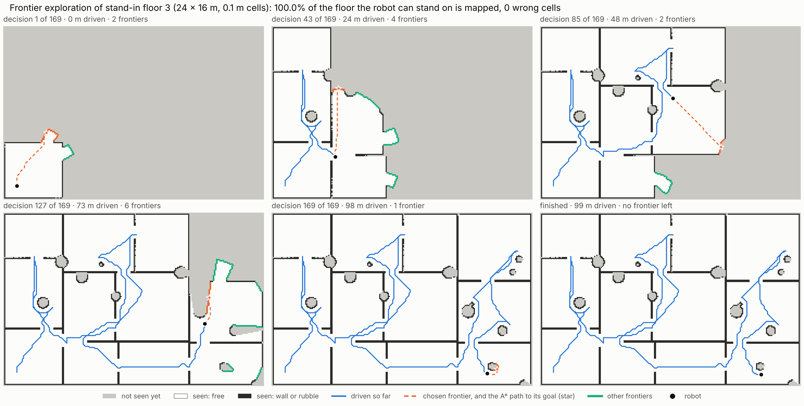

# indoor_sar: indoor search and rescue with SLAM

The sister project of the drone mission, **in progress**. A ground robot explores a damaged building with no GPS
and no true pose: it finds its own position and builds the map with SLAM, drives to the edges of what it has
mapped, and pins the people it finds on its own map. Isaac Sim knows the truth, so every error can be measured.

| Piece | State |
|---|---|
| Frontier exploration ([`indoor_sar/frontier.py`](indoor_sar/frontier.py)): where to drive next on an occupancy grid | done, tested in the stand-in |
| 2-D stand-in ([`indoor_sar/standin.py`](indoor_sar/standin.py)): a floor plan, a range sensor and the explore loop, planned with drone_lab's A* | done |
| SLAM (RTAB-Map on ROS 2), the Isaac Sim building, people pinned on the SLAM map | not started |

<p align="center">
  
</p>

## Frontier exploration

A frontier is the border between what the map knows is free and what it has not seen. The robot drives to the
nearest one it can reach, looks, and picks again; when no frontier is left, everything it can reach is mapped.
The steps, and why each is there, are in the docstring of [`frontier.py`](indoor_sar/frontier.py). The grid is a
`nav_msgs/OccupancyGrid` as RTAB-Map and Nav2 publish it (-1 unknown, 0 to 100 occupancy), so the same code will
run on the SLAM map.

In the stand-in, on 12 random floors of 24 × 16 m with rubble (seeds 100 to 111), the robot mapped all of the
floor it could stand on, on every floor, with no wrong cell, and drove 90 m on average.

The stand-in gives the robot its exact cell and a sensor that makes no mistakes. It tests the exploration logic
alone; wrong poses and a noisy map are what SLAM will bring, in Isaac Sim.

## Run it

From the repository root, with the CI dependencies (`python -m pip install -r .github/requirements-ci.txt`):

```bash
scripts/check.sh indoor                                           # 28 tests, under a minute
python indoor/scripts/explore_demo.py --seed 3 --out explore.png  # the figure above
```

Both find `drone_lab` (the A*) in `../sim/src` by themselves; numpy, scipy and matplotlib are all they need.
