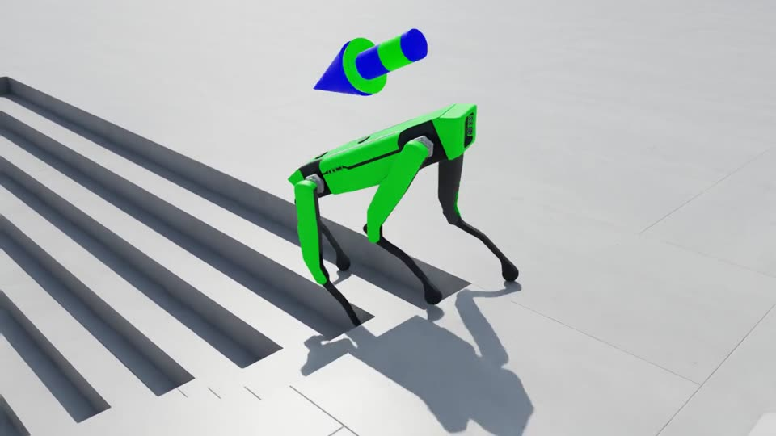

# quadruped_lab

Hector's custom 12-DOF quadruped velocity-tracking tasks, ported from Isaac Lab 2.3.2 (Isaac Sim 5.1) to
**Isaac Lab 3.0 (Isaac Sim 6.2)** as an external Isaac Lab project (template: `isaaclab --new`, external, blank).

The port details and the evidence behind each decision are in [PORT_NOTES.md](PORT_NOTES.md); the GPU validation of
2026-11-01 (metrics, verified commands, open issues) is its [section 14](PORT_NOTES.md#14-gpu-validation-2026-11-01).

[](docs/media/quadruped_followcam.mp4)

*The converted 2.x height-scan policy in Isaac Lab 3.0 (Isaac Sim PhysX, follow-cam on one of 32 robots, 20 s
episode: rough terrain, flat ground, then down a flight of stairs). Click the picture for the clip.*

| Task ID | Policy input | rsl_rl | skrl | Status |
|---|---|---|---|---|
| `Isaac-Velocity-Rough-Custom-Quad-v0` | 48 proprio + 187 height scan = 235 | MLP | yes | ported and GPU-validated; the converted 2.x checkpoint (`checkpoints_2x/height_scanner_model_rslrl5.pt`) walks at its 2.x level with the parity switches below |
| `Isaac-Velocity-Flat-Custom-Quad-v0` | 48 proprio | MLP | yes | ported, trains (no 2.x checkpoint) |
| `Isaac-Velocity-Rough-Depth-Custom-Quad-v0` | 48 proprio + 64x48 depth image (camera on the trunk's front face) | CNN | no | **experimental** 3.0 redesign, retrain from scratch; camera checked on the GPU |

The 2.x `-Play-v0` IDs are gone: `isaaclab play` applies the env config's `play_mode()` automatically
(`--train_env_cfg` skips it).

## Physics backend

All three tasks default to **Isaac Sim PhysX** (`physics=isaacsim_physx`), the backend the 2.x checkpoints were trained
on. The Isaac Lab 3.0 velocity base would otherwise default to Newton MJWarp. Newton stays available with
`physics=newton_mjwarp`. `physics=physx` (an auto preset that would pick the uninstalled OvPhysX for headless runs) is
aliased to Isaac Sim PhysX in these configs; still prefer the explicit `physics=isaacsim_physx`.

### 2.x parity switches (for the converted checkpoint)

Two Isaac Lab 3.0 execution defaults change how the 2.x policy behaves on Isaac Sim PhysX. Pass both when you replay
or fine-tune the converted checkpoint:

```
env.sim.use_newton_actuators=false env.sim.physics.enable_external_forces_every_iteration=false
```

* `use_newton_actuators=false`: 3.0's native actuator path feeds the DC-motor PD joint positions that are 1-3 physics
  substeps old on Isaac Sim PhysX (an Isaac Lab 3.0 defect); the legacy path uses fresh ones, as 2.x did. Also
  recommended for new PhysX training until upstream fixes it.
* `enable_external_forces_every_iteration=false`: the 2.3.2 TGS setting (3.0 flipped the default).

With both, the replay matches the same checkpoint run in Isaac Lab 2.3.2 (about 19 % of 20 s episodes end in a fall in
both; tracking error 0.19 m/s); without them its velocity-tracking error is about a third higher. The project defaults
stay at the 3.0 values because both switches select deprecated APIs. Numbers: PORT_NOTES section 14.2.

### Newton (opt-in)

`physics=newton_mjwarp` (or `newton_kamino`) also switches the robot through the `CustomQuadRobotCfg` preset
(`rough_env_cfg.py`); the PhysX default is untouched (identical resolved config, `robot.usd`, native order):

* **Asset**: `robot.usd` puts its collision APIs on the Xform above each collision mesh. Isaac Sim PhysX accepts that;
  Newton's importer skips all 17 colliders, and the scene does not even build (the contact sensor fails with
  `No local entities but world_count=...`). The Newton preset loads `robot_newton.usd`, a small text layer over
  `robot.usd` that moves the APIs onto the meshes as convex hulls (17 shapes, at most 64 vertices each). It is generated
  by `scripts/make_newton_asset.py` (`--check` compares it with `robot.usd`, `--newton` imports both with Newton);
  don't edit it by hand.
* **Ordering**: Newton lists joints and bodies per leg (FL hip, thigh, calf, FR ...), Isaac Sim PhysX breadth-first
  (FL/FR/RL/RR hips, then thighs, then calves). The Newton preset pins `joint_ordering` / `body_ordering` to the PhysX
  order, so observations and actions have the same layout on both backends: the converted 2.x checkpoint walks on
  Newton zero-shot (and falls within a second without the remap), and a Newton-trained policy has the layout PhysX
  expects. Newton's own order: `env.scene.robot.joint_ordering=null env.scene.robot.body_ordering=null`.
* `env.scene.robot.spawn.usd_path=<path>` still overrides the preset's asset. A list override must be quoted, e.g.
  `"env.scene.robot.joint_ordering=['FL_hip_joint', ...]"` (unquoted names are kept as one string).
* Kit-less (Newton) runs print no `INFO` records even with `--info` (no log handler is installed), so
  `scripts/check_joint_order.py` cannot read a Newton log; `robot.joint_names` / `robot.backend_joint_names` show the
  public / Newton order.
* **Speed** (rough task, 1024 envs, 30 PPO iterations, idle GPU, 2026-11-01): Newton 56k env-steps/s and 1.4 GB VRAM
  vs Isaac Sim PhysX 14k and 4.0 GB (3.9x faster, 2.9x less memory). With other jobs on the GPU, Newton ran at
  24-57k and PhysX at 10-14k. `newton_kamino` loads the same asset (zero-action stand check only).

## Setup (conda env `env_isaaclab`)

The generated `pyproject.toml` depends on `isaaclab-dev`, which exists only as the local source checkout
(`../../IsaacLab`), so install with `--no-deps` into the env that already has Isaac Lab 3.0:

```bash
source ~/anaconda3/etc/profile.d/conda.sh && conda activate env_isaaclab
cd ~/isaac_ws/projects/quadruped_lab
git lfs fsck                              # USD assets and checkpoints are Git LFS objects; checks the local copies
python -m pip install --no-deps -e .      # registers the isaaclab.tasks entry point
isaaclab list_envs                        # run from the project root: lists only this project's tasks
```

This repository has no remote yet, so its working tree already holds the binaries. In a fresh clone from an
LFS-capable remote, run `git lfs install --local && git lfs pull` first.

## Run

Quick start, verified on the RTX 5080 on 2026-11-01 (PORT_NOTES section 14.9 has the full list). Run from the project
root with `env_isaaclab` active. `train` and `play` are headless unless `--viz` is given; `zero_agent` and
`random_agent` open a `newton_gl` window by default, so pass `--viz none` for headless smoke tests. `--headless` /
`--enable_cameras` no longer exist in 3.0. Windows need `DISPLAY=:1 XAUTHORITY=/run/user/1000/gdm/Xauthority` when
started from a shell without them.

```bash
# watch the converted 2.x policy walk (Kit window, real time; close the window or Ctrl+C to stop)
isaaclab play --rl_library rsl_rl --task Isaac-Velocity-Rough-Custom-Quad-v0 --num_envs 32 \
    --checkpoint "$PWD/checkpoints_2x/height_scanner_model_rslrl5.pt" --viz kit --real-time physics=isaacsim_physx \
    env.sim.use_newton_actuators=false env.sim.physics.enable_external_forces_every_iteration=false
#   the IsaacLab panel's Viewer Settings can follow one robot; play also exports exported/policy.{pt,onnx}
#   next to the checkpoint (git-ignored)

# record the demo clip instead (headless, stops after the clip: checkpoints_2x/videos/play/clip_<n>.mp4)
isaaclab play --rl_library rsl_rl --task Isaac-Velocity-Rough-Custom-Quad-v0 --num_envs 32 --seed 42 \
    --checkpoint "$PWD/checkpoints_2x/height_scanner_model_rslrl5.pt" --video --video_length 990 \
    physics=isaacsim_physx env.sim.use_newton_actuators=false \
    env.sim.physics.enable_external_forces_every_iteration=false \
    env.viewer.origin_type=asset_root env.viewer.asset_name=robot env.viewer.env_index=30 \
    'env.viewer.eye=(1.9,-1.9,1.0)' 'env.viewer.lookat=(0.0,0.0,-0.2)'
#   without the five env.viewer.* tokens: the default fixed camera

# measure it: episode length, falls (base_contact) vs time-outs, tracking error, per-term rewards (about 1 min)
python scripts/eval_policy.py --task Isaac-Velocity-Rough-Custom-Quad-v0 --num_envs 128 --episodes 2 \
    --policy checkpoint --checkpoint "$PWD/checkpoints_2x/height_scanner_model_rslrl5.pt" --seed 42 \
    --out logs/eval/best_s42.json physics=isaacsim_physx \
    env.sim.use_newton_actuators=false env.sim.physics.enable_external_forces_every_iteration=false
#   expect: base_contact 0.18, time_out 0.82, lin_vel_err 0.187 m/s, episode_reward_total 1.491 (deterministic here)

# smoke test (zero actions: the robots sit down within 0.6 s, that is expected) + joint-order check
mkdir -p logs
isaaclab zero_agent --task Isaac-Velocity-Rough-Custom-Quad-v0 --num_envs 16 --max_steps 500 --viz none --info \
    physics=isaacsim_physx 2>&1 | tee logs/zero_agent_rough.log
python scripts/check_joint_order.py logs/zero_agent_rough.log    # "joint order OK": FL/FR/RL/RR hips, thighs, calves

# fine-tune the 2.x policy (resumes with its optimizer state; logs in ./logs/rsl_rl/custom_quad_rough)
isaaclab train --rl_library rsl_rl --task Isaac-Velocity-Rough-Custom-Quad-v0 --num_envs 1024 --max_iterations 20 \
    --checkpoint "$PWD/checkpoints_2x/height_scanner_model_rslrl5.pt" physics=isaacsim_physx \
    env.sim.use_newton_actuators=false env.sim.physics.enable_external_forces_every_iteration=false

# train from scratch: Isaac Sim PhysX, or Newton MJWarp (3.9x faster here); add --max_iterations N
isaaclab train --rl_library rsl_rl --task Isaac-Velocity-Rough-Custom-Quad-v0 --num_envs 1024 physics=isaacsim_physx \
    env.sim.use_newton_actuators=false env.sim.physics.enable_external_forces_every_iteration=false
isaaclab train --rl_library rsl_rl --task Isaac-Velocity-Rough-Custom-Quad-v0 --num_envs 1024 physics=newton_mjwarp

# experimental depth task (Newton Warp depth renderer by default; renderer=isaacsim_rtx for RTX)
isaaclab train --rl_library rsl_rl --task Isaac-Velocity-Rough-Depth-Custom-Quad-v0 --num_envs 1024 \
    physics=isaacsim_physx agent.check_for_nan=false
```

The depth runner uses a fixed learning rate (7e-5, 8 mini-batches), as the Isaac Lab 3.0 camera tasks do. The depth
camera follows the trunk through the `body_mounted_image_depth` observation term: on Isaac Sim PhysX with Newton Warp
the 3.0 camera would otherwise render from its spawn pose for the whole run (the log prints
`pose refresh from 'trunk' on (...)`). 1024 depth envs need about 5.5 GB of GPU memory (7.3 GB with RTX).
`agent.check_for_nan=false` removes the per-step NaN scan of the image (about 30 % faster; the GPU runs were NaN-free).

Useful overrides: `--max_iterations N`, `--seed N`, `--video --video_length N`, `env.scene.robot.joint_ordering=...`,
the two parity switches above. The GPU is shared: check `nvidia-smi` before launching, Isaac Sim needs a few GB free.

## Checkpoints

`checkpoints_2x/` holds copies of the 2.x checkpoints (originals in `~/quadruped_rough_terrain/logs` are untouched):

* `height_scanner_model.pt`: rsl-rl 3.x format, iteration 13900 (235 obs, 12 actions).
* `height_scanner_model_rslrl5.pt`: the same weights in rsl-rl 5.5 format, bit-identical outputs on CPU.
* `depth_camera_model.pt`: kept for reference only; its 240-dim input matches no recorded camera config.

Re-run the conversion and its CPU verification with:

```bash
PYTHONPATH=src python scripts/convert_rslrl_checkpoint.py checkpoints_2x/height_scanner_model.pt \
    checkpoints_2x/height_scanner_model_rslrl5.pt --force --verify
```

## Project layout

```
src/quadruped_lab/
  assets/custom_quad.py                      # ArticulationCfg (DC motors, package-relative USD path) + Newton variant
  assets/data/robots/custom_quad/            # robot.usd (canonical, Jan 15), robot_feb23.usd (alternative), configuration/,
                                             # robot_newton.usd + configuration/robot_physics_newton.usd (generated, Newton)
  tasks/locomotion/config/custom_quad/
    __init__.py                              # gym.register for the three task IDs
    rough_env_cfg.py, flat_env_cfg.py        # height-scan rough / flat tasks; CustomQuadRobotCfg (robot per backend)
    rough_env_depth_cfg.py                   # EXPERIMENTAL depth-camera task
    agents/rsl_rl_ppo_cfg.py                 # rsl-rl 5.5 runner cfgs (MLP, CNN for depth)
    agents/skrl_{rough,flat}_ppo_cfg.yaml    # skrl >= 2.1 configs
scripts/convert_rslrl_checkpoint.py          # rsl-rl 3.x -> 5.x checkpoint converter + CPU verification
scripts/check_obs_parity.py                  # 2.x vs 3.0 parity: observations, action, timing, MDP terms, terrain (CPU)
scripts/check_joint_order.py                 # joint order in a run log vs the order the 2.x policy expects
scripts/eval_policy.py                       # play-mode metrics: falls vs time-outs, tracking error, rewards (GPU)
scripts/make_newton_asset.py                 # writes / checks robot_newton.usd (collision APIs on the meshes)
scripts/depth_camera_study.py                # depth-camera self-occlusion and ground coverage, ray-cast on the CPU
scripts/list_envs.py                         # wrapper for `isaaclab list_envs`
checkpoints_2x/                              # 2.x checkpoints and the converted one (Git LFS)
docs/media/                                  # demo clip + poster frame for this README (Git LFS)
tests/                                       # kit-less tests (registration, configs, conversion, Newton asset)
```

## Development

```bash
python -m pip install pytest               # not installed by ./isaaclab.sh -i
PYTHONPATH=src python -m pytest tests -q   # 22 kit-less tests: run on the CPU without Isaac Sim
PYTHONPATH=src python scripts/check_obs_parity.py --markdown   # add --verbose to list all 214 compared 2.x settings
PYTHONPATH=src python scripts/depth_camera_study.py --markdown
```

VS Code: run the `setup_python_env` task (it calls `isaaclab --editor` inside `env_isaaclab`); the launch template has
Train/Play entries for the three tasks.

USD files, `*.pt`, `*.onnx`, `*.mp4` and `*.jpg` go through Git LFS (`.gitattributes`); `git lfs install --local` is
already set up in this clone.
