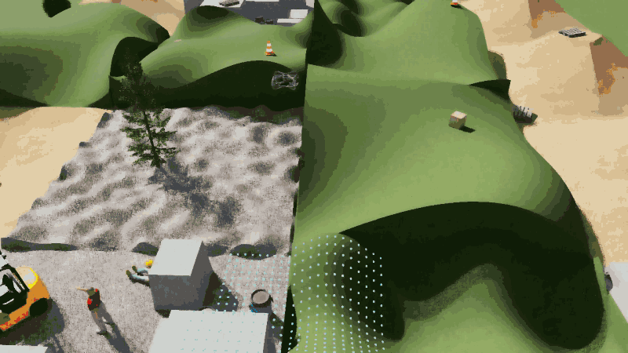
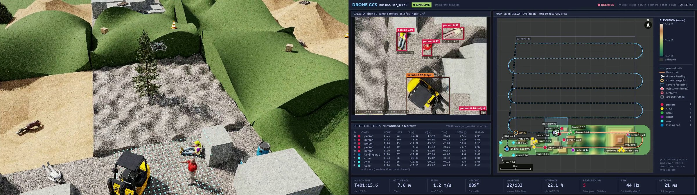
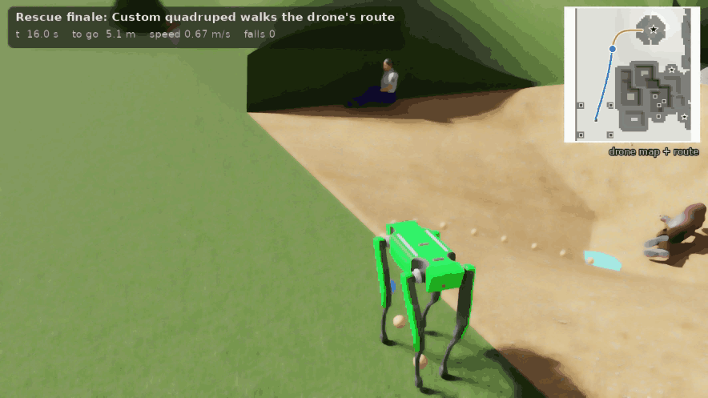
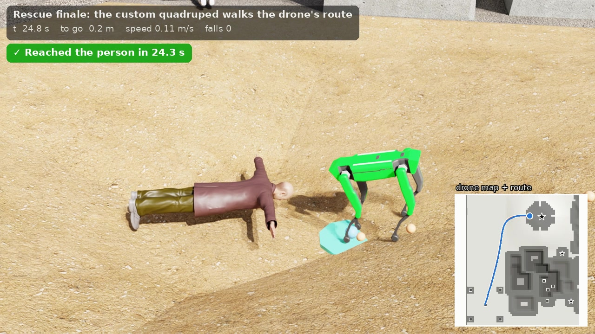
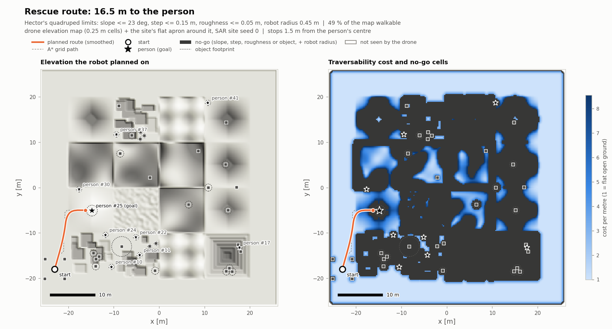
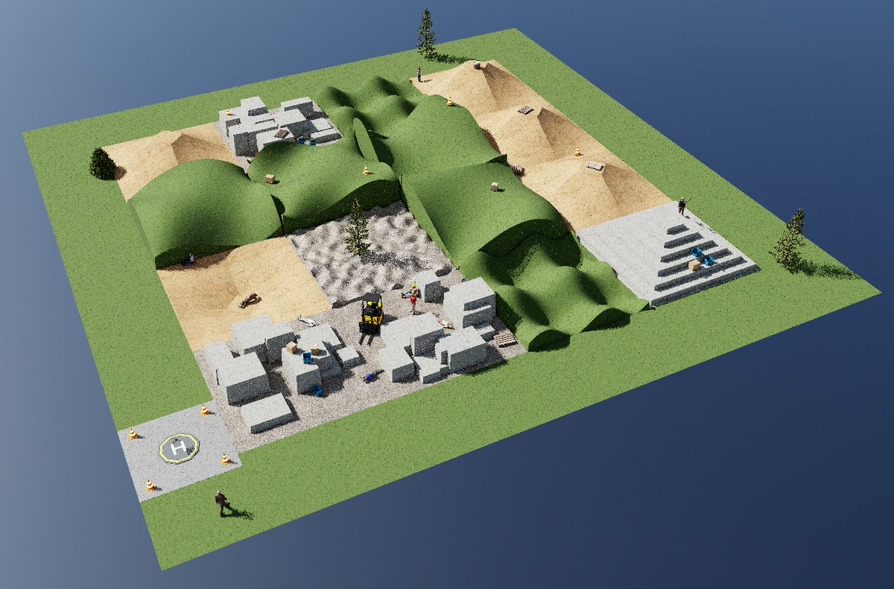
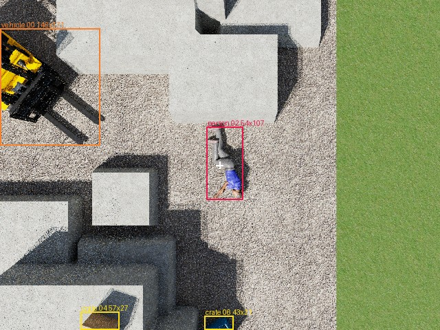
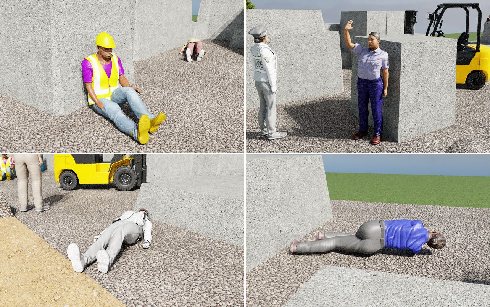
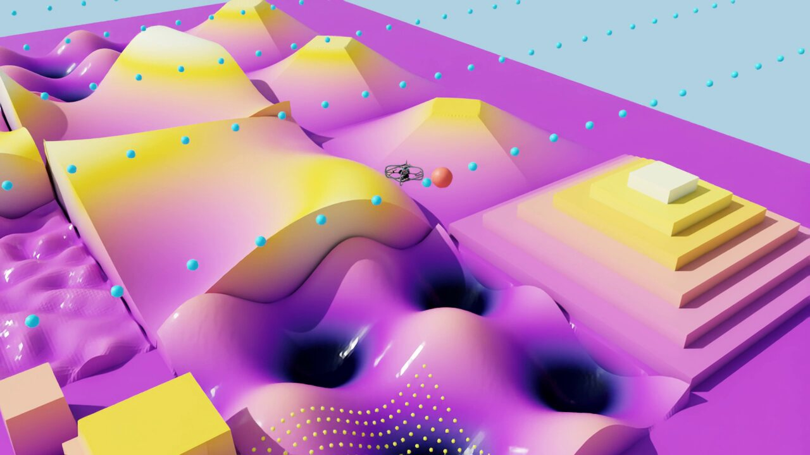
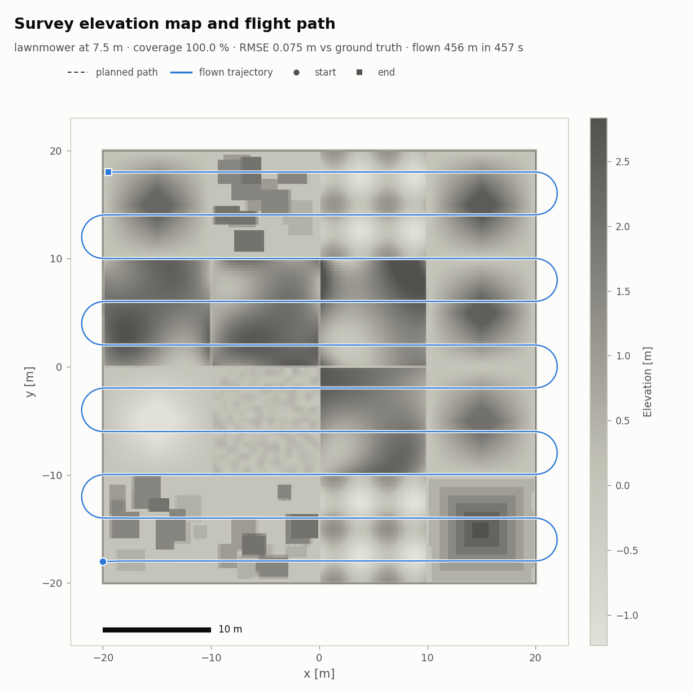

# drone_lab

The simulation side of the drone search and rescue, an Isaac Lab 3.0 / Isaac Sim 6.2 project. A quadrotor (NTNU
ARL-Robot-1) flown by a reinforcement-learning policy takes off from its landing pad, surveys a 40 m × 40 m
disaster site with a downward ray-cast scanner and an RGB-D camera, streams everything live to the ground station
([`../gcs`](../gcs/README.md)) and lands back on the pad. Then the custom quadruped
([`../quadruped`](../quadruped/README.md)) walks over the rubble to a person the drone found, on the drone's map.

<p align="center">
  
</p>

*The live mission in Isaac Sim: a follow camera over the drone, the scanner's ray hits glowing on the gravel, the
forklift and people sitting, pointing and lying around it.*

## Results

The demo site (seed 0), flown and walked with the commands below on an RTX 5080:

| | |
|---|---|
| Mission | take-off to touchdown in 6 min 16 s along a 428 m path; landed 7 mm from the centre of the pad |
| People and objects found | 10 / 10 people in the survey area and 40 / 41 objects on the site, no false alarm; pins 4 cm from the truth on average (people 6 cm). The one object missed is a responder walking outside the survey area, never in the camera's view |
| Map | 100 % of the survey area scanned and 99.8 % photographed; heights within 4 mm of the true terrain where the ground has no step (0.10 m RMSE with the block walls) |
| Rescue finale | the custom quadruped reached the person the drone found lying in the crater in 24.3 s (16.5 m, no fall); 32 robots at once: 32 / 32 in 23.9-24.7 s, no fall |
| Detector | 255 of 256 people found on 7 sites never seen in training, 54 of 54 along the mission's path ([details](../gcs/README.md#fine-tuned-detector-for-the-search-and-rescue-site)) |
| Simulation | 1.45x real time with the Isaac Sim window, the video and the ground station's detector on one machine; 6.3 GiB of GPU memory at the peak |

## Quick start

The simulator runs in the conda env `env_isaaclab` (Isaac Sim 6.2 + Isaac Lab 3.0), the ground station in `vision`
(see the [top-level README](../README.md)). This project is not pip-installed: its scripts put `src/` on the path
themselves. The trained models are release assets: `../scripts/download_assets.sh` puts the drone's flight policy
and the detector in `../downloads/`, and the quadruped's walking policy in `../quadruped/checkpoints_2x/`.

The uv setup in `pyproject.toml` comes from the Isaac Lab project template and is not needed here: its
`[tool.uv.sources]` table expects an Isaac Lab checkout two folders up (`../../IsaacLab`), and without one `uv sync`
stops with "Distribution not found".

```bash
# terminal 1, in gcs/ (conda env vision): the ground station; it waits for the drone
python scripts/gcs.py --name sar_live --weights ../downloads/drone_sar_yolo26n.pt --exit-on-end

# terminal 2, in sim/ (conda env env_isaaclab): the mission, with an Isaac Sim window that follows the drone
python scripts/sar_mission.py --checkpoint ../downloads/arl-robot-1_policy.pt --viz kit --video --out sar_live

# afterwards, in gcs/: the demo video, both recordings side by side and in step
python scripts/compose_video.py --gcs runs/sar_live --sim ../sim/runs/sar_live

# in sim/: the rescue finale on the mission's report (--goal_pin: see "Rescue finale")
python scripts/rescue_finale.py --report ../gcs/runs/sar_live --video --out finale_live
```

`../scripts/run_demo.sh` runs the ground station and the mission in one go (`--finale` adds the walk). The
[CPU tools](#cpu-tools-no-gpu-needed) (terrain preview, synthetic survey, tests) run without a GPU.

## The live mission

`scripts/sar_mission.py` flies the whole search-and-rescue mission and streams it, as it flies, to the ground
station: the drone takes off from its landing pad, flies a lawnmower over the site, comes back and lands on the pad.
The ground station builds the height map and the photo map as the drone uncovers the site, runs its YOLO detector on
the camera frames, pins every find on the map and writes the mission report when the drone has landed. Either side
may start first.



*Frame of the demo video, 75 s into the mission: on the left the Isaac Sim window, a follow camera over the drone
with its mapping rays glowing on the gravel; on the right the ground station, whose detector has just boxed three
people (sitting, pointing, lying) and the forklift in the drone camera's frame and pinned five people on the map
so far.*

**The Isaac Sim window** shows only the viewport (`--kit_ui` brings back Isaac Sim's menus and panels;
`--window_pos X Y` places it, e.g. on a second monitor) and the same view is recorded with `--video`. The camera
(`src/drone_lab/sar/chase_view.py`) follows the drone from behind and above with a wide lens, looking at a point
30 % of the way from the drone down to the ground, so the drone and its scan stay in the frame; it glides
(first-order smoothing, 0.4 s) and never looks in from beyond the terrain edge. As the drone crosses the site from
west to east the camera swings round it, from south-west to south-east of it, so at both ends of the lines it looks
back over the site instead of out over the grass border: at the east turns the survey area fills 46 % of the frame,
against 18 % for a camera that stays south-west of the drone. Two extras dress the view: the mapping scanner's 441
ray hits glow on the ground, and the site's grass runs on to the horizon instead of the terrain ending in a void.
Only the window's camera sees them: they live in their own RTX scene partition, and the drone camera gets a
partition of its own, so the detector and the photo map get exactly the frames they get without the extras
(checked: not one scan-dot pixel in the photo map of a full mission).

**Flight plan** (`src/drone_lab/sar/mission.py`, which also has the math):

| | |
|---|---|
| Height | 7.5 m: the highest terrain (3.5 m) + 4 m. The camera is 7.4 m above the ground: 1.54 cm per pixel, a lying person is 26-29 px wide |
| Camera footprint | 9.9 m across the flight line x 7.4 m along it (640 x 480 px, f = 480 px) |
| Line spacing | 5 m, 8 lines: the camera swaths overlap by 49 %; over the highest hill (camera 3.9 m above it) the swath is still 5.2 m wide, so the photo map has no gaps. The 5 m ray grid of the mapping scanner tiles the area exactly, on the 0.25 m map lattice |
| Speed | carrot 1.5 m/s, flown about 1.25 m/s. Frames every 0.1 s are 0.13 m apart (98 % forward overlap): each point stays in view about 6 s per pass |
| Path | 428 m: climb 7 m, transit 3 m, survey 375 m, return 36 m, descent and touchdown 7.5 m; about 6 minutes of flight |
| Take-off and landing | the drone starts hovering 0.5 m over the pad; at the end the carrot sinks to 5 cm over the pad, lower than the drone's body allows, and at the first contact the motors stop |

**What goes over the link** every 0.1 s step: TELEMETRY (pose, velocity, waypoint, carrot, mission phase), SCAN
(the 441 ray hits) and CAMERA (640 x 480 RGB, distance-to-image-plane depth, K and the ROS-optical camera pose):
2.15 MB per frame, about 22 MB per second of flight (45 MB/s on the local UNIX socket when a headless run goes at
2x real time). Once at the start: MISSION (area, map grid, planned path, landing pad) and, for the scorecard only,
GT_OBJECTS (the site's ground truth) and GT_TERRAIN (the true terrain height). At the end: END with the closest
approach to obstacles. The sender copies the data and returns at once (0.9 ms per step); a background thread
writes it, and a slow or missing ground station only costs dropped frames, never a stalled simulation.

Options: `--seed` (site), `--spacing`, `--altitude`, `--speed`, `--max_time` (sim seconds), `--video` and
`--view chase|overview` (records `runs/<out>/mission.mp4`, real time by default, and `mission_frames.csv`, the sim
time of every frame), `--no_scan_rays`, `--window_pos X Y`, `--kit_ui`, `--markers` (the carrot and path
markers; off by default because the drone camera sees the ones below it at take-off and landing, and the detector
may pin them), `--gt_boxes` (adds the objects' boxes from the instance segmentation to every frame, for the ground
station's `--detector gt`), `--jpeg`, `--camera_every N`, `--gcs <address>`, `--gcs_root <dir>` (the ground
station's folder when it is not next to this one), `--no_gcs`. Without `--viz kit` it runs headless. Outputs in
`runs/<out>/` (default `sar_mission_seed<seed>`): `mission.json` (plan, outcome, closest approach, loop and link
timing, GPU memory), `trajectory.csv`, `ground_truth.json`.

**Result** (seed 0, the commands of the quick start: both windows open, the chase view recorded, the ground station
with the fine-tuned detector). The drone lands on its pad after 6 min 16 s and 428 m, 7 mm from its centre; over
the survey it holds 7.68 m with 0.10 m standard deviation and tilts 0.7 degrees on average. The ground station
scanned 100 % of the area and photographed 99.8 %. It found all 35 objects in the survey area, the 10 people among
them, and 5 of the 6 around the landing pad, with no false alarm and pins 4 cm from the truth on average (people
6 cm); the one it missed is a responder walking 5.6 m south of the pad, outside the survey area, whom the camera
never saw. Its height map is within 4 mm of the true terrain where the ground has no step (0.10 m RMSE with the
block walls). Closest approach to an obstacle: 2.4 m, the crown of a tree. With the window, the video and the
ground station's YOLO on the same machine the simulation runs at 14.5 steps per second (1.45x real time): the step
with the RTX render 61 ms, the chase view 2.4 ms, the video frame 3.9 ms, the link 0.9 ms; 6.3 GiB of GPU memory at
the peak.

Headless, the same flight runs at 17-22 steps per second (1.7-2.2x real time), and a run with the same detector
found the same 40 objects, again without a false alarm. The comparison with the stock COCO detector, the geometry
check with perfect boxes and the loop rates are in the [ground station's results](../gcs/README.md#results).

## Rescue finale: the custom quadruped walks to a person the drone found

<p align="center">
  
</p>

After the mission, a ground robot goes to a person the drone found. The custom quadruped (`quadruped_lab`, the
converted Isaac Lab 2.x height-scan policy, unchanged) gets the drone's elevation map and its pins of people and
objects from the ground station's mission report. It works out where it can walk (slope, step height, roughness,
object footprints, its own size), plans the cheapest safe route with A*, and follows it with pure pursuit. It starts
on the drone's landing pad and walks on Isaac Sim PhysX, the drone mission's backend, over the same seeded terrain
and dressed site. Method, options and tests: [`src/drone_lab/teaming/README.md`](src/drone_lab/teaming/README.md).





*Planned on the report of the recorded live mission (10 of 10 people found): from the landing pad north along the
border, then straight down the crater's west wall to pin #32, the person the drone saw lying in the recovery
position on the crater floor (the pin is 0.05 m from person_08's true centre). Top: the arrival in the follow-cam
video, with the minimap of the drone's map and the walked track. Bottom: the elevation the robot planned on (the
drone's map plus the known flat border around the surveyed area) and the traversability cost with the no-go cells.*

The recorded finale on the live mission's report (one robot, `--goal_pin 32 --video`): the robot reached the person
in 24.3 s, walked 16.5 m of the 16.5 m route without a fall and stopped 1.74 m from the drone's pin (1.69 m from the
person's real centre). With 8 robots at once on the same route: 8/8 in 24.0-24.4 s, no fall.

| Map and pins | Person | 32 robots at once, no second tries | Planned route | Falls |
|---|---|---|---|---|
| the recorded live mission's report (`--report <ground-station run> --goal_pin 32`) | pin #32, in the recovery position in the crater (person_08) | 32/32 reached, 23.9-24.7 s | 16.5 m | 0 |
| terrain + site ground truth (default without a report) | person_08 in the crater | 32/32, 23.5-24.1 s | 16.1 m | 0 |
| ground truth, `--goal_pin person_04` | person_04, lying by the collapsed buildings | 32/32, 28.3-29.3 s | 17.5 m | 0 |
| ground truth, `--max_slope 22` | person_08, from the crater rim | 32/32, 34.7-36.8 s | 23.7 m | 0 |
| ground truth, `--sar_seed 3` (another site) | that site's person_04, lying face up | 32/32, 33.5-38.3 s | 20.7 m | 0 |
| the drone's survey map `runs/lawnmower_v1` + the site's pins | person_08, from the crater's north rim | 32/32, 32.4-33.1 s | 22.8 m | 1 |

On the plain survey map the route comes down the crater's north wall, where one robot of the 32 tipped over 0.1 s
after arriving.

**Which person.** The pins do not say how a person lies, sits or stands; the height of a pin above the mapped ground
tells a person on the ground from one on their feet (on the demo site 0.1-0.5 m for people lying or sitting,
0.8-1.9 m for standing ones). So the planner picks a person on the ground 15-25 m from the start first and gives
them a larger footprint; on the recorded mission's report that is a person sitting 18.4 m away (pin #37; 8 robots at
once: 8/8 in 26.7-27.1 s, no fall). `--goal_pin` names a pin of the report instead (its id in `report.md`): the
recorded finale walks to the person lying in the crater with `--goal_pin 32`. The ground station numbers its pins in
the order it first sees each find, so another run of the mission may number them differently.

**Steep ground along the fall line.** Turning on a steep descent is what makes this policy run away downhill: a
route that turned on the crater wall in its last metre made a recorded robot run away at 2.2 m/s and tumble into the
person half a second after arriving. So the custom quadruped's planner also pays for the slope across its direction
of travel, and its routes turn on flat ground and come down the fall line
([details](src/drone_lab/teaming/README.md#the-robots-robotspy)).

**The textured site and the Go2.** The site's textured terrain needed one change for walking robots: on PhysX a
collision mesh with material face subsets stops colliding (the robot fell through the ground), so the rescue tasks
move the textures to a render-only copy of the terrain mesh. The Unitree Go2 with Isaac Lab's rough-terrain policy
is a fallback (`--robot go2 --checkpoint <its model_*.pt>`, on Newton: that policy flips within about 2 s on PhysX);
it reached the crater person 4/4.

```bash
CUDA_VISIBLE_DEVICES= python scripts/rescue_finale.py --plan_only --out rescue_plan    # CPU, seconds: plan only
python scripts/rescue_finale.py --report ../gcs/runs/<mission> --goal_pin <id> --video --out finale_mission
python scripts/rescue_finale.py --video --out finale_gt                  # without a report: the ground truth
python scripts/rescue_finale.py --num_envs 32 --out finale_x32           # 32 robots at once: success rate, falls
```

Each run writes `runs/<out>/plan.png`, `walk.png`, `summary.txt` and, with `--video`, `rescue.mp4` (a title card
with the plan, the follow-cam walk with a HUD and a minimap, an end card with the result) plus `rescue_share.mp4`
(about 5x smaller, for sharing).

## The search-and-rescue site (`DroneLab-SAR-ARL-Robot-1-v0`)

The survey area dressed as a disaster site: 6-10 victims lying, sitting or waving for help (many of them next to
the blocks of "collapsed buildings") and two or three responders, a forklift, crates, barrels, pallets, traffic
cones, trees, textured ground and a landing pad at the start of the path. A seeded generator places every object
on the exact terrain mesh (flat footing, no overlaps, nothing inside a block) and writes the ground truth: class,
position, size and pose of each object. The drone carries a downward 640 x 480 RGB-D camera with instance
segmentation, so every frame comes with exact labels and boxes for training a detector; a lying person is 26-29 px
across the shoulders at survey altitude. The policy inputs are unchanged, so the same trained policy flies it. The
camera costs about 35-50 ms per step and 2.4 GB of GPU memory. Details:
[`src/drone_lab/sar/README.md`](src/drone_lab/sar/README.md).





*Seed 0 (`scripts/sar_preview.py`): the helipad with its cones and a responder walking past it, people among the
blocks, the forklift. Below: a drone-camera frame at survey altitude with the boxes and classes from the instance
segmentation (a victim in the recovery position, the forklift, two crates).*

```bash
python scripts/sar_preview.py            # GPU, ~1 min: overview, photo map with GT pins, drone frames, checks
python scripts/sar_preview.py --no_sim   # CPU, seconds: ground truth + object map
python scripts/gen_yolo_dataset.py --out ../datasets/drone_sar_yolo_v2/capture   # GPU, ~7 min: 2118 labelled frames of 44 sites
```

**Natural people (the default).** The victims lie on their back or in the recovery position, sit against the
rubble or wave for help, and two or three responders by the forklift and the helipad look around, point or walk.
Each pose is a frame of Isaac Sim's own animation clips (idle, wave, sit, look-around, point, walk), retargeted onto
the character's skeleton on the CPU and baked into a static mesh ([`people.py`](src/drone_lab/sar/people.py)), so
it looks the same in RGB, depth and segmentation (class `person`) and costs nothing per frame. Every pose also comes
mirrored (the other arm waves, the other knee is up), so two people in the same pose are not copies.
`people_style=tpose` gives Isaac Sim's characters in their rest T-pose instead, standing or lying flat, without
responders. The rest of the site is the same in both; the natural victims keep the names of the T-pose ones and
stay within 1 m of their places, resting on the terrain through the under-side height map of their pose.



*Close-ups from `sar_preview.py --closeups` (seeds 0 and 1). Top: a worker sitting against a block, a woman waving
from a sand hill, an officer in the recovery position. Bottom: a worker on his back, and two responders, one
pointing ahead (a victim lies behind him) and one walking.*

```bash
python scripts/sar_preview.py --closeups              # GPU, ~2 min: + close-ups of every pose
python scripts/sar_preview.py --people_style tpose     # the T-pose people (runs/sar_preview_seed0_tpose)
# in any SAR task or script, the Hydra token:  env.scene.sar_site.spawn.people_style=tpose
```

The ground station's detector (YOLO26n) is fine-tuned on that dataset. In the 183 test frames along the survey path
over the demo site it finds every person (54 sightings) without a false alarm, and 255 of the 256 people in the
frames of 7 held-out sites; the stock COCO model finds 31 and 107. The same recipe trained on T-pose people misses
13 of those 256, most of them responders on their feet. Details: [the ground station's README](../gcs/README.md).

## The survey: how the drone flies and maps



*Isaac Sim, chase camera: the RL-controlled quadrotor follows the red carrot along the planned path (cyan dots);
the yellow dots are its mapping rays hitting the ground. Frame from `survey_map.py --video --camera chase --show_rays`.*

1. **The pilot is a reinforcement-learning policy** trained on Isaac Lab's built-in task
   `IsaacContrib-TrackPositionNoObstacles-ARL-Robot-1`. That policy learned one thing: fly from up to 1 m away to a
   target point and hover there. It reads 17 numbers per step: where it is relative to the target (3), its
   orientation quaternion (4), body velocity (3), body rotation rate (3) and its previous action (4). It outputs
   four rotor thrusts.
2. **A "carrot" turns that hover skill into path following.** The survey task
   `DroneLab-Survey-ARL-Robot-1-v0` keeps exactly the same 17 inputs, but the "target" is a carrot that slides
   along the survey path at the requested speed. The carrot never gets more than 1 m ahead of the drone (it slows
   down and waits), and the observed offset is clamped to the +-1 m box the policy saw in training. So the same
   trained network flies the whole survey unchanged.
3. **The survey area** is built with Isaac Lab's terrain generator: 16 tiles of 10 m (hills, rough ground,
   pyramids, a pit, waves, stepped blocks, stairs), heights from about -1.4 m to 3.5 m, inside a flat 6 m border.
   It is seeded and fully deterministic, so the CPU preview shows exactly what the simulator builds.
4. **Mapping:** a 5 m x 5 m grid of 441 vertical rays (0.25 m apart) hangs under the drone (gimballed: it stays
   level when the drone tilts). Every step the ray hits are binned into 0.25 m cells; each cell's height is the
   median of its hits. The survey lines run 2, 6, 10 ... m from the area edge, so the rows of rays fall on a
   0.25 m lattice; the cell edges are placed midway between those rows, so each row crosses the middle of its
   cells instead of their edge. The ground truth is a dense vertical ray cast of the exact terrain mesh.
5. **Metrics:** coverage of the area, map RMSE / MAE / max error (also "away from steps", since a 0.25 m cell
   straddling a 2 m wall is ambiguous by nature), the sensor-only error (map vs the true terrain under the very
   same rays, independent of where the rays landed in each cell), path length, cross-track error between plan
   and flight, and the drone-carrot distance.

### Survey results

Flown over the bare terrain with the built-in tracking policy after 1300 training iterations (the release asset
`arl-robot-1_policy.pt`) on Isaac Sim PhysX, RTX 5080.



| Run | Flight | Coverage | Map RMSE (cells without a step) | Cross-track RMS / max |
|---|---|---|---|---|
| lawnmower, 1 drone, `--speed 1` | 456 m path in 457 s, no crash | 100 % | 0.075 m (0.010 m) | 3.0 / 5.3 cm |
| lawnmower, 1 drone, `--speed 1.5` | 456 m path in 392 s, no crash | 100 % | 0.080 m (0.012 m) | 4.0 / 7.6 cm |
| lawnmower, 3 drones, `--speed 1.5` | 176 m each in 151 s, no crash | 100 % | 0.110 m (0.025 m) | 3.8 / 7.8 cm |

* **Map error** sits on the edges of steps and walls (a 0.25 m cell across a 2 m wall is ambiguous). The 88 % of
  the cells with no step inside are mapped to about 1 cm. The drone never came closer than 4.7 m to the ground.
* **How the policy follows the carrot:** about 0.75 s behind it (0.75 m at 1 m/s). It never saw a moving target in
  training and only saw offsets up to 1 m, so it tops out near 1.3 m/s however fast the carrot goes (commanded
  1.5 / 2 / 3 m/s gives 1.16 / 1.23 / 1.31 m/s). `--speed 1.5` is the sweet spot: 14 % faster, smoother, same map.
  On +x legs (flying nose first) it flies about 0.2 m high with a small speed ripple every 2 s; on -x legs it stays
  within 1 cm. Training `DroneLab-TrackTrajectory-ARL-Robot-1-v0` on moving targets is the real fix.
* **Simulation speed** (sim time / wall time, RTX 5080): about 5-8x real time without video (2.6 GB of GPU
  memory), 2.3x with the headless video camera (4.9 GB), 1.6-2x with the live window (`--viz kit`, 5.1 GB). Video
  and window runs also need 13-16 GB of RAM while Kit starts. A large training job on the same GPU slows a survey
  to about 0.5x, so give a live demo the GPU to itself.
* **Video:** `--video --camera chase --show_rays` records the survey with the chase camera and the ray hits. The
  videos are 3x time-lapses (one frame per 0.1 s, written at 30 fps): 131 s of video for the 392 s flight.
* **Start:** right after the spawn the drone dips about 15 cm and recovers within a second, so it first hovers
  `--settle` seconds (default 1.5) at the start of the path; the video starts after the hover.

## Layout

```
src/drone_lab/
  terrain.py        survey area (TerrainGeneratorCfg) + deterministic sub-terrain wrappers, CPU generation
  paths.py          lawnmower / spiral / figure-8 / custom waypoints, polyline geometry   (numpy only)
  carrot.py         moving target: speed, lead limit, offset clamp                          (torch only)
  mapping.py        elevation map, mesh ground truth, coverage and error metrics            (numpy only)
  survey_io.py      run directory format, trajectory log, summary                           (numpy only)
  plotting.py       all figures                                                              (matplotlib)
  synthetic.py      CPU-only kinematic survey (pipeline test without Isaac Sim)
  video.py          headless MP4 capture from a Kit visualizer, shared by the GPU scripts    (numpy only)
  reference.py      reference trajectories for the tracking task                            (torch only)
  register.py       task-registration callback for the isaaclab CLI without pip install
  sar/              search-and-rescue site: assets, seeded scenario + ground truth, camera, spawner, labels,
                    mission plan, chase view (follow camera, scan rays, ground skirt)
  teaming/          rescue finale: traversability, A* planner, pure-pursuit follower, inputs, robots, figures
  tasks/
    physics.py      physics preset (Isaac Sim PhysX)
    survey/         DroneLab-Survey-ARL-Robot-1-v0          (flies the built-in policy, not for training)
    sar/            DroneLab-SAR-ARL-Robot-1-v0             (the survey over the dressed site, with the camera)
    rescue/         DroneLab-Rescue-CustomQuad-v0           (the custom quadruped walks a planned route; PhysX)
                    DroneLab-Rescue-Go2-v0                  (the Go2 fallback; Newton physics)
    track_trajectory/ DroneLab-TrackTrajectory-ARL-Robot-1-v0 (new RL task: follow moving references)
scripts/
  survey_map.py     GPU: fly the survey with a trained policy, map, score, plot, video
  plot_survey.py    any Python with matplotlib: figures for a run directory
  preview_area.py   CPU: terrain height map + planned path, no flight
  synthetic_survey.py CPU: full pipeline with a kinematic stand-in for the policy
  eval_trajectory.py  GPU: evaluate a trajectory-tracking policy (reference vs flown, RMSE)
  sar_preview.py    GPU: render the SAR site (overview, photo map, drone frames) and check its scale and labels
  sar_mission.py    GPU: the search-and-rescue mission, streamed live to the ground station
  gen_yolo_dataset.py GPU: render the detector dataset (RGB + instance segmentation over many seeded sites)
  rescue_finale.py  rescue finale: plan on the drone's map (CPU), walk it with the quadruped (GPU), follow-cam video
tests/              CPU tests (run_cpu_tests.py or pytest)
docs/images/        Isaac Sim figures (isaac_*, sar_*, rescue_*) and CPU-pipeline previews (synthetic_*, area_preview)
```

## GPU phase: train, export, survey, plot

Run everything from this folder in the conda env `env_isaaclab`. Training logs land in `./logs/`, survey results in
`./runs/` (both git-ignored).

```bash
# 1. Train the built-in position-tracking policy (Isaac Sim PhysX; 1500 iterations x 4096 envs).
#    Do NOT add physics=...: this built-in task declares no physics presets, so any physics= selector is
#    rejected with "Typed preset selector(s) ... did not match"; its default is already Isaac Sim PhysX.
isaaclab train --rl_library rsl_rl --task IsaacContrib-TrackPositionNoObstacles-ARL-Robot-1 \
    --num_envs 4096 --max_iterations 1500 --seed 42

# 2. Export it (writes exported/policy.pt + policy.onnx next to the checkpoint). Play keeps looping
#    until Ctrl+C; the export happens first, so a timeout is enough. (--video would need moviepy<2.)
timeout --signal=INT 600 isaaclab play --rl_library rsl_rl \
    --task IsaacContrib-TrackPositionNoObstacles-ARL-Robot-1 --num_envs 16 --checkpoint latest
RUN=$(ls -td logs/rsl_rl/arl_robot_1_track_position_state_based/*/ | head -1)
ls $RUN/exported        # policy.pt  policy.onnx

# 3. Quick smoke test of the survey (1 minute of flight, no video)
python scripts/survey_map.py --checkpoint ${RUN}exported/policy.pt --max_time 60 --out smoke

# 4. Full lawnmower survey with video (headless camera over the whole area; 3x time-lapse)
#    Ctrl+C stops the flight early and still saves everything flown so far (marked PARTIAL RUN).
python scripts/survey_map.py --checkpoint ${RUN}exported/policy.pt --pattern lawnmower \
    --altitude 4 --spacing 4 --speed 1.0 --video --out lawnmower_v1

# 5. Figures (survey_map.py already makes them; re-run any time, in any Python with matplotlib)
python scripts/plot_survey.py runs/lawnmower_v1
```

The released policy (`../downloads/arl-robot-1_policy.pt`) works in place of `${RUN}exported/policy.pt` in every
command. More survey variants:

```bash
python scripts/survey_map.py --checkpoint ${RUN}exported/policy.pt --pattern spiral --out spiral
python scripts/survey_map.py --checkpoint ${RUN}exported/policy.pt --num_envs 3 --speed 1.5 --out three_drones
python scripts/survey_map.py --checkpoint ${RUN}exported/policy.pt --video --camera chase --show_rays --out chase
python scripts/survey_map.py --checkpoint ${RUN}model_1499.pt --sensor lidar --out lidar   # raw checkpoint works too
python scripts/survey_map.py --checkpoint ${RUN}exported/policy.pt --viz kit               # watch it live (wide view)
python scripts/survey_map.py --checkpoint ${RUN}exported/policy.pt --viz kit --video --camera chase --show_rays \
    --speed 1.5 --out live_chase           # live window that follows the drone, and records the clip
python scripts/survey_map.py --checkpoint ${RUN}exported/policy.pt --print_config          # check, no simulator
```

`survey_map.py` options: `--pattern lawnmower|spiral|figure8|waypoints`, `--waypoints file.csv|json` (x,y flown at
the survey altitude, or x,y,z absolute; implies `--pattern waypoints`, and combining it with another `--pattern`
is an error), `--altitude` (clearance above the highest terrain point, default 4 m), `--spacing` (default 4 m;
keep it below the 5 m footprint), `--speed` (default 1 m/s), `--max_lead` (default 1 m), `--turn round|square`,
`--direction x|y`, `--num_envs N` (drones split the area into strips), `--sensor grid|lidar`, `--map_resolution`
(keep it a multiple of the 0.25 m ray spacing), `--reducer median|mean|max|min`, `--max_time`, `--settle`
(seconds of hover at the start before the carrot moves, default 1.5), `--video`,
`--camera overview|chase`, `--video_fps` (default 30: one frame per 0.1 s step, so a 3x time-lapse; 10 plays in
real time), `--show_rays`, `--seed`, `--out`. Trailing `key=value` tokens are Hydra overrides of the task config,
e.g. `env.commands.survey_target.turn=square`.

Watching the survey task in the `isaaclab` CLI needs the project installed in env_isaaclab, or the no-install
callback:

```bash
python -m pip install --no-deps -e .      # registers the DroneLab-* tasks
isaaclab play --task DroneLab-Survey-ARL-Robot-1-v0 --checkpoint ${RUN}model_1499.pt --viz kit physics=isaacsim_physx

# or without installing:
PYTHONPATH=src isaaclab play --rl_library rsl_rl --external_callback drone_lab.register.register_tasks \
    --task DroneLab-Survey-ARL-Robot-1-v0 --checkpoint ${RUN}model_1499.pt --viz kit
```

(`--checkpoint latest` does not work for the survey task: `latest` only searches runs trained on the same task.)

### Optional: train a trajectory-tracking policy

`DroneLab-TrackTrajectory-ARL-Robot-1-v0` teaches the drone to follow moving references (circles, figure-eights,
Lissajous curves, smooth random curves; size 0.8-2.5 m, peak speed 0.3-1.5 m/s, small height changes). The policy
sees its position and velocity error to the reference and two look-ahead points (0.5 s and 1 s ahead), plus
orientation, body rates and last action (26 inputs). It needs the project installed (or the callback above).

```bash
isaaclab train --rl_library rsl_rl --task DroneLab-TrackTrajectory-ARL-Robot-1-v0 --num_envs 4096 --max_iterations 2000
TRUN=$(ls -td logs/rsl_rl/drone_lab_track_trajectory/*/ | head -1)
python scripts/eval_trajectory.py --checkpoint ${TRUN}model_1999.pt --shape figure8 --size 2 --speed 1.0 --duration 30
```

`eval_trajectory.py` writes `runs/<name>/trajectory_tracking.png` (3D and top view of reference vs flown, error
over time with the RMSE), `trajectory_eval.csv` and `eval_summary.json`; with `--video` also `trajectory.mp4`
(chase camera with the reference and look-ahead markers; `--video_fps`, default 30 = 3x time-lapse).

## Outputs of a survey (`runs/<name>/`)

| File | Content |
|---|---|
| `trajectory.csv` | one row per drone per 0.1 s step: time, position, quaternion (x,y,z,w) and roll/pitch/yaw, world velocity, body rates, speed, carrot position and distance, path arclength / progress / segment index, the (clamped) offset the policy saw, carrot speed gate, height above ground |
| `planned_path.csv` | planned waypoints per drone with arclength |
| `elevation_map.npy` | 2.5D map from the ray hits, (ny, nx) float32, NaN where nothing was seen |
| `hit_count.npy` | ray hits per cell |
| `ground_truth.npy`, `ground_truth_range.npy` | true terrain height per cell, and the height spread inside each cell (steps/walls) |
| `hits.npy` | subsampled ray hits, world frame: time, drone, x, y, z |
| `map_meta.json`, `summary.json`, `summary.txt` | grid and area, all metrics (map error vs the cell-mean truth, away from steps, and sensor-only vs the truth under the same rays), short text summary; `interrupted` is set for a partial run (Ctrl+C or an error) |
| `map_with_trajectory.png`, `map_error.png`, `map_3d.png`, `altitude_profile.png` | figures; cells without ray hits are outlined |
| `survey.mp4` | video (with `--video`): one frame per 0.1 s policy step written at `--video_fps` 30, i.e. a 3x time-lapse (`--video_fps 10` for real time); it starts after the `--settle` hover |

## CPU tools (no GPU needed)

```bash
CUDA_VISIBLE_DEVICES= python scripts/preview_area.py --pattern lawnmower           # runs/preview_lawnmower/
CUDA_VISIBLE_DEVICES= python scripts/synthetic_survey.py --out synthetic_lawnmower  # whole pipeline, ~4 s
CUDA_VISIBLE_DEVICES= python tests/run_cpu_tests.py                                 # every CPU test, ~1 min
python -m pytest tests     # any Python with numpy, scipy, matplotlib and pytest: the tests that need torch skip
```

## Adapting the area and the path

* **Area:** edit `SURVEY_TERRAIN_CFG` in `src/drone_lab/terrain.py` (tile size, rows/cols, sub-terrain mix and
  heights, `seed`). Keep `slope_threshold=None` (with Isaac Lab's default 0.75 the height-field mesh gets 0.1 m
  slits at tile edges that rays fall through) and avoid `MeshRandomGridTerrainCfg` (random on CUDA, so the CPU
  preview would differ). Preview with `scripts/preview_area.py`.
* **Survey rectangle:** by default the whole sub-terrain grid; override it with Hydra tokens, e.g.
  `'env.commands.survey_target.area=[-15,15,-15,15]' env.commands.survey_target.area_margin=1.0`
  (quote the brackets in zsh).
* **Path:** `--pattern`, `--spacing`, `--altitude`, `--turn`, `--direction`, or your own waypoints file.
  Coverage needs spacing <= footprint (5 m). When the survey lines sit at multiples of 0.25 m from the area edge
  (the default: 40 m area, 4 m spacing), every row of rays crosses the middle of its cells. Other spacings or
  drone counts (e.g. 3 drones: lines 3.33 m apart) put the rows elsewhere inside the cells, which costs about
  1-2 cm of RMSE away from steps on this terrain; the summary's "map error (sensor)" line stays independent of
  that. With the default area, 2 or 5 drones keep the 4 m lines; 4 drones do not (each 10 m strip gets 3 lines
  3.33 m apart).
* **Sensor:** `--sensor lidar` (downward cone, 1152 rays) or edit `MAPPING_GRID` in
  `tasks/survey/config/arl_robot_1/survey_env_cfg.py`.
* **Speed:** the carrot slows down as the drone falls behind and never gets more than `max_lead` ahead; if the
  drone cannot keep up, the survey just takes longer. With the current policy, commands above about 1.3 m/s only
  keep the carrot at the lead limit (see Survey results). Watch `altitude_profile.png` (speed and carrot panels).

## Notes and limits

* **Physics backend:** the multirotor is PhysX-only in Isaac Lab 3.0: `isaaclab_contrib.assets.Multirotor`
  subclasses the PhysX articulation and applies the rotor wrench through the PhysX view, and the built-in task
  says the thruster model has no Newton path. The survey and trajectory tasks therefore declare only the
  `isaacsim_physx` preset (`physics=newton_mjwarp` fails early with a clear message). The ray caster itself has
  PhysX and Newton backends.
* **Video:** Isaac Lab's built-in `--video` needs `moviepy<2`; `survey_map.py`, `eval_trajectory.py` and
  `sar_mission.py` grab frames from a Kit camera and write MP4 with imageio-ffmpeg instead.
* **Generalisation:** the policy never saw a moving target in training. The carrot keeps its inputs in range;
  in Isaac Sim it lags about 0.75 s behind the carrot and tops out near 1.3 m/s (see Survey results).
* The built-in tracking task gives the `flat_orientation_l2` penalty a positive weight (+1.0); the new
  trajectory task uses -1.0.
* The synthetic runs use a point-mass stand-in for the policy, so their tracking numbers are not the policy's.
* A survey stops for a drone when it crashes (contact with anything, flipping, or falling below the terrain).
  If the contact check ever fires without a real collision, disable it for a run with the Hydra token
  `env.terminations.collision=null`.
* `survey_map.py` also accepts the raw training checkpoint (`model_*.pt`), so step 2 (export) is optional.

## Design notes

* **Map grid aligned with the rays.** The survey lines sit at 2, 6, 10 ... m from the area edge, so the 0.25 m
  rows of rays fall on a 0.25 m lattice. A grid anchored at the area edge would put every row on a cell edge:
  each cell would be measured along its edge, shifting the map by 12.5 cm across the lines (opposite-signed
  errors on north- and south-facing slopes). `GridSpec.for_survey` moves the cell edges midway between the ray
  rows (half the ray spacing, which also keeps `--map_resolution 0.5` or `1.0` symmetric). Synthetic lawnmower:
  RMSE 0.086 m instead of 0.155 m, away from steps 0.006 m instead of 0.046 m. The summary also reports a
  sensor-only error: the map against the true terrain under the very same rays. That number does not depend on
  where the rays landed and is 0.000 m for the exact synthetic rays. Line spacings off the lattice (3 drones:
  lines 3.33 m apart) stay at about 0.017 m away from steps.
* **Markers in the trajectory video.** `eval_trajectory.py --video` captures frames the way Isaac Lab's own
  recorder does (sync the stage, then run the marker callbacks), so the reference and look-ahead spheres move.
  Both GPU scripts share `drone_lab/video.py`.
* **Partial runs are kept.** Ctrl+C or an error during the flight saves everything logged so far (summary, map,
  plots, marked PARTIAL RUN) before the script exits; an error is re-raised after saving. A CPU test runs
  `survey_map.py` offline with a stand-in environment through both paths.
* **Coverage holes are visible.** Cells without ray hits are outlined in both map figures, in light and dark
  themes, so a hole does not read as "lowest terrain" or "zero error". The "no ray hits" legend entry only
  appears when there are holes.
* **Video speed is stated.** `survey.mp4` is a 3x time-lapse by default (10 Hz frames written at 30 fps);
  `--video_fps 10` plays in real time. The factor is printed and stored in the summary.
* **`--waypoints` with another `--pattern`** stops with a clear message instead of flying the generated pattern
  (`survey_map.py`, `synthetic_survey.py`, `preview_area.py`).
* **The carrot keeps moving at high speed.** A carrot step that would end more than `max_lead` from the drone is
  shortened to the remaining lead. Rejecting the whole step instead makes the carrot stop and go above 3 m/s
  commanded and stall for good at 10 m/s; at `--speed 6` the carrot waits on 0 % of the steps instead of 84 %,
  and the survey flies 1.32 m/s instead of 0.97 m/s. Test: `test_carrot_keeps_moving_at_high_commanded_speed`.
* **Time budget.** The default `--max_time` assumes at most 1 m/s, so fast commands do not cut the survey short,
  and the log and summary say when the time limit stopped a flight (the summary also records wall time and the
  real-time factor).
* **`--settle`.** The drone hovers 1.5 s at the start before the carrot moves, so the video starts without the
  spawn dip (vertical speed in the first 2 s of video: 0.17 m/s instead of 0.58 m/s).
