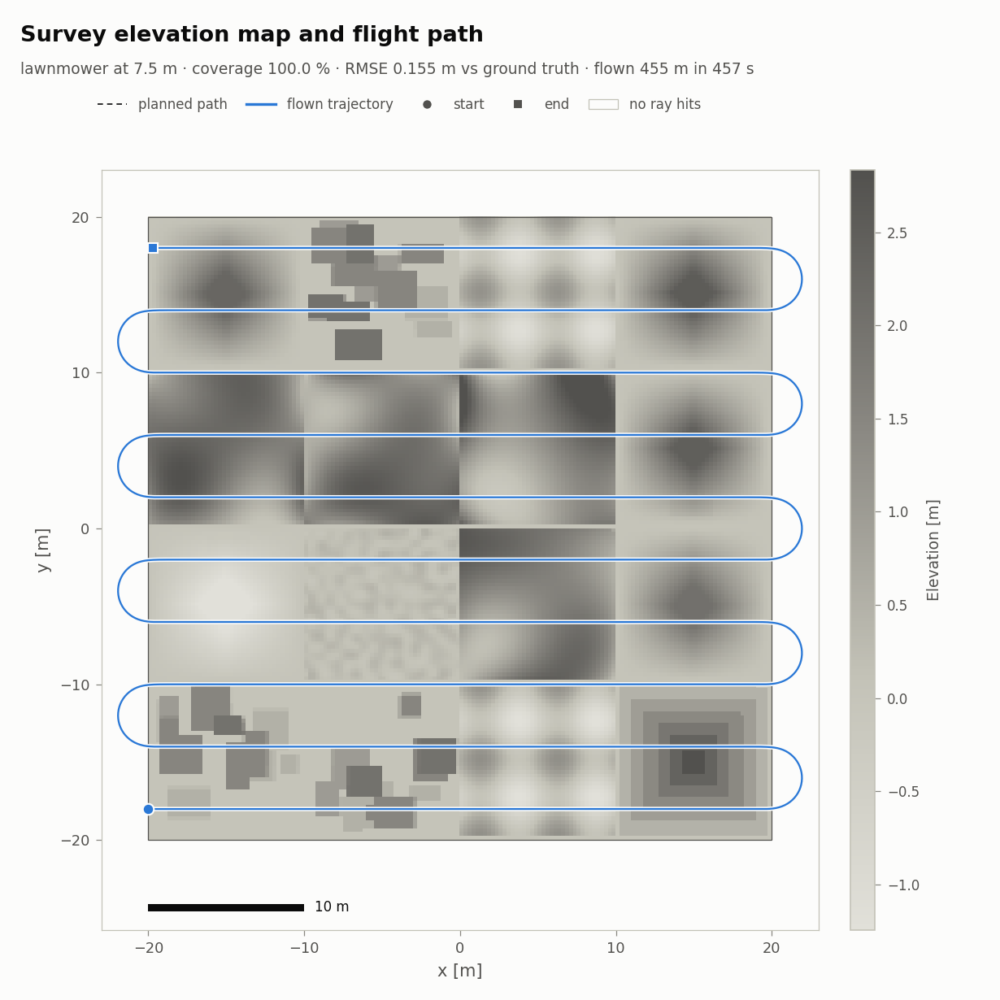

# drone_lab

Drone flight simulation with Isaac Lab 3.0 / Isaac Sim 6.2: a quadrotor (NTNU ARL-Robot-1) flies a survey over a
procedural 40 m x 40 m area, scans the ground with a downward ray-cast "lidar", and turns the scan into an
**elevation map** that is compared against the true terrain. You get a map of the area, the planned and flown
trajectories, error maps, a 3D view, altitude/speed plots, and optionally a video.



*Figure: CPU-only preview of the pipeline (the drone here is a simple kinematic stand-in, not the RL policy).*

## How it works (in plain words)

1. **The pilot is a reinforcement-learning policy** trained on Isaac Lab's built-in task
   `IsaacContrib-TrackPositionNoObstacles-ARL-Robot-1`. That policy learned one thing: fly from up to 1 m away to a
   target point and hover there. It reads 17 numbers per step: where it is relative to the target (3), its
   orientation quaternion (4), body velocity (3), body rotation rate (3) and its previous action (4). It outputs
   four rotor thrusts.
2. **A "carrot" turns that hover skill into path following.** The survey task
   `DroneLab-Survey-ARL-Robot-1-v0` keeps exactly the same 17 inputs, but the "target" is a carrot that slides
   along the survey path at the requested speed. The carrot never gets more than 1 m ahead of the drone (it slows
   down and waits), and the observed offset is clamped to the +-1 m box the policy saw in training. So the same
   trained network flies the whole survey unchanged.
3. **The survey area** is built with Isaac Lab's terrain generator: 16 tiles of 10 m (hills, rough ground,
   pyramids, a pit, waves, stepped blocks, stairs), heights from about -1.4 m to 3.5 m, inside a flat 6 m border.
   It is seeded and fully deterministic, so the CPU preview shows exactly what the simulator builds.
4. **Mapping:** a 5 m x 5 m grid of 441 vertical rays (0.25 m apart) hangs under the drone (gimballed: it stays
   level when the drone tilts). Every step the ray hits are binned into 0.25 m cells; each cell's height is the
   median of its hits. The ground truth is a dense vertical ray cast of the exact terrain mesh.
5. **Metrics:** coverage of the area, map RMSE / MAE / max error (also "away from steps", since a 0.25 m cell
   straddling a 2 m wall is ambiguous by nature), path length, cross-track error between plan and flight, and the
   drone-carrot distance.

## Layout

```
src/drone_lab/
  terrain.py        survey area (TerrainGeneratorCfg) + deterministic sub-terrain wrappers, CPU generation
  paths.py          lawnmower / spiral / figure-8 / custom waypoints, polyline geometry   (numpy only)
  carrot.py         moving target: speed, lead limit, offset clamp                          (torch only)
  mapping.py        elevation map, mesh ground truth, coverage and error metrics            (numpy only)
  survey_io.py      run directory format, trajectory log, summary                           (numpy only)
  plotting.py       all figures                                                              (matplotlib)
  synthetic.py      CPU-only kinematic survey (pipeline test without Isaac Sim)
  reference.py      reference trajectories for the tracking task                            (torch only)
  register.py       task-registration callback for the isaaclab CLI without pip install
  tasks/
    physics.py      physics preset (Isaac Sim PhysX)
    survey/         DroneLab-Survey-ARL-Robot-1-v0          (flies the built-in policy, not for training)
    track_trajectory/ DroneLab-TrackTrajectory-ARL-Robot-1-v0 (new RL task: follow moving references)
scripts/
  survey_map.py     GPU: fly the survey with a trained policy, map, score, plot, video
  plot_survey.py    any Python with matplotlib: figures for a run directory
  preview_area.py   CPU: terrain height map + planned path, no flight
  synthetic_survey.py CPU: full pipeline with a kinematic stand-in for the policy
  eval_trajectory.py  GPU: evaluate a trajectory-tracking policy (reference vs flown, RMSE)
tests/              CPU tests (run_cpu_tests.py or pytest)
docs/images/        preview figures from the CPU pipeline
```

## GPU phase: train, export, survey, plot

Run everything from the project directory in an Isaac terminal (`isaac`, or
`source ~/anaconda3/etc/profile.d/conda.sh && conda activate env_isaaclab`). Training logs land in `./logs/`
(git-ignored); survey results in `./runs/` (git-ignored).

```bash
cd ~/isaac_ws/projects/drone_lab

# 1. Train the built-in position-tracking policy (Isaac Sim PhysX; 1500 iterations x 4096 envs).
#    Do NOT add physics=...: this built-in task declares no physics presets, so any physics= selector is
#    rejected with "Typed preset selector(s) ... did not match"; its default is already Isaac Sim PhysX.
isaaclab train --rl_library rsl_rl --task IsaacContrib-TrackPositionNoObstacles-ARL-Robot-1 \
    --num_envs 4096 --max_iterations 1500 --seed 42

# 2. Export it (writes exported/policy.pt + policy.onnx next to the checkpoint). Play keeps looping
#    until Ctrl+C; the export happens first, so a timeout is enough. (--video would need moviepy<2.)
timeout --signal=INT 600 isaaclab play --rl_library rsl_rl \
    --task IsaacContrib-TrackPositionNoObstacles-ARL-Robot-1 --num_envs 16 --checkpoint latest
RUN=$(ls -td logs/rsl_rl/arl_robot_1_track_position_state_based/*/ | head -1)
ls $RUN/exported        # policy.pt  policy.onnx

# 3. Quick smoke test of the survey (1 minute of flight, no video)
python scripts/survey_map.py --checkpoint ${RUN}exported/policy.pt --max_time 60 --out smoke

# 4. Full lawnmower survey with video (headless camera over the whole area)
python scripts/survey_map.py --checkpoint ${RUN}exported/policy.pt --pattern lawnmower \
    --altitude 4 --spacing 4 --speed 1.0 --video --out lawnmower_v1

# 5. Figures (survey_map.py already makes them; re-run any time, also in the base or mujoco Python)
python scripts/plot_survey.py runs/lawnmower_v1
```

More survey variants:

```bash
python scripts/survey_map.py --checkpoint ${RUN}exported/policy.pt --pattern spiral --out spiral
python scripts/survey_map.py --checkpoint ${RUN}exported/policy.pt --num_envs 3 --speed 1.5 --out three_drones
python scripts/survey_map.py --checkpoint ${RUN}exported/policy.pt --video --camera chase --show_rays --out chase
python scripts/survey_map.py --checkpoint ${RUN}model_1499.pt --sensor lidar --out lidar   # raw checkpoint works too
python scripts/survey_map.py --checkpoint ${RUN}exported/policy.pt --viz kit               # watch it live
python scripts/survey_map.py --checkpoint ${RUN}exported/policy.pt --print_config          # check, no simulator
```

`survey_map.py` options: `--pattern lawnmower|spiral|figure8|waypoints`, `--waypoints file.csv|json` (x,y flown at
the survey altitude, or x,y,z absolute), `--altitude` (clearance above the highest terrain point, default 4 m),
`--spacing` (default 4 m; keep it below the 5 m footprint), `--speed` (default 1 m/s), `--max_lead` (default 1 m),
`--turn round|square`, `--direction x|y`, `--num_envs N` (drones split the area into strips), `--sensor grid|lidar`,
`--map_resolution`, `--reducer median|mean|max|min`, `--max_time`, `--video`, `--camera overview|chase`,
`--video_fps`, `--show_rays`, `--seed`, `--out`. Trailing `key=value` tokens are Hydra overrides of the task
config, e.g. `env.commands.survey_target.turn=square`.

Watching the survey task in the `isaaclab` CLI needs the project installed (once, in env_isaaclab), or the
no-install callback:

```bash
python -m pip install --no-deps -e ~/isaac_ws/projects/drone_lab      # registers the DroneLab-* tasks
isaaclab play --task DroneLab-Survey-ARL-Robot-1-v0 --checkpoint ${RUN}model_1499.pt --viz kit physics=isaacsim_physx

# or without installing:
PYTHONPATH=src isaaclab play --rl_library rsl_rl --external_callback drone_lab.register.register_tasks \
    --task DroneLab-Survey-ARL-Robot-1-v0 --checkpoint ${RUN}model_1499.pt --viz kit
```

(`--checkpoint latest` does not work for the survey task: `latest` only searches runs trained on the same task.)

### Optional: train a trajectory-tracking policy

`DroneLab-TrackTrajectory-ARL-Robot-1-v0` teaches the drone to follow moving references (circles, figure-eights,
Lissajous curves, smooth random curves; size 0.8-2.5 m, peak speed 0.3-1.5 m/s, small height changes). The policy
sees its position and velocity error to the reference and two look-ahead points (0.5 s and 1 s ahead), plus
orientation, body rates and last action (26 inputs). It needs the project installed (or the callback above).

```bash
isaaclab train --rl_library rsl_rl --task DroneLab-TrackTrajectory-ARL-Robot-1-v0 --num_envs 4096 --max_iterations 2000
TRUN=$(ls -td logs/rsl_rl/drone_lab_track_trajectory/*/ | head -1)
python scripts/eval_trajectory.py --checkpoint ${TRUN}model_1999.pt --shape figure8 --size 2 --speed 1.0 --duration 30
```

`eval_trajectory.py` writes `runs/<name>/trajectory_tracking.png` (3D and top view of reference vs flown, error
over time with the RMSE), `trajectory_eval.csv` and `eval_summary.json`.

## Outputs of a survey (`runs/<name>/`)

| File | Content |
|---|---|
| `trajectory.csv` | one row per drone per 0.1 s step: time, position, quaternion (x,y,z,w) and roll/pitch/yaw, world velocity, body rates, speed, carrot position and distance, path arclength / progress / segment index, the (clamped) offset the policy saw, carrot speed gate, height above ground |
| `planned_path.csv` | planned waypoints per drone with arclength |
| `elevation_map.npy` | 2.5D map from the ray hits, (ny, nx) float32, NaN where nothing was seen |
| `hit_count.npy` | ray hits per cell |
| `ground_truth.npy`, `ground_truth_range.npy` | true terrain height per cell, and the height spread inside each cell (steps/walls) |
| `hits.npy` | subsampled ray hits, world frame: time, drone, x, y, z |
| `map_meta.json`, `summary.json`, `summary.txt` | grid and area, all metrics, short text summary |
| `map_with_trajectory.png`, `map_error.png`, `map_3d.png`, `altitude_profile.png` | figures |
| `survey.mp4` | video (with `--video`) |

## CPU tools (no GPU needed)

```bash
conda activate env_isaaclab           # or the isaac terminal
CUDA_VISIBLE_DEVICES= python scripts/preview_area.py --pattern lawnmower           # runs/preview_lawnmower/
CUDA_VISIBLE_DEVICES= python scripts/synthetic_survey.py --out synthetic_lawnmower  # whole pipeline, ~4 s
CUDA_VISIBLE_DEVICES= python tests/run_cpu_tests.py                                 # 39 tests
~/anaconda3/bin/python -m pytest tests                                             # numpy-only subset
```

## Adapting the area and the path

* **Area:** edit `SURVEY_TERRAIN_CFG` in `src/drone_lab/terrain.py` (tile size, rows/cols, sub-terrain mix and
  heights, `seed`). Keep `slope_threshold=None` (with Isaac Lab's default 0.75 the height-field mesh gets 0.1 m
  slits at tile edges that rays fall through) and avoid `MeshRandomGridTerrainCfg` (random on CUDA, so the CPU
  preview would differ). Preview with `scripts/preview_area.py`.
* **Survey rectangle:** by default the whole sub-terrain grid; override it with Hydra tokens, e.g.
  `'env.commands.survey_target.area=[-15,15,-15,15]' env.commands.survey_target.area_margin=1.0`
  (quote the brackets in zsh).
* **Path:** `--pattern`, `--spacing`, `--altitude`, `--turn`, `--direction`, or your own waypoints file.
  Coverage needs spacing <= footprint (5 m); denser lines or a little cross-track jitter also reduce the per-cell
  sampling bias of a fixed ray grid.
* **Sensor:** `--sensor lidar` (downward cone, 1152 rays) or edit `MAPPING_GRID` in
  `tasks/survey/config/arl_robot_1/survey_env_cfg.py`.
* **Speed:** the carrot waits whenever the drone lags more than `max_lead`; if the drone cannot keep up, the
  survey just takes longer. Raise `--speed` gradually and watch `altitude_profile.png` (speed and carrot panels).

## Notes and limits

* **Physics backend:** the multirotor is PhysX-only in Isaac Lab 3.0: `isaaclab_contrib.assets.Multirotor`
  subclasses the PhysX articulation and applies the rotor wrench through the PhysX view, and the built-in task
  says the thruster model has no Newton path. The survey and trajectory tasks therefore declare only the
  `isaacsim_physx` preset (`physics=newton_mjwarp` fails early with a clear message). The ray caster itself has
  PhysX and Newton backends.
* **Video:** Isaac Lab's built-in `--video` needs `moviepy<2`, which env_isaaclab does not have; `survey_map.py`
  and `eval_trajectory.py` grab frames from a headless Kit camera and write MP4 with imageio-ffmpeg instead.
* **Generalisation:** the policy never saw a moving target in training. The carrot keeps its inputs in range, but
  how fast it can follow (and how much it lags) is only known after the GPU run; tune `--speed` from the plots.
* The built-in tracking task gives the `flat_orientation_l2` penalty a positive weight (+1.0); the new
  trajectory task uses -1.0.
* The synthetic runs use a point-mass stand-in for the policy, so their tracking numbers are not the policy's.
* A survey stops for a drone when it crashes (contact with anything, flipping, or falling below the terrain).
  If the contact check ever fires without a real collision, disable it for a run with the Hydra token
  `env.terminations.collision=null`.
* `survey_map.py` also accepts the raw training checkpoint (`model_*.pt`), so step 2 (export) is optional.
